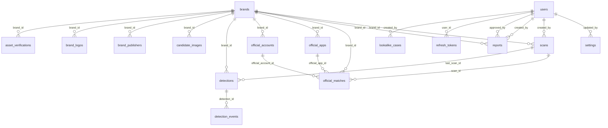

# BrandShield database schema

Generated by `python -m scripts.export_schema` from the SQLAlchemy models (PostgreSQL types). Do not edit by hand.
The live Supabase/PostgreSQL database matches these models (`alembic check` reports no differences). SQL: [schema.sql](schema.sql).

**22 tables** plus Alembic's own `alembic_version`. Row-level security is enabled on every table (the API connects as the database owner, which bypasses it; Supabase's public REST key sees nothing).

## Tables

| Table | Purpose |
|---|---|
| [`api_usage`](#api_usage) | Monthly provider credit / request counters (Tavily credits, Safe Browsing requests). |
| [`asset_verifications`](#asset_verifications) | Human attestation that an official asset is verified (method, who, when). |
| [`audit_log`](#audit_log) | Who did what and when, for every mutating action. |
| [`brand_logos`](#brand_logos) | Extra official logos per brand. A candidate image is compared with all of them. |
| [`brand_publishers`](#brand_publishers) | Official publisher / developer identifiers per app store. |
| [`brands`](#brands) | The protected brand: name, description, aliases, keywords, domains, logo and verification summary. |
| [`candidate_images`](#candidate_images) | Images uploaded with manual or imported candidates (safe re-encoded copies). |
| [`collector_state`](#collector_state) | Collector health, back-off schedule and last good cached results. |
| [`detection_events`](#detection_events) | Timeline of every status change, note and re-score on a detection. |
| [`detections`](#detections) | Candidate impersonations with score, band, severity, reasons, evidence and review status. |
| [`lookalike_cases`](#lookalike_cases) | Labelled name cases for the Look-alike Lab test runner. |
| [`official_accounts`](#official_accounts) | Official social handles. Anything listed here is never flagged (allowlist). |
| [`official_apps`](#official_apps) | Official app listings (package / bundle id, store ids, publisher). Also allowlisted. |
| [`official_matches`](#official_matches) | Candidates excluded because they matched an official asset, with the matched rule. |
| [`refresh_tokens`](#refresh_tokens) | Rotating refresh tokens (hashed). Reuse of a rotated token revokes the user's tokens. |
| [`reports`](#reports) | Draft and approved reports built from selected detections. Nothing is sent automatically. |
| [`scans`](#scans) | Scan runs: state, progress, counts, per-source report and timings. |
| [`settings`](#settings) | Key / value application settings (data mode, schedule, sensitivity, active text provider...). |
| [`sources`](#sources) | Per-platform source health: status, last sync, message, monitored flag. |
| [`stored_files`](#stored_files) |  |
| [`text_analysis_cache`](#text_analysis_cache) | Cached results of hosted AI text analysis, keyed by a hash of model, prompt and text. |
| [`users`](#users) | People who can sign in (admin, analyst, viewer). The first admin is seeded from ADMIN_EMAIL / ADMIN_PASSWORD. |

## Relationships

## api_usage

Monthly provider credit / request counters (Tavily credits, Safe Browsing requests).

| Column | Type | Null | Default | Notes |
|---|---|---|---|---|
| `id` | INTEGER | no |  | PK |
| `provider` | VARCHAR(60) | no |  |  |
| `month` | VARCHAR(7) | no |  |  |
| `credits` | BIGINT | no | `0` (app) |  |
| `updated_at` | TIMESTAMP WITH TIME ZONE | no |  |  |

Constraints and indexes: unique (provider, month)

## asset_verifications

Human attestation that an official asset is verified (method, who, when).

| Column | Type | Null | Default | Notes |
|---|---|---|---|---|
| `id` | INTEGER | no |  | PK |
| `brand_id` | INTEGER | no |  | FK -> brands.id (CASCADE) |
| `asset_type` | VARCHAR(12) | no |  |  |
| `asset_key` | VARCHAR(300) | no |  |  |
| `status` | VARCHAR(12) | no | `unverified` (app) |  |
| `method` | VARCHAR(40) | yes |  |  |
| `note` | VARCHAR(300) | no | `` (app) |  |
| `verified_at` | TIMESTAMP WITH TIME ZONE | yes |  |  |
| `verified_by_id` | INTEGER | yes |  |  |
| `verified_by` | VARCHAR(120) | yes |  |  |

Constraints and indexes: unique (brand_id, asset_type, asset_key); index `ix_asset_verifications_brand_id` (brand_id)

## audit_log

Who did what and when, for every mutating action.

| Column | Type | Null | Default | Notes |
|---|---|---|---|---|
| `id` | INTEGER | no |  | PK |
| `ts` | TIMESTAMP WITH TIME ZONE | no |  |  |
| `actor_id` | INTEGER | yes |  |  |
| `actor` | VARCHAR(120) | no | `system` (app) |  |
| `action` | VARCHAR(60) | no |  |  |
| `target` | VARCHAR(300) | no | `` (app) |  |
| `detail` | TEXT | no | `` (app) |  |
| `source` | VARCHAR(10) | no | `live` (app) |  |

Constraints and indexes: index `ix_audit_log_action` (action); index `ix_audit_log_ts` (ts)

## brand_logos

Extra official logos per brand. A candidate image is compared with all of them.

| Column | Type | Null | Default | Notes |
|---|---|---|---|---|
| `id` | INTEGER | no |  | PK |
| `brand_id` | INTEGER | no |  | FK -> brands.id (CASCADE) |
| `label` | VARCHAR(120) | no | `` (app) |  |
| `path` | VARCHAR(300) | no |  |  |
| `format` | VARCHAR(10) | no |  |  |
| `width` | INTEGER | no |  |  |
| `height` | INTEGER | no |  |  |
| `size_bytes` | INTEGER | no |  |  |
| `sha256` | VARCHAR(64) | no |  |  |
| `created_at` | TIMESTAMP WITH TIME ZONE | no |  |  |

Constraints and indexes: unique (brand_id, sha256); index `ix_brand_logos_brand_id` (brand_id)

## brand_publishers

Official publisher / developer identifiers per app store.

| Column | Type | Null | Default | Notes |
|---|---|---|---|---|
| `id` | INTEGER | no |  | PK |
| `brand_id` | INTEGER | no |  | FK -> brands.id (CASCADE) |
| `store` | VARCHAR(20) | no |  |  |
| `name` | VARCHAR(120) | no | `` (app) |  |
| `publisher_id` | VARCHAR(120) | yes |  |  |
| `publisher_key` | VARCHAR(120) | no |  |  |
| `created_at` | TIMESTAMP WITH TIME ZONE | no |  |  |

Constraints and indexes: unique (brand_id, store, publisher_key); index `ix_brand_publishers_brand_id` (brand_id)

## brands

The protected brand: name, description, aliases, keywords, domains, logo and verification summary.

| Column | Type | Null | Default | Notes |
|---|---|---|---|---|
| `id` | INTEGER | no |  | PK |
| `name` | VARCHAR(120) | no |  |  |
| `industry` | VARCHAR(120) | no | `` (app) |  |
| `aliases` | JSON | no |  |  |
| `keywords` | JSON | no |  |  |
| `domains` | JSON | no |  |  |
| `logo_path` | VARCHAR(300) | yes |  |  |
| `logo_format` | VARCHAR(10) | yes |  |  |
| `logo_width` | INTEGER | yes |  |  |
| `logo_height` | INTEGER | yes |  |  |
| `logo_size_bytes` | INTEGER | yes |  |  |
| `logo_sha256` | VARCHAR(64) | yes |  |  |
| `description` | TEXT | yes |  |  |
| `archived_at` | TIMESTAMP WITH TIME ZONE | yes |  |  |
| `source` | VARCHAR(10) | no | `live` (app) |  |
| `created_at` | TIMESTAMP WITH TIME ZONE | no |  |  |
| `updated_at` | TIMESTAMP WITH TIME ZONE | no |  |  |

## candidate_images

Images uploaded with manual or imported candidates (safe re-encoded copies).

| Column | Type | Null | Default | Notes |
|---|---|---|---|---|
| `id` | INTEGER | no |  | PK |
| `brand_id` | INTEGER | no |  | FK -> brands.id (CASCADE) |
| `purpose` | VARCHAR(20) | no | `candidate_image` (app) |  |
| `path` | VARCHAR(300) | no |  |  |
| `format` | VARCHAR(10) | no |  |  |
| `width` | INTEGER | no |  |  |
| `height` | INTEGER | no |  |  |
| `size_bytes` | INTEGER | no |  |  |
| `sha256` | VARCHAR(64) | no |  |  |
| `hashes` | JSON | no |  |  |
| `created_by` | INTEGER | yes |  |  |
| `created_at` | TIMESTAMP WITH TIME ZONE | no |  |  |

Constraints and indexes: unique (brand_id, sha256); index `ix_candidate_images_brand_id` (brand_id)

## collector_state

Collector health, back-off schedule and last good cached results.

| Column | Type | Null | Default | Notes |
|---|---|---|---|---|
| `id` | INTEGER | no |  | PK |
| `collector` | VARCHAR(40) | no |  | unique |
| `status` | VARCHAR(15) | no | `online` (app) |  |
| `reason` | VARCHAR(40) | yes |  |  |
| `message` | VARCHAR(400) | no | `` (app) |  |
| `latency_ms` | INTEGER | yes |  |  |
| `last_attempt_at` | TIMESTAMP WITH TIME ZONE | yes |  |  |
| `last_success_at` | TIMESTAMP WITH TIME ZONE | yes |  |  |
| `consecutive_failures` | INTEGER | no | `0` (app) |  |
| `next_retry_at` | TIMESTAMP WITH TIME ZONE | yes |  |  |
| `cache_brand_id` | INTEGER | yes |  |  |
| `cache` | JSON | yes |  |  |
| `cached_at` | TIMESTAMP WITH TIME ZONE | yes |  |  |
| `source` | VARCHAR(10) | no | `live` (app) |  |

Constraints and indexes: unique (collector)

## detection_events

Timeline of every status change, note and re-score on a detection.

| Column | Type | Null | Default | Notes |
|---|---|---|---|---|
| `id` | INTEGER | no |  | PK |
| `detection_id` | INTEGER | no |  | FK -> detections.id (CASCADE) |
| `at` | TIMESTAMP WITH TIME ZONE | no |  |  |
| `actor` | VARCHAR(120) | no | `system` (app) |  |
| `actor_id` | INTEGER | yes |  |  |
| `kind` | VARCHAR(20) | no | `status` (app) |  |
| `from_status` | VARCHAR(20) | yes |  |  |
| `to_status` | VARCHAR(20) | yes |  |  |
| `note` | TEXT | no | `` (app) |  |

Constraints and indexes: index `ix_detection_events_detection_id` (detection_id)

## detections

Candidate impersonations with score, band, severity, reasons, evidence and review status.

| Column | Type | Null | Default | Notes |
|---|---|---|---|---|
| `id` | INTEGER | no |  | PK |
| `brand_id` | INTEGER | no |  | FK -> brands.id (CASCADE) |
| `type` | VARCHAR(20) | no |  |  |
| `category` | VARCHAR(10) | no |  |  |
| `platform` | VARCHAR(20) | no |  |  |
| `name` | VARCHAR(200) | no | `` (app) |  |
| `handle` | VARCHAR(200) | yes |  |  |
| `package_id` | VARCHAR(200) | yes |  |  |
| `publisher` | VARCHAR(200) | yes |  |  |
| `profile_url` | VARCHAR(500) | yes |  |  |
| `score` | INTEGER | no |  |  |
| `band` | VARCHAR(10) | no |  |  |
| `severity` | VARCHAR(10) | no | `LOW` |  |
| `algorithm_version` | VARCHAR(10) | yes |  |  |
| `scored_at` | TIMESTAMP WITH TIME ZONE | yes |  |  |
| `status` | VARCHAR(20) | no | `new` (app) |  |
| `resolution` | VARCHAR(20) | yes |  |  |
| `canonical_key` | VARCHAR(400) | no | `` (app) |  |
| `first_seen_at` | TIMESTAMP WITH TIME ZONE | yes |  |  |
| `last_seen_at` | TIMESTAMP WITH TIME ZONE | yes |  |  |
| `last_scan_id` | INTEGER | yes |  | FK -> scans.id (SET NULL) |
| `score_history` | JSON | no |  |  |
| `notes` | JSON | no |  |  |
| `reasons` | JSON | no |  |  |
| `evidence` | JSON | no |  |  |
| `details` | JSON | no |  |  |
| `stale` | BOOLEAN | no | `False` (app) |  |
| `source` | VARCHAR(10) | no | `live` (app) |  |
| `origin` | VARCHAR(12) | no | `scan` |  |
| `found_at` | TIMESTAMP WITH TIME ZONE | no |  |  |
| `created_at` | TIMESTAMP WITH TIME ZONE | no |  |  |
| `updated_at` | TIMESTAMP WITH TIME ZONE | no |  |  |

Constraints and indexes: unique (brand_id, canonical_key); index `ix_detections_brand_id` (brand_id); index `ix_detections_platform` (platform); index `ix_detections_status` (status)

## lookalike_cases

Labelled name cases for the Look-alike Lab test runner.

| Column | Type | Null | Default | Notes |
|---|---|---|---|---|
| `id` | INTEGER | no |  | PK |
| `name` | VARCHAR(200) | no |  |  |
| `expected` | VARCHAR(15) | no |  |  |
| `builtin` | BOOLEAN | no | `False` (app) |  |
| `source` | VARCHAR(10) | no | `live` (app) |  |
| `created_by` | INTEGER | yes |  | FK -> users.id (SET NULL) |
| `created_at` | TIMESTAMP WITH TIME ZONE | no |  |  |

Constraints and indexes: unique index `uq_lookalike_cases_builtin_name` (name)

## official_accounts

Official social handles. Anything listed here is never flagged (allowlist).

| Column | Type | Null | Default | Notes |
|---|---|---|---|---|
| `id` | INTEGER | no |  | PK |
| `brand_id` | INTEGER | no |  | FK -> brands.id (CASCADE) |
| `platform` | VARCHAR(20) | no |  |  |
| `handle` | VARCHAR(100) | no |  |  |
| `handle_key` | VARCHAR(100) | no |  |  |
| `url` | VARCHAR(300) | no |  |  |
| `status` | VARCHAR(20) | no | `unreachable` (app) |  |
| `check_message` | VARCHAR(300) | yes |  |  |
| `last_checked_at` | TIMESTAMP WITH TIME ZONE | yes |  |  |
| `source` | VARCHAR(10) | no | `live` (app) |  |
| `created_at` | TIMESTAMP WITH TIME ZONE | no |  |  |

Constraints and indexes: unique (brand_id, platform, handle_key); index `ix_official_accounts_brand_id` (brand_id)

## official_apps

Official app listings (package / bundle id, store ids, publisher). Also allowlisted.

| Column | Type | Null | Default | Notes |
|---|---|---|---|---|
| `id` | INTEGER | no |  | PK |
| `brand_id` | INTEGER | no |  | FK -> brands.id (CASCADE) |
| `name` | VARCHAR(120) | no |  |  |
| `package_id` | VARCHAR(155) | no |  |  |
| `package_key` | VARCHAR(155) | no |  |  |
| `publisher` | VARCHAR(120) | no |  |  |
| `store_id` | VARCHAR(20) | yes |  |  |
| `stores` | JSON | no |  |  |
| `status` | VARCHAR(20) | no | `verified` (app) |  |
| `source` | VARCHAR(10) | no | `live` (app) |  |
| `created_at` | TIMESTAMP WITH TIME ZONE | no |  |  |

Constraints and indexes: unique (brand_id, package_key); index `ix_official_apps_brand_id` (brand_id)

## official_matches

Candidates excluded because they matched an official asset, with the matched rule.

| Column | Type | Null | Default | Notes |
|---|---|---|---|---|
| `id` | INTEGER | no |  | PK |
| `brand_id` | INTEGER | no |  | FK -> brands.id (CASCADE) |
| `scan_id` | INTEGER | yes |  | FK -> scans.id (SET NULL) |
| `kind` | VARCHAR(10) | no |  |  |
| `platform` | VARCHAR(20) | yes |  |  |
| `label` | VARCHAR(300) | no |  |  |
| `reason` | VARCHAR(40) | no |  |  |
| `matched_rule` | VARCHAR(300) | no | `` (app) |  |
| `match_key` | VARCHAR(400) | no | `` (app) |  |
| `url` | VARCHAR(500) | yes |  |  |
| `last_seen_at` | TIMESTAMP WITH TIME ZONE | yes |  |  |
| `times_seen` | INTEGER | no | `1` (app) |  |
| `official_account_id` | INTEGER | yes |  | FK -> official_accounts.id (SET NULL) |
| `official_app_id` | INTEGER | yes |  | FK -> official_apps.id (SET NULL) |
| `source` | VARCHAR(10) | no | `live` (app) |  |
| `created_at` | TIMESTAMP WITH TIME ZONE | no |  |  |

Constraints and indexes: unique (brand_id, match_key); index `ix_official_matches_brand_id` (brand_id)

## refresh_tokens

Rotating refresh tokens (hashed). Reuse of a rotated token revokes the user's tokens.

| Column | Type | Null | Default | Notes |
|---|---|---|---|---|
| `id` | INTEGER | no |  | PK |
| `jti` | VARCHAR(64) | no |  | unique |
| `user_id` | INTEGER | no |  | FK -> users.id (CASCADE) |
| `expires_at` | TIMESTAMP WITH TIME ZONE | no |  |  |
| `revoked_at` | TIMESTAMP WITH TIME ZONE | yes |  |  |
| `created_at` | TIMESTAMP WITH TIME ZONE | no |  |  |

Constraints and indexes: unique index `ix_refresh_tokens_jti` (jti); index `ix_refresh_tokens_user_id` (user_id)

## reports

Draft and approved reports built from selected detections. Nothing is sent automatically.

| Column | Type | Null | Default | Notes |
|---|---|---|---|---|
| `id` | INTEGER | no |  | PK |
| `brand_id` | INTEGER | no |  | FK -> brands.id (CASCADE) |
| `filename` | VARCHAR(200) | no |  |  |
| `format` | VARCHAR(5) | no |  |  |
| `title` | VARCHAR(200) | no | `Brand Protection Report` (app) |  |
| `status` | VARCHAR(10) | no | `draft` (app) |  |
| `detection_ids` | JSON | no |  |  |
| `snapshot` | JSON | no |  |  |
| `approved_by` | INTEGER | yes |  | FK -> users.id (SET NULL) |
| `approved_at` | TIMESTAMP WITH TIME ZONE | yes |  |  |
| `size_bytes` | INTEGER | no | `0` (app) |  |
| `params` | JSON | no |  |  |
| `file_path` | VARCHAR(300) | yes |  |  |
| `includes_sample` | BOOLEAN | no | `False` (app) |  |
| `source` | VARCHAR(10) | no | `live` (app) |  |
| `created_by` | INTEGER | yes |  | FK -> users.id (SET NULL) |
| `created_at` | TIMESTAMP WITH TIME ZONE | no |  |  |

Constraints and indexes: index `ix_reports_brand_id` (brand_id)

## scans

Scan runs: state, progress, counts, per-source report and timings.

| Column | Type | Null | Default | Notes |
|---|---|---|---|---|
| `id` | INTEGER | no |  | PK |
| `job_id` | VARCHAR(40) | no |  | unique |
| `brand_id` | INTEGER | no |  | FK -> brands.id (CASCADE) |
| `scope` | VARCHAR(10) | no | `all` (app) |  |
| `state` | VARCHAR(10) | no | `queued` (app) |  |
| `progress` | INTEGER | no | `0` (app) |  |
| `message` | VARCHAR(300) | no | `` (app) |  |
| `steps` | JSON | no |  |  |
| `result` | JSON | yes |  |  |
| `data_mode` | VARCHAR(10) | no | `live` (app) |  |
| `created_by` | INTEGER | yes |  | FK -> users.id (SET NULL) |
| `started_by` | VARCHAR(120) | no | `scheduler` (app) |  |
| `counts` | JSON | no |  |  |
| `source_report` | JSON | no |  |  |
| `timings` | JSON | no |  |  |
| `errors` | JSON | no |  |  |
| `started_at` | TIMESTAMP WITH TIME ZONE | yes |  |  |
| `finished_at` | TIMESTAMP WITH TIME ZONE | yes |  |  |
| `created_at` | TIMESTAMP WITH TIME ZONE | no |  |  |

Constraints and indexes: unique (job_id); index `ix_scans_brand_id` (brand_id); unique index `uq_scans_one_active_per_brand` (brand_id)

## settings

Key / value application settings (data mode, schedule, sensitivity, active text provider...).

| Column | Type | Null | Default | Notes |
|---|---|---|---|---|
| `id` | INTEGER | no |  | PK |
| `key` | VARCHAR(80) | no |  | unique |
| `value` | JSON | yes |  |  |
| `updated_at` | TIMESTAMP WITH TIME ZONE | no |  |  |
| `updated_by` | INTEGER | yes |  | FK -> users.id (SET NULL) |

Constraints and indexes: unique (key)

## sources

Per-platform source health: status, last sync, message, monitored flag.

| Column | Type | Null | Default | Notes |
|---|---|---|---|---|
| `id` | INTEGER | no |  | PK |
| `platform` | VARCHAR(20) | no |  | unique |
| `name` | VARCHAR(80) | no |  |  |
| `kind` | VARCHAR(10) | no |  |  |
| `description` | VARCHAR(200) | no | `` (app) |  |
| `status` | VARCHAR(15) | no | `online` (app) |  |
| `monitored` | BOOLEAN | no | `True` (app) |  |
| `message` | VARCHAR(300) | no | `` (app) |  |
| `detail` | VARCHAR(200) | no | `` (app) |  |
| `last_sync` | TIMESTAMP WITH TIME ZONE | yes |  |  |
| `retry_in_minutes` | INTEGER | yes |  |  |
| `stale_since` | TIMESTAMP WITH TIME ZONE | yes |  |  |
| `source` | VARCHAR(10) | no | `live` (app) |  |

Constraints and indexes: unique (platform)

## stored_files

| Column | Type | Null | Default | Notes |
|---|---|---|---|---|
| `path` | VARCHAR(300) | no |  | PK |
| `content` | BYTEA | no |  |  |
| `content_type` | VARCHAR(100) | no | `application/octet-stream` (app) |  |
| `size_bytes` | INTEGER | no | `0` (app) |  |
| `created_at` | TIMESTAMP WITH TIME ZONE | no |  |  |

## text_analysis_cache

Cached results of hosted AI text analysis, keyed by a hash of model, prompt and text.

| Column | Type | Null | Default | Notes |
|---|---|---|---|---|
| `key` | VARCHAR(64) | no |  | PK |
| `provider` | VARCHAR(20) | no |  |  |
| `value` | JSON | no |  |  |
| `created_at` | TIMESTAMP WITH TIME ZONE | no |  |  |

## users

People who can sign in (admin, analyst, viewer). The first admin is seeded from ADMIN_EMAIL / ADMIN_PASSWORD.

| Column | Type | Null | Default | Notes |
|---|---|---|---|---|
| `id` | INTEGER | no |  | PK |
| `name` | VARCHAR(120) | no |  |  |
| `email` | VARCHAR(254) | no |  | unique |
| `password_hash` | VARCHAR(100) | no |  |  |
| `role` | VARCHAR(20) | no | `viewer` (app) |  |
| `active` | BOOLEAN | no | `True` (app) |  |
| `created_at` | TIMESTAMP WITH TIME ZONE | no |  |  |

Constraints and indexes: unique index `ix_users_email` (email)
