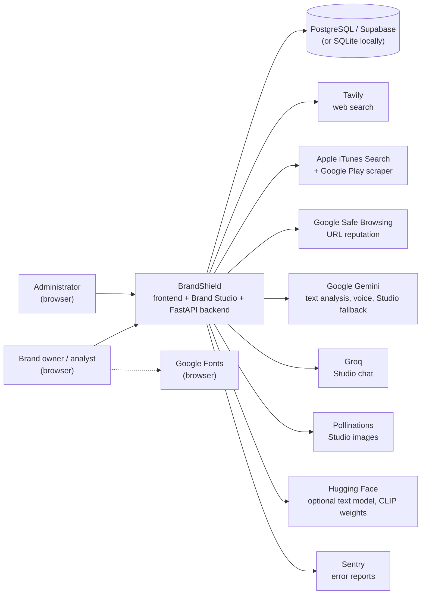
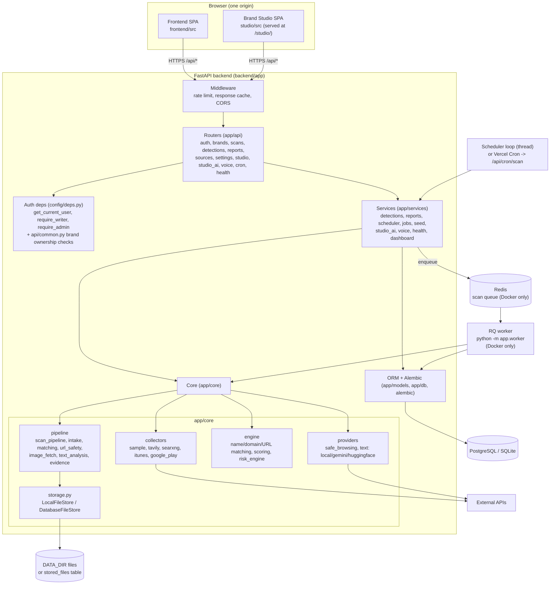
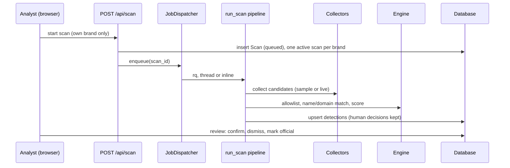
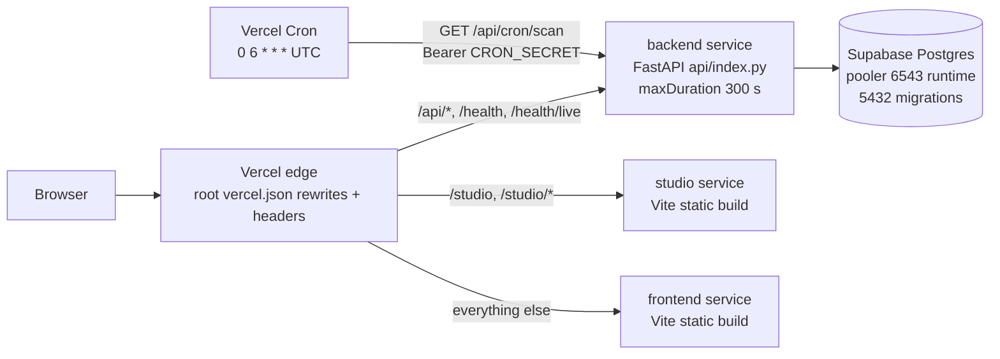
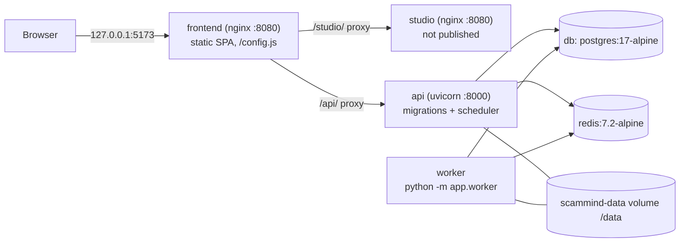

# Architecture

**Plain-language summary**

- BrandShield helps a company find fake social-media accounts, fake mobile apps and look-alike websites that imitate its brand.
- Each person who signs up gets their own private workspace (their own brand). A background "scan" collects possible fakes, scores them, and shows them to a human, who decides what is real. Nothing is reported automatically.
- It is made of a Python server (the "backend"), a React website (the "frontend") and a second React tool, Brand Studio, for creating brand names, logos and content.
- Without any outside keys it runs on built-in sample data. Real web search, AI and link-reputation checks switch on only when keys are provided.
- It can run on Vercel (three services on one domain plus a daily scheduled call) or with Docker Compose (database, queue, API, worker, web servers).

---

## 1. System context

Who and what BrandShield talks to. Every external service is optional and is called only from the backend (never from the browser), except Google Fonts which the browser loads directly.



| External system | What it is used for | Evidence |
|---|---|---|
| PostgreSQL / Supabase | All data; SQLite is the default for local runs | `backend/app/config/config.py:28`, `backend/app/db/session.py:10-45` |
| Tavily | Live web search collector | `backend/app/core/collectors/tavily.py:38` |
| iTunes / Google Play | App-store candidates | `backend/app/core/collectors/itunes.py:34`, `backend/app/core/collectors/google_play.py` |
| Google Safe Browsing v4 | Reputation of candidate URLs (URL is sent, never opened) | `backend/app/core/providers/safe_browsing.py:1-3,42` |
| Gemini | Optional scan text analysis; voice agent; Studio chat fallback | `backend/app/core/providers/text/gemini.py:36`, `backend/app/services/studio_ai.py:40,152` |
| Groq / Pollinations | Studio chat / image generation | `backend/app/services/studio_ai.py:39,41` |
| Hugging Face | Optional text provider; CLIP model download | `backend/app/core/providers/text/huggingface.py`, `backend/requirements-extra.txt:6,8` |
| Sentry | Optional scrubbed error reporting | `backend/app/config/observability.py:1-8,79-102` |

## 2. Component diagram



| Piece | Responsibility | Evidence |
|---|---|---|
| `create_app` | Wires settings, limiters, collectors, file store, scan context, middleware, routers; seeds admin and demo users at startup; optionally starts the scheduler | `backend/app/main.py:50-184` |
| Middleware | Per-IP and per-token rate limit for `/api/*`; short read cache; CORS | `backend/app/main.py:119-167` |
| Routers | Thin HTTP layer under prefix `/api`; health routes live outside it | `backend/app/main.py:170-183` |
| Auth deps | Bearer JWT -> `User`; role checks; `require_writer` = admin or analyst, `require_admin` | `backend/app/config/deps.py:28-57` |
| Ownership helpers | Brand lookups scoped to `brands.owner_id`; foreign brand is a 404 | `backend/app/api/common.py:22-58` |
| Scan pipeline | collect, de-duplicate, allowlist, name match, prefilter, logo fetch, text analysis, score, upsert detections | `backend/app/core/pipeline/scan_pipeline.py:1-16` |
| Engine | Pure, deterministic scoring and explanations; never confirms anything | `backend/app/core/README.md:1-9`, `backend/app/core/engine/risk_engine.py:19` |
| Job dispatcher | Runs a queued scan via RQ, a thread, or inline | `backend/app/services/jobs.py:1-9,25-65` |
| Scheduler | Pure decision function plus an in-process loop; credit-aware interval stretching | `backend/app/services/scheduler.py:1-14` |
| File store | Logos, candidate images, evidence snapshots, Studio images | `backend/app/core/storage.py:1-10` |

### 2.1 Life of a scan



Evidence: `request_scan` creates the queued row, enforces ownership and a partial unique index for one active scan per brand, and calls the dispatcher (`backend/app/core/pipeline/scan_pipeline.py:146-190`); the executor choice is in `backend/app/services/jobs.py:25-48`; "a human decision survives a re-scan" is stated at `scan_pipeline.py:10-12`.

## 3. Deployment diagrams

### 3.1 Vercel (one project, three services, one domain)



Evidence: services and rewrites `vercel.json:3-81`; cron `vercel.json:82-87`; entrypoint `backend/api/index.py:18-40` and `backend/pyproject.toml:57-59`; Supabase ports `backend/app/config/config.py:35-37`, `backend/app/db/session.py:30-31`. On Vercel the backend runs with serverless defaults (inline scans, no scheduler, no response cache, files in the database): `backend/app/config/config.py:175-190`. The Vercel deployment is described in `docs/DEPLOY_VERCEL.md:9-12` as unverified (never deployed); Vercel Services are labelled Beta there.

### 3.2 Docker Compose



Evidence: services `docker-compose.yml:37-161`; frontend nginx proxies `/studio/` and `/api/` (`frontend/nginx/default.conf.template:38-70`); api publishes `127.0.0.1:${API_PORT:-8000}` (`docker-compose.yml:85-86`); only `studio` is internal-only (`docker-compose.yml:157-159`) unless the dev overlay publishes it (`docker-compose.dev.yml:16-20`). The `worker` has `SCHEDULER_ENABLED=false` and `SCAN_EXECUTOR=rq` (`docker-compose.yml:22,111`).


### 3.3 Local development

`npm run backend` (API on 8000) and `npm run frontend` (BrandShield on 5173, Studio on 3000; BrandShield's Vite dev server proxies `/studio` and `/api`) (`scripts/dev.mjs:79-110`, `frontend/vite.config.ts:8-15`). Without `REDIS_URL` scans run in an in-process thread (`backend/app/services/jobs.py:25-30`).

## 4. Folder and module structure

```text
ScamMind AI/
  backend/            FastAPI + SQLAlchemy 2 + Alembic
  frontend/           BrandShield React + Vite app (also holds the Playwright e2e tests)
  studio/             Brand Studio React + Vite app (base /studio/)
  docs/               Documentation (existing docs plus generated schema)
  scripts/            dev.mjs: one-command local runner
  .github/workflows/  ci.yml
  vercel.json         Vercel services, routing, cron, security headers
  docker-compose.yml  Full stack; docker-compose.dev.yml adds localhost ports
```

### 4.1 `backend/`

| Path | Purpose |
|---|---|
| `backend/app/main.py` | App factory `create_app()`; lifespan seeding and scheduler start (`main.py:50-184`) |
| `backend/app/worker.py` | RQ worker entrypoint; `run_scan_job(scan_id)` (`worker.py:80-101`) |
| `backend/app/api/` | HTTP routers: `auth`, `brands`, `candidates`, `scans`, `detections`, `dashboard`, `lookalike`, `reports`, `evaluation`, `sources`, `settings`, `providers`, `audit`, `studio` (saved items), `studio_ai` (AI proxy), `voice`, `cron`, `health`; `common.py` holds the ownership helpers |
| `backend/app/config/` | `config.py` (settings), `security.py` (bcrypt, JWT), `deps.py` (auth dependencies), `ratelimit.py`, `response_cache.py`, `logging.py` (JSON + redaction), `observability.py` (Sentry), `errors.py`, `time.py` |
| `backend/app/db/` | `session.py` (engine/pool per backend), `request_cache.py` (per-session memo), `base.py` |
| `backend/app/models/` | SQLAlchemy models: `user.py` (users, refresh tokens), `brand.py` (brands and registry), `detection.py`, `ops.py` (sources, scans, settings, reports, audit log, api usage, look-alike cases, stored files), `studio.py` |
| `backend/app/schemas/` | Pydantic request/response models (`auth.py`, `brand.py`) |
| `backend/app/services/` | Business logic between routers and core: detection review actions, reports, dashboard aggregates, scheduler, job dispatcher, seed (admin/demo), Studio AI proxy, voice agent, health, canary, settings and data-mode helpers |
| `backend/app/core/` | Detection features, free of HTTP and persistence (`core/README.md:1-9`) |
| `backend/app/core/engine/` | Pure scoring: normalization, name/domain/URL matching, allowlist, `scoring.py`, `risk_engine.py`, logo/image hashes, text signals, synthetic generation/evaluation |
| `backend/app/core/collectors/` | Candidate sources (Tavily, SearXNG, iTunes, Google Play, sample), query variants, credit ledger, orchestrator, selection of the collector chain |
| `backend/app/core/pipeline/` | Scan pipeline and steps: intake, matching, `url_safety.py`, `image_fetch.py`, screenshot hook, logo handling, text analysis, evidence, bands |
| `backend/app/core/providers/` | External checks behind interfaces: `safe_browsing.py`, `text/` (local, Gemini, Hugging Face, cache, prompt, schema), authorized-access stub |
| `backend/app/core/storage.py` | File store interface and two implementations |
| `backend/alembic/versions/` | Migrations 0001 to 0012 (initial schema through `0012_active_brand.py`) |
| `backend/api/index.py` | Vercel entrypoint (`api.index:app`) |
| `backend/scripts/` | `migrate.py` (advisory-locked upgrade), `canary.py`, `e2e_server.py`, `evaluate.py`, `export_schema.py`, `live_check.py`, `seed_test_brand.py`, `studio_ai_check.py` |
| `backend/tests/` | pytest suite: `api/`, `config/`, `core/`, `db/`, `services/`, fixtures, Postgres support (`pg_support.py`) |
| `backend/data/` | Local runtime data (SQLite DB, logos, evidence, models); git-ignored (`.gitignore`: `backend/data/`) |
| `backend/Dockerfile`, `docker-entrypoint.sh` | One image for `api`, `worker`, `migrate` roles |

### 4.2 `frontend/src/`

| Path | Purpose |
|---|---|
| `App.tsx`, `main.tsx` | Routes and guards (`RequireAuth`, `RequireAdmin`), theme bootstrap (`App.tsx:38-78`) |
| `api/` | `client.ts` (base URL, token storage, refresh-on-401 with Web Lock), `auth.ts`, `sm.ts` (endpoint wrappers), `queryCache.ts`, `types.ts`, `format.ts`, `sample.ts` |
| `pages/` | One file per screen: Login, Register, ProtectBrand, Setup, Dashboard, BrandProfile, SocialMonitoring, AppStoreMonitoring, WebThreats, Investigations, LookalikeLab, Reports, SourceHealth, Settings, Evaluation |
| `components/` | `layout/` (AppLayout, Sidebar, Header, BrandSwitcher), `monitor/`, `charts/`, `common/`, `voice/` (voice agent button) |
| `hooks/` | Data hooks (`useApi`, `useBrand`, `useScan`, `useMonitor`, `useVoiceAgent`, ...) |
| `landing/` | Public marketing page shown at `/` for signed-out visitors (`App.tsx:26-36`) |
| `utils/` | Theme, passwords policy mirror, voice executor/snapshot, Studio link helpers |
| `styles/` | Tokens and global CSS |
| `frontend/e2e/` | Playwright specs: `smoke`, `demo-login`, `register`, `multi-brand`, `studio-flow`, `voice`, `visual`, `protect-hover` |
| `frontend/nginx/` | Container web server config and runtime `config.js` writer |

### 4.3 `studio/src/`

| Path | Purpose |
|---|---|
| `App.tsx`, `main.tsx` | Studio shell; dev-only redirect to BrandShield's origin (`main.tsx:9-12`) |
| `components/` | Tools: BrandNameGenerator, LogoGenerator, BrandingAssistant, ContentGenerator, ColorPaletteGenerator, BrandAudit, BrandChecker, ReviewAnalyzer, SentimentAnalysis, Analytics, Collections, ProtectBrand, LogoUpload, SuccessFlow |
| `contexts/` | Auth (reads the shared BrandShield session), Brand, Collections, Theme |
| `lib/` | `session.ts` (same storage keys as BrandShield), `api.ts` (refresh with the same Web Lock name), `ai.ts` (calls the backend AI proxy), `items.ts` (saved items), `brandshield.ts`, `useAiStatus.ts` |
| `services/gemini.ts` | Despite its name, wraps the backend `/api/studio/ai/*` proxy (`gemini.ts:1-17`) |
| `studio/nginx/default.conf` | Container web server config |

### 4.4 Other top-level folders

| Path | Purpose |
|---|---|
| `docs/` | `API.md`, `DATABASE_SCHEMA.md` and `schema.sql` (generated by `backend/scripts/export_schema.py:1-4`), `DECISIONS.md`, `SECURITY.md`, `DEPENDENCIES.md`, `DEPLOY_VERCEL.md`, `COLLECTORS.md`, `STUDIO*.md`, `USER_GUIDE.md`, and others |
| `scripts/dev.mjs` | Cross-platform dev runner (ports 8000, 5173, 3000) |
| `e2e` | There is no top-level `e2e/` folder; the browser tests are in `frontend/e2e/` (`frontend/playwright.config.ts:31-32`) |

## 5. Design patterns and key decisions

### 5.1 Tenant ownership through `brands.owner_id`

Every brand has a nullable `owner_id` pointing at `users.id` (`backend/app/models/brand.py:14`). All brand-scoped data hangs off a brand, so ownership of a brand implies ownership of its detections, scans, reports and images.

- `get_brand_or_404` returns the brand only if `brand.owner_id == user.id`; another account's brand is a plain 404, never 403, so existence does not leak (`backend/app/api/common.py:22-27`).
- `own_brand` picks the user's selected (`users.active_brand_id`) or oldest non-archived brand (`common.py:30-40`); `resolve_brand` makes `brand_id` optional everywhere (`common.py:43-50`); `owns_brand` guards objects such as images (`common.py:53-58`, used at `backend/app/api/candidates.py:109-115`).
- `request_scan` refuses a brand the user does not own (`scan_pipeline.py:146-160`). Studio items are scoped by `user_id` (`backend/app/api/studio.py:103-119`).
- Migration 0010 added the column and gave existing brands to the first admin (`backend/alembic/versions/0010_brand_owner.py:1-11`).
- Still global (shared by all accounts): settings, data mode, provider choice, source health and collector state, credit counters (`docs/DECISIONS.md:208`; code: `backend/app/services/app_settings.py:59-66`, `backend/app/api/sources.py:125-158`). See `docs/auth-and-security.md` for the consequences.

### 5.2 Per-request memo

`memo(db, key, load)` stores repeated identical reads (brand lookups, settings rows) in `Session.info`, and clears the memo on every flush, commit and rollback, so it never outlives a write (`backend/app/db/request_cache.py:1-30`). It exists because a remote database makes every query a network round trip (`request_cache.py:3-5`). Used for the ownership helpers (`backend/app/api/common.py:24,40,57`).

### 5.3 Response cache

A tiny in-process cache serves heavy read endpoints (dashboard, lists, sources, settings, detections, brands, reports, scans, providers) for `RESPONSE_CACHE_SECONDS` (default 15). Keys include a hash of the `Authorization` header (so answers that differ by role or user do not mix); any POST/PUT/PATCH/DELETE clears everything; scan start/finish also clears it (`backend/app/config/response_cache.py:1-18,43-45`, `backend/app/main.py:137-158`). It is per process and is turned off on Vercel (`config.py:184`).

### 5.4 Frozen scoring weights

The original social and app weights are frozen as `WEIGHTS_V1` and every such detection is stamped algorithm version `1.0`; a test pins them to the numbers in `scoring.py`. New web signals use separate weights `WEIGHTS_V2_WEB` and algorithm version `2.0` (`backend/app/core/engine/risk_engine.py:41-43`, docstring `risk_engine.py:9-18`). The social maxima are name 34, logo 28, added words 12, bio 28, account 18; app maxima name 24, icon 30, publisher 22, description 17, store 10 (`backend/app/core/engine/scoring.py:34-35`). Severity cut-offs are configurable but default to LOW below 40, MEDIUM 40-69, HIGH 70-84, CRITICAL 85+ (`risk_engine.py:46-54`, `backend/app/config/config.py:166-168`). `docs/DECISIONS.md:134` records that the `weights_v2_web` numbers still "need your approval".

### 5.5 Human in the loop

- The engine "only scores; a human approves or rejects every detection" (`backend/app/core/engine/scoring.py:14`; `risk_engine.py:19`).
- A re-scan never resets a human decision (confirmed, dismissed, reviewing, marked official) (`scan_pipeline.py:10-12`).
- Review statuses a user may set: reviewing, confirmed, dismissed, plus mark-official (`backend/app/services/detections.py:33-35`); these routes require `require_writer` (`backend/app/api/detections.py:163-195`).
- Reports start as drafts and need an explicit approve step (`backend/app/api/reports.py:195-196`, `backend/app/services/reports.py:1-3`).
- AI output can only add a bounded number of points and never triggers an action (`backend/app/core/providers/text/prompt.py:1-9`); the voice agent asks for a spoken yes before destructive clicks or unrequested submits (`backend/app/services/voice.py:1-18`).

### 5.6 Sample versus live data

`data_mode` is `live`, `sample` or `auto` (default `auto`), stored in the `settings` table (`backend/app/services/data_mode.py:7-16`). `auto` becomes live only when a Tavily key, a SearXNG URL or the Google Play package is configured; otherwise sample (`backend/app/core/collectors/selection.py:68-97`). Sample candidates are synthetic and are labelled as such on every signal (`risk_engine.py:21-22`); sample URLs are never sent to Safe Browsing and nothing is fetched for them (`backend/app/core/collectors/sample.py:273-275`, `scan_pipeline` logo fetch is live-only per `config.py:116`). Changing the global mode is admin-only (`backend/app/api/sources.py:239-250`).

### 5.7 Inline scans on Vercel

A serverless function can be frozen once its response is sent, so background threads and an RQ worker do not work (`docs/DEPLOY_VERCEL.md:210`). On Vercel the executor defaults to `inline`, the scan runs inside the request, the in-process scheduler is off, and Vercel Cron calls `GET /api/cron/scan` (`backend/app/config/config.py:181-187`, `backend/app/services/jobs.py:41-42`, `backend/app/api/cron.py:1-6,32-46`). The function limit is `maxDuration: 300` (`vercel.json:10`). The cron handler runs the same decision function as the scheduler, including credit-aware interval stretching, plus a 60-minute slack because Hobby cron can fire anywhere in the hour (`backend/app/api/cron.py:22-24`).

### 5.8 Database-backed file store

`FileStore` is a small protocol (`write`, `write_if_absent`, `read`, `exists`, `delete`) with two implementations chosen by `STORAGE_BACKEND`: `LocalFileStore` under `DATA_DIR`, and `DatabaseFileStore` using the `stored_files` table, needed on Vercel where the filesystem is read-only and not shared. Both reject paths that could escape the store (`backend/app/core/storage.py:1-10,45-52,169-176`). Files are content-addressed and served with a SHA-256-based ETag (`backend/app/api/common.py:13-15`).

### 5.9 Other recurring patterns

| Pattern | Where |
|---|---|
| App factory with injectable collaborators (tests pass fakes for the URL checker, collectors, fetcher) | `backend/app/main.py:50-58` |
| Optional features behind lazy imports and feature flags | `backend/app/services/jobs.py:8-9`, `backend/requirements-extra.txt:1-2` |
| A failing data source never blocks a scan; the scan ends `partial` | `scan_pipeline.py:15-16` |
| Advisory-locked migrations safe for many replicas | `backend/scripts/migrate.py:1-7,35-42` |
| Append-only audit log for mutating actions | `backend/app/services/audit.py`, `backend/app/api/audit.py:36-84` |
| Single-flight token refresh shared across tabs and both apps via a Web Lock | `frontend/src/api/client.ts:225-264`, `studio/src/lib/api.ts:93-99` |
| Shared login between BrandShield and Studio through same-origin `localStorage` keys `scammind.auth` / `scammind.user` | `frontend/src/api/client.ts:59-60`, `studio/src/lib/session.ts:1-4` |
| One origin for everything (Vercel rewrites or nginx proxy) so the SPA calls relative `/api` | `vercel.json:44-81`, `frontend/nginx/default.conf.template:60-70`, `frontend/src/api/client.ts:23-27` |
