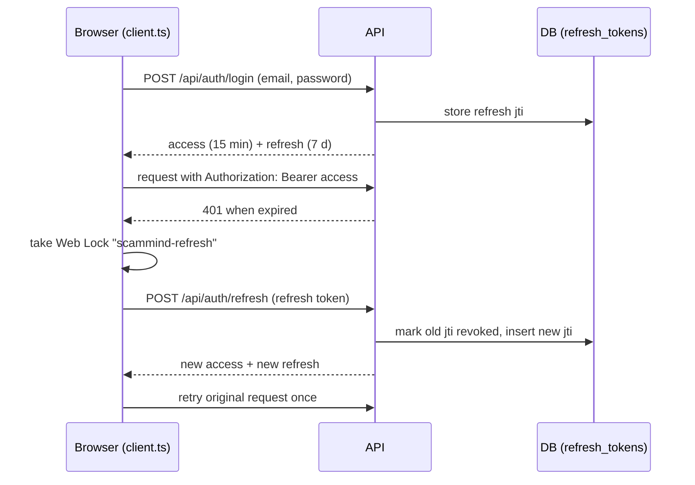

# Authentication and security

**Plain-language summary**

- People sign in with an email and password. The server hands back a short-lived "access" pass (15 minutes) and a longer "refresh" pass (7 days) that is swapped for a new pair each time it is used.
- Every person's brands, scans and reports belong to them; other accounts cannot see them. Only a small set of settings is shared by everyone.
- There are two public demo accounts whose passwords are shown on the login page. The demo administrator is "guarded": it is blocked from the few actions that would affect real users.
- Outside services are called only by the server, which keeps the API keys; the browser never sees them. Downloads of images and links are protected against being tricked into reaching internal networks.
- Known gaps are listed at the end. The most important: anyone can sign up without email verification, rate limits are per server process, and some "admin-only" screens are hidden in the interface but their read endpoints are open to any signed-in user.

This page was written from the code. `docs/SECURITY.md` predates multi-tenant ownership and the demo accounts, so where the two differ, this page reflects the code.

---

## 1. Authentication

### 1.1 Passwords

| Item | Behaviour | Source |
|---|---|---|
| Hashing | bcrypt, 12 rounds (tests lower it) | `backend/app/config/security.py:11,15-16` |
| Length limit | Only the first 72 bytes are used; longer passwords are rejected at the schema level | `security.py:12,15,21`, `backend/app/schemas/auth.py:10-15` |
| Sign-up policy | At least 10 characters, a denylist of trivial passwords, not all-digits, at least 5 distinct characters, not the same as name or email | `backend/app/schemas/auth.py:18-42,66-71` |
| Timing | Unknown emails are verified against a dummy hash so response time does not reveal whether an account exists | `backend/app/api/auth.py:26,69` |
| Login errors | Same message for wrong password, unknown email and inactive account: "Incorrect email or password" | `auth.py:70-74` |
| Failed logins | Counted per `email|client IP` and blocked after `LOGIN_MAX_FAILURES` (5) in `LOGIN_WINDOW_SECONDS` (900); failures are written to the audit log | `auth.py:63-74`, `backend/app/config/ratelimit.py:6-32`, `backend/app/config/config.py:53-54` |

### 1.2 Tokens (access + rotating refresh)

| Item | Behaviour | Source |
|---|---|---|
| Signing | PyJWT, `HS256` by default, key `JWT_SECRET` (minimum 16 characters, no default) | `security.py:26-35`, `backend/app/config/config.py:40-41` |
| Claims | `sub`, `typ` (`access` or `refresh`), `iat`, `exp`, `jti`; decoding requires `exp`, `sub`, `typ`, `jti` and checks the type | `security.py:26-56` |
| Lifetimes | `ACCESS_TOKEN_MINUTES` = 15, `REFRESH_TOKEN_DAYS` = 7 | `config.py:42-43` |
| Access check | Bearer token decoded, user loaded from the DB on every request; a missing or inactive user gives 401 | `backend/app/config/deps.py:28-43` |
| Refresh rotation | Each refresh revokes the presented token and issues a new pair; only the `jti` is stored | `backend/app/api/auth.py:39-46,148-156` |
| Theft detection | Presenting an already-revoked refresh token revokes all of that user's refresh tokens | `auth.py:136-141` |
| Logout | Revokes the presented refresh token and writes an audit row; an invalid token is silently accepted | `auth.py:159-170` |
| Access tokens | Not individually revocable; they expire after at most 15 minutes. An account set inactive stops working at once because the user row is checked per request | `deps.py:41-42` |

### 1.3 Token storage in the browser

| Item | Behaviour | Source |
|---|---|---|
| Keys | `scammind.auth` (tokens) and `scammind.user` (name, email, role, default brand) | `frontend/src/api/client.ts:59-60` |
| Where | `localStorage` when "keep me signed in" is on (default `persist = true`), otherwise `sessionStorage`; reads check both | `client.ts:77-98`, `frontend/src/api/auth.ts:11-15` |
| Not cookies | Tokens travel in the `Authorization` header; CORS credentials are off | `client.ts:297-299` (`send`), `backend/app/main.py:160-167` |
| Sign-out | Clears both stores, legacy keys and the in-memory query cache so the next user never sees the previous session's pages | `client.ts:120-126` |
| Single-flight refresh | One refresh per tab; concurrent 401s share it; a refresh rejected with 4xx ends the session, a network or 5xx error keeps it | `client.ts:221-264,315-345` |
| Web Locks | Refresh runs inside `navigator.locks.request('scammind-refresh', ...)` so tabs and both apps (BrandShield and Brand Studio) never spend the same rotated refresh token twice; the tokens are re-read inside the lock; without the API it falls back to the in-tab single flight | `client.ts:227-262`, `studio/src/lib/api.ts:7,93-99` |
| Shared with Studio | Studio reads the same keys from the same origin | `studio/src/lib/session.ts:1-4` |

Because tokens live in web storage, any script running on the page could read them (see "Known risks").

## 2. Authorization

### 2.1 Roles

Roles are `viewer`, `analyst`, `admin` (`frontend/src/api/client.ts:68-75`). Backend dependencies:

| Dependency | Allows | Source |
|---|---|---|
| `get_current_user` | Any signed-in, active user (all roles) | `backend/app/config/deps.py:28-43` |
| `require_writer` | `admin` or `analyst` | `deps.py:46-52,56` |
| `require_admin` | `admin` only | `deps.py:46-57` |

How accounts get roles:
- Self-service sign-up always creates an `analyst` (`backend/app/api/auth.py:114`).
- The real `admin` is created at startup from `ADMIN_EMAIL` / `ADMIN_PASSWORD` if absent; it never overwrites an existing password (`backend/app/services/seed.py:14-24`).
- Demo accounts are described in section 4.
- No API endpoint creates `viewer` accounts or changes roles; `viewer` is used by the e2e server's seed (`backend/scripts/e2e_server.py:54-56`) and tests. **Needs confirmation:** how production viewer accounts are meant to be created (no user-management route exists in `backend/app/api/`).

### 2.2 What each endpoint group requires

From the router decorators in `backend/app/api/*.py`:

| Area | Read | Write | Source |
|---|---|---|---|
| Brands, accounts, apps, logos, publishers | signed-in, owner only | `require_writer` and owner | `backend/app/api/brands.py:124-163,165-217,262-420,449-547` |
| Brand archive / restore | | `require_admin` and owner | `brands.py:419-446` |
| Scans, detections, reports, candidates, evaluation | signed-in, owner only | `require_writer` and owner | `backend/app/api/scans.py:25-106`, `detections.py:59-195`, `reports.py:81-196`, `candidates.py:36-115`, `evaluation.py:94-102` |
| Audit log and CSV export | `require_writer` (viewers cannot read) | | `backend/app/api/audit.py:52-84` |
| Settings | any signed-in user (GET) | `require_admin` (PUT) | `backend/app/api/settings.py:125-139` |
| Data mode | any signed-in user (GET) | `require_admin` (PUT) | `backend/app/api/sources.py:233-250` |
| Source health | any signed-in user (GET) | `require_writer` (PATCH monitored, POST retry) | `sources.py:125,160,179` |
| Active AI provider | any signed-in user (GET) | `require_admin` (PUT) | `backend/app/api/providers.py:45-57` |
| Look-alike test cases | signed-in, owner | add/delete `require_admin`; run `require_writer` | `backend/app/api/lookalike.py:125-160` |
| Detailed health, canary | | `require_admin` | `backend/app/api/health.py:36-49` |
| Studio saved items | signed-in, `user_id` scoped | signed-in, `user_id` scoped | `backend/app/api/studio.py:103-190` |
| Studio AI, voice | any signed-in user, per-user rate limits and quotas | | `backend/app/api/studio_ai.py:63-110`, `backend/app/api/voice.py:55-60` |
| Public (no auth) | `/health`, `/api/health`, `/health/live`, `/api/auth/demo`, login, register, refresh, logout, FastAPI `/docs` and `/openapi.json` | | `backend/app/api/health.py:22-33`, `auth.py:56-170`, `backend/app/main.py:94` |
| Cron | `GET /api/cron/scan` with `Authorization: Bearer <CRON_SECRET>`, compared with `hmac.compare_digest`; 503 when the secret is unset | | `backend/app/api/cron.py:27-38` |

**Needs confirmation:** `/docs` and `/openapi.json` are not disabled in `create_app` (`FastAPI(title="BrandShield", version="0.1.0", lifespan=lifespan)`, `backend/app/main.py:94`), so they are public wherever the API is reachable. Confirm whether Vercel routing exposes them (`vercel.json` routes only `/api/*`, `/health`, `/health/live` to the backend, `vercel.json:44-62`, so `/docs` would not reach it on Vercel, but would on the Docker API port).

### 2.3 Frontend route guards

| Guard | Behaviour | Source |
|---|---|---|
| `RequireAuth` | Without stored tokens redirects to `/login`; an `scammind:unauthorized` event (refresh rejected) sends the user to `/login` | `frontend/src/App.tsx:56-78` |
| `RequireAdmin` | Wraps `/sources` (Source Health), `/settings`, `/evaluation` (Model Evaluation); reads the role from the stored `scammind.user` and redirects non-admins to `/dashboard` | `App.tsx:38-54,175-179` |
| Sidebar | Hides the three admin links unless `session.user()?.role === 'admin'` | `frontend/src/components/layout/Sidebar.tsx:33` |

These are convenience checks. The role is read from `localStorage`, which a user can edit, so the real enforcement is the backend (section 2.2).

### 2.4 The three admin-only pages: does the backend also restrict non-admins?

Exactly what the code does, per page:

| Page | Endpoint | Non-admin result | Source |
|---|---|---|---|
| Settings | `GET /api/settings` | **Allowed** for any signed-in user (viewer, analyst). The stored notification webhook URL is blanked unless the caller is a real (non-demo) admin; `webhook_configured` is still shown | `backend/app/api/settings.py:118,125-127` |
| Settings | `PUT /api/settings` | 403 for non-admin | `settings.py:130-132` |
| Source Health | `GET /api/sources` | **Allowed** for any signed-in user; includes the global monthly Tavily credit snapshot and Safe Browsing reputation status (never the key) | `backend/app/api/sources.py:125-158` |
| Source Health | `PATCH /api/sources/{id}` (turn monitoring on/off) and `POST /api/sources/{id}/retry` | **Allowed** for `analyst` (so for any self-registered user). The `Source` rows are global (not tied to a brand), so a toggle affects every account. Retry runs collectors against the caller's own brand and may spend shared paid credits; it needs `confirm=true` when credits would be spent | `sources.py:160-231` |
| Source Health | `GET/PUT /api/settings/data-mode` | GET any signed-in user; PUT `require_admin` | `sources.py:233-250` |
| Model Evaluation | `GET /api/evaluation`, `POST /api/evaluation/run` | GET any signed-in user for their **own** brand; run needs `require_writer`. Scoped to the caller's brand through `resolve_brand`, so no other tenant's data is returned | `backend/app/api/evaluation.py:94-110` |

Conclusion: only the **write** side of Settings and the data-mode switch are admin-enforced on the server. Reading Settings, Source Health and Evaluation is not admin-restricted on the server, and an analyst can change the global monitored flag of a source. Hiding the three pages is a UI choice, not an access control.

## 3. Tenant isolation

Each brand has `owner_id`; every brand-scoped route resolves the brand through helpers that compare it to the signed-in user:

- `get_brand_or_404`: a brand owned by someone else is a 404, never 403, so existence is not revealed (`backend/app/api/common.py:22-27`).
- `resolve_brand` and `own_brand`: `brand_id` is optional and defaults to the caller's selected or oldest non-archived brand (`common.py:30-50`).
- `owns_brand` for objects hanging off a brand (candidate images, detections, reports) (`common.py:53-58`, `backend/app/api/candidates.py:109-115`).
- Starting a scan for a brand the user does not own raises `NoBrand` (`backend/app/core/pipeline/scan_pipeline.py:152-155`).
- Studio items and Studio quotas are keyed by `user_id` (`backend/app/api/studio.py:103-119`, `backend/app/services/studio_ai.py:286-300`).
- The audit log shows non-admins only the rows they performed themselves; the shared demo administrator is also restricted to its own rows (`backend/app/api/audit.py:36-49,64`).
- The ownership helpers (`owns_brand`, `resolve_brand`, `get_brand_or_404`) appear on 65 lines across `backend/app/api/` (including imports), i.e. they are used throughout the brand-scoped routers.

Still shared by all accounts (by design, per `docs/DECISIONS.md:208`, confirmed in code): the `settings` table (monitoring, notifications, data mode, active text provider; `backend/app/services/app_settings.py:59-66`, `backend/app/services/data_mode.py:7-34`), source rows and collector state (`backend/app/models/ops.py:10-50`), Tavily and Safe Browsing budget counters (`api_usage`), the response cache (keyed per Authorization header, `backend/app/config/response_cache.py:15-18,43`), and the per-IP/per-token rate limiter.

The response cache is keyed by a hash of the `Authorization` header, so one user's cached page is not served to another (`backend/app/config/response_cache.py:5-6,24-25`).

## 4. Demo accounts and the guarded demo administrator

| Item | Behaviour | Source |
|---|---|---|
| Public credentials | `GET /api/auth/demo` is unauthenticated and returns the demo account's email and password (and the demo admin's) when configured; the response is `Cache-Control: no-store` | `backend/app/api/auth.py:82-96` |
| Demo user | `DEMO_EMAIL` / `DEMO_PASSWORD`, role `analyst`; disabled if equal to `ADMIN_EMAIL`; an existing account with another role is never touched | `backend/app/services/seed.py:27-60` |
| Demo admin | `DEMO_ADMIN_EMAIL` / `DEMO_ADMIN_PASSWORD`, role `admin`; email must differ from `ADMIN_EMAIL` and `DEMO_EMAIL`; an existing non-admin account is never promoted | `seed.py:63-97` |
| Advertised only if real | Credentials are returned only if the account exists, is an active admin, and the password verifies | `seed.py:100-105` |
| Password resync | A changed env password is re-applied at the next start so the advertised password keeps working | `seed.py:52-54,89-91` |
| Identification | The demo admin is recognised by email: `is_demo_admin` | `seed.py:108-110` |

What the guard (`forbid_demo_admin`, 403) blocks (`seed.py:113-116`):

| Blocked action | Source |
|---|---|
| Choosing a data mode other than `sample` (in Settings or the data-mode endpoint) | `backend/app/api/settings.py:136-137`, `backend/app/api/sources.py:247-248` |
| Setting the notifications webhook | `settings.py:138-139` |
| Changing the active AI provider | `backend/app/api/providers.py:53` |
| Seeing other accounts' audit rows (restricted to own rows) | `backend/app/api/audit.py:64,80` |
| Seeing the stored webhook URL (blanked); an empty webhook from its form does not clear the real one | `settings.py:118,171-172` |

What the demo administrator can still do, because it is a real `admin` and the credentials are public (so, effectively, anyone): change global monitoring settings (schedule, sensitivity, rules, impersonation words, which sources are monitored; `settings.py:140-166`), archive and restore its own brands, add or delete look-alike test cases for its own brand, call `GET /api/health/details` and `POST /api/health/canary` (`backend/app/api/health.py:36-49`), and use the Studio AI quotas shared per user. Note that the demo account and the demo admin are each one shared user, so everyone using them shares one workspace and one AI quota. **Needs confirmation:** whether changes to the global monitoring settings by the public demo admin are acceptable for the intended deployments; the guard list above does not cover them.

Frontend: the login page shows demo buttons from the server response, with an optional local fallback from `VITE_DEMO_EMAIL` / `VITE_DEMO_PASSWORD` that should never be set on a public deployment (`frontend/src/pages/LoginPage.tsx:21-23`, `frontend/.env.example:4-6`).

## 5. Sign-up limits

| Control | Behaviour | Source |
|---|---|---|
| Switch | `SIGNUP_ENABLED` (default true); false returns 403 | `backend/app/api/auth.py:107-108` |
| Limits | 5 per client IP and 3 per email per hour, in memory per process | `auth.py:109-111`, `backend/app/main.py:100-101`, `config.py:58-59` |
| Duplicate email | 409; a race on the unique email is also caught | `auth.py:112-120` |
| Result | New `analyst`, signed in immediately, audited as `auth.registered` | `auth.py:114-124` |
| Email verification | **None** (an address proves nothing) | `docs/DECISIONS.md:202`; no mail code in `backend/app/` |
| Password reset | The frontend client defines `forgot` and `reset` calls (`frontend/src/api/auth.ts:41-46`) but the backend has no `/auth/forgot` or `/auth/reset` route (search of `backend/app` finds none) and the UI does not call them | `backend/app/api/` (no match for `forgot` or `reset`) |

## 6. Rate limiters

| Limiter | Key | Default | Scope | Source |
|---|---|---|---|---|
| General API | client IP and a SHA-256 prefix of the Authorization header (both must pass); `/api/*` only, preflights exempt | 600/min (`API_RATE_LIMIT_PER_MINUTE`, 0 = off) | in memory, per process | `backend/app/main.py:119-135`, `backend/app/config/ratelimit.py:35-61`, `config.py:163` |
| Login failures | `email|IP` | 5 failures / 900 s | in memory, per process | `main.py:99`, `ratelimit.py:6-32` |
| Sign-up | IP; email | 5/h; 3/h | in memory, per process | `main.py:100-101` |
| Studio AI | `user:<id>` | 20/min | in memory, per process | `main.py:102-103`, `backend/app/api/studio_ai.py:63-67` |
| Studio AI daily quota | per user per UTC day, stored in `api_usage` (survives restarts) | 200 text, 50 images | database | `backend/app/services/studio_ai.py:279-300`, `config.py:151-152` |
| Voice | `user:<id>` | 30/min | in memory, per process | `main.py:104`, `backend/app/api/voice.py:55-58` |

`RequestLimiter` documents its own limit: "Single process only: with several workers each one counts separately" (`ratelimit.py:35-37`).

The client IP comes from `request.client.host`. In the container, uvicorn trusts `X-Forwarded-For` only from `FORWARDED_ALLOW_IPS` (default `127.0.0.1`) (`backend/docker-entrypoint.sh:20-21`), while the frontend nginx proxy sends the header from another container (`frontend/nginx/default.conf.template:60-70`). Unless `FORWARDED_ALLOW_IPS` is set, all users coming through nginx would appear as one IP, so per-IP limits (including sign-up) would be shared by everyone. **Needs confirmation:** how the client IP is derived on Vercel (no proxy-header handling exists in `backend/api/index.py` or `main.py`); if it is the platform's proxy address, per-IP limits are effectively global there too.

## 7. CORS

`CORSMiddleware` with an explicit origin list from `CORS_ORIGINS` (default `http://localhost:5173`), optional `CORS_ORIGIN_REGEX`, `allow_credentials=False`, all methods and headers allowed (`backend/app/main.py:160-167`, `backend/app/config/config.py:30-31,192-194`). On the single-origin deployments (Vercel rewrites, nginx proxy) the browser makes same-origin calls and CORS is not exercised (`backend/.env.example:93-94`).

## 8. Security headers and CSP

Headers sent on every path on Vercel (`vercel.json:88-117`) and by both nginx servers (`frontend/nginx/default.conf.template:14-20`, `studio/nginx/default.conf:13-18`):

| Header | Value |
|---|---|
| `X-Content-Type-Options` | `nosniff` |
| `X-Frame-Options` | `DENY` |
| `Referrer-Policy` | `strict-origin-when-cross-origin` |
| `Permissions-Policy` | `camera=(), microphone=(self), geolocation=(), payment=()` on Vercel and in the frontend nginx (`vercel.json:106`, `frontend/nginx/default.conf.template:17`); `microphone=()` in the standalone Studio nginx (`studio/nginx/default.conf:16`) |
| `Strict-Transport-Security` | `max-age=31536000; includeSubDomains` |
| `Content-Security-Policy` | see below |

| Deployment | CSP differences | Source |
|---|---|---|
| Vercel | `default-src 'self'; script-src 'self'; style-src 'self' 'unsafe-inline' https://fonts.googleapis.com; font-src 'self' data: https://fonts.gstatic.com; img-src 'self' data: blob: https:; connect-src 'self'; object-src 'none'; base-uri 'self'; form-action 'self'; frame-ancestors 'none'` | `vercel.json:112-115` |
| Frontend nginx | Same, but `img-src 'self' data: blob: ${API_URL}` and `connect-src 'self' ${API_URL}` (API address substituted at container start) | `frontend/nginx/default.conf.template:20` |
| Studio nginx | Same as Vercel (`img-src ... https:`, `connect-src 'self'`) | `studio/nginx/default.conf:18` |

Notes:
- `'unsafe-inline'` is allowed for styles only; scripts are `'self'` only.
- The microphone is allowed for the page's own origin (`microphone=(self)`) because the voice assistant uses it; the standalone Studio container still sends `microphone=()` (Studio has no voice feature; in Compose the frontend's headers apply to proxied Studio pages).
- In Compose, frontend nginx proxies `/studio/` and hides Studio's own security headers so they are not duplicated (`frontend/nginx/default.conf.template:38-56`); the frontend's CSP (which restricts `img-src` to `API_URL`) therefore applies to proxied Studio pages. **Needs confirmation:** whether Studio shows any image from an `https:` host other than `API_URL` that this stricter CSP would block in Compose.
- Static assets are cached for a year, `/config.js` is `no-cache` (`vercel.json:118-144`).
- The API process itself adds no security headers; they come from Vercel or nginx. The API port in Compose is published only on `127.0.0.1` (`docker-compose.yml:85-86`).

## 9. SSRF protection (outbound requests)

Both fetchers share `validate_public_url` (`backend/app/core/pipeline/url_safety.py:63-92`):

| Rule | Source |
|---|---|
| Only `http` and `https` | `url_safety.py:66-67` |
| No credentials in the URL | `url_safety.py:68-69` |
| Only ports 80 and 443 | `url_safety.py:19,77-78` |
| Rejects `localhost`, `*.localhost`, `*.local`, `*.internal` | `url_safety.py:80-81` |
| IP literals are checked; hostnames are resolved and **all** addresses must be public (global, not private, loopback, link-local, multicast, reserved, unspecified; IPv4-mapped IPv6 unwrapped) | `url_safety.py:45-60,82-91` |
| Redirects are followed manually (limit `URL_CHECK_MAX_REDIRECTS`, 3) and every hop is re-validated | `url_safety.py:130-155` |
| The connection is pinned to the validated IP (Host header and SNI keep the hostname) so DNS cannot change between check and connect | `url_safety.py:134-146` |
| Environment proxies ignored (`trust_env=False`, `follow_redirects=False`) | `url_safety.py:95-96` |
| Response read capped (`URL_CHECK_MAX_BYTES`, 65536) | `url_safety.py:147-150` |

`UrlChecker` never raises; every failure becomes an "unreachable" result (`url_safety.py:117-128`).

`SafeFetcher` (candidate logos and icons) adds a content-type allow-list (png, jpeg, webp, gif), `Content-Length` and streaming size caps (default 2 MB), a magic-byte check, and a 25-million-pixel decompression-bomb guard; it only raises `FetchError` (`backend/app/core/pipeline/image_fetch.py:20-106`). It is limited per scan by `SCAN_MAX_LOGO_FETCHES` (25) and only runs for live data (`backend/app/config/config.py:116,120`).

Other outbound URLs: the SearXNG base URL goes through `validate_public_url` unless the operator sets `SEARXNG_ALLOW_PRIVATE_HOSTS` (then only scheme and no-credentials checks apply) (`backend/app/core/collectors/searxng.py:79-93`). Candidate URLs themselves are not visited: Safe Browsing receives the URL string only (`backend/app/core/providers/safe_browsing.py:1-3`, `docs/DECISIONS.md:140`).

## 10. Upload and import validation

| Input | Validation | Source |
|---|---|---|
| Brand logo, extra logos | Read at most cap + 1 byte (`LOGO_MAX_BYTES`, 2 MB); PNG/JPEG/WebP by magic bytes; Pillow `verify` then load; at least 256x256; roughly square (0.8 to 1.25); 25 MP guard; **re-encoded** (drops metadata and trailing bytes); stored under `logos/brand_<id>/<hash>.<ext>`, never the user's filename | `backend/app/api/brands.py:210-228`, `backend/app/core/pipeline/logo.py:11-13,44-80` |
| Candidate images and app icons | Same approach, plus a maximum side; hashed and re-encoded | `backend/app/api/candidates.py:75-95`, `backend/app/core/pipeline/candidate_images.py:36-60` |
| Studio item images | Same image processor; files stored under `studio/user_<id>/`; JSON `data` limited in size; at most 500 items per user | `backend/app/api/studio.py:34,60-100` |
| CSV / JSON candidate import | Size cap `IMPORT_MAX_BYTES` (1 MB), row cap `IMPORT_MAX_ROWS` (500), strict schema, per-row errors, `dry_run` | `backend/app/api/candidates.py:51-72`, `backend/app/core/pipeline/candidate_intake.py:170` |
| Served files | Fixed media type from the stored format, `X-Content-Type-Options: nosniff`, SHA-256 ETag | `backend/app/api/brands.py:242-259`, `backend/app/api/candidates.py:109-115`, `backend/app/api/common.py:13-15` |
| Audit CSV export | Cells starting with `= + - @` or tab/CR get a leading `'` (formula-injection guard) | `backend/app/api/audit.py:70-72` |
| File paths in the store | Absolute paths, `..`, backslashes, NUL bytes rejected; resolved path must stay under the root | `backend/app/core/storage.py:45-52,59-64` |
| Platform limit | Vercel request body limit 4.5 MB | `docs/DEPLOY_VERCEL.md` (platform facts table) |

## 11. Secrets management

Secrets are read only from the environment (or an untracked `.env`), never stored in the database, and never returned by an endpoint. The names, where each is read:

| Secret (name only) | Read in |
|---|---|
| `JWT_SECRET` | `backend/app/config/config.py:40` -> `security.py:35,48` |
| `ADMIN_PASSWORD`, `DEMO_PASSWORD`, `DEMO_ADMIN_PASSWORD` | `config.py:46,48,50` -> `backend/app/services/seed.py` |
| `DATABASE_URL`, `MIGRATION_DATABASE_URL` (contain a password) | `config.py:28,37` -> `backend/app/db/session.py` |
| `REDIS_URL` | `config.py:110` -> `backend/app/services/jobs.py:63-64`, `backend/app/worker.py:95` |
| `CRON_SECRET` | `config.py:38` -> `backend/app/api/cron.py:34` |
| `TAVILY_API_KEY` | `config.py:91` -> `backend/app/core/collectors/selection.py:83` |
| `GOOGLE_SAFE_BROWSING_API_KEY` | `config.py:132` -> `backend/app/core/providers/safe_browsing.py:177` (header `x-goog-api-key`, never in the URL) |
| `GEMINI_API_KEY`, `VOICE_GEMINI_API_KEY` | `config.py:71,145` -> `backend/app/core/providers/text/factory.py:31`, `backend/app/services/studio_ai.py:208`, `backend/app/services/voice.py` |
| `HUGGINGFACE_API_TOKEN` | `config.py:74` -> `factory.py:33` |
| `GROQ_API_KEY`, `POLLINATIONS_API_KEY` | `config.py:139-140` -> `backend/app/services/studio_ai.py:94,180,230` (sent as `Authorization: Bearer`) |
| `SENTRY_DSN` | `config.py:171` -> `backend/app/config/observability.py:79-102` |

Handling:
- Typed as `SecretStr` for the API keys, `REDIS_URL`, `SENTRY_DSN`, `CRON_SECRET` (`config.py:38,71,74,91,110,132,139,140,145,171`). `JWT_SECRET`, `ADMIN_PASSWORD`, demo passwords, `DATABASE_URL` are plain strings.
- **Log masking.** `configure_logging(level, settings.secret_values)` installs a filter that replaces exact secret values with `[REDACTED]`, then also masks `password/secret/token/api_key/authorization=...` pairs, `Bearer ...` strings and JWT-shaped strings (`backend/app/config/logging.py:8-28,58-64`, `backend/app/main.py:60`). Secrets shorter than 4 characters are ignored (`logging.py:21`). Exceptions are redacted too (`logging.py:36-41`).
- **Gaps in the exact-value list.** `Settings.secret_values` includes `JWT_SECRET`, admin and both demo passwords, Tavily, `REDIS_URL`, Sentry DSN, Safe Browsing, Gemini, Hugging Face and the voice Gemini key (`config.py:196-202`). It does **not** list `GROQ_API_KEY`, `POLLINATIONS_API_KEY`, `CRON_SECRET` or `DATABASE_URL`. Those are still caught when they appear after a recognised key name or as `Bearer ...`, but not when printed bare. The same list feeds Sentry scrubbing (`observability.py:90-98`).
- **Sentry scrubbing.** Before sending: request body and cookies dropped, headers and query string redacted, user reduced to id, local variables removed, server name removed, `send_default_pii=False`, `include_local_variables=False` (`observability.py:46-76,90-98`).
- **Provider status endpoints** report only whether a key is configured (`backend/app/api/providers.py:30-43`, `backend/app/api/sources.py:155-156`).
- **Browser bundle.** Nothing from the environment is injected into the Studio bundle (`studio/vite.config.ts:7-8`); the only `VITE_*` values are the API URL, the optional demo fallback and dev redirect targets (`docs/configuration.md`, sections 3 and 4).
- **Tests** pop real keys from the environment so they cannot reach a test run (`backend/tests/conftest.py:17-19`); the e2e server ignores `.env` files (`backend/scripts/e2e_server.py:4-6`).
- Secret files are git-ignored: `.env`, `.env.*`, `*.env` except the `.env.example` templates (`.gitignore`).
- `backend/.env` was deliberately not read to produce this page.

## 12. AI provider key handling

- All AI keys live on the server; Brand Studio and the frontend call BrandShield endpoints only (`backend/app/api/studio_ai.py:1-3`, `studio/src/services/gemini.ts:1-6`, `studio/vite.config.ts:7-8`).
- Studio AI endpoints require a signed-in user, a per-user rate limit (20/min) and a daily quota; timeouts and bounded retries (timeouts, connection errors and 5xx only) apply to every outbound call (`backend/app/api/studio_ai.py:63-67`, `backend/app/services/studio_ai.py:1-12`, `config.py:143,151-156`).
- Chat uses Groq first and Gemini as a fallback; images use Pollinations (`backend/app/services/studio_ai.py:39-41,152`).
- Hosted text analysis of scan candidates is **off** by default (`SCAM_LLM_ENABLED=false`), is never run for sample data, and only the configured provider is used (`config.py:66-69`, `backend/app/core/pipeline/text_analysis.py:2-3,77`).
- Prompt-injection controls: candidate text is truncated, control characters and delimiter strings removed, placed between explicit markers declared as untrusted data; emails, phone numbers and UPI ids are replaced by placeholders before sending; no tools or URL fetching are offered; the answer must match a strict JSON schema and can only add capped points, never lower a score or touch the allowlist (`backend/app/core/providers/text/prompt.py:1-40`). Regression tests are named in `docs/SECURITY.md`.

## 13. Voice agent safety rules

The voice endpoint is `POST /api/voice`, signed-in users only, rate limited to 30/min per user (`backend/app/api/voice.py:55-58`). Rules enforced in `backend/app/services/voice.py` (docstring `voice.py:1-18`, constants `voice.py:34-50`):

| Rule | Detail |
|---|---|
| Sensitive fields never reach the planner | The server drops snapshot elements whose label or name matches `pass(word|code)`, `pwd`, `secret`, `token`, `otp`, `pin`, `cvv`, `card`, `credit`, `ssn`, `api key`, `credential`, `auth`, whatever the browser sent (`voice.py:38`, `backend/app/api/voice.py:59-60`) |
| Navigation allow-list | Only fixed paths (`/dashboard`, `/brand`, `/social`, `/apps`, `/web`, `/investigations`, `/lookalike`, `/sources`, `/reports`, `/settings`, `/evaluation`, `/setup`, `/protect-brand`, `/studio/`) (`voice.py:34-37`) |
| Element ids validated | Actions must reference elements in the snapshot that was sent; option names must exist on that element |
| Destructive clicks need a spoken yes | Words such as delete, remove, block, pay, purchase, archive, discard, revoke, erase, deactivate (`voice.py:39`) |
| Submits need a request or a yes | submit, register, create, finish, publish, launch, send, save, confirm (`voice.py:40`) |
| Value size | Values capped (`MAX_VALUE = 500`, `voice.py:50`); request fields bounded (text 1000 characters, 200 snapshot elements, 50 routes, `backend/app/api/voice.py:40-52`) |
| No logging of content | Snapshots, values and the API key are never logged (`voice.py:17-18`) |
| Fast path without network | Simple commands ("open dashboard") use regex and rapidfuzz, no key needed (`voice.py:7-14`) |
| Model | Gemini with function calling only after the fast path fails; `VOICE_GEMINI_MODEL`, fallback model, 10 s timeout (`config.py:145-150`) |

## 14. Postgres Row Level Security (Supabase)

Supabase exposes the `public` schema through its REST API, so two tables that hold uploaded content have RLS enabled with **no policy**, which blocks the API roles (`anon`, `authenticated`) completely. The backend connects as the table owner, which RLS does not apply to:

| Table | Migration |
|---|---|
| `stored_files` (logos, candidate images, evidence snapshots when `STORAGE_BACKEND=database`) | `backend/alembic/versions/0009_stored_files.py:1-10,31` |
| `studio_items` (saved Studio items) | `backend/alembic/versions/0011_studio_items.py:1-9,34` |

Migration 0010 notes "No new tables, so nothing to do for row level security" (`0010_brand_owner.py:9`). A search of `backend/alembic` and `backend/app` finds no other `ROW LEVEL SECURITY` statement. **Needs confirmation:** whether Supabase's REST/Data API is disabled or the other tables (`users`, `refresh_tokens`, `brands`, `detections`, `audit_log`, `settings`, ...) are otherwise protected from the `anon`/`authenticated` roles; the repo contains no RLS or grants for them, so if the Data API is enabled with default grants they could be exposed. Authorization for those tables relies entirely on the FastAPI layer.

## 15. Other controls worth knowing

| Control | Detail | Source |
|---|---|---|
| Audit trail | Every mutating action writes an `audit_log` row (actor, action, target, detail); logins, logout, registration, scans, settings and provider changes are recorded; detections also keep an event timeline | `backend/app/services/audit.py`, `backend/app/api/auth.py:72,77,122,168`, `backend/app/api/settings.py:178-179` |
| Error handling | Unhandled errors return a generic 500 and log only the exception type | `backend/app/config/errors.py:30-32` |
| Cron endpoint | Inert without `CRON_SECRET`; constant-time compare | `backend/app/api/cron.py:27-38` |
| Containers | Non-root user (uid 10001); `no-new-privileges`; `cap_drop: ALL` on api and worker; ports bound to `127.0.0.1`; secrets with `${VAR:?}` so Compose refuses to start without them | `backend/Dockerfile:25-26,41`, `docker-compose.yml:8,100-103,127-130` |
| Redis | Password via environment variable, not command line | `docker-compose.yml:57-60` |
| Database pooling safety | Small pool and TCP keepalives for hosted Postgres | `backend/app/db/session.py:19-32` |
| Scan safety | One active scan per brand enforced by a partial unique index | `scan_pipeline.py:178-183` |
| Soft deletion | Archived brands return 404 unless explicitly included | `backend/app/api/common.py:25` |

## 16. Known risks and limitations

Each item is based on what the code does today.

| # | Risk or limitation | Evidence |
|---|---|---|
| 1 | **No email verification.** Anyone can register any address they can type; an address proves nothing. No CAPTCHA, no password-reset flow, no account deletion | `docs/DECISIONS.md:202`; `backend/app/api/auth.py:99-124`; no `/auth/forgot` route though `frontend/src/api/auth.ts:41-46` defines client calls |
| 2 | **Rate limiters are in memory per process.** Each worker or serverless instance counts separately and a restart resets counts; on Vercel every instance has its own. Login, sign-up, Studio AI, voice and the general limit are all affected. Daily AI quotas are the exception (database) | `backend/app/config/ratelimit.py:1-3,35-37`, `backend/app/main.py:99-106` |
| 3 | **Client IP may be the proxy's.** Without `FORWARDED_ALLOW_IPS` set to the proxy's address, per-IP limits (including sign-up and login keys) can be shared by all users behind nginx; Vercel behaviour not verified in code | `backend/docker-entrypoint.sh:20-21`; section 6 |
| 4 | **Tokens in web storage.** Access and refresh tokens are in `localStorage` (or `sessionStorage`), readable by any script on the origin; the CSP allows only same-origin scripts, which reduces but does not remove the risk. Access tokens cannot be revoked before they expire (15 min) | `frontend/src/api/client.ts:59,77-98`; `vercel.json:112-115` |
| 5 | **Admin pages are hidden, not protected, for reads.** `GET /api/settings`, `GET /api/sources`, `GET /api/settings/data-mode` and `GET /api/providers` are open to any signed-in user; `PATCH /api/sources/{id}` and `POST /api/sources/{id}/retry` are open to any analyst (including self-registered users) and change or spend shared, global state | section 2.4; `backend/app/api/sources.py:125-231` |
| 6 | **Shared global state and budgets.** Settings, data mode, provider, source rows and Tavily / Safe Browsing counters are one pool for all accounts; one heavy account can use up the shared Tavily budget | `docs/DECISIONS.md:208`; `backend/app/services/app_settings.py:59-66` |
| 7 | **Public demo admin is a real admin.** Its credentials are public; it is blocked from live data, the AI provider, the webhook and others' audit rows, but can still change global monitoring settings and read detailed health | section 4 |
| 8 | **Google Safe Browsing terms.** The Lookup API v4 is for non-commercial use; a revenue-generating product should use Web Risk (paid). Candidate URLs are sent to Google. "Clean" means "not in Google's lists", not "safe" | `backend/app/core/providers/safe_browsing.py:15-17,3`, `docs/DECISIONS.md:139` |
| 9 | **Shared Supabase database.** **Needs confirmation:** the repo does not say whether development, e2e and production share one Supabase project. Evidence that local runs may use the hosted database: `docs/DECISIONS.md:166` ("Supabase in Tokyo costs 130-500 ms per query" while tuning local speed) and `backend/.env.example:81-86` pool settings. Tests use in-memory SQLite or a throwaway Postgres schema (`backend/tests/conftest.py:12`, `.github/workflows/ci.yml:90-93`) |
| 10 | **RLS only on two tables.** Other tables rely on the API layer; see section 14 | `0009_stored_files.py:31`, `0011_studio_items.py:34` |
| 11 | **Secret masking is not exhaustive.** Groq, Pollinations, `CRON_SECRET` and `DATABASE_URL` are missing from the exact-value list used for logs and Sentry | `backend/app/config/config.py:196-202` |
| 12 | **No MFA / SSO, no account lockout beyond login failures, no malware scanning of uploads, no WAF, no dependency scanning in CI, no independent security review** | `docs/SECURITY.md` "Not implemented"; `.github/workflows/ci.yml` has no such job |
| 13 | **Encryption at rest** is whatever the database or disk provides; evidence files may be stored as database rows | `backend/app/core/storage.py:96-130` |
| 14 | **Public API docs** (`/docs`, `/openapi.json`) are not disabled | `backend/app/main.py:94` |
| 15 | **Hosted-model and hash similarity are hints, not proof**; a person confirms every detection. Sample data is synthetic and is labelled as such | `backend/app/core/engine/risk_engine.py:19-22` |
| 16 | **Notifications are stored preferences only**; nothing is sent (delivery `not_implemented`), so a configured webhook URL is never called today | `backend/app/api/settings.py:117-119` |
| 17 | **Deployment unverified on Vercel.** Services are Beta and the setup has never been deployed per its own guide; some behaviours (IP handling, cron placement) are unconfirmed | `docs/DEPLOY_VERCEL.md:9-12` |
| 18 | **CI never executed.** The workflow header says it was written and YAML-checked locally but not run | `.github/workflows/ci.yml:3-5` |

### 16.1 Differences from `docs/SECURITY.md`

| `docs/SECURITY.md` says | Code says |
|---|---|
| "Tenant isolation ... NOT implemented" (single-tenant) | Implemented through `brands.owner_id` (section 3); settings and budgets remain global |
| Roles: admin also manages "users" | No user-management endpoint exists in `backend/app/api/` |
| No mention of demo accounts, sign-up, Studio AI, voice | Present (sections 4, 5, 12, 13) |
| "Fetches ... (official account/URL checks, image fetch, snapshots)" go through `url_safety` / `SafeFetcher` | Consistent for the fetchers found (`url_safety.py`, `image_fetch.py`); screenshots are off by default (`config.py:121`) |
