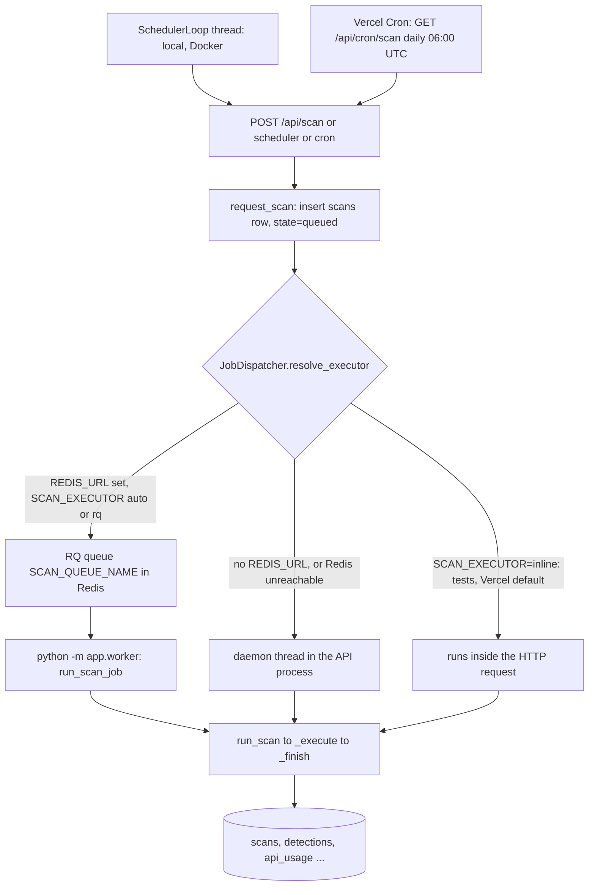

# Background jobs and third-party integrations

## Plain-language summary

BrandShield does some work in the background (running scans, running them on a timer, a daily cron call on Vercel) and talks to a
handful of outside services (web search, app stores, Google, AI models, error reporting, databases). This page lists every one of them:
what it is for, where it lives in the code, which environment variable names switch it on, what happens when it is down, and how its
cost or quota is kept under control. Values of keys are never written here: only variable names.
The golden rule of the design is that **an outside service failing must never break a scan or a page**: the scan ends "partial", the
signal is shown as "unavailable" (never as "clean"), and everything else still works.

All paths are relative to the repository root (`ScamMind AI/`). Config is declared in `backend/app/config/config.py` (class `Settings`,
env names are the upper-case field names, `case_sensitive=False`, a blank value counts as unset: `config.py:20-24`).

## 1. Execution modes at a glance

| Mode | Selected when | Code | Notes |
|---|---|---|---|
| RQ worker | `REDIS_URL` set and `SCAN_EXECUTOR` is `auto` (default) or `rq` | `backend/app/services/jobs.py:23-30,59-67`; worker `backend/app/worker.py` | Docker compose runs a separate `worker` service with `SCAN_EXECUTOR: rq` (`docker-compose.yml`, x-server-env and service `worker`) |
| Thread | no Redis, or Redis unreachable when queuing (logged, then falls back) | `jobs.py:46-52` | local dev works without Redis. The thread dies with the API process; a scan stuck `running` is failed after `SCAN_STALE_MINUTES` (30) by `fail_stale_scans` (`backend/app/core/pipeline/scan_pipeline.py:117-125`) |
| Inline | tests; on Vercel unless `SCAN_EXECUTOR` is set explicitly | `jobs.py:40-42`; Vercel defaults in `config.py:175-190` | the HTTP response contains the finished scan; bounded by the function duration (`maxDuration: 300` in `vercel.json`) |

## 2. Scheduler, cron and worker

### 2.1 SchedulerLoop (local and Docker)

- `SchedulerLoop` (`backend/app/services/scheduler.py:192-218`) is a daemon thread started in the FastAPI lifespan only when `SCHEDULER_ENABLED` is true (default true) and `APP_ENV != "test"`
  (`backend/app/main.py:84-89`); it is stopped on shutdown (91-92). It sleeps `SCHEDULER_POLL_SECONDS` (default 60, minimum 5, line 197) between passes.
- Every pass runs `scheduler_tick` (scheduler.py:147-189): for each non-archived brand (oldest first) it reads the schedule inputs, asks the pure function `decide_schedule` (52-89) and, if due, calls
  `request_scan(... scope="all", user=None)` which records `started_by = "scheduler"`. It never raises (a failure is logged and returns "Scheduler error (see log)", 187-189). At most `SCHEDULER_MAX_BRANDS_PER_RUN`
  (default 5) scans are started per pass (178-179).
- The interval comes from `SCAN_INTERVAL_MINUTES` (env wins, `0` = off) or the Settings page (`off | 5m | 15m | 1h | 1d`, default `1d`) (`backend/app/services/app_settings.py:15-16,19-24,79-83`).
- Brands with no official account or app are skipped to avoid spending credits ("Waiting for the first official account or app", scheduler.py:92-95,168-169).
- **Credit-aware stretching and pausing** (scheduler.py:1-13,68-84): when Tavily is part of the live chain, `cost = TAVILY_MAX_QUERIES_PER_SCAN x credit_cost(depth)`, `reserve = one scan`, `usable = remaining - reserve`;
  if `usable < cost` scheduled scans pause until the month resets (manual scans still work), else the interval is stretched to `days_left x 24h / affordable_scans`. The interval is never shortened.
- Status for the UI: `schedule_status` (124-144), exposed in `GET /api/scan/status` and `GET /api/sources` (`backend/app/api/scans.py:56-80`, `backend/app/api/sources.py:139,148-149`).

### 2.2 Vercel Cron (`/api/cron/scan`)

| Aspect | Detail |
|---|---|
| Schedule | `{"path": "/api/cron/scan", "schedule": "0 6 * * *"}` in the root `vercel.json` (`crons`), daily 06:00 UTC. Vercel Hobby: at most once a day, fired anywhere within the hour (`docs/DEPLOY_VERCEL.md:43-44`) |
| Route | `GET /api/cron/scan` (`backend/app/api/cron.py:32-46`), rewritten to the backend by the `/api/(.*)` rewrite in `vercel.json` |
| Auth | `Authorization: Bearer <CRON_SECRET>`, compared with `hmac.compare_digest` (cron.py:27-29). `CRON_SECRET` unset: **503** "Scheduled scans via cron are not configured"; wrong or missing header: **401** with `WWW-Authenticate: Bearer` (cron.py:34-37). `CRON_SECRET` is declared `SecretStr` (`config.py:38`) |
| Logic | `scheduler_tick(ctx, now + 60 min)` (cron.py:24,40): the same decision as the loop (interval, credit stretching, running check, official-assets check), looking ahead by `CRON_SLACK` = 60 min so a cron that fires a few minutes early is not skipped for a whole extra day |
| Response | `{"ran": bool, "skipped": bool, "reason": str, "scan_id": int|null}`; `ran` is true only if a new scan row appeared (cron.py:38-46) |
| Execution | the scan runs inline in this request (Vercel default executor) up to 300 s |
| Retries | none by Vercel (`docs/DEPLOY_VERCEL.md:43`); delivery is best effort |

**Needs confirmation:** `docs/DEPLOY_VERCEL.md:55-57` says Vercel's documentation lists `crons` only at the top level and does not describe cron in `services` mode, and that this was not verified live. Check in the Vercel
dashboard (Project Settings, Cron Jobs) that the job exists after a deploy.

### 2.3 RQ worker (`backend/app/worker.py`)

- Entry: `python -m app.worker` (`worker.py:45-60`), or the container role `worker` (`backend/docker-entrypoint.sh`, `worker)` case). Requires `REDIS_URL`; otherwise logs an error and exits with code 2.
- The API enqueues the function path `app.worker.run_scan_job` with the scan id, `job_id = "scan-<id>"`, timeout `SCAN_JOB_TIMEOUT_SECONDS` (900) on queue `SCAN_QUEUE_NAME` (`scans`) (`jobs.py:59-67`).
- The worker builds one `ScanContext` per process (engine, `CollectorRuntime`, fetcher; `worker.py:28-37`) and calls `run_scan`, which never raises: failures are written on the scan row (`worker.py:40-42`).
  It uses `SimpleWorker` on Windows because the default RQ worker forks (line 58). Sentry is initialised in `main()` (line 47).
- Health: `GET /health` reports `redis` (PING with 1 s timeouts) and `worker` (registered RQ workers, last heartbeat age, queue length; `backend/app/services/health.py:89-117`). Compose marks the worker healthy by the same check.
  No worker registered means "queued scans will not run" (health.py:116).
- Not covered by automated tests against a real Redis server (docstring, `worker.py:3-5`; `docs/DEPENDENCIES.md`).

### 2.4 Database migrations and startup on each platform

`backend/docker-entrypoint.sh`: role `api` runs `python -m scripts.migrate` (PostgreSQL advisory lock so replicas do not collide) unless `RUN_MIGRATIONS=false`, then starts uvicorn; role `migrate` runs it once.
On Vercel the entrypoint is `backend/api/index.py` (`app = create_app()`); it never starts the scheduler thread and seeds the admin lazily (`cold_start`).

## 3. Integration catalogue

| # | Integration | Used for | Real or mock |
|---|---|---|---|
| 1 | Tavily | live social and store search | real, paid credits |
| 2 | SearXNG | optional free social search fallback | real, self-hosted |
| 3 | Apple iTunes Search | App Store listings | real, free, rate limited |
| 4 | google-play-scraper | Google Play listings | real (scraping), optional package |
| 5 | Google Safe Browsing | URL reputation of web candidates | real, only when a key is set |
| 6 | Google Gemini | scan text analysis, voice agent, Studio chat fallback | real, optional |
| 7 | Hugging Face | alternative scan text analysis | real, optional |
| 8 | Groq | Brand Studio chat (primary) | real, optional |
| 9 | Pollinations | Brand Studio image generation | real, optional |
| 10 | Sentry | error reporting | real, optional |
| 11 | Redis | RQ job queue, health | real, optional |
| 12 | Supabase / PostgreSQL | production database | real; SQLite is the local default |
| - | Sample collector | fake candidates for demos and tests | MOCK (no network) |

### 3.1 Tavily

- **Purpose:** primary live search for social profiles, brand pages and store listings, restricted to `instagram.com`, `facebook.com`, `x.com`/`twitter.com`, `t.me`, `linkedin.com`, `youtube.com`, `play.google.com`,
  `apps.apple.com` and six APK mirror sites (`backend/app/core/collectors/tavily.py:41-51`). It does **not** search general websites.
- **Where:** `backend/app/core/collectors/tavily.py`, ledger `backend/app/core/collectors/credits.py`, wiring `backend/app/core/collectors/selection.py:163-169`. Endpoint `POST https://api.tavily.com/search` (tavily.py:38) with
  `Authorization: Bearer <key>`.
- **Config:** `TAVILY_API_KEY`, `TAVILY_MONTHLY_BUDGET` (900), `TAVILY_MAX_QUERIES_PER_SCAN` (12), `TAVILY_SEARCH_DEPTH` (`basic`=1 credit, `advanced`=2), `TAVILY_MAX_RESULTS` (10, capped at 20) (`config.py:91-95`).
- **Credit ledger:** table `api_usage`, provider `tavily`, one row per UTC month (`YYYY-MM`). `reserve(cost)` is one atomic `UPDATE ... WHERE credits + cost <= budget`, so parallel scans cannot overspend (`credits.py:83-98`); it also
  refuses when Tavily's self-reported usage (provider `tavily:reported`, from `include_usage`) plus the cost would exceed the budget (line 90). The guard uses the larger of the two counters (`_snapshot`, 57-69).
  `refund()` returns the cost when the call provably did not run (4xx, connection error); a timeout or 5xx keeps it because it may have been billed (`tavily.py:165-176`).
  `GET /api/sources` returns `tavily_credits {used, budget, remaining, reported_used, month}` (`backend/app/api/sources.py:154`).
- **Failure behavior:** missing key -> source `unavailable (no_key)`, retried next scan with no waiting; 401 `invalid_key`; 432/433 `quota`; 429 `rate_limited` (honours `Retry-After`, up to 24 h); budget reached -> `budget` with no
  call made; 5xx/timeout `unreachable`/`timeout`. The orchestrator then applies back-off 1 min, 5 min, 15 min, 1 h, 6 h and serves cached results marked stale (`backend/app/core/collectors/orchestrator.py:39-68,258-331`). If it fails after at
  least one successful query, the partial results are kept with a warning (tavily.py:129-133).
- **Cost control summary:** per-scan query cap, monthly budget, credit-aware scheduler, retry confirmation dialog for manual source retries that can spend credits (`backend/app/api/sources.py:44-53,207-214`).

### 3.2 SearXNG

- **Purpose:** optional self-hosted search fallback for the five social networks (`backend/app/core/collectors/searxng.py:57`). Active only when `SEARXNG_BASE_URL` is set (`selection.py:104-107`).
- **Config:** `SEARXNG_BASE_URL`, `SEARXNG_ALLOW_PRIVATE_HOSTS` (false), `SEARXNG_MAX_QUERIES_PER_SCAN` (12) (`config.py:96-98`).
- **Safety:** the base URL must resolve to a public address (SSRF guard `validate_public_url`, `backend/app/core/pipeline/url_safety.py:63`) unless private hosts are explicitly allowed; then only http(s) without credentials is accepted
  (`searxng.py:78-93`). Errors: 403 means JSON is disabled on the instance (`json_disabled`), 429 `rate_limited`, 5xx `unreachable`.
- **Cost:** none from us. **Failure:** same orchestrator back-off and stale cache.

### 3.3 Apple iTunes Search

- **Purpose:** App Store listings, no key (`backend/app/core/collectors/itunes.py`, `GET https://itunes.apple.com/search?term&country&entity=software&limit`).
- **Config:** `ITUNES_COUNTRY` (in), `ITUNES_CALLS_PER_MINUTE` (20), `ITUNES_CACHE_TTL_SECONDS` (3600), `ITUNES_MAX_QUERIES_PER_SCAN` (8) (`config.py:99-102`).
- **Quota handling:** `SpacingLimiter` waits between calls (one every 3 s at 20/min) and a `TTLCache` (512 entries) avoids repeating the same term within the TTL (`backend/app/core/collectors/util.py:13-56`; `selection.py:134-135`).
  Alone it does not flip `auto` data mode to live (`selection.py:77-80`).
- **Failure:** timeouts and HTTP errors become `SourceUnavailable`; back-off and cache as above.

### 3.4 google-play-scraper

- **Purpose:** Google Play search (Google has no public Play search API). The package is imported lazily and is **not** in `backend/requirements.txt`, only in `backend/requirements-extra.txt`
  (`backend/app/core/collectors/google_play.py:1-9,37-56`). Licence and terms risk are marked unverified in the file header.
- **Config:** `GOOGLE_PLAY_COUNTRY` (in), `GOOGLE_PLAY_MAX_QUERIES_PER_SCAN` (6) (`config.py:103-104`). A fixed 30 calls/min spacing limiter (`selection.py:136`).
- **Failure:** package missing -> `not_installed` (a local-configuration reason: no waiting period, `orchestrator.py:42`); any exception from the library -> `unreachable`. If the package is installed `auto` data mode counts as live
  (`selection.py:85,92-97`).

### 3.5 Google Safe Browsing

- **Purpose:** reputation of **web candidates that already look brand related**, one batched request per scan (up to 500 URLs; our cap 100). URLs are sent to Google and never opened. Details in `docs/features/web-threats.md` section 4.
- **Where:** `backend/app/core/providers/safe_browsing.py`; called only from `_reputation_pass` (`backend/app/core/pipeline/scan_pipeline.py:445-484`), which scans and manual/imported candidates use. Not called by the URL tester.
- **Config:** `GOOGLE_SAFE_BROWSING_API_KEY` (sent in the `x-goog-api-key` header), `SAFE_BROWSING_TIMEOUT_SECONDS` (5), `SAFE_BROWSING_DAILY_BUDGET` (5000 requests per UTC day), `SAFE_BROWSING_MAX_URLS_PER_SCAN` (100),
  `SAFE_BROWSING_CACHE_TTL_SECONDS` (3600) (`config.py:132-136`).
- **Quota:** `DailyLedger` in `api_usage` (provider `safe_browsing:YYYY-MM-DD`), atomic reserve; a 429 blocks further requests until `Retry-After` (or 1 h); TTL cache of `match`/`clean` answers.
- **Failure:** no key, budget used, quota -> `unknown`; timeout, 5xx, bad key -> `failed`. Both reach the engine as `unavailable` (zero points and never "clean"). Status for Source Health: `runtime.safe_browsing.status()` (key never included).
  Terms: non-commercial use; Web Risk is the paid alternative (file header, lines 14-15).

### 3.6 Google Gemini

Three separate uses, all through the official `google-genai` SDK (lazy imports; `backend/requirements-extra.txt` and `backend/requirements.txt` both list it):

| Use | Code | Key and model | When it runs | Failure behavior |
|---|---|---|---|---|
| **Scan text analysis** (bio, app description) | `backend/app/core/providers/text/gemini.py:16-52`, wired by `build_provider` (`factory.py:24-31`) | `GEMINI_API_KEY`, `GEMINI_MODEL` (default `gemini-3.5-flash-lite`, `config.py:71-72`) | only if `SCAM_LLM_ENABLED=true` and the active provider is `gemini` (admin setting, else `SCAM_LLM_PROVIDER`), not for sample or stale candidates; structured JSON output, temperature 0, 2048 output tokens | never raises: `unavailable` finding; cached answers 30 days; 10 s timeout (`TEXT_PROVIDER_TIMEOUT_SECONDS`), 2 retries on 5xx/timeout (`TEXT_PROVIDER_MAX_RETRIES`); quota cool-down 600 s, bad key 900 s (`providers/text/base.py:22-23,141-159`) |
| **Voice agent** (`POST /api/voice`) | `backend/app/services/voice.py:492-615`, `backend/app/api/voice.py:54-66` | `VOICE_GEMINI_API_KEY`, else `GEMINI_API_KEY`; `VOICE_GEMINI_MODEL` (`gemini-3-flash-preview`), `VOICE_GEMINI_FALLBACK_MODEL` (`gemini-flash-latest`, tried once if the first refuses within 4 s), `VOICE_THINKING_LEVEL`, `VOICE_TIMEOUT_SECONDS` (10) (`config.py:145-150`) | simple commands (open page, scroll, fill) are handled locally with no model (`fast_command`, `fast_fill`); Gemini function calling only when those do not match; sensitive fields are stripped from the page snapshot before use (`api/voice.py:60`) | one attempt, hard timeout; any error returns a friendly sentence ("The AI service is busy..." for 429/503/504, otherwise "not understood"), never an error page (voice.py:531-540). No key: only the simple commands work. Per-user rate limit `VOICE_RATE_PER_MINUTE` (30, in memory, single process; `api/voice.py:56`) |
| **Brand Studio chat fallback** | `backend/app/services/studio_ai.py:150-218` (`_gemini`) | `GEMINI_API_KEY`, `GEMINI_MODEL` | when `GROQ_API_KEY` is unset or Groq fails; REST `generateContent` with header `x-goog-api-key` | see 3.8 |

Optional embeddings (`TEXT_EMBEDDINGS_ENABLED`, `GEMINI_EMBEDDING_MODEL`, no default model) are built only to show status in `GET /api/providers` (`backend/app/api/providers.py:38`; `factory.py:34-39`); nothing in scoring calls them.

### 3.7 Hugging Face

- **Purpose:** alternative hosted text provider for scan bios and descriptions (`backend/app/core/providers/text/huggingface.py`), through `huggingface_hub.InferenceClient.chat_completion` (lazy import, in `requirements-extra.txt`).
- **Config:** `HUGGINGFACE_API_TOKEN`, `HUGGINGFACE_MODEL` (no default: unusable until a model is chosen), plus `SCAM_LLM_ENABLED=true` and the active provider set to `huggingface` (`config.py:74-75`; `PUT /api/providers/active`,
  admin only, not allowed for the shared demo administrator, `backend/app/api/providers.py:50-57`).
- **Behavior:** requests JSON-schema output, repeats once without `response_format` if the provider rejects it (huggingface.py:54-65); `max_tokens` 400, temperature 0. Same cache, retry, cool-down and "never fails a scan" rules as Gemini.
- The same package is also pulled in by `fastembed` for the CLIP model download (see `docs/features/lookalike-lab.md`).

### 3.8 Groq (Brand Studio chat)

- **Purpose:** primary chat model of Brand Studio's AI helper, `POST https://api.groq.com/openai/v1/chat/completions` (`backend/app/services/studio_ai.py:39,171-189`), served at `POST /api/studio/ai/chat`
  (`backend/app/api/studio_ai.py:88-106`); the Studio frontend calls it through `studio/src/lib/ai.ts:66`. Keys stay on the server.
- **Config:** `GROQ_API_KEY`, `STUDIO_GROQ_MODEL` (`openai/gpt-oss-120b`), `STUDIO_AI_TIMEOUT_SECONDS` (45), `STUDIO_AI_MAX_RETRIES` (2), `STUDIO_AI_RETRY_BACKOFF_SECONDS`, `STUDIO_MAX_MESSAGES` (40), `STUDIO_MAX_CHARS`, `STUDIO_MAX_TOKENS`,
  `STUDIO_AI_RATE_PER_MINUTE` (20 per user, in memory) (`config.py:139-156`).
- **Order:** Groq first, then Gemini when Groq has no key or fails; if neither key is set: HTTP 503 "AI chat is not set up on the server" (`studio_ai.py:150-169`).
- **Quota and cost:** per-user daily quota stored in `api_usage` under provider `studio:text:u<user>:<YYYYMMDD>` (`STUDIO_DAILY_TEXT_QUOTA`, 200, 0 = unlimited; `studio_ai.py:282-316`), reserved before the call and refunded on provider failure
  (`api/studio_ai.py:101-105`).
- **Failure mapping** (`studio_ai.py:70-80`): 401/403 -> 503 "not set up correctly", 402 -> 503 "run out of credits", 429 -> 429 with `Retry-After`, 4xx request errors -> 422, 5xx/timeout -> 502. Only timeouts, connection errors and 5xx are retried;
  responses are size capped (512 KB) and prompts/answers/keys are never logged (docstring, lines 1-10).

### 3.9 Pollinations (Brand Studio images)

- **Purpose:** AI image generation for Brand Studio: `GET https://gen.pollinations.ai/image/<prompt>?model&width&height&seed=-1` with `Authorization: Bearer <key>` (`studio_ai.py:41,222-236`), served at `POST /api/studio/ai/image`.
- **Config:** `POLLINATIONS_API_KEY` (no key: image generation is not configured, `image_configured()`), `STUDIO_IMAGE_MODEL` (`black-forest-labs/flux.1-schnell`), `STUDIO_IMAGE_TIMEOUT_SECONDS` (120), `STUDIO_DAILY_IMAGE_QUOTA` (50),
  `STUDIO_MAX_PROMPT_CHARS` (2000) (`config.py:140-160`).
- **Safety:** response capped at 12 MB, decoded, side and pixel limits (4096 px, 16 million), only PNG/JPEG/WebP accepted, then **re-encoded as PNG** before it reaches the browser (`studio_ai.py:42-46,257+`). httpx request logging is turned down because the prompt is
  in the URL path (lines 35-37).
- **Failure and cost:** same error mapping and daily quota refund as Groq (provider `studio:image:u<user>:<day>`).

### 3.10 Sentry

- **Purpose:** optional error reporting. Off unless `SENTRY_DSN` is set; if set but `sentry-sdk` is missing, one warning and the app continues (`backend/app/config/observability.py:79-87`). The SDK is in `backend/requirements-extra.txt`
  (Docker build arg `INSTALL_EXTRAS`).
- **Config:** `SENTRY_DSN` (secret), `SENTRY_ENVIRONMENT` (default `APP_ENV`), `SENTRY_TRACES_SAMPLE_RATE` (0.0) (`config.py:171-173`). Initialised in `create_app` (`backend/app/main.py:61`) and in the worker (`worker.py:47`).
- **Privacy:** `send_default_pii=False`, no request bodies, no local variables; `before_send` blanks auth headers, cookies, query strings, user identity except the id, `server_name`, and redacts every configured secret value found in messages
  (observability.py:46-76,89-98). A bad DSN is logged and ignored (99-101).

### 3.11 Redis

- **Purpose:** the RQ job queue and the worker heartbeat. Nothing else uses it: rate limiters, response cache and the Tavily/Safe Browsing ledgers are in memory or in the database (`backend/app/config/ratelimit.py`, `response_cache.py`).
- **Config:** `REDIS_URL` (secret, may contain a password), `SCAN_EXECUTOR`, `SCAN_QUEUE_NAME`, `SCAN_JOB_TIMEOUT_SECONDS` (`config.py:110-113`). Compose provides a password-protected `redis:7.2-alpine` with AOF persistence (`docker-compose.yml`, service `redis`).
- **Failure:** if Redis is down when a scan is queued the scan runs in a thread instead (`jobs.py:46-52`); `/health` reports `redis: down` and `worker: degraded`, but only a database failure makes `/health` return 503
  (`backend/app/api/health.py:22-27`). `redis` and `rq` are imported lazily so the app starts and the tests run without a server.
- **On Vercel:** the default executor is `inline`, so Redis is not used for scans.

### 3.12 Supabase / PostgreSQL

- **Purpose:** production database (SQLAlchemy 2, psycopg 3; migrations with Alembic `backend/alembic/versions/0001...0012`). Local default is a SQLite file `backend/data/scammind.db` (`config.py:28`), with WAL mode, foreign keys on and a 30 s busy timeout
  (`backend/app/db/session.py:10-45`). Docker compose runs `postgres:17-alpine`.
- **Config:** `DATABASE_URL` (runtime), `MIGRATION_DATABASE_URL` (used only by Alembic and `scripts/migrate.py`; falls back to `DATABASE_URL`; `config.py:37,214-221`), `DB_POOL_SIZE`, `DB_MAX_OVERFLOW`, `DB_POOL_RECYCLE`, `DB_PRE_PING`
  (read from the environment in `session.py:24-27`), `STORAGE_BACKEND` (`local` or `database`).
- **Supabase specifics:** use the transaction pooler (port 6543) for runtime and a direct or session connection (5432) for migrations (`docs/DEPLOY_VERCEL.md:46,132-160`). The engine sets, for any `postgresql` URL: small pool (5 + 2; on Vercel 1 + 1),
  recycle 1800 s (300 s on Vercel), TCP keepalives, and for URLs containing `:6543/` it disables server-side prepared statements (`prepare_threshold=None`) (`session.py:18-32`).
- **Files in the database:** with `STORAGE_BACKEND=database` (default on Vercel, `config.py:181-187`) uploaded logos, candidate images and evidence snapshots live in table `stored_files` (`backend/app/core/storage.py:96-166`), because the Vercel function file system is read-only
  except `/tmp`.
- **What else lives here that behaves like an integration:** the counters `api_usage` (Tavily month, Safe Browsing day, Studio user/day), `collector_state` (per-collector status, back-off and cached results), `text_analysis_cache`, `settings` (data mode, monitoring, text provider).
- **Failure:** `/health` returns 503 only when the database is down; migration drift is reported as degraded (`backend/app/services/health.py:66-79`). The lifespan skips seeding with a warning when tables do not exist yet (`main.py:81-83`).

### 3.13 Sample collector (mock)

`backend/app/core/collectors/sample.py`: deterministic fictional candidates built from your own brand name (look-alikes in three tiers, hard negatives, echoes of your official assets, `.test` web hosts), generated logos derived from your uploaded logo.
No network, no cost. Used when the data mode is `sample`, or `auto` with no live source configured (`selection.py:88-100`); every detection it creates has `source="sample"` and every signal is labelled `synthetic`. The in-memory **canary**
(`POST /api/health/canary`, admin only) also uses it against a private database (`backend/app/services/canary.py:1-12`).

## 4. Failure and cost matrix

| Integration | If the key or service is missing | If it errors | Spend control |
|---|---|---|---|
| Tavily | `unavailable (no_key)`; scan still runs with the other collectors; auto mode needs it, SearXNG, or google-play to go live | back-off 1m/5m/15m/1h/6h, stale cache, scan `partial` | monthly budget ledger, per-scan query cap, credit-aware scheduler, confirmation on manual retry |
| SearXNG | skipped (inactive) | back-off + cache | none needed |
| iTunes | always on in live mode | back-off + cache | 20 calls/min spacing, 1 h cache, 8 queries per scan |
| google-play-scraper | `unavailable (not_installed)` | `unreachable`, back-off | 6 queries per scan, 30 calls/min |
| Safe Browsing | reputation `unavailable` | `unavailable`, 429 block | 5000 requests/UTC day, 100 URLs per scan, 1 h cache |
| Gemini / Hugging Face (scan) | skipped; local baseline only | `unavailable` finding, cool-down 10-15 min | answer cache 30 days, `SCAM_LLM_ENABLED` master switch (off by default) |
| Gemini (voice) | simple commands only | friendly message | per-user rate limit 30/min |
| Groq / Gemini / Pollinations (Studio) | 503 "not set up" | mapped 4xx/5xx messages | per-user rate limit and daily quotas (text 200, image 50) |
| Sentry | no reporting | ignored | sampling `SENTRY_TRACES_SAMPLE_RATE` (0.0) |
| Redis | thread fallback | thread fallback | n/a |
| Database | `/health` 503, API errors | n/a | n/a |

## 5. Environment variable names by integration (no values)

| Area | Names |
|---|---|
| Jobs and timer | `SCAN_EXECUTOR`, `REDIS_URL`, `SCAN_QUEUE_NAME`, `SCAN_JOB_TIMEOUT_SECONDS`, `SCAN_STALE_MINUTES`, `SCHEDULER_ENABLED`, `SCAN_INTERVAL_MINUTES`, `SCHEDULER_POLL_SECONDS`, `SCHEDULER_MAX_BRANDS_PER_RUN`, `CRON_SECRET`, `VERCEL` (set by the platform) |
| Tavily | `TAVILY_API_KEY`, `TAVILY_MONTHLY_BUDGET`, `TAVILY_MAX_QUERIES_PER_SCAN`, `TAVILY_SEARCH_DEPTH`, `TAVILY_MAX_RESULTS` |
| SearXNG | `SEARXNG_BASE_URL`, `SEARXNG_ALLOW_PRIVATE_HOSTS`, `SEARXNG_MAX_QUERIES_PER_SCAN` |
| iTunes / Play | `ITUNES_COUNTRY`, `ITUNES_CALLS_PER_MINUTE`, `ITUNES_CACHE_TTL_SECONDS`, `ITUNES_MAX_QUERIES_PER_SCAN`, `GOOGLE_PLAY_COUNTRY`, `GOOGLE_PLAY_MAX_QUERIES_PER_SCAN`, `SOURCE_SLOW_THRESHOLD_MS`, `COLLECTOR_TIMEOUT_SECONDS` |
| Safe Browsing | `GOOGLE_SAFE_BROWSING_API_KEY`, `SAFE_BROWSING_TIMEOUT_SECONDS`, `SAFE_BROWSING_DAILY_BUDGET`, `SAFE_BROWSING_MAX_URLS_PER_SCAN`, `SAFE_BROWSING_CACHE_TTL_SECONDS` |
| Text analysis | `SCAM_LLM_ENABLED`, `SCAM_LLM_PROVIDER`, `GEMINI_API_KEY`, `GEMINI_MODEL`, `HUGGINGFACE_API_TOKEN`, `HUGGINGFACE_MODEL`, `TEXT_PROVIDER_TIMEOUT_SECONDS`, `TEXT_PROVIDER_MAX_RETRIES`, `TEXT_EMBEDDINGS_ENABLED`, `GEMINI_EMBEDDING_MODEL` |
| Voice | `VOICE_GEMINI_API_KEY`, `VOICE_GEMINI_MODEL`, `VOICE_GEMINI_FALLBACK_MODEL`, `VOICE_THINKING_LEVEL`, `VOICE_TIMEOUT_SECONDS`, `VOICE_RATE_PER_MINUTE` |
| Studio AI | `GROQ_API_KEY`, `POLLINATIONS_API_KEY`, `STUDIO_GROQ_MODEL`, `STUDIO_IMAGE_MODEL`, `STUDIO_AI_RATE_PER_MINUTE`, `STUDIO_DAILY_TEXT_QUOTA`, `STUDIO_DAILY_IMAGE_QUOTA`, `STUDIO_AI_TIMEOUT_SECONDS`, `STUDIO_IMAGE_TIMEOUT_SECONDS`, `STUDIO_AI_MAX_RETRIES`, `STUDIO_AI_RETRY_BACKOFF_SECONDS`, `STUDIO_MAX_MESSAGES`, `STUDIO_MAX_CHARS`, `STUDIO_MAX_TOKENS`, `STUDIO_MAX_PROMPT_CHARS` |
| Sentry | `SENTRY_DSN`, `SENTRY_ENVIRONMENT`, `SENTRY_TRACES_SAMPLE_RATE` |
| Database and storage | `DATABASE_URL`, `MIGRATION_DATABASE_URL`, `DB_POOL_SIZE`, `DB_MAX_OVERFLOW`, `DB_POOL_RECYCLE`, `DB_PRE_PING`, `STORAGE_BACKEND`, `DATA_DIR`, `RUN_MIGRATIONS` |
| Logo / images | `IMAGE_SIMILARITY_BACKEND`, `LOGO_COMPARE_CLIP`, `SCAN_LOGO_FETCH`, `SCREENSHOTS_ENABLED` |

Real values live only in `backend/.env` (never committed, never documented) or the platform's environment settings. The template with names only is `backend/.env.example`. `Settings.secret_values` lists the secrets that log redaction and Sentry scrubbing
hide (`config.py:197-202`).

## 6. Open questions

**Needs confirmation:** `REACHABILITY_CHECKS_PER_SCAN` and `SCHEDULER_MAX_QUERIES_PER_SCAN` are declared in `config.py:107,127` but no scan or scheduler code reads them (details in `docs/features/scanning-and-detection.md` section 12).

**Needs confirmation:** `fastembed` and `google-play-scraper` are only in `backend/requirements-extra.txt`; the Docker build installs extras only when `INSTALL_EXTRAS=true` (`docker-compose.yml`, `api.build.args`). Whether the Vercel deployment installs them
(and therefore whether CLIP, Google Play search and Hugging Face are ever available in production) is not visible in the repository files read for this document.

**Needs confirmation:** the shared in-memory rate limiters (`RequestLimiter`, `FailureLimiter`) and the response cache are per process (comments in `config.py:149,163`); on Vercel each function instance has its own, so the effective limits are looser than the numbers
suggest. Confirm whether that is acceptable for the public demo.
