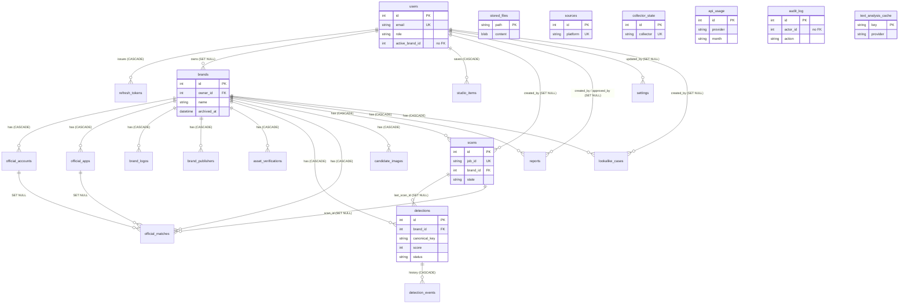

# BrandShield data model

## Plain-language summary

BrandShield keeps everything it knows in a database of 23 tables. Think of them as spreadsheets: one lists the people who can sign in,
one lists the brands each person protects (with their official accounts, apps and logos), one lists every suspected fake that scans
found, and others record who did what (the audit log), scan history, saved reports and Brand Studio items. The structure is changed
over time by numbered "migrations" (0001 to 0012) that are applied with one command. The app works on a simple file database
(SQLite) on a laptop and on PostgreSQL (for example Supabase) in production; uploaded images live either in a folder on disk or inside
the database itself. This page is written from the code (`backend/app/models/*.py`, `backend/alembic/versions/*.py`).

Companion files: `docs/api-reference.md` (endpoints), `docs/DATABASE_SCHEMA.md` and `docs/schema.sql` (auto-generated, older).
Citations are `path:line`. "Python default" means the ORM fills the value when a row is created through the app; "server default"
means the database column itself has a default (only those added with `server_default` in a migration or model).

---

## 1. Overview

* ORM: SQLAlchemy 2 declarative models, all registered through `backend/app/models/__init__.py:1-31`.
* Constraint and index names follow one naming convention (`ix_`, `uq_`, `fk_`, `pk_`) defined at `backend/app/db/base.py:5-11`.
* 23 tables, matching `EXPECTED_TABLES` in `backend/tests/db/test_migration.py:14-18`, plus Alembic's own `alembic_version`.
* Timestamps are `DateTime(timezone=True)`; the Python default is `utcnow()` (`backend/app/config/time.py:7-8`).
* JSON columns use SQLAlchemy `JSON` (JSON on both databases).
* Ownership: users own brands (`brands.owner_id`); everything about a brand cascades from `brands`. Brand Studio items belong
  directly to a user.

### Entity relationship diagram



Tables with **no foreign key** to anything (standalone): `sources`, `collector_state`, `api_usage`, `audit_log`, `text_analysis_cache`,
`stored_files`. Soft references with no FK on purpose: `users.active_brand_id` (`backend/alembic/versions/0012_active_brand.py:5-6`),
`audit_log.actor_id` ("log outlives users", `ops.py:136`), `asset_verifications.verified_by_id` (`brand.py:130`),
`detection_events.actor_id`, `candidate_images.created_by`, `collector_state.cache_brand_id`.

---

## 2. Tables

Notation: **NN** = NOT NULL, **null** = nullable. Types are SQLAlchemy types; `String(n)` is VARCHAR(n). All `id` columns are
`Integer` primary keys. File and line references point at the model class.

### 2.1 Accounts (`backend/app/models/user.py`)

#### `users` (`user.py:10-21`)

| Column | Type | Null | Default | Notes |
|---|---|---|---|---|
| id | Integer | NN | auto | PK |
| name | String(120) | NN | | |
| email | String(254) | NN | | unique + indexed (`ix_users_email`), stored lower-case |
| password_hash | String(100) | NN | | bcrypt |
| role | String(20) | NN | `"viewer"` (Python) | `admin` / `analyst` / `viewer` |
| active | Boolean | NN | `True` (Python) | inactive users cannot sign in |
| created_at | DateTime(tz) | NN | `utcnow` | |
| active_brand_id | Integer | null | | the brand the account is working on; no FK, re-validated on every read (`backend/app/api/common.py:30-40`); added by migration 0012 |

Self-service sign-up creates role `analyst` (`backend/app/api/auth.py:114`).

#### `refresh_tokens` (`user.py:24-34`)

| Column | Type | Null | Default | Notes |
|---|---|---|---|---|
| id | Integer | NN | auto | PK |
| jti | String(64) | NN | | unique + indexed |
| user_id | Integer | NN | | FK `users.id` ON DELETE CASCADE, indexed |
| expires_at | DateTime(tz) | NN | | |
| revoked_at | DateTime(tz) | null | | set on rotation or logout |
| created_at | DateTime(tz) | NN | `utcnow` | |

### 2.2 Brand registry (`backend/app/models/brand.py`)

#### `brands` (`brand.py:10-40`)

| Column | Type | Null | Default | Notes |
|---|---|---|---|---|
| id | Integer | NN | auto | PK |
| owner_id | Integer | null | | FK `users.id` ON DELETE SET NULL, indexed (`ix_brands_owner_id`); migration 0010 |
| name | String(120) | NN | | |
| industry | String(120) | NN | `""` | |
| aliases | JSON | NN | `[]` | list of strings |
| keywords | JSON | NN | `[]` | |
| domains | JSON | NN | `[]` | normalised domains |
| logo_path | String(300) | null | | relative path in the file store |
| logo_format | String(10) | null | | `png`/`jpg`/`webp` |
| logo_width, logo_height, logo_size_bytes | Integer | null | | |
| logo_sha256 | String(64) | null | | |
| description | Text | null | | brand's own public description (migration 0006) |
| archived_at | DateTime(tz) | null | | soft delete; nothing is erased (migration 0006) |
| source | String(10) | NN | `"live"` | `live` / `sample` |
| created_at | DateTime(tz) | NN | `utcnow` | |
| updated_at | DateTime(tz) | NN | `utcnow`, on update `utcnow` | |

Relationships (all `cascade="all, delete-orphan"`): `accounts`, `apps`, `logos`, `publishers`, `verifications` (`brand.py:36-40`).

#### `official_accounts` (`brand.py:43-59`)

Columns: `id`, `brand_id` (FK `brands.id` CASCADE, indexed, NN), `platform` String(20) NN, `handle` String(100) NN (bare handle, no `@`),
`handle_key` String(100) NN (lower-case duplicate key), `url` String(300) NN, `status` String(20) NN default `"unreachable"`
(`verified` / `unreachable`), `check_message` String(300) null, `last_checked_at` DateTime(tz) null, `source` String(10) NN default `"live"`,
`created_at` DateTime(tz) NN default `utcnow`.
Constraint: `UNIQUE (brand_id, platform, handle_key)` (`uq_official_accounts_brand_id`). Handle columns were widened from 30 to 100 by 0008.

#### `official_apps` (`brand.py:62-78`)

Columns: `id`, `brand_id` (FK CASCADE, indexed), `name` String(120), `package_id` String(155), `package_key` String(155) (lower-case),
`publisher` String(120), `store_id` String(20) null (numeric App Store id; migration 0005), `stores` JSON NN default `[]`, `status` String(20)
NN default `"verified"`, `source` String(10) default `"live"`, `created_at`.
Constraint: `UNIQUE (brand_id, package_key)`.

#### `brand_logos` (`brand.py:81-97`) - extra official logos (the first stays on `brands.logo_*`)

Columns: `id`, `brand_id` (FK CASCADE, indexed), `label` String(120) default `""`, `path` String(300), `format` String(10), `width`, `height`,
`size_bytes` (Integer, NN), `sha256` String(64), `created_at`. Constraint: `UNIQUE (brand_id, sha256)`. At most 10 per brand is
enforced by the API (`backend/app/api/brands.py:460-462`), not by the database.

#### `brand_publishers` (`brand.py:100-112`)

Columns: `id`, `brand_id` (FK CASCADE, indexed), `store` String(20) (`google_play`/`app_store`/`any`), `name` String(120) default `""`,
`publisher_id` String(120) null, `publisher_key` String(120) (lower-case id, or name when no id), `created_at`.
Constraint: `UNIQUE (brand_id, store, publisher_key)`.

#### `asset_verifications` (`brand.py:115-131`)

Columns: `id`, `brand_id` (FK CASCADE, indexed), `asset_type` String(12) (`domain|account|app|publisher|logo`), `asset_key` String(300),
`status` String(12) default `"unverified"`, `method` String(40) null, `note` String(300) default `""`, `verified_at` DateTime(tz) null,
`verified_by_id` Integer null (no FK), `verified_by` String(120) null.
Constraint: `UNIQUE (brand_id, asset_type, asset_key)`. This is a person's attestation; the app does not check DNS or stores itself (`brand.py:116-117`).

### 2.3 Detections (`backend/app/models/detection.py`)

#### `detections` (`detection.py:10-53`)

| Column | Type | Null | Default | Notes |
|---|---|---|---|---|
| id | Integer | NN | auto | PK |
| brand_id | Integer | NN | | FK `brands.id` CASCADE, indexed |
| type | String(20) | NN | | `fake_profile`, `fake_brand_page`, `scam_account`, `fake_app`, `lookalike_domain` |
| category | String(10) | NN | | `social` / `apps` / `web` |
| platform | String(20) | NN | | indexed |
| name | String(200) | NN | `""` | |
| handle, package_id, publisher | String(200) | null | | |
| profile_url | String(500) | null | | |
| score | Integer | NN | | 0-100 |
| band | String(10) | NN | | `high` / `medium` / `low` |
| severity | String(10) | NN | `"LOW"` Python and **server default** | `LOW`/`MEDIUM`/`HIGH`/`CRITICAL`; migration 0005 |
| algorithm_version | String(10) | null | | `"1.0"` social/app, `"2.0"` web |
| scored_at | DateTime(tz) | null | | |
| status | String(20) | NN | `"new"` | indexed; `new`, `reviewing`, `confirmed`, `dismissed`, `marked_official`, `cleared` |
| resolution | String(20) | null | | `true_positive`, `false_positive`, `resolved`, `monitoring` (migration 0007) |
| canonical_key | String(400) | NN | `""` | `<platform>:<lower-case handle or package or url>` |
| first_seen_at, last_seen_at | DateTime(tz) | null | | |
| last_scan_id | Integer | null | | FK `scans.id` ON DELETE SET NULL |
| score_history | JSON | NN | `[]` | `[{at, score, scan_id}]` |
| notes | JSON | NN | `[]` | `[{at, actor, text, kind}]` |
| reasons | JSON | NN | `[]` | `[{signal, detail, points}]` |
| evidence | JSON | NN | `{}` | `{page_url, captured_at, sha256, snapshot_path, screenshot_path}` |
| details | JSON | NN | `{}` | per-type extras |
| stale | Boolean | NN | `False` | |
| source | String(10) | NN | `"live"` | `live` / `sample` |
| origin | String(12) | NN | `"scan"` Python and **server default** | `scan`, `manual`, `import`, `synthetic`; migration 0006 |
| found_at, created_at | DateTime(tz) | NN | `utcnow` | |
| updated_at | DateTime(tz) | NN | `utcnow`, on update | |

Constraint: `UNIQUE (brand_id, canonical_key)` (`uq_detections_brand_id`, migration 0003) - this is what lets a re-scan update rather
than duplicate. Indexes: `ix_detections_brand_id`, `ix_detections_platform`, `ix_detections_status`.

#### `official_matches` (`detection.py:56-81`) - items skipped because they matched the allowlist

Columns: `id`, `brand_id` (FK CASCADE, indexed), `scan_id` (FK `scans.id` SET NULL, null), `kind` String(10) (`account`/`app`), `platform`
String(20) null, `label` String(300), `reason` String(40) (`exact_handle|exact_url|package_id|apple_id|bundle_id|marked_official`),
`matched_rule` String(300) default `""`, `match_key` String(400) default `""` (`<kind>:<platform>:<key>`), `url` String(500) null,
`last_seen_at` null, `times_seen` Integer default 1, `official_account_id` (FK `official_accounts.id` SET NULL, null),
`official_app_id` (FK `official_apps.id` SET NULL, null), `source` String(10) default `"live"`, `created_at`.
Constraint: `UNIQUE (brand_id, match_key)`.

#### `detection_events` (`detection.py:84-97`) - append-only history of one detection

Columns: `id`, `detection_id` (FK `detections.id` CASCADE, indexed), `at` DateTime(tz) default `utcnow`, `actor` String(120) default
`"system"`, `actor_id` Integer null (no FK), `kind` String(20) default `"status"` (`status|scan|note|evidence`), `from_status` String(20) null,
`to_status` String(20) null, `note` Text default `""`.

#### `candidate_images` (`detection.py:100-118`)

Columns: `id`, `brand_id` (FK CASCADE, indexed), `purpose` String(20) default `"candidate_image"` (`candidate_image|app_icon`), `path`
String(300), `format` String(10), `width`, `height`, `size_bytes`, `sha256` String(64), `hashes` JSON default `{}`
(`{phash, dhash, whash, colorhash}`), `created_by` Integer null (no FK), `created_at`.
Constraint: `UNIQUE (brand_id, sha256)`.

### 2.4 Operations (`backend/app/models/ops.py`)

#### `sources` (`ops.py:10-25`) - one row per monitored platform

Columns: `id`, `platform` String(20) NN **unique**, `name` String(80), `kind` String(10) (`social`/`store`), `description` String(200) default `""`,
`status` String(15) default `"online"` (`online|slow|unavailable`), `monitored` Boolean default `True`, `message` String(300) default `""`,
`detail` String(200) default `""`, `last_sync` DateTime(tz) null, `retry_in_minutes` Integer null, `stale_since` DateTime(tz) null,
`source` String(10) default `"live"`.

#### `collector_state` (`ops.py:28-46`) - health, back-off and last good result per collector (migration 0002)

Columns: `id`, `collector` String(40) **unique**, `status` String(15) default `"online"`, `reason` String(40) null, `message` String(400)
default `""`, `latency_ms` Integer null, `last_attempt_at`, `last_success_at` (DateTime(tz) null), `consecutive_failures` Integer default 0,
`next_retry_at` null, `cache_brand_id` Integer null (no FK), `cache` JSON null (last good normalised candidates), `cached_at` null,
`source` String(10) default `"live"`.

#### `scans` (`ops.py:53-79`)

| Column | Type | Null | Default | Notes |
|---|---|---|---|---|
| id | Integer | NN | auto | PK |
| job_id | String(40) | NN | | unique |
| brand_id | Integer | NN | | FK `brands.id` CASCADE, indexed |
| scope | String(10) | NN | `"all"` | `all|social|apps` |
| state | String(10) | NN | `"queued"` | `queued|running|completed|partial|failed` (API also exposes `done|error`) |
| progress | Integer | NN | 0 | |
| message | String(300) | NN | `""` | |
| steps | JSON | NN | `[]` | |
| result | JSON | null | | |
| data_mode | String(10) | NN | `"live"` | |
| created_by | Integer | null | | FK `users.id` SET NULL |
| started_by | String(120) | NN | `"scheduler"` (Python and server default) | user name or `scheduler` |
| counts, timings | JSON | NN | `{}` | server defaults `{}` (0003) |
| source_report, errors | JSON | NN | `[]` | server defaults `[]` |
| started_at, finished_at | DateTime(tz) | null | | |
| created_at | DateTime(tz) | NN | `utcnow` | |

Partial unique index `uq_scans_one_active_per_brand` on `(brand_id)` WHERE `state IN ('queued','running')` (`ops.py:49, 55-58`; migration 0004):
the database itself guarantees one active scan per brand, on both SQLite and PostgreSQL.

#### `settings` (`ops.py:82-91`) - org-level key/value

Columns: `id`, `key` String(80) **unique**, `value` JSON null, `updated_at` DateTime(tz) default/on update `utcnow`, `updated_by` Integer null
(FK `users.id` SET NULL). Keys seen in code include `monitoring`, `notifications`, `text_provider`
(`backend/app/core/pipeline/text_analysis.py:28`) and the data-mode setting (`backend/app/services/data_mode.py`).

#### `reports` (`ops.py:94-113`)

Columns: `id`, `brand_id` (FK CASCADE, indexed), `filename` String(200), `format` String(5) (`csv|html`), `title` String(200) default
`"Brand Protection Report"`, `status` String(10) default `"draft"` (`draft|approved`), `detection_ids` JSON default `[]`, `snapshot` JSON
default `[]` (rows frozen at creation), `approved_by` (FK `users.id` SET NULL, null), `approved_at` null, `size_bytes` Integer default 0,
`params` JSON default `{}`, `file_path` String(300) null, `includes_sample` Boolean default `False`, `source` String(10) default `"live"`,
`created_by` (FK `users.id` SET NULL, null), `created_at`.

**Needs confirmation:** `reports.file_path` is never read or written by `backend/app/api/reports.py` or `backend/app/services/reports.py`
(reports are rendered on demand from `snapshot`); it appears to be an unused column kept from migration 0001.

#### `api_usage` (`ops.py:116-126`) - credit / quota counters

Columns: `id`, `provider` String(60), `month` String(7) (`YYYY-MM`), `credits` BigInteger default 0, `updated_at`.
Constraint: `UNIQUE (provider, month)`. Used for the monthly Tavily credit ledger (`backend/app/core/collectors/credits.py`) and, with keys
like `studio:text:u<user>:<YYYYMMDD>`, for Studio AI daily quotas (`backend/app/services/studio_ai.py:283`).

#### `audit_log` (`ops.py:129-141`) - append-only

Columns: `id`, `ts` DateTime(tz) default `utcnow`, indexed (`ix_audit_log_ts`), `actor_id` Integer null (no FK), `actor` String(120) default
`"system"`, `action` String(60) indexed (`ix_audit_log_action`), `target` String(300) default `""`, `detail` Text default `""`, `source` String(10)
default `"live"`.

#### `lookalike_cases` (`ops.py:144-160`)

Columns: `id`, `brand_id` Integer null (FK `brands.id` CASCADE, indexed; migration 0010), `name` String(200), `expected` String(15)
(`flagged|not_flagged|official`), `builtin` Boolean default `False`, `source` String(10) default `"live"`, `created_by` (FK `users.id` SET NULL, null), `created_at`.
Partial unique index `uq_lookalike_cases_builtin_name` on `(brand_id, name)` WHERE `builtin` (`ops.py:50, 149-151`): built-in cases are seeded once per brand.

#### `text_analysis_cache` (`ops.py:163-171`)

Columns: `key` String(64) **PK** (hash of model + prompt version + context + text), `provider` String(20), `value` JSON default `{}`, `created_at`.

#### `stored_files` (`ops.py:174-184`) - file content in the database

Columns: `path` String(300) **PK** (same relative path the local store would use), `content` LargeBinary NN, `content_type` String(100) default
`"application/octet-stream"`, `size_bytes` Integer default 0, `created_at`.

### 2.5 Brand Studio (`backend/app/models/studio.py`)

#### `studio_items` (`studio.py:11-22`)

| Column | Type | Null | Default | Notes |
|---|---|---|---|---|
| id | Integer | NN | auto | PK |
| user_id | Integer | NN | | FK `users.id` CASCADE, indexed (`ix_studio_items_user_id`) |
| type | String(20) | NN | | one of `STUDIO_TYPES = logo, palette, brand_name, content, audit, sentiment` (`studio.py:9`); enforced by the API, not by a CHECK constraint |
| label | String(200) | NN | `""` | |
| data | JSON | null | | up to 64 KB, API-enforced (`backend/app/api/studio.py:32`) |
| image_path | String(300) | null | | relative file-store path `studio/user_<id>/<sha>.<ext>` (`studio.py:94`) |
| created_at | DateTime(tz) | NN | `utcnow` | |

---

## 3. Constraint and index summary

| Kind | Name / columns | Table | Where defined |
|---|---|---|---|
| unique | `users.email` (`ix_users_email`) | users | `user.py:15` |
| unique | `refresh_tokens.jti` | refresh_tokens | `user.py:30` |
| unique | `(brand_id, platform, handle_key)` | official_accounts | `brand.py:45` |
| unique | `(brand_id, package_key)` | official_apps | `brand.py:64` |
| unique | `(brand_id, sha256)` | brand_logos, candidate_images | `brand.py:86`, `detection.py:105` |
| unique | `(brand_id, store, publisher_key)` | brand_publishers | `brand.py:104` |
| unique | `(brand_id, asset_type, asset_key)` | asset_verifications | `brand.py:120` |
| unique | `(brand_id, canonical_key)` | detections | `detection.py:14` |
| unique | `(brand_id, match_key)` | official_matches | `detection.py:60` |
| unique | `platform` / `collector` / `key` / `job_id` | sources / collector_state / settings / scans | `ops.py:14, 34, 88, 61` |
| unique | `(provider, month)` | api_usage | `ops.py:121` |
| partial unique | `uq_scans_one_active_per_brand` | scans | `ops.py:56-58` |
| partial unique | `uq_lookalike_cases_builtin_name` | lookalike_cases | `ops.py:149-151` |
| index | `brand_id` on every brand child table; `owner_id`; `user_id` (refresh_tokens, studio_items); `detection_id` | various | each model |
| index | `detections.platform`, `detections.status` | detections | `detection.py:20, 33` |
| index | `audit_log.ts`, `audit_log.action` | audit_log | `ops.py:135, 138` |

Foreign-key delete behaviour: deleting a brand cascades to all its child rows; deleting a user cascades to `refresh_tokens` and
`studio_items` but only nulls `brands.owner_id`, `scans.created_by`, `reports.created_by/approved_by`, `settings.updated_by`,
`lookalike_cases.created_by`. In practice brands are soft-deleted (`archived_at`), never erased (`backend/app/api/brands.py:419-430`).

---

## 4. Migration history (Alembic, `backend/alembic/versions/`)

Linear chain, each file's `down_revision` is the previous number. `render_as_batch=True` is set in `backend/alembic/env.py:16, 25, 29` so
column changes work on SQLite.

| Rev | File | Date (file header) | What it does |
|---|---|---|---|
| 0001 | `0001_initial_schema.py` | 2026-10-13 | Creates the first 13 tables: `api_usage`, `audit_log`, `brands`, `sources`, `users`, `detections`, `official_accounts`, `official_apps`, `refresh_tokens`, `reports`, `scans`, `settings`, `official_matches`, with FKs, unique constraints and indexes |
| 0002 | `0002_collector_state.py` | 2026-10-13 | Adds `collector_state` (collector health, back-off, cached last good result) |
| 0003 | `0003_scan_pipeline.py` | 2026-10-13 | Scan reports (`started_by`, `counts`, `source_report`, `timings`, `errors`) and maps old scan states `done`->`completed`, `error`->`failed`; detection `canonical_key`, `first_seen_at`, `last_seen_at`, `last_scan_id`, `score_history`, `notes` + `UNIQUE(brand_id, canonical_key)` (existing rows get `legacy:<id>`); new `detection_events`; `official_matches` match keys (`matched_rule`, `match_key`, `url`, `last_seen_at`, `times_seen`) + unique; report draft fields (`title`, `status`, `detection_ids`, `snapshot`, `approved_by`, `approved_at`); new `lookalike_cases` |
| 0004 | `0004_integrity_indexes.py` | 2026-10-13 | Partial unique indexes: one queued/running scan per brand; built-in look-alike cases seeded once. First cleans duplicates (fails older active scans, deletes duplicate built-in cases) |
| 0005 | `0005_risk_engine_and_web.py` | 2026-10-14 | `detections.severity` (server default `LOW`), `algorithm_version`, `scored_at` with back-fill from score (85/70/40 cut-offs, version `1.0`); `official_apps.store_id` |
| 0006 | `0006_registry_v2_and_providers.py` | 2026-10-14 | `brands.description`, `brands.archived_at`; `detections.origin` (sample rows back-filled `synthetic`); new `brand_logos`, `brand_publishers`, `asset_verifications`, `candidate_images`, `text_analysis_cache` |
| 0007 | `0007_resolution.py` | 2026-10-15 | `detections.resolution` (nullable) |
| 0008 | `0008_wider_account_handles.py` | 2026-10-15 | `official_accounts.handle` / `handle_key` from 30 to 100 chars (matters on PostgreSQL only, SQLite ignores VARCHAR length) |
| 0009 | `0009_stored_files.py` | 2026-10-16 | New `stored_files`; on PostgreSQL also `ENABLE ROW LEVEL SECURITY` with no policy |
| 0010 | `0010_brand_owner.py` | 2026-10-17 | `brands.owner_id` (FK users SET NULL, indexed) and `lookalike_cases.brand_id` (FK brands CASCADE, indexed); existing brands go to the lowest-id admin, existing cases to the first brand; built-in unique index becomes `(brand_id, name)`. On SQLite, foreign keys are switched off around the `brands` rebuild so it does not cascade-delete children (`0010_brand_owner.py:30-37`) |
| 0011 | `0011_studio_items.py` | 2026-10-17 | New `studio_items`; on PostgreSQL `ENABLE ROW LEVEL SECURITY` with no policy |
| 0012 | `0012_active_brand.py` | 2026-10-20 | `users.active_brand_id` (nullable, no FK) - backs `POST /api/brands/{id}/select` |

Every migration has a working `downgrade()` (0010's downgrade de-duplicates built-in cases first so the older single-column unique
index can return, `0010_brand_owner.py:55-79`). `alembic_version` holds the current revision; the health check reads it (`backend/app/services/health.py:66`, `check_migration`).

### How to run migrations

Run from `backend/`:

```bash
alembic upgrade head                 # apply everything
alembic current                      # show the applied revision
alembic downgrade -1                 # undo the last one
python -m scripts.migrate            # same as upgrade head, plus a Postgres advisory lock (safe with many replicas)
```

* `alembic.ini` points `script_location` at `alembic` (`backend/alembic.ini:2`). `env.py` takes the URL from `sqlalchemy.url` if set, else
  from `DatabaseSettings().migration_url` (`backend/alembic/env.py:11-12`). That reads only `MIGRATION_DATABASE_URL` or `DATABASE_URL`, so no
  `JWT_SECRET` etc. is needed to migrate (`backend/app/config/config.py:210-222`).
* **`MIGRATION_DATABASE_URL`** (optional): a session-mode or direct connection (port 5432) used only by Alembic and `scripts/migrate.py`
  (`config.py:35-37`). Use it with Supabase: set `DATABASE_URL` to the **transaction pooler** (port 6543) for the running app, and
  `MIGRATION_DATABASE_URL` to the session/direct URL (5432) for schema changes, because DDL and advisory locks need a session-level connection. When it is
  unset, migrations use `DATABASE_URL`. (Never put real URLs or passwords in docs or commits.)
* On port 6543 the engine disables server-side prepared statements (`prepare_threshold=None`, `backend/app/db/session.py:30-31`).
* `scripts/migrate.py` takes `pg_advisory_lock(727274 0001)` on PostgreSQL for the whole upgrade so concurrent starters wait, then find head
  already applied (`backend/scripts/migrate.py:21, 32-42`).
* Docker: the `api` role runs `python -m scripts.migrate` before uvicorn unless `RUN_MIGRATIONS=false`; the `migrate` role runs it once and exits
  (`backend/docker-entrypoint.sh:3-22`).
* If the app starts before migrations ran, seeding is skipped with a warning and `/health` reports the problem (`backend/app/main.py:76-83`).
* Tests check that migrations produce exactly the models' schema (`compare_metadata` in `backend/tests/db/test_migration.py:33-36`) and, on
  PostgreSQL only, inside a throw-away schema when `TEST_DATABASE_URL` is set (`backend/tests/db/test_postgres.py:1-30`).

---

## 5. Row-level security (PostgreSQL)

* Only two tables enable RLS, both with **no policy** (so non-owner roles can read nothing): `stored_files` (migration 0009) and
  `studio_items` (migration 0011). The `ALTER TABLE ... ENABLE ROW LEVEL SECURITY` runs only when the dialect is `postgresql`
  (`0009_stored_files.py:30-31`, `0011_studio_items.py:33-34`).
* Reason, from the migration docstrings: Supabase exposes the `public` schema through its REST API, and the API roles (`anon`, `authenticated`)
  must not be able to read uploaded files or saved Studio items. The backend connects as the table owner / `postgres` role, which is not subject to RLS,
  so the application is unaffected.
* Migration 0010 notes that it adds no new tables, so no new RLS was needed (`0010_brand_owner.py` docstring).
* **Needs confirmation:** no other table (for example `users`, `refresh_tokens`, `audit_log`, `brands`) has RLS enabled by any migration in `backend/alembic/versions/`.
  If the database is on Supabase with the REST API reachable, the project owner should check whether those tables also need RLS or whether the public schema is not exposed.
* Application-level tenant isolation is separate: it is done in code with `owner_id` checks (404 for another account's data), see
  `docs/api-reference.md` section 1.3 and `backend/tests/api/test_tenant_isolation.py`.

---

## 6. SQLite vs PostgreSQL

| Topic | SQLite (default local) | PostgreSQL (production, e.g. Supabase) | Source |
|---|---|---|---|
| Default URL | `sqlite:///.../backend/data/scammind.db` | set `DATABASE_URL` | `config.py:28` |
| Foreign keys | switched on per connection with `PRAGMA foreign_keys=ON` | native | `session.py:36-43` |
| Concurrency | WAL journal mode, 30 s busy timeout, `check_same_thread=False`; in-memory DBs use a `StaticPool` | pooled connections: 5 + 2 overflow (1 + 1 on Vercel), recycle 1800 s (300 on Vercel), TCP keepalives; `pool_pre_ping` only if `DB_PRE_PING` is set | `session.py:10-33` |
| Datetimes | returned **naive**; code treats them as UTC via `as_utc()` | timezone-aware | `config/time.py:11-13` |
| VARCHAR length | not enforced (the 0008 handle-length bug only showed on PostgreSQL) | enforced | `0008_wider_account_handles.py` docstring |
| Schema changes | Alembic batch mode (table rebuild); 0010 turns FKs off during the `brands` rebuild | normal `ALTER TABLE` | `alembic/env.py`, `0010_brand_owner.py:30-37` |
| Partial unique indexes | supported (`sqlite_where`) | supported (`postgresql_where`) | `ops.py:56-58, 149-151` |
| Migration locking | none needed (one process) | advisory lock in `scripts/migrate.py` | `migrate.py:32-42` |
| Row-level security | not applicable | enabled on `stored_files`, `studio_items` | section 5 |
| JSON / binary | `JSON` stored as text; `LargeBinary` as BLOB | `JSON`; `LargeBinary` as BYTEA | models |
| Transaction pooler | n/a | no prepared statements when URL has `:6543/` | `session.py:30-31` |

Date-sensitive code paths use `as_utc` / `iso_z`, and API output always ends with `Z` (`config/time.py:16-20`).

---

## 7. Where files are stored

Uploaded and generated files never go inside normal table columns. Rows keep a **relative path** (`logo_path`, `candidate_images.path`,
`studio_items.image_path`, `detections.evidence.snapshot_path`) and the bytes live in a "file store" chosen by `STORAGE_BACKEND`
(`backend/app/core/storage.py:169-176`, setting at `config.py:34`):

| `STORAGE_BACKEND` | Implementation | Where bytes live | When used |
|---|---|---|---|
| `local` (default) | `LocalFileStore` (`storage.py:55-93`) | files under `DATA_DIR` (default `backend/data`) | laptops, Docker with a volume |
| `database` | `DatabaseFileStore` (`storage.py:96-166`) | rows of the **`stored_files`** table (`path` PK, `content` blob) | serverless (Vercel), where the disk is read-only and not shared; default when `VERCEL` is set (`config.py:185`) |

Any other value raises `ValueError` at start-up (`storage.py:174-175`). Both stores refuse unsafe paths (absolute, `..`, backslashes, NUL,
longer than 300 characters) (`storage.py:45-52`), so a path in the database cannot escape the store.

Path layout (identical in both stores, content-addressed by SHA-256, so uploads de-duplicate):

| Content | Relative path | Written by |
|---|---|---|
| Official brand logos | `logos/brand_<brand_id>/<sha256[:24]>.<png|jpg|webp>` | `backend/app/core/pipeline/logo.py:76-80` |
| Candidate images / app icons | `candidate_images/brand_<brand_id>/<sha256[:24]>.<ext>` | `backend/app/core/pipeline/candidate_images.py:67-70` |
| Evidence snapshots | `evidence/<sha[:2]>/<sha>.json` | `backend/app/core/pipeline/evidence.py:35` |
| Evidence screenshots (off by default) | `evidence/screenshots/<sha[:2]>/<sha>.png` | `evidence.py:42` |
| Brand Studio images | `studio/user_<user_id>/<sha256[:24]>.<ext>` | `backend/app/api/studio.py:94` |

Notes:

* With the `database` backend, `DATA_DIR` is only scratch space; the health check then reports the database store instead of probing the disk
  (`backend/app/services/health.py:120-122`, `backend/app/main.py:72-75`).
* The database store joins the caller's transaction when a session is passed (so a rollback also drops the file row), otherwise it uses its own short
  session (`storage.py:102-125`).
* Reports are **not** stored as files: they are re-rendered from `reports.snapshot` on every download (see `reports.file_path` note in section 2.4).
* Moving from `local` to `database` (or back) does not migrate existing files. **Needs confirmation:** whether a copy script exists; none was found in `backend/scripts/`
  (`canary.py`, `e2e_server.py`, `evaluate.py`, `export_schema.py`, `live_check.py`, `migrate.py`, `seed_test_brand.py`, `studio_ai_check.py`).

---

## 8. Seed data

At start-up the app (inside `lifespan`, `backend/app/main.py:76-83`) seeds, when the tables exist: the real admin from `ADMIN_EMAIL` /
`ADMIN_PASSWORD`, the optional shared demo analyst (`DEMO_EMAIL` / `DEMO_PASSWORD`) and the optional guarded demo administrator
(`DEMO_ADMIN_EMAIL` / `DEMO_ADMIN_PASSWORD`) (`backend/app/services/seed.py`). `sources` rows are created on demand by `ensure_sources`
(`backend/app/core/collectors/orchestrator.py`); built-in look-alike cases are created per brand by `lookalike.ensure_default_cases`
(`backend/app/core/pipeline/lookalike.py:78`). `scripts/export_schema.py` generates `docs/DATABASE_SCHEMA.md` and `docs/schema.sql`.
