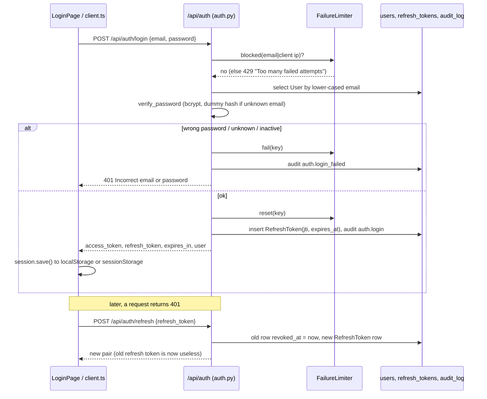
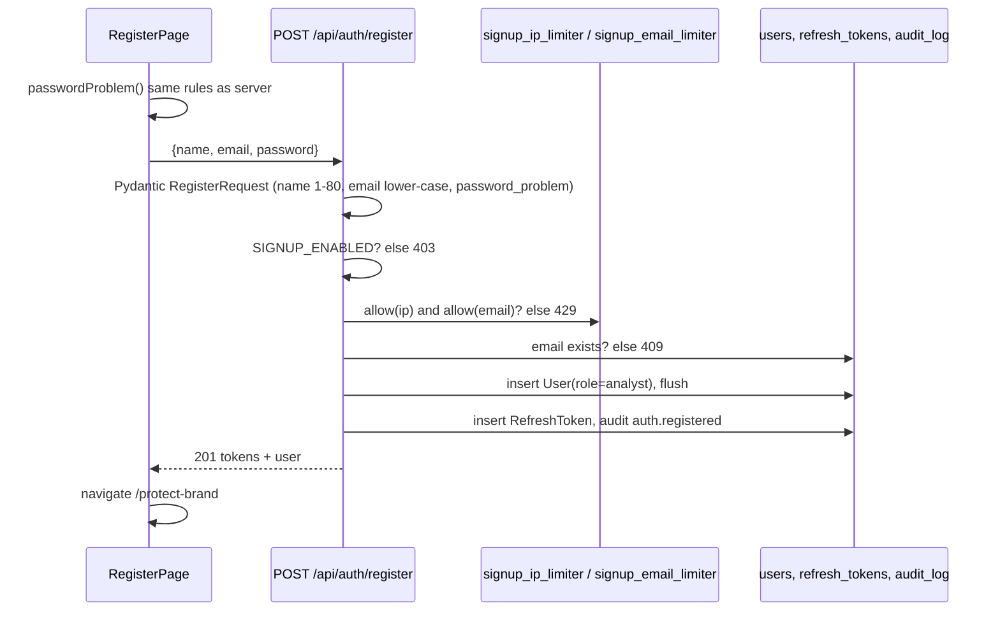
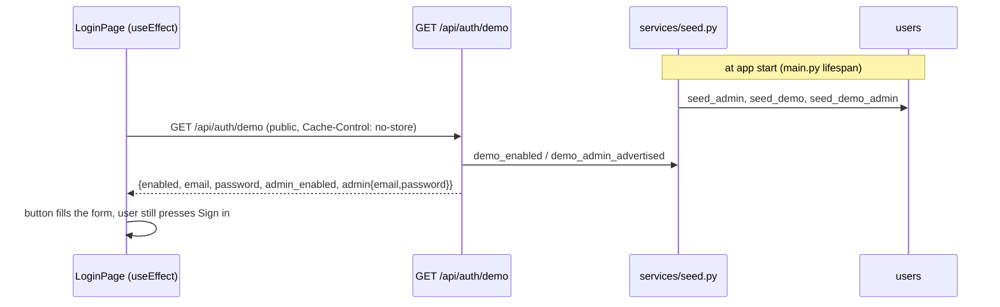

# Authentication and accounts

## Plain-language summary

People sign in with an email and a password. The server hands back a short-lived "access pass" (15 minutes by default) and a longer "renewal pass" (7 days). The browser quietly swaps the renewal pass for a fresh pair whenever the access pass runs out, so users are not thrown out mid-work. Anyone can create their own account on the Register page; it becomes an `analyst` that owns its own brand workspace. The login page can also show two shared demo buttons: a normal demo analyst and a demo administrator whose dangerous powers are switched off. There are three roles: `viewer` (read only), `analyst` (can work with detections, brands, scans) and `admin` (also settings, sources, evaluation).

Everything below is real code; there is no mock authentication. The demo accounts are real database users created from environment variables, but they are a convenience for demos, not a different code path.

## Purpose and user-facing behaviour

| Screen / action | What the user sees | Code |
|---|---|---|
| `/login` | Email, password, "Keep me signed in" checkbox, "Use demo credentials" / "Use admin demo credentials" buttons (only when the server advertises them), link to Register. | `frontend/src/pages/LoginPage.tsx:12`, `:188-229` |
| "Forgot password?" | Only shows an `alert()` saying reset by email is not available. | `frontend/src/pages/LoginPage.tsx:154-160` |
| `/register` | Name, email, password, confirm, live password checklist. Signs the user in at once and goes to `/protect-brand`. | `frontend/src/pages/RegisterPage.tsx:15-75` |
| Sign out (header menu) | Revokes the refresh token on the server, clears local storage, goes to `/login`. | `frontend/src/components/layout/Header.tsx:32-38`, `frontend/src/api/auth.ts:27-35` |
| Admin-only menu items | Source Health, Settings and Model Evaluation are hidden for non-admins. | `frontend/src/components/layout/Sidebar.tsx:33`, `:124`, `:143`, `:171` |

**Needs confirmation:** `frontend/src/api/auth.ts:41-46` defines `forgot()` and `reset()` that call `POST /api/auth/forgot` and `POST /api/auth/reset`, but no such backend route exists (searched `backend/app`). They look unused (the Forgot password button only shows an alert). Confirm they can be deleted.

## Roles

| Role | Set how | May do | Enforced by |
|---|---|---|---|
| `viewer` | Default value of the column (`backend/app/models/user.py:17`); no self-service path creates one | `GET` endpoints only. Cannot read the audit log. | `require_writer` rejects with 403 (`backend/app/config/deps.py:46-52`) |
| `analyst` | Every self-registered account (`backend/app/api/auth.py:114`); the demo analyst (`backend/app/services/seed.py:44`) | Everything writer-level: scans, reviews, brand edits, reports, source monitoring toggle and retry | `require_writer = require_roles("admin", "analyst")` (`backend/app/config/deps.py:56`) |
| `admin` | Seeded from `ADMIN_EMAIL`/`ADMIN_PASSWORD` (`seed.py:14-24`) and the demo admin (`seed.py:71-97`) | Writer powers plus settings, data mode, provider choice, archive/restore a brand, Look-alike Lab cases, health details, canary | `require_admin = require_roles("admin")` (`backend/app/config/deps.py:57`) |

Admin-only endpoints (from `Depends(require_admin)`): `PUT /api/settings` (`backend/app/api/settings.py:132`), `PUT /api/settings/data-mode` (`backend/app/api/sources.py:243`), `PUT /api/providers/active` (`backend/app/api/providers.py:51`), `DELETE /api/brands/{id}` archive and `POST .../restore` (`backend/app/api/brands.py:421`, `:434`), look-alike cases add/delete (`backend/app/api/lookalike.py:134`, `:148`), `GET /api/health/details` and canary (`backend/app/api/health.py:37`, `:44`).

## Step-by-step flows

### Login and token rotation

1. `POST /api/auth/login` (`backend/app/api/auth.py:56`). The limiter key is `"<email>|<client ip>"` (`:65`). After `LOGIN_MAX_FAILURES` (5) failures inside `LOGIN_WINDOW_SECONDS` (900) the answer is 429 (`:66-67`; defaults at `backend/app/config/config.py:53-54`). The limiter is an in-memory sliding window per process (`backend/app/config/ratelimit.py:6-32`).
2. Timing equalisation: an unknown email is checked against `_DUMMY_HASH` so that response time does not reveal which emails exist (`auth.py:26`, `:69`).
3. A wrong password, an unknown email and an inactive user all give the same 401 text (`:70-74`) and an audit row `auth.login_failed` with `actor_label=email`.
4. Success issues tokens via `_issue` (`:39-53`): a JWT access token (`typ=access`, `ACCESS_TOKEN_MINUTES`=15) and a JWT refresh token (`typ=refresh`, `REFRESH_TOKEN_DAYS`=7). Each carries `sub`, `typ`, `iat`, `exp`, `jti` (`backend/app/config/security.py:26-35`), algorithm `JWT_ALGORITHM` (HS256) signed with `JWT_SECRET` (min length 16, `config.py:40`). The refresh token's `jti` is stored in `refresh_tokens` (`backend/app/models/user.py:24-34`).
5. `POST /api/auth/refresh` (`auth.py:148-156`) validates the token (`_active_refresh_row`, `:127-145`), marks the old row `revoked_at`, issues a new pair. **Reuse detection:** presenting an already-revoked refresh token revokes every refresh token of that user (`:136-141`) and returns 401. That is treated as a stolen token.
6. `POST /api/auth/logout` (`:159-170`) revokes the presented refresh token and writes `auth.logout`; an already-invalid token returns `ok` anyway.
7. Passwords: bcrypt with 12 rounds (`security.py:11`), input cut at 72 bytes (`:12`, `:16`). `LoginRequest` rejects passwords over 72 bytes (`backend/app/schemas/auth.py:10-15`).

### Browser session handling (`frontend/src/api/client.ts`)

- Tokens live under the single key `scammind.auth`, user under `scammind.user` (`client.ts:59-60`). "Keep me signed in" ticked means `localStorage`; unticked means `sessionStorage` (tab only) (`:89-98`, `LoginPage.tsx:18`).
- Every request adds `Authorization: Bearer <access>` unless `anonymous` (`client.ts:297-307`).
- On a 401 the client refreshes once, single-flight, under a Web Lock named `scammind-refresh` shared across tabs and with Brand Studio (`:227-269`), then retries the original request once (`:310-348`). A 4xx on refresh clears the session and fires `scammind:unauthorized`; a network error or 5xx keeps the session (`:254-263`).
- `session.clear()` also clears the query cache so the next user never sees the previous user's pages (`:121-126`).

### Register (self-service)

- Endpoint `backend/app/api/auth.py:99-124`. Disabled with `SIGNUP_ENABLED=false` gives 403 "Sign-up is disabled" (`:107-108`).
- Rate limits: `SIGNUP_MAX_PER_IP_PER_HOUR` (5) and `SIGNUP_MAX_PER_EMAIL_PER_HOUR` (3), one-hour in-memory windows (`config.py:58-59`, `backend/app/main.py:100-101`). Both are counted by `allow()`, so each attempt, successful or not, uses a slot. A limit of 0 disables the check (`backend/app/config/ratelimit.py:46-48`).
- Validation (`backend/app/schemas/auth.py:45-71`): name cleaned of non-printable characters and 1-80 chars long; email lower-cased, at most 254; password through `password_problem` (`:30-42`): at least 10 characters, at most 72 bytes, not on the trivial list (`TRIVIAL_PASSWORDS`, `:19-26`), not all digits, at least 5 distinct characters, not equal to name, email or the email local part (or the local part doubled when it is 6+ chars).
- The frontend mirrors these rules in `frontend/src/utils/passwordPolicy.ts:24-54` (the server stays the authority) and maps statuses 403 / 409 / 422 / 429 to messages (`RegisterPage.tsx:56-71`).
- Duplicate email: pre-check (`auth.py:112-113`) plus `IntegrityError` catch for simultaneous sign-ups (`:116-120`), both 409.
- There is no email verification (`auth.py:106` docstring; `docs/DECISIONS.md`). A new account has no brand yet; the next screen `/protect-brand` creates the first one (see `docs/features/brand-registry.md`).

### `/api/me`

`GET /api/me` and `GET /api/auth/me` return `UserOut`: `id, name, email, role, active, default_brand_id` (`auth.py:173-176`, `schemas/auth.py:78-85`). `default_brand_id` is the account's current brand from `own_brand()` (`auth.py:29-36`). The frontend `useMe` shows the stored copy first, then confirms with the server and exposes `isAdmin` and `canWrite` (`frontend/src/hooks/useMe.ts:15-34`).

### Route guards in the SPA

| Guard | Behaviour | Code |
|---|---|---|
| `RequireAuth` | No stored token: redirect to `/login` (remembering `from`). Also listens for `scammind:unauthorized` to reset the brand cache and go to `/login`. Mounts the voice assistant button once above all signed-in routes. | `frontend/src/App.tsx:56-78` |
| `RequireAdmin` | Uses the role saved at sign-in; if missing, asks `GET /api/me` once. Non-admin gets `<Navigate to="/dashboard">`. Wraps `/sources`, `/settings`, `/evaluation`. | `App.tsx:39-54`, `:174-179` |
| `Home` at `/` | Signed in: go to `/dashboard`; else the landing page. | `App.tsx:29-36` |

These guards are a convenience only. The real protection is the server-side `require_admin` / `require_writer` listed above.

## Demo analyst and guarded demo administrator

- **Seeding** happens in the app lifespan: `seed_admin`, `seed_demo`, `seed_demo_admin` (`backend/app/main.py:76-80`). If the database is not migrated yet the seed is skipped with a warning (`:81-83`).
- **Real admin** is created only if absent and a password is never overwritten (`seed.py:14-24`).
- **Demo analyst** (`DEMO_EMAIL`, `DEMO_PASSWORD`): advertised only when both are set and the email differs from `ADMIN_EMAIL` (`seed.py:27-31`). The account is created as `Demo User`, role `analyst` (`:44`). A changed `DEMO_PASSWORD` is re-applied at next start, an inactive account is re-activated (`:51-59`), and an existing account with another role is left untouched (`:48-50`).
- **Demo administrator** (`DEMO_ADMIN_EMAIL`, `DEMO_ADMIN_PASSWORD`): enabled only when the email differs from both the real admin's and the demo analyst's (`seed.py:63-68`). Created as `Demo Admin`, role `admin` (`:81`); a non-admin account with that email is never promoted (`:85-87`). It is advertised only if the stored account really is an active admin with that password (`demo_admin_advertised`, `:100-105`).
- **`GET /api/auth/demo`** (`auth.py:82-96`) is deliberately public: it returns the demo credentials when enabled, `{"enabled": false}` otherwise, plus `admin_enabled` and `admin`. The real admin is never advertised. Because the password of a shared demo account is public by design, never put real data in the demo accounts.
- The login page also supports local build-time `VITE_DEMO_EMAIL` / `VITE_DEMO_PASSWORD` (`LoginPage.tsx:22-23`, `:38-39`); the server value wins.

### What the demo administrator cannot do

The demo admin is recognised by email (`is_demo_admin`, `seed.py:108-110`). `forbid_demo_admin` raises 403 `Disabled for the shared demo administrator: <what>` (`seed.py:113-116`).

| Guard | Rule | Code |
|---|---|---|
| Data mode | Only `sample` may be chosen; `live` and `auto` are refused (they spend search credits and change the demo for everyone). Applies to both `PUT /api/settings/data-mode` and `PUT /api/settings` with `data_mode`. | `backend/app/api/sources.py:246-247`; `backend/app/api/settings.py:136-137` |
| AI provider | `PUT /api/providers/active` is refused entirely. | `backend/app/api/providers.py:53` |
| Webhook | Setting a non-empty `notifications.webhook_url` is refused; an empty value from its form is silently skipped so it cannot clear the real URL; the stored URL is never shown back to it. | `settings.py:138-139`, `:171-172`, `:118` |
| Audit log | Sees only rows it created itself (`own_only`), both in the list and the CSV export. The real admin sees every row. | `backend/app/api/audit.py:36-40`, `:64`, `:80` |

Other admin actions (monitoring schedule, sensitivity, rules, impersonation words, source toggles) are allowed for the demo admin. **Needs confirmation:** `POST /api/sources/{id}/retry` (`sources.py:179`) has no demo-admin guard; it is a writer endpoint, and credits are only spent after `confirm=true` when Tavily is active. Confirm that this is acceptable for the shared demo (the login page note at `LoginPage.tsx:225-229` does not mention it).

## Files, tables, services

| Item | Path |
|---|---|
| Auth routes | `backend/app/api/auth.py` |
| Token and password helpers | `backend/app/config/security.py` |
| Current-user dependency, role checks | `backend/app/config/deps.py:28-57` (`get_current_user`, `require_roles`) |
| Limiters | `backend/app/config/ratelimit.py` (`FailureLimiter`, `RequestLimiter`), wired in `backend/app/main.py:99-106` |
| Request schemas, password policy | `backend/app/schemas/auth.py` |
| Seeding and demo guards | `backend/app/services/seed.py` |
| Audit helper | `backend/app/services/audit.py:6-26` |
| Models | `backend/app/models/user.py` (`User`, `RefreshToken`) |
| Frontend | `frontend/src/api/auth.ts`, `frontend/src/api/client.ts`, `frontend/src/App.tsx`, `frontend/src/hooks/useMe.ts`, `frontend/src/pages/LoginPage.tsx`, `RegisterPage.tsx` |

**Tables:** `users` (`id, name, email unique lower-case, password_hash, role, active, created_at, active_brand_id`), `refresh_tokens` (`jti, user_id, expires_at, revoked_at`), `audit_log` (rows `auth.login`, `auth.login_failed`, `auth.registered`, `auth.logout`). **External services:** none (no email, no OAuth).

## Validation, errors and edge cases

| Situation | Result | Code |
|---|---|---|
| Wrong password, unknown or inactive account | 401 "Incorrect email or password" | `auth.py:70-74` |
| 5 failures in 15 minutes for the same email and IP | 429 | `auth.py:66-67` |
| No / bad / expired access token | 401 `Not authenticated` / `Invalid or expired token`, with `WWW-Authenticate: Bearer` | `backend/app/config/deps.py:33-42` |
| Deactivated user with a valid token | 401 | `backend/app/config/deps.py:41-42` |
| Wrong role | 403 "You do not have permission to do this" | `backend/app/config/deps.py:46-50` |
| Refresh token reused after rotation | 401 and all that user's refresh tokens revoked | `auth.py:136-141` |
| Whole API: more than `API_RATE_LIMIT_PER_MINUTE` (600) requests per minute per IP or per token | 429 with `Retry-After: 60` | `backend/app/main.py:119-135` |
| Validation failure | 422 with `detail` list of `{loc,msg,type}` | `backend/app/config/errors.py:22-27` |

Notes: the in-memory limiters count per process, so several workers each keep their own counters (`ratelimit.py` docstring). Access tokens cannot be revoked individually; they simply expire (default 15 minutes).

## Related configuration (names only)

`JWT_SECRET`, `JWT_ALGORITHM`, `ACCESS_TOKEN_MINUTES`, `REFRESH_TOKEN_DAYS`, `ADMIN_EMAIL`, `ADMIN_PASSWORD`, `ADMIN_NAME`, `DEMO_EMAIL`, `DEMO_PASSWORD`, `DEMO_ADMIN_EMAIL`, `DEMO_ADMIN_PASSWORD`, `LOGIN_MAX_FAILURES`, `LOGIN_WINDOW_SECONDS`, `SIGNUP_ENABLED`, `SIGNUP_MAX_PER_IP_PER_HOUR`, `SIGNUP_MAX_PER_EMAIL_PER_HOUR`, `API_RATE_LIMIT_PER_MINUTE`; frontend: `VITE_DEMO_EMAIL`, `VITE_DEMO_PASSWORD`, `VITE_API_URL`. Defined in `backend/app/config/config.py:40-59`, `:163`; templates in `backend/.env.example` (the demo and sign-up names are at `.env.example:99-129`).
