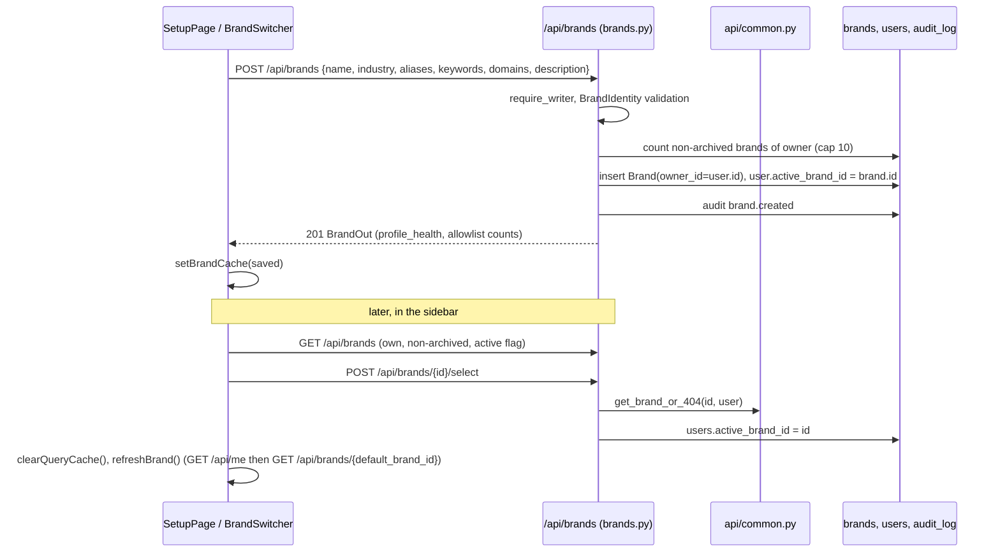
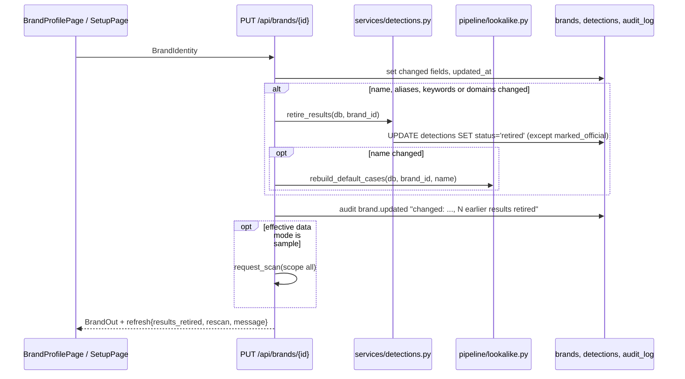

# Brand registry

## Plain-language summary

The brand registry is where a company tells BrandShield "this is who we are": the brand name, spelling variants, keywords, official websites, official social accounts, official mobile apps and official logos. Everything the scanner later finds is compared against this list, and anything on it is never flagged as fake. One account can protect up to 10 brands and switch between them from the sidebar. Brands belong to one account only; another account can never see them. Changing the brand's name, keywords or domains makes older findings obsolete, so they are hidden ("retired") rather than mixed with the new identity.

Everything here is real code. The only sample data is the optional sample-mode scan that re-runs after an identity change when the data mode resolves to sample (`backend/app/api/brands.py:195-201`).

## Purpose and user-facing behaviour

| Screen | What it does | Code |
|---|---|---|
| `/protect-brand` (Protect Your Brand) | Two cards: "Create a Brand" (opens Brand Studio, a separate app, via `openStudio()`) and "Protect a Brand" (goes to the setup wizard). With `?add=1` it says "Add another brand to protect." and shows "Back to dashboard"; the wizard link then becomes `/setup?new=1`. | `frontend/src/pages/ProtectBrandPage.tsx:8-19`, `:41-45` |
| `/setup` (Setup wizard, 3 steps) | Step 1 brand identity and logo; step 2 official accounts and apps; step 3 first scan. "Skip setup for now" returns to the dashboard. | `frontend/src/pages/SetupPage.tsx:46`, `:311-313` |
| `/brand` (Brand Profile) | Edit identity, logo, accounts, apps; see profile health; record verification of official identifiers. | `frontend/src/pages/BrandProfilePage.tsx` (`:114`, `:147`, `:163`, `:193`, `:813-857`) |
| Sidebar `BrandSwitcher` | Card showing the active brand and its official asset count; opens a menu listing every brand of the account, "Brand profile", and "Add another brand". With no brand it links to `/setup`. | `frontend/src/components/layout/BrandSwitcher.tsx:13-103` |

### Setup wizard in detail (`SetupPage.tsx`)

1. **Step 1, identity** (`saveBrand`, `:124-185`): company name (required), industry, description, aliases, keywords, domains (each comma separated; `https://` and any path are stripped from domains client-side, `:141-144`), optional logo (pre-checked by `checkLogoFile`, `:111-121`). Saves with `sm.updateBrand` when a brand exists, else `sm.createBrand` (`:149-165`); then uploads the logo with `sm.uploadLogo` (`:167-171`).
2. **Step 2, official assets** (`handleAddAccount` `:188-207`, `handleAddApp` `:220-247`): add accounts (platform and handle) and apps (name, package id, publisher, store). Removal via `handleRemoveAccount` / `handleRemoveApp`.
3. **Step 3, first scan** (`launch`, `:260-277`): if "run immediately" is on, calls `sm.startScan(scanScope)` (`POST /api/scan`); a 409 (a scan already running) is ignored; any other error is shown and the user is told to start it from the dashboard. Then it goes to `/dashboard`.

`?new=1` makes the wizard start from an empty form and create a new brand instead of editing the active one (`SetupPage.tsx:49-53`).

**Needs confirmation:** the wizard's UI and the backend disagree in four places. (a) The platform dropdown offers `tiktok` and `telegram` (`SetupPage.tsx:25-33`), but the backend only accepts `instagram, x, facebook, linkedin, youtube` (`backend/app/services/validators.py:4`, enforced at `backend/app/schemas/brand.py:45-51`), so those two return 422. (b) The store option "Apple App Store Only" sends `apple` and "Google Play & App Store" sends `['google_play','apple']` (`SetupPage.tsx:232`, `:700-702`), but the backend accepts `google_play` and `app_store` only (`validators.py:5`, `schemas/brand.py:75-85`), so both give 422; the Brand Profile page uses the correct `app_store` value (`BrandProfilePage.tsx:626-627`). (c) The step 3 fields "Scan Analysis Mode" (`scanDepth`) and "Alert recipient email" (`alertEmail`) are collected (`SetupPage.tsx:84-85`, `:828-847`) but `launch()` sends only the scope (`:265`). (d) `sm.addApp` has no `apple_app_id` support in the wizard. Please confirm whether these are known gaps.

## Step-by-step flows

### Create a brand and switch brands

- Create: `create_brand` (`backend/app/api/brands.py:142-154`). Cap `MAX_BRANDS_PER_ACCOUNT = 10` (`:46`), archived brands do not count; at the cap the answer is 409 "You can protect up to 10 brands. Archive one first." (`:145-146`). A newly created brand becomes the active one (`:150`).
- List: `GET /api/brands` returns only `owner_id == user.id` and non-archived brands, ordered by id, with `active` marked (`:124-129`). Not even an admin sees another account's brands.
- Select: `POST /api/brands/{id}/select` sets `users.active_brand_id` (`:132-139`). Column added by migration `backend/alembic/versions/0012_active_brand.py:20`; model `backend/app/models/user.py:21`.
- Every page that does not receive a `brand_id` works on `own_brand(db, user)`: the selected brand if still the user's and not archived, otherwise the oldest non-archived one, otherwise `None` (`backend/app/api/common.py:30-40`). `resolve_brand` uses it as the default when `brand_id` is omitted and answers 404 "No brand profile yet. Create one first." when none exists (`:43-50`). `GET /api/me` exposes the result as `default_brand_id` (`backend/app/api/auth.py:29-36`), which the frontend `useBrand` hook then loads (`frontend/src/hooks/useBrand.ts:36-60`).
- A per-request memo avoids repeated brand queries inside one request (`memo(...)` in `common.py:24`, `:40`; see `docs/features/dashboard.md`).

### Tenant isolation

`get_brand_or_404` loads the brand and raises a plain `404 Brand not found` if it does not exist, belongs to another `owner_id`, or is archived (unless `include_archived`) (`common.py:22-27`). It is deliberately 404 and never 403 so another account's brand ids cannot be probed. `owns_brand` does the same check for objects that carry a `brand_id` (detections, scans, reports, images) (`common.py:53-58`). Every brand sub-route (`accounts`, `apps`, `logo`, `logos`, `publishers`, `verification`) starts with `get_brand_or_404`. Migration `0010_brand_owner.py` added `brands.owner_id` and assigned previously owner-less brands to the first admin (`backend/alembic/versions/0010_brand_owner.py:44`).

### Update identity and retire old detections

- `update_brand` (`brands.py:165-204`). `IDENTITY_FIELDS = ("name", "aliases", "keywords", "domains")` (`:162`). `description` is only changed when the client sends it (`:176-177`), so an older client cannot wipe it.
- `retire_results` sets `Detection.status = "retired"` for every detection of the brand except `retired` and `marked_official` rows; nothing is deleted, but retired rows leave every list, count and report (`backend/app/services/detections.py:499-505`, constant `RETIRED` at `:32`).
- The Look-alike Lab's built-in cases are rebuilt when the name changes (`brands.py:188-189`).
- For live data a new scan is not started automatically because scans spend search credits; the response says `rescan: "needed"` (`:191`). For sample data a scan starts at once (`:195-201`; `ScanAlreadyRunning` and `NoBrand` are ignored). The profile page shows `refresh.message` (`BrandProfilePage.tsx:127`, `:696`).

### Official accounts, apps, domains, publishers

| Asset | Endpoint(s) | Rules | Code |
|---|---|---|---|
| Domains | part of the brand (`domains` array on `POST/PUT /api/brands`) | Lower-case hostname only: no scheme, path, port, `@`, IP literal; valid labels and TLD; max 253 chars; max 50 domains, deduplicated | `backend/app/services/validators.py:51-61`, `backend/app/schemas/brand.py:26-35` |
| Aliases / keywords | same | trimmed, blanks dropped, case-insensitive dedupe, each at most 80 chars, at most 50 items each | `validators.py:64-79`; `schemas/brand.py:24-25` (list field cap 200 at `:10-12`) |
| Official accounts | `GET/POST /api/brands/{id}/accounts`, `DELETE .../accounts/{account_id}` | Platforms `instagram, x, facebook, linkedin, youtube`; handle 3-30 chars of letters, digits, dot, underscore (hyphen also for linkedin and youtube; linkedin up to 100); leading `@` stripped; duplicate per brand/platform returns 409; the profile URL is built (`instagram.com/<h>`, `linkedin.com/company/<h>`, `youtube.com/@<h>`) and probed once with `UrlChecker`; failure is stored as `status=unreachable` with a warning, not an error | `brands.py:268-325`; `validators.py:7-48`; `schemas/brand.py:41-56` |
| Official apps | `GET/POST /api/brands/{id}/apps`, `PATCH .../apps/{app_id}` (App Store id), `DELETE` | Stores `google_play`, `app_store`; Google package must look like `com.example.app`, Apple bundle id letters/digits/hyphen/dot; same package on the other store adds the store instead of 409; optional numeric App Store id (number, `id123`, or an `apps.apple.com/.../id123` URL), only for apps on the App Store; duplicate returns 409 | `brands.py:337-413`; `schemas/brand.py:59-105`; `validators.py:82-109` |
| Publishers / developers | `POST /api/brands/{id}/publishers`, `DELETE .../publishers/{publisher_id}` | `store` is `google_play`, `app_store` or `any`; needs a name or an id; duplicate returns 409; new publishers start unverified and a publisher id only counts for the allowlist after it is verified | `brands.py:502-529`; `schemas/brand.py:207-226` |
| Extra logos | `POST /api/brands/{id}/logos?label=`, `GET .../logos/{logo_id}/file`, `DELETE .../logos/{logo_id}` | Same image rules as the main logo; duplicate hash returns 409; at most 10 extra logos (422); label max 120 chars | `brands.py:449-496` |

After adding an account or app, or changing an App Store id or a verification, `sync_with_allowlist` closes any existing detection that exactly matches the new official asset by setting it to `marked_official`, writing a `DetectionEvent` and an audit row `detection.marked_official` (`brands.py:304`, `:355`, `:372`, `:396`, `:568`; `backend/app/services/detections.py:430-445`). Removing an account, app, logo or publisher does not reopen detections (**Needs confirmation:** no code path reverts `marked_official` on removal in `brands.py:313-325`, `:401-413`; confirm this is intended).

**There is no UI for publishers or extra-logo upload on the Brand Profile page**; extra logos are added from the Look-alike Lab (`frontend/src/components/common/LogoCompareCard.tsx:221`) and `sm.addExtraLogo` (`frontend/src/api/sm.ts:88`). No frontend `sm` function exists for publishers, archive or restore (searched `frontend/src`): these exist only as API endpoints.

### Logo upload rules

`process_logo` in `backend/app/core/pipeline/logo.py:44-73`:

| Rule | Value | Error |
|---|---|---|
| Max size | `LOGO_MAX_BYTES` = 2 MB (`config.py:61`); the endpoint reads at most cap + 1 bytes (`brands.py:220`) | 413 "Logo is larger than 2 MB" |
| Format | decided from the bytes (PNG, JPEG, WebP), never the filename (`logo.py:34-41`) | 415 "Logo must be a PNG, JPEG or WebP image" |
| Minimum side | 256 px (`MIN_SIDE`, `:12`) | 422 |
| Aspect ratio | 0.8 to 1.25, "roughly square" (`:13`) | 422 |
| Decompression-bomb guard | 25,000,000 pixels (`:11`) | 415 invalid image |
| Re-encode | image is re-saved, dropping metadata and appended bytes (`:63-66`) | |
| Stored as | `logos/brand_<id>/<sha256[:24]>.<ext>` via the file store (`save_logo`, `:76-80`) | |

On success the brand row stores format, size, dimensions and `logo_sha256`, the old file is deleted, and `logo.replaced` is audited (`brands.py:225-239`). The browser pre-checks with the same limits (`frontend/src/utils/logoCheck.ts:3-66`) but the server is the authority.

### Verification

`PUT /api/brands/{id}/verification` (`brands.py:547-571`) records that a person checked an identifier: `asset_type` in `domain, account, app, publisher, logo`; `status` `unverified` or `verified`; a verified record needs a `method` from `dns_txt, website_link, store_listing, platform_badge, manual_review, other` (`schemas/brand.py:229-247`). It stores who and when (`verified_by`, `verified_at`) and audits `asset.verification_changed`. The key must name an asset that exists (else 404, `_asset_exists` `:535-544`). The docstring is explicit that the application does not check DNS or stores itself; it is an analyst attestation (`:549-550`, model `backend/app/models/brand.py:115-131`). The UI is the verification card (`BrandProfilePage.tsx:813-857`).

### Archive and restore

- `DELETE /api/brands/{id}?confirm=<exact name>` (admin only) sets `archived_at`; a wrong `confirm` returns 409 (`brands.py:419-430`). Nothing is erased.
- `POST /api/brands/{id}/restore` (admin only) clears it, or 409 when the account already has 10 active brands (`:433-443`).
- Archived brands disappear from lists and scans, and from `own_brand`. There is no archived-brand list endpoint (**Needs confirmation:** restoring requires knowing the brand id; no `GET` returns archived brands in `brands.py`).

### Profile health

`compute_profile_health` gives a deterministic 0-100 score with a reason per missing item (`backend/app/services/profile_health.py:5-53`): brand name and aliases 20, keywords 10, logo present 20 (the code only checks `logo_path is not None`, `:32`, although the label says "meets requirements"), domains 15, accounts 15, apps with publisher names 10, all account URLs reachable 10. It is returned as `profile_health` inside `BrandOut` (`brands.py:109`).

## Roles and permissions

| Action | Roles |
|---|---|
| List/get brand, accounts, apps, logos, select a brand | any signed-in user (`get_current_user`) |
| Create, update, upload logo, add/remove accounts, apps, logos, publishers, set verification | `admin`, `analyst` (`require_writer`) |
| Archive, restore | `admin` only (`require_admin`) |
| See another account's brand | nobody (404) |

Self-registered accounts are analysts, so they can create and edit brands but cannot archive them (see `docs/features/authentication-and-accounts.md`).

## Tables and external services

`brands` (`owner_id`, `archived_at`, `source`), `official_accounts`, `official_apps`, `brand_logos`, `brand_publishers`, `asset_verifications`, `users.active_brand_id`, `detections` and `detection_events` (retire/sync), `audit_log`, `stored_files` when `STORAGE_BACKEND=database` (`backend/app/models/brand.py`). External services: the official-account URL probe through `UrlChecker` (SSRF-safe fetch, `backend/app/config/deps.py:24-25`; limits `URL_CHECK_TIMEOUT_SECONDS`, `URL_CHECK_MAX_REDIRECTS`, `URL_CHECK_MAX_BYTES`). Nothing else leaves the server.

## Audit actions written

`brand.created`, `brand.updated`, `brand.archived`, `brand.restored`, `logo.replaced`, `logo.added`, `logo.removed`, `account.added`, `account.removed`, `app.added`, `app.updated`, `app.removed`, `publisher.added`, `publisher.removed`, `asset.verification_changed`, `detection.marked_official` (all in `backend/app/api/brands.py`).

## Related configuration (names only)

`LOGO_MAX_BYTES`, `URL_CHECK_TIMEOUT_SECONDS`, `URL_CHECK_MAX_REDIRECTS`, `URL_CHECK_MAX_BYTES`, `STORAGE_BACKEND`, `DATA_DIR`, `SCAN_EXECUTOR` (for the sample re-scan), `IMAGE_SIMILARITY_BACKEND` (how logos are compared later). The brand cap of 10 is a code constant, not an environment variable (`brands.py:46`).
