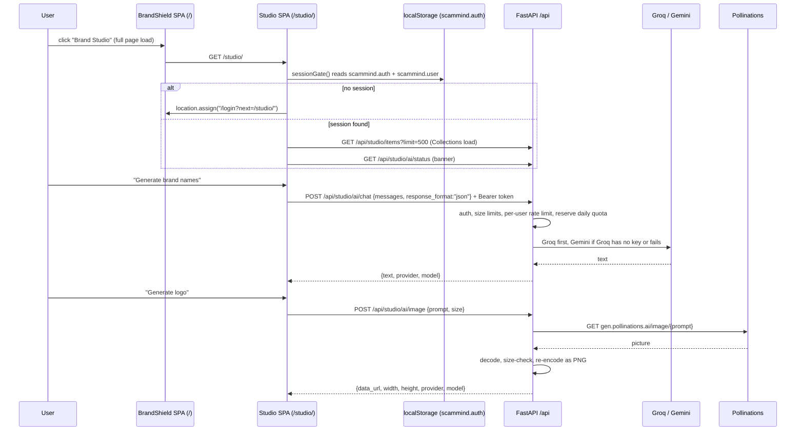
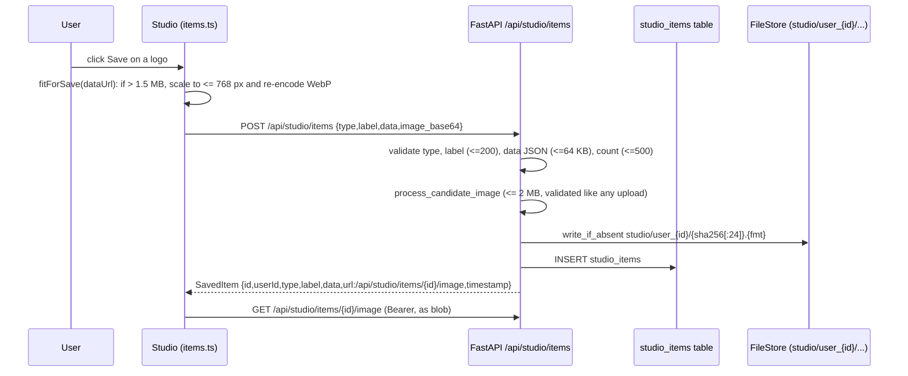
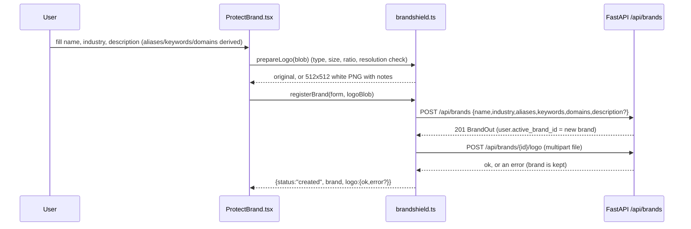

# Brand Studio

## Plain-language summary

Brand Studio is a second web app that sits next to BrandShield and helps a person create a brand: it suggests names, designs logos, picks colour palettes, writes taglines and posts, scores copy, audits a brand and answers branding questions. There is no separate login: if you are signed in to BrandShield you are signed in to Studio, because both apps live on the same web address and share the same saved session. Everything you like can be saved to "Collections" (kept in the BrandShield database), and when you are happy with a brand you can press "Protect in BrandShield" to register it for monitoring. The AI itself runs on the BrandShield server, never in the browser, so the provider keys stay secret and every person has a daily allowance.

---

## 1. Purpose and user-facing behavior

| Area | What the user sees | Code |
|---|---|---|
| Entry | "Brand Studio" button in the BrandShield sidebar, and the "Create a Brand" card on `/protect-brand`. Both do a full page load of `/studio/`. | `frontend/src/components/layout/Sidebar.tsx:156`, `frontend/src/pages/ProtectBrandPage.tsx:12-14`, `frontend/src/utils/studio.ts:3-8` |
| Sign-in | None of its own. Signed-out visitors are sent to `/login?next=/studio/` and come back after login. | `studio/src/lib/session.ts:71-76`, `frontend/src/utils/studio.ts:15-19`, `frontend/src/pages/LoginPage.tsx:51-52` |
| Tools (sidebar tabs) | Dashboard, Brand Names, Logo Designer, Content Lab, Color Palette, Sentiment AI, Brand Audit, Protect in BrandShield, AI Consultant, Analytics, Collections | `studio/src/App.tsx:32` (tab type), `studio/src/App.tsx:76-91` (menu) |
| Extra tool | "Brand Checker" component (name availability opinion and a similar-name suggestion) exists and is imported, but is **not** in the sidebar menu list above | `studio/src/App.tsx:18`, `studio/src/components/BrandChecker.tsx:13` |
| Remembered inputs | Brand name, industry, audience, etc. typed once and pre-filled in every tool | `studio/src/lib/profile.ts` |
| Saved items | "Save" buttons store results in Collections; the dashboard counts them | `studio/src/contexts/CollectionsContext.tsx:66-67`, `studio/src/App.tsx:46-51` |
| Protect | A wizard that creates a **new** BrandShield brand (with optional logo) | `studio/src/components/ProtectBrand.tsx`, `studio/src/lib/brandshield.ts:226-231` |

Which AI call each tool makes (all through `studio/src/services/gemini.ts`, despite the file name it calls the BrandShield proxy, see `studio/src/services/gemini.ts:3-18`):

| Tool | Service function | Kind | Source |
|---|---|---|---|
| Brand Names | `generateBrandNames`, `suggestNamingContext` | chat (JSON) | `studio/src/services/gemini.ts:41,62` |
| Logo Designer | `generateLogo`, `suggestLogoIdea` | image + chat | `studio/src/services/gemini.ts:77,272` |
| Content Lab | `generateContent` | chat (JSON) | `studio/src/services/gemini.ts:138` |
| Sentiment | `analyzeSentiment`, `analyzeReviews` (Review Analyzer component) | chat (JSON) | `studio/src/services/gemini.ts:157,177` |
| Color Palette | `generateColorPalette` | chat (JSON) | `studio/src/services/gemini.ts:215` |
| Brand Audit | `auditBrand` | chat (JSON) | `studio/src/services/gemini.ts:241` |
| Brand Checker | `checkNameAvailability`, `suggestSimilarName` | chat (JSON) | `studio/src/services/gemini.ts:290,305` |
| AI Consultant | `createChatSession` (whole history re-sent each turn) | chat (text) | `studio/src/services/gemini.ts:22-37,322` |
| Analytics | local counters only, no server call | none | `studio/src/utils/analytics.ts:5-25` |

The "Analytics" tool reads events from `studio/src/utils/analytics.ts`: `trackEvent` appends `{type, timestamp, label}` to `localStorage` key `bc-analytics`, keeping the last 500 (`analytics.ts:3-11`). It is per browser, not per account, and never sent to the server.

---

## 2. Step-by-step flow

### 2.1 Open Studio and use an AI tool



1. The sidebar link is a plain `<a href="/studio/">` (full page load, not a React route) (`frontend/src/components/layout/Sidebar.tsx:156`).
2. `AuthProvider` reads the BrandShield session with `sessionGate()`; with no tokens or no user it calls `redirectToLogin()` (`studio/src/contexts/AuthContext.tsx:17-30`, `studio/src/lib/session.ts:79-84`). The loading spinner reads "Checking your BrandShield sign-in" (`studio/src/App.tsx:58-65`).
3. Every call goes through `request()` in `studio/src/lib/api.ts:163`, with relative URLs (same origin), `Authorization: Bearer <access>` (`studio/src/lib/api.ts:123-133`).
4. AI helpers `aiChat`, `aiImage`, `getAiStatus` post to `/api/studio/ai/chat|image|status` (`studio/src/lib/ai.ts:64,76,85`).
5. `useAiStatus()` calls status once per page load and feeds `AiStatusBanner` (`studio/src/lib/useAiStatus.ts:8-20`, `studio/src/components/AiStatusBanner.tsx`).

### 2.2 One shared login: session, refresh, sign-out

* Same storage keys as BrandShield: `scammind.auth` (tokens) and `scammind.user`; legacy keys `scammind_auth`, `scammind.offline-session` are wiped on clear (`studio/src/lib/session.ts:3-5`, `frontend/src/api/client.ts:59-61`).
* Read order: `localStorage` then `sessionStorage` (so "keep me signed in" off still works in the same tab) (`studio/src/lib/session.ts:21-31`). Studio never writes a brand-new session; `save()` only keeps the session wherever it already lives (`studio/src/lib/session.ts:55-59`).
* On a 401 the client refreshes **once**. The refresh runs inside `navigator.locks.request('scammind-refresh', ...)` (Web Locks API) so BrandShield, Studio and other tabs never use the same rotating refresh token twice. Inside the lock the stored tokens are re-read: if they differ from the token that failed, another tab already rotated them and the request is just retried (`studio/src/lib/api.ts:7,73-106`; same lock name in `frontend/src/api/client.ts:227-262`). Without the Locks API it runs directly (`studio/src/lib/api.ts:98-100`).
* Refresh outcomes: `ok`, `denied` (4xx, session cleared and redirect to login), `network` (5xx or fetch failure: keep session, show a network error) (`studio/src/lib/api.ts:84-90,152-160`).
* `endSession()` clears the session, fires `scammind:unauthorized`, and redirects to `/login?next=/studio/` (`studio/src/lib/api.ts:117-121`).
* Other tabs: `AuthProvider` listens to `storage` events on the two keys and to `scammind:unauthorized`; a sign-out in another tab sends this tab to login (`studio/src/contexts/AuthContext.tsx:31-47`).
* Studio "Log out": best-effort `POST /api/auth/logout` (revokes the refresh token), clear storage, go to `/login` (no `next`) (`studio/src/lib/api.ts:172-187`).
* After login, BrandShield only follows `next` when it matches `^/studio/[A-Za-z0-9\-._~/]*$` with no `..` or `//` (anti open-redirect) (`frontend/src/utils/studio.ts:15-19`).

### 2.3 AI proxy (server side)

Files: `backend/app/api/studio_ai.py` (routes, validation, quotas), `backend/app/services/studio_ai.py` (providers, retries, quota storage). Router is mounted at `/api/studio/ai` (`backend/app/main.py:180`, `backend/app/api/studio_ai.py:27`). The service objects live on `app.state.studio_ai` and `app.state.studio_ai_limiter` (`backend/app/main.py:102-103`).

| Route | Body / query | Success response | Source |
|---|---|---|---|
| `GET /api/studio/ai/status` | none | `{chat:{configured, providers, used_today, daily_limit}, image:{configured, provider:"pollinations", used_today, daily_limit, sizes}, limits:{...}}`. No secrets. | `backend/app/api/studio_ai.py:75-85` |
| `POST /api/studio/ai/chat` | `{messages[1..200], response_format:"json"\|"text", temperature 0..2, max_tokens?}`; each message `{role: system\|user\|assistant\|model, content}` (`text` accepted as alias) | `{text, provider, model}` | `backend/app/api/studio_ai.py:33-52,88-106` |
| `POST /api/studio/ai/image?format=json\|png` | `{prompt (1..20000), size}` | json: `{image_base64, data_url, media_type, width, height, provider, model}`; `format=png` returns raw PNG bytes | `backend/app/api/studio_ai.py:54-56,109-136` |

Chat order of work (`backend/app/api/studio_ai.py:88-106`):

1. Reject more than `STUDIO_MAX_MESSAGES` messages (422), more than `STUDIO_MAX_CHARS` total characters (413), `max_tokens` above `STUDIO_MAX_TOKENS` (422).
2. 503 "AI chat is not set up on the server." when neither `GROQ_API_KEY` nor `GEMINI_API_KEY` is usable (`backend/app/services/studio_ai.py:105-106`).
3. `_guard`: per-user in-memory limiter `STUDIO_AI_RATE_PER_MINUTE` (429 with `Retry-After: 30`), then daily quota (429 "You have used today's text AI allowance (N). It resets at midnight UTC.") (`backend/app/api/studio_ai.py:63-68`).
4. Provider call. On `StudioAIError` the quota unit is refunded, so a broken provider does not use up the user's day (`backend/app/api/studio_ai.py:102-106`, `backend/app/services/studio_ai.py:305-312`).

Provider selection and fallback (`backend/app/services/studio_ai.py:150-169`): Groq first (`STUDIO_GROQ_MODEL`, default `openai/gpt-oss-120b`, `backend/app/config/config.py:141`), then Gemini (`GEMINI_MODEL`, default `gemini-3.5-flash-lite`, `backend/app/config/config.py:72`) if Groq has no key or fails. In JSON mode the answer is repaired by `_as_json_text` (unwraps a ```json fence or surrounding prose); if it still is not JSON the next provider is tried (`backend/app/services/studio_ai.py:162-166,238-254`). Gemini maps `system` messages to `systemInstruction` and roles `assistant` to `model` (`backend/app/services/studio_ai.py:191-218`).

Image order of work (`backend/app/api/studio_ai.py:109-136`): collapse whitespace; reject prompts over `STUDIO_MAX_PROMPT_CHARS` (default 2000, 413); `size` must be one of `512x512, 768x768, 1024x1024, 1024x768, 768x1024, 1280x720, 720x1280` (422); 503 if `POLLINATIONS_API_KEY` missing; guard (rate limit and image quota); `StudioAI.image` calls `GET https://gen.pollinations.ai/image/{prompt}?model=...&width=..&height=..&seed=-1` with a Bearer key (`backend/app/services/studio_ai.py:222-235`). The picture must be `image/png|jpeg|webp` (SVG refused), is decoded with limits (16 million pixels, 16 to 4096 px per side), and **re-encoded as PNG**, dropping metadata and trailing bytes (`backend/app/services/studio_ai.py:43-46,257-276`).

Transport rules for every outbound call (`backend/app/services/studio_ai.py:113-146`): timeout (`STUDIO_AI_TIMEOUT_SECONDS`, images `STUDIO_IMAGE_TIMEOUT_SECONDS`), `1 + STUDIO_AI_MAX_RETRIES` attempts for timeouts, connection errors and 5xx only (never 429 or key errors), backoff `STUDIO_AI_RETRY_BACKOFF_SECONDS * attempt`, response streamed and cut at 512 KB (text) or 12 MB (image), redirects not followed. Prompts, answers and keys are never logged; only provider, status and duration (`backend/app/services/studio_ai.py:1-10,136`).

Status mapping to the browser (`backend/app/services/studio_ai.py:70-80`): provider 401/403 becomes 503 "key was rejected", 402 becomes 503 "out of credits", 429 stays 429 with `Retry-After`, 400/404/413/422 become 422, anything else 502. The provider's own error text is never forwarded.

Daily quota: stored in table `api_usage` with `provider = "studio:{text|image}:u{user_id}:{YYYYMMDD}"` and `month = "YYYY-MM"`; `reserve_quota` does an atomic `UPDATE ... WHERE credits + 1 <= limit`; limit `<= 0` means unlimited (`backend/app/services/studio_ai.py:282-317`). Defaults: 200 text and 50 image per user per UTC day (`backend/app/config/config.py:151-152`).

Browser error wording (`studio/src/lib/ai.ts:28-62`): network error; 402 or "out of credits" (image: offers manual upload, `imageUnavailable=true`); 429 (adds "try again in about N seconds"); 503 (image: "not available right now, upload your own logo"); 502; 403 "Your account is not allowed to use this."

### 2.4 Collections (saved items)



Client (`studio/src/lib/items.ts`, `studio/src/contexts/CollectionsContext.tsx`):

* `listItems` asks for up to 500 items (`studio/src/lib/items.ts:14-21`).
* `createItem` sends `image_base64` only when `url` starts with `data:image/` (`studio/src/lib/items.ts:57-61`).
* **Image size handling (`fitForSave`)**: a generated 1024 px PNG can exceed the server limit of 2 MB. If the decoded size is over `SAVE_LIMIT_BYTES = 1_500_000` the picture is scaled so its longest side is at most 768 px and saved as WebP at quality 0.9; up to 4 attempts, each shrinking the side by 25 percent, until it fits. If it cannot be decoded (tests, odd data) it is sent unchanged and the server decides (`studio/src/lib/items.ts:22-54`).
* Pictures need the `Authorization` header, so `` cannot load them; `fetchItemImage` fetches a Blob via `request(..., {blob:true})` (`studio/src/lib/items.ts:68-70`).
* `uploadLegacyGuestItems` uploads the old standalone-app guest collection (`localStorage` key `brandcraft_collections`, items with `userId === 'guest'`) one by one, then removes the key; it stops and keeps the rest if the limit, an offline error or any failure occurs (`studio/src/lib/items.ts:72-104`).

Server (`backend/app/api/studio.py`, model `backend/app/models/studio.py:11-22`):

| Route | Behavior | Source |
|---|---|---|
| `GET /api/studio/items?type&limit(1..500, default 100)&offset` | Owner-only list, newest first, `{total,limit,offset,items}` | `backend/app/api/studio.py:103-118` |
| `POST /api/studio/items` (201) | JSON `{type,label,data?,image_base64?}` or multipart (`type,label,data` JSON text, `file`) | `backend/app/api/studio.py:121-162` |
| `DELETE /api/studio/items/{id}` | Owner-only; deletes the stored file only if no other item uses the same content-addressed path | `backend/app/api/studio.py:172-180` |
| `GET /api/studio/items/{id}/image` | Owner-only; `Cache-Control: private, max-age=300`, `nosniff`, inline | `backend/app/api/studio.py:183-191` |

Validation: `type` in `logo, palette, brand_name, content, audit, sentiment` (422); `label` required, printable characters only, whitespace collapsed, max 200 (422); `data` JSON max 64 KB (413); image max 2 MB (413), must be valid base64 (422); body over about 4.06 MB refused before parsing (413); other Content-Type 415; at most 500 items per user (409 "You can keep at most 500 saved items. Delete some first."). Another person's item is a plain 404 (`backend/app/api/studio.py:31-35,51-81,86-87,165-169`). The picture goes through `process_candidate_image` (same validator as uploads) and is stored at `studio/user_{id}/{sha256[:24]}.{format}` (`backend/app/api/studio.py:89-95`).

### 2.5 Remembered inputs

`studio/src/lib/profile.ts` keeps seven fields: `brandName, industry, audience, description, personality, style, mood` (`profile.ts:6`). They are stored in `localStorage` under `brandshield.studio.profile.{userId|anon}` (`profile.ts:12-14`), so each account has its own set in this browser and nothing is sent to the server. `useRemembered(field, fallback)` is a `useSyncExternalStore` hook, so the same field typed in one tool appears in the others and survives reload (`profile.ts:64-67`). Used by BrandAudit, BrandChecker, BrandNameGenerator, ColorPaletteGenerator, ContentGenerator, LogoGenerator and ProtectBrand (`studio/src/components/*.tsx`, e.g. `BrandAudit.tsx:54-56`, `ProtectBrand.tsx:56-58`). `clearRemembered()` empties it; storage failures are swallowed (value stays in memory).

### 2.6 "Protect in BrandShield" (brand registration)



* **A new brand is created every time.** `registerBrand` always calls `POST /api/brands` and returns `status: 'created'`; there is no update path, because an account can protect several brands (`studio/src/lib/brandshield.ts:225-231`). The limit is `MAX_BRANDS_PER_ACCOUNT = 10` non-archived brands; the 11th gets a 409 "You can protect up to 10 brands. Archive one first." (`backend/app/api/brands.py:46,143-147`). The new brand also becomes the user's active brand (`backend/app/api/brands.py:150-151`).
* Permissions: `require_writer` (admin or analyst). A viewer gets 403, and the wizard shows "Your account can view BrandShield but cannot create a brand. Ask an administrator for an analyst account." (`backend/app/api/brands.py:143`, `studio/src/components/ProtectBrand.tsx:153`).
* Derivations (client side, pure functions): `deriveAliases("Acme Bank")` gives `acmebank, acme-bank, acme_bank, acme` (max 8, never the name itself); `deriveKeywords` takes name words of 3+ letters plus tagline words of 4+ letters (max 8); `normalizeDomain("https://www.Acme.com/path")` gives `acme.com` or `null` (`studio/src/lib/brandshield.ts:38-70`). `buildPayload` trims, de-duplicates, and only sends `description` when not empty (`brandshield.ts:194-204`).
* Logo rules mirror the backend: PNG, JPEG or WebP; at most 2 MB; at least 256 px; width/height ratio 0.8 to 1.25 (`brandshield.ts:5-12`, `checkLogoMeta` at `89-110`). An unusable file (wrong type, unreadable) is rejected; otherwise, if too small, not square enough or over 2 MB, it is centred on a white 512 x 512 canvas and saved as PNG, with plain-language notes (`prepareLogo`, `brandshield.ts:143-161`).
* The logo upload is a second request; if it fails the brand still exists and the outcome reports `logo: {ok:false, error}` (`brandshield.ts:206-223`).
* 422 errors are mapped to wizard fields through `mapFieldErrors` (`fields.file` becomes the logo field) (`brandshield.ts:234-239`).
* "Back to BrandShield" goes to `/dashboard` (`BRANDSHIELD_HOME`, `studio/src/lib/session.ts:72`). A generated logo saved to Collections can be reused: `dataUrlToBlob` converts a data URL to a Blob (`brandshield.ts:163-170`).

---

## 3. Files, functions and classes

| Path | Role |
|---|---|
| `studio/src/main.tsx` | Mounts `ThemeProvider`, `AuthProvider`, `App`; DEV-only direct-port redirect (`main.tsx:9-12`) |
| `studio/src/App.tsx` | Sidebar, tabs, dashboard, counts; `BrandProvider`, `CollectionsProvider` |
| `studio/src/contexts/AuthContext.tsx`, `BrandContext.tsx`, `CollectionsContext.tsx`, `ThemeContext.tsx` | Session user, selected brand/tab navigation, saved items, theme |
| `studio/src/lib/session.ts`, `api.ts`, `ai.ts`, `items.ts`, `profile.ts`, `brandshield.ts`, `devRedirect.ts`, `useAiStatus.ts` | Shared client logic described above |
| `studio/src/services/gemini.ts` | Prompts for each tool (calls `aiChat`/`aiImage`) |
| `studio/src/components/*` | One component per tool, plus `Collections`, `ProtectBrand`, `SuccessFlow`, `LogoUpload`, `AiStatusBanner`, `CustomCursor` |
| `backend/app/api/studio_ai.py`, `backend/app/services/studio_ai.py` | AI proxy, class `StudioAI`, `StudioAIError`, quota functions |
| `backend/app/api/studio.py`, `backend/app/models/studio.py` | Collections API, `StudioItem` model, `STUDIO_TYPES` |
| `backend/app/config/ratelimit.py` | `RequestLimiter` (in-memory sliding window, single process) (`ratelimit.py:35-47`) |
| `frontend/src/utils/studio.ts` | `STUDIO_URL`, `openStudio()`, `safeStudioNext()` |

---

## 4. APIs, tables and external services

| Kind | Item |
|---|---|
| APIs used by Studio | `POST /api/auth/refresh`, `POST /api/auth/logout`, `GET/POST /api/studio/items`, `DELETE /api/studio/items/{id}`, `GET /api/studio/items/{id}/image`, `GET /api/studio/ai/status`, `POST /api/studio/ai/chat`, `POST /api/studio/ai/image`, `POST /api/brands`, `POST /api/brands/{id}/logo` |
| DB tables | `studio_items` (id, user_id FK users ON DELETE CASCADE, type, label, data JSON, image_path, created_at) (`backend/app/models/studio.py:14-22`); `api_usage` (daily quota counters) (`backend/app/models/ops.py:116-119`); `brands` and related tables when protecting a brand |
| File storage | `FileStore` path `studio/user_{id}/{hash}.{fmt}` |
| External services | Groq `https://api.groq.com/openai/v1/chat/completions`; Google Gemini `generativelanguage.googleapis.com/v1beta/models/{model}:generateContent`; Pollinations `https://gen.pollinations.ai/image/` (`backend/app/services/studio_ai.py:39-41`) |
| Browser APIs | Web Locks (`navigator.locks`), `localStorage`/`sessionStorage`, Canvas (logo resize, `fitForSave`) |

---

## 5. Validation, permissions, errors and edge cases

* All Studio endpoints need a valid access token (`get_current_user`); any role may use items and AI. Only brand creation needs analyst or admin.
* Rate limit: `STUDIO_AI_RATE_PER_MINUTE` (default 20) per user, chat and image together, in memory per process; with several workers each counts separately (`backend/app/config/config.py:143`, `backend/app/config/ratelimit.py:35-37`).
* Gemini fallback only applies to chat. Images have a single provider; when Pollinations is out of credits the UI offers uploading your own logo (`studio/src/lib/ai.ts:34-39`).
* Studio-only screens still depend on BrandShield: if the API returns 401 and refresh is denied, the user is redirected to login and loses unsaved results.
* Legacy guest collections are migrated once (section 2.4).
* The brand cap and the 500-item cap are separate (10 brands, 500 items).

---

## 6. Dev proxy, redirect and Vercel/Docker layout

* Studio is built with `base: '/studio/'` (`studio/vite.config.ts:11`). Nothing from the environment is injected into the bundle (`studio/vite.config.ts:8-10`).
* Studio dev server: `127.0.0.1:3000`, `strictPort`, proxy `/api` to `STUDIO_API_PROXY` or `http://127.0.0.1:8000` (`studio/vite.config.ts:19-25`).
* BrandShield dev server (port 5173) proxies `/studio` (with `ws: true` for HMR) to `STUDIO_DEV_URL` or `http://127.0.0.1:3000`, and `/api` to `STUDIO_API_PROXY` or `http://127.0.0.1:8000`, so both apps share one origin and one `localStorage` session (`frontend/vite.config.ts:8-14`). This is the address that works in development: `http://localhost:5173/studio/`.
* `devRedirect`: if someone opens Studio directly on `localhost:3000` or `127.0.0.1:3000`, `directDevRedirect()` returns `http://localhost:5173` (or `VITE_SHIELD_URL`) plus the same path (`/studio/` if the path is not under `/studio`), query and hash; any other host or port returns `null`. It runs only when `import.meta.env.DEV` (`studio/src/lib/devRedirect.ts:16-20`, `studio/src/main.tsx:9-12`).
* Vercel (`vercel.json`): three services `backend` (FastAPI, `api.index:app`, `maxDuration` 300), `frontend` (Vite, SPA rewrite) and `studio` (Vite, rewrites under `/studio/`) (`vercel.json:3-44`). Top-level rewrites: `/api/*` and `/health*` to backend, `/studio` and `/studio/*` to studio, everything else to frontend (`vercel.json:45-80`). `/studio/assets/*` is cached immutable for a year (`vercel.json:127-132`). The CSP is `connect-src 'self'`, which is why Studio must use same-origin relative URLs (`vercel.json:114`).
* Docker: the frontend nginx has `location /studio/` proxying to the `studio` container (`http://studio:8080`) and forwards `/api` to the api container (`frontend/nginx/default.conf.template:35-60`; `docker-compose.yml:146-156`).
* Tests: `studio/src/lib/*.test.ts` (api, brandshield, devRedirect, items, session), `studio/src/contexts/AuthContext.test.tsx`; cross-app e2e in `frontend/e2e/studio-flow.spec.ts` and `frontend/e2e/multi-brand.spec.ts` (Studio started on port 3100, `frontend/playwright.config.ts:78-87`).

---

## 7. Configuration (names only)

| Name | Purpose | Default (from `backend/app/config/config.py`) |
|---|---|---|
| `GROQ_API_KEY` | Primary chat provider key (secret) | none (`config.py:139`) |
| `GEMINI_API_KEY` | Chat fallback key (secret); also used by voice | none (`config.py:71`) |
| `POLLINATIONS_API_KEY` | Image provider key (secret) | none (`config.py:140`) |
| `STUDIO_GROQ_MODEL` | Groq model id | `openai/gpt-oss-120b` |
| `GEMINI_MODEL` | Gemini model for chat fallback | `gemini-3.5-flash-lite` |
| `STUDIO_IMAGE_MODEL` | Pollinations model | `black-forest-labs/flux.1-schnell` |
| `STUDIO_AI_RATE_PER_MINUTE` | Per-user requests per minute | 20 |
| `STUDIO_DAILY_TEXT_QUOTA`, `STUDIO_DAILY_IMAGE_QUOTA` | Per-user per UTC day (0 = unlimited) | 200, 50 |
| `STUDIO_AI_TIMEOUT_SECONDS`, `STUDIO_IMAGE_TIMEOUT_SECONDS` | Provider timeouts | 45, 120 |
| `STUDIO_AI_MAX_RETRIES`, `STUDIO_AI_RETRY_BACKOFF_SECONDS` | Retry policy | 2, 0.5 |
| `STUDIO_MAX_MESSAGES`, `STUDIO_MAX_CHARS`, `STUDIO_MAX_TOKENS`, `STUDIO_MAX_PROMPT_CHARS` | Request size limits | 40, 30000, 4096, 2000 |
| `VITE_STUDIO_URL` (frontend) | Only for an odd setup with Studio on another origin | `/studio/` |
| `VITE_SHIELD_URL` (studio, dev only) | Where the direct-port redirect goes | `http://localhost:5173` |
| `STUDIO_DEV_URL`, `STUDIO_API_PROXY` | Dev proxy targets | `http://127.0.0.1:3000`, `http://127.0.0.1:8000` |

Names are listed in `backend/.env.example:105-120`. No values are reproduced here.
