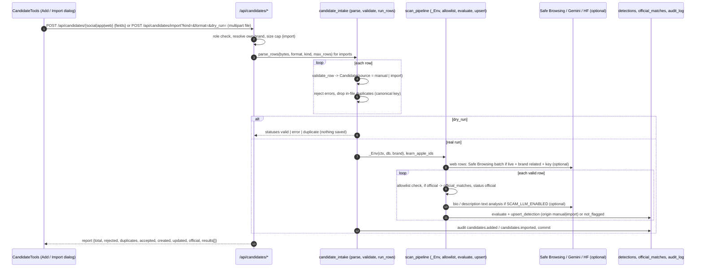

# Candidate intake: manual entry and CSV / JSON import

## Plain-language summary

Sometimes you already know about a suspicious account, app or website: a customer sent a screenshot, or a partner shared a list.
Candidate intake lets an analyst type one in ("Add candidate") or upload a CSV or JSON file with many rows ("Import CSV / JSON").
Each row is checked for mistakes, then judged exactly like something a scan found: official assets are skipped, the rest are scored,
and the suspicious ones appear in the Social, App or Web Threats list for review. Nothing in a row is ever opened or downloaded;
you can also do a "dry run" first, which checks the file and saves nothing.

All paths are relative to the repository root (`ScamMind AI/`).

## 1. Purpose and user-facing behavior

The tools appear as two buttons, **Add candidate** and **Import CSV / JSON**, on three pages (`frontend/src/components/monitor/CandidateTools.tsx:45-87`):

| Page | `kind` | Mounted at |
|---|---|---|
| Social Media Monitoring | `social` | `frontend/src/pages/SocialMonitoringPage.tsx:91` |
| App Store Monitoring | `app` | `frontend/src/pages/AppStoreMonitoringPage.tsx:93` |
| Web Threats | `web` | `frontend/src/pages/WebThreatsPage.tsx:296` |

- Buttons are disabled for viewers with the tooltip "Your role can view but not add candidates" (`CandidateTools.tsx:48,52-57`). The API requires role `admin` or `analyst`
  (`require_writer`, `backend/app/config/deps.py:56`, used in `backend/app/api/candidates.py:37,42,47,58`).
- **Add dialog** ("Add a candidate by hand"): form fields per kind (`FIELDS`, `CandidateTools.tsx:12-32`). Only non-empty values are sent (line 100). Result text: the server `message`
  or "Candidate saved (status)." (line 102).

| Kind | Fields in the form (required marked *) |
|---|---|
| social | platform * (instagram, facebook, x, telegram, linkedin, youtube), handle *, display name, profile URL, bio |
| app | store * (google_play, app_store, third_party_apk), package or bundle id *, app name *, publisher, description |
| web | URL * ("never opened by this app"), title, note |

  The API accepts more fields than the form shows (followers, following, posts, created_at, verified, image_id for social; publisher_id, installs, rating_count, image_id for apps), see section 3.
- **Import dialog** (`ImportDialog`, `CandidateTools.tsx:146-216`): choose a `.csv` or `.json` file (format picked from the file extension, line 151), press **Dry run** (validates and saves nothing; shows
  "N rows, N valid, N rejected, N duplicates" and every error as "Row N: message", lines 168-196), then **Import valid rows** (enabled only after a dry run with at least one valid row, line 208).
  After a real import: "Import finished: N created, N updated, N rejected." (line 160).
- After either action the page reloads its lists (`onChanged`, `useMonitor.reloadAll`).

## 2. Flow



### Single entry

`POST /api/candidates/social|app|web?brand_id=` (`backend/app/api/candidates.py:36-48`, HTTP 201). The body is validated by the pydantic model (unknown fields refused, section 3), then
`_single` (lines 27-33) calls `run_rows(..., origin="manual", dry_run=False)` with one row; an `error` result becomes HTTP 422 with the row's message.
Any other outcome is 201 with `{row, status, detection_id, score, severity, message}` where `status` is one of `created`, `updated`, `cleared`, `official`, `not_flagged`
(`backend/app/core/pipeline/candidate_intake.py:253-267`). So a 201 does not mean a detection exists: `official` and `not_flagged` store no detection.

### Import

`POST /api/candidates/import?kind=social|app|web&format=csv|json&dry_run=true|false` with multipart field `file` (`candidates.py:51-72`):

1. Reads at most `IMPORT_MAX_BYTES + 1` bytes (default 1 MB); larger is HTTP 413 "The file is larger than N KB" (lines 65-67).
2. `parse_rows` (`candidate_intake.py:170-204`):
   - decoding: UTF-8 (BOM allowed) or UTF-16 with a byte-order mark; anything else 422 "must be UTF-8" (`decode_bytes`, 159-167);
   - **CSV**: strict `csv.DictReader`; needs a header row; every header must be an allowed column of the kind (`COLUMNS`, lines 33-36) else 422 "Unknown column(s): ... Allowed: ..."; values are stripped;
     a row with more values than headers becomes an error row "Too many values in this row"; more than `IMPORT_MAX_ROWS` (500) rows is 413; malformed CSV 422;
   - **JSON**: an array of objects, or `{"rows": [...]}`; not JSON 422; not an array 422; more than 500 rows 413; a non-object element becomes an error row "Row is not an object".
3. `run_rows` (225-276) validates each row, then (unless `dry_run`) analyses it. Valid rows are saved even when others fail (partial success, `candidates.py:63`).

### Allowed columns

| Kind | Columns (`candidate_intake.py:33-35`) |
|---|---|
| social | `platform, handle, display_name, url, bio, followers, following, posts, created_at, verified, image_id` |
| app | `store, package_id, name, publisher, publisher_id, url, description, installs, rating_count, image_id` |
| web | `url, title, note` |

Example JSON for web (shape from `WebIn`, lines 98-101):

```json
[{"url": "https://acmebank-support.example/kyc-update", "title": "KYC page", "note": "reported by a customer"}]
```

Example CSV for social:

```csv
platform,handle,display_name,bio
instagram,acmebank_support,Acme Bank Support,Official helpline. DM to unblock your account
```

## 3. Validation rules

Every row model forbids unknown fields and strips whitespace (`_Row`, `candidate_intake.py:49-50`); empty strings become null (`_blank_to_none`, 207-208). Error messages are shortened to 300 characters.

| Field | Rule | Code |
|---|---|---|
| `platform` (social) | one of instagram, x, facebook, linkedin, youtube, telegram; `twitter` is mapped to `x` | lines 66-74, `services/validators.py:4` |
| `handle` | 1-100 characters, then `normalize_handle`: leading `@` removed, 3-30 of letters, digits, dot, underscore; LinkedIn and YouTube also allow hyphen (LinkedIn up to 100, YouTube 30) | `backend/app/services/validators.py:7-40` |
| `display_name` / `name` | max 200 (app `name` required, min 1) | lines 56, 80 |
| `url` | max 500; must be http(s): a missing scheme gets `https://`; otherwise "url must be an http(s) address". Social without URL gets a built one (`instagram.com/<h>`, `linkedin.com/company/<h>`, `youtube.com/@<h>`, `t.me/<h>`) | `_http_url` 107-115, `to_candidate` 120-123 |
| `bio` | max 2000; `description` max 4000 | lines 58, 84 |
| `followers`, `following` | integer 0 to 10^10; `posts` 0 to 10^9 | lines 59-61 |
| `created_at` | ISO date | line 62 |
| `verified` | boolean | line 63 |
| `store` (app) | google_play, app_store, third_party_apk | lines 89-95 |
| `package_id` (app) | 1-155 chars; for Google Play must look like `com.example.app` (dot separated parts starting with a letter); for App Store a reverse-DNS bundle id; not checked for `third_party_apk` | `validate_package_id`, `validators.py:82-92` |
| `publisher` / `publisher_id` | max 200 / 120. `publisher_id` is used by the allowlist only if that publisher is VERIFIED in Brand Registry (`matching.py:151-152,185-187`) | lines 81-82 |
| `installs` | integer 0 to 10^12, stored as `installs_count` for the few-installs signal | lines 85,138-139 |
| `rating_count` | 0 to 10^10 | line 86 |
| `image_id` | integer >= 1: id returned by `POST /api/candidate-images` | lines 64, 87 |
| web `url` | max 500; must normalise to a host with a registrable domain; IP addresses are refused ("IP addresses are not compared") | `to_candidate` 142-146, `base.py:381-400` |
| web `title` / `note` | max 300 / 1000 | lines 100-101 |

**Text cleaning** (`clean_text`, lines 39-46): control characters become spaces, whitespace is collapsed, a leading `=`, `+`, `-`, `@`, tab or carriage return is defused with a leading `'` (spreadsheet formula injection), and
the text is cut to its limit. The API never renders anything as HTML.

**Duplicates inside one file:** rows with the same canonical key (`platform:handle`, or the canonical URL) as an earlier row are reported as `duplicate` and skipped (lines 235-239;
`canonical_key`, `backend/app/core/pipeline/scan_pipeline.py:198-203`). Duplicates of an existing detection are not rejected: they update it (below).

Per-row result statuses: `error`, `duplicate`, `valid` (dry run only), `official`, `not_flagged`, `created`, `updated`, `cleared`.
Report fields (lines 273-276): `dry_run, kind, origin, total, rejected, duplicates, accepted (= total - rejected - duplicates, which includes official and not_flagged rows), created, updated, official, results[]`.

## 4. How rows become detections

`run_rows` (`candidate_intake.py:225-276`) deliberately reuses the scan pipeline functions, so a manual row is judged like a scan row:

1. `sp._Env(ctx, db, brand)`: the brand's matcher, allowlist, official logos, Settings (sensitivity threshold, rules, impersonation words), risk engine and text service (`scan_pipeline.py:287-315`).
2. `learn_apple_ids` and `_reputation_pass` (Safe Browsing for web rows, conditions in `docs/features/web-threats.md` section 4).
3. For each valid row: **allowlist first** (`BrandAllowlist.check`): exact official handle, URL, package id, bundle id, verified publisher id or official domain: recorded in `official_matches`, result `official`, "Excluded: <rule>".
4. `evaluate` (`scan_pipeline.py:515-554`): the prefilter is **off** for these rows (`c.source not in INTAKE_SOURCES`, line 526); a candidate with nothing tying it to the brand is `ignored`, reported as `not_flagged`
   "Evaluated; nothing ties it to the brand, so it was not saved." (candidate_intake.py:258-260).
5. `upsert_detection(ctx, db, None, brand, oc, existing, counts)` (scan_pipeline.py:678-724) with no scan (`scan=None`): creates the detection with event "Added by manual entry." / "Added by import entry." (line 697) or updates an existing one;
   a decided detection (reviewing, confirmed, dismissed, marked_official) keeps its status (lines 710-716). A score below the review threshold but a similar name stores a `cleared` row ("Below the review threshold: kept in the
   cleared list").
6. `origin` is `manual` or `import` (`origin_of`, scan_pipeline.py:80-81); `source` is `live` (`Candidate.data_source`, `base.py:75-78`). Logo: URLs are never fetched; only an image uploaded through `POST /api/candidate-images` and linked with
   `image_id` is compared with the official logos (`_logo_step`, scan_pipeline.py:408-421; `_intake_image` 364-377; a row linked to another account's image gets "unavailable").
7. One audit row `candidates.added` or `candidates.imported` ("N analysed, M detections", lines 268-269), then a single `commit`.

Scoring, bands and severity are identical to scans: see `docs/features/scanning-and-detection.md` sections 8 and 9. The detection shows up in the matching page list (social, apps or web). A viewer of those lists sees the origin in the row
(`origin` field of `summary_row`, `backend/app/services/detections.py:201`).

### Candidate image upload

`POST /api/candidate-images?purpose=candidate_image|app_icon&brand_id=` (`backend/app/api/candidates.py:75-106`), writer only: reads at most `CANDIDATE_IMAGE_MAX_BYTES` (2 MB) + 1; `process_candidate_image`
(`backend/app/core/pipeline/candidate_images.py:36-64`) takes the type from the bytes (PNG, JPEG, WebP), refuses SVG, enforces 32-6000 px per side and 25 million pixels, decodes and re-encodes (metadata dropped), computes
pHash/dHash/wHash/colour hash, and stores it under a hash-derived name `candidate_images/brand_<id>/<sha24>.<ext>`. The same image for a brand is stored once (unique `(brand_id, sha256)`). Response: `{id, format, width,
height, size_bytes, sha256, purpose, url, note}`. `GET /api/candidate-images/{id}/file` serves it only to the owner of the brand with `nosniff`. Errors: 413, 415, 422.
**The web UI has no upload control for this** (no reference to `candidate-images` or `image_id` in `frontend/src`); it is API only today.

## 5. Files, tables, APIs, services

| Item | Detail |
|---|---|
| Frontend | `frontend/src/components/monitor/CandidateTools.tsx` (+ `.css`), client calls `sm.addCandidate`, `sm.importCandidates` at `frontend/src/api/sm.ts:125-131`, report type `ImportReport` (`frontend/src/api/types.ts:621-631`) |
| API | `backend/app/api/candidates.py` (`/api/candidates/social`, `/app`, `/web`, `/import`, `/api/candidate-images`, `/api/candidate-images/{id}/file`) |
| Logic | `backend/app/core/pipeline/candidate_intake.py`, `candidate_images.py`, reuse of `scan_pipeline.py`, `matching.py`, `services/validators.py`, `core/collectors/base.py` (`candidate_from_web_url`) |
| Tables | `detections`, `detection_events`, `official_matches`, `candidate_images`, `audit_log`, `stored_files` (when `STORAGE_BACKEND=database`), `api_usage` (Safe Browsing day counter), `text_analysis_cache`; reads `brands`, `official_accounts`, `official_apps`, `brand_publishers`, `asset_verifications`, `settings` |
| External services | none required. Optional, only when configured: Google Safe Browsing for web rows (the URL is sent, never opened); Gemini or Hugging Face for a social bio of at least 20 characters or an app description when `SCAM_LLM_ENABLED=true` (manual and imported rows are real, not sample, so they are eligible: `text_analysis.py:74`) |
| Not called | SearXNG, Tavily, iTunes, google-play-scraper (no discovery for manual rows); no logo or page download |

## 6. Permissions, error handling, edge cases

| Case | Behavior |
|---|---|
| Viewer role | 403; UI buttons disabled |
| No brand profile | 404 "No brand profile yet. Create one first." (`resolve_brand`); someone else's `brand_id`: 404 |
| File over 1 MB | 413 |
| More than 500 rows | 413 (CSV raises as soon as the 501st row is read; JSON counts the array) |
| Wrong encoding / not CSV / not JSON / unknown column | 422 with a plain message |
| A single invalid row in an import | that row is `error`; the others still import (partial success). The UI shows the row numbers |
| Single-add validation error | 422 with the row message (`candidates.py:31-32`); unknown field names are also 422 from the model (`extra="forbid"`) |
| Candidate is your own official asset | `official`: nothing saved as a detection; an `official_matches` row is created or updated |
| Same candidate added twice | the second call is `updated` (same detection), not a second row (unique `(brand_id, canonical_key)`, `backend/app/models/detection.py:14`) |
| Web row that is an IP address, or has no registrable domain | `error` "url is not a usable website address (IP addresses are not compared)" |
| Dry run | nothing is written, not even audit; Safe Browsing and AI are not called (the `if dry_run` branch skips the whole analysis, `candidate_intake.py:241-242`) |
| Safe Browsing key missing or budget used | web row still analysed; reputation `unavailable` (never clean) |
| Hosted AI unavailable | local text analysis still runs; hosted finding marked `unavailable` |
| Existing detection already confirmed/dismissed | status and score unchanged (human decision survives) |
| Sample data mode | see the note below |

**Needs confirmation:** rows added by hand or imported get `source = "live"` even when the app is running in sample data mode. The detection list defaults to the current data mode as its source filter
(`backend/app/api/detections.py:52-56`), so in sample mode such a row would not appear in the default Social, App or Web list. Confirm whether intake is meant to be used only in live mode or whether the list filter should
include `manual` and `import` origins.

**Needs confirmation:** `accepted` in the import report counts rows that were `official` or `not_flagged` as accepted (`candidate_intake.py:274`) while the dialog text calls them "valid" (`CandidateTools.tsx:186`);
confirm whether the wording should distinguish "valid and saved" from "valid but not saved".

## 7. Config (names only)

`IMPORT_MAX_BYTES` (1 MB), `IMPORT_MAX_ROWS` (500), `CANDIDATE_IMAGE_MAX_BYTES` (2 MB) (`backend/app/config/config.py:84-86`); inherited from the pipeline: `SCAM_LLM_ENABLED`, `SCAM_LLM_PROVIDER`,
`GEMINI_API_KEY`, `HUGGINGFACE_API_TOKEN`, `GOOGLE_SAFE_BROWSING_API_KEY`, `SAFE_BROWSING_DAILY_BUDGET`, `IMAGE_SIMILARITY_BACKEND`, `STORAGE_BACKEND`, `SEVERITY_*`, and the Settings page `sensitivity`, look-alike
rules and impersonation words (`backend/app/services/app_settings.py:19-24`).
