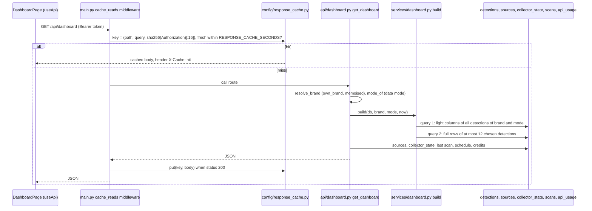

# Dashboard

## Plain-language summary

The Dashboard is the first screen after sign-in. It answers "how risky is my brand right now?" with four headline numbers (total detections, social impersonations, suspicious apps, official assets protected), a donut chart of the kinds of impersonation found, a bar list of where they were found, the five cases most in need of a human decision, the six most recent detections, an explanation of the highest-scoring case, and a small health card for the data sources. A "Run scan now" button starts a new scan. Every number is calculated from stored database rows for the active brand and the current data mode; nothing is hard-coded. To keep the page fast, answers are held for a few seconds and thrown away as soon as anyone changes something.

Real versus sample: when the data mode is `sample` all numbers come from fictional sample candidates, and the page footer says "Sample data for the fictional brand ... Not real detections." (`frontend/src/components/common/States.tsx:53-61`).

## Purpose and user-facing behaviour

Page `/dashboard` (`frontend/src/pages/DashboardPage.tsx:65`, route `frontend/src/App.tsx:97-105`). Blocks, top to bottom:

| Block | Source field in `GET /api/dashboard` | Code |
|---|---|---|
| Hero line: "Last scan ... · N of M sources online · Next scan HH:MM", buttons "Run scan now" and "Edit brand profile" | `last_scan_at`, `sources_online`, `sources_total`, `next_scan_at` | `DashboardPage.tsx:112-115`, `:166-201` |
| Four KPI tiles | `kpis.total_detections`, `social_impersonations`, `suspicious_apps` (each with `value`, `delta_week`, 7-point `trend` sparkline), `official_assets.value` | `:129-155`, `:206-227` |
| "Impersonation types" donut and legend | `by_type[]` (`type`, `count`, `percent`) | `:117-122`, `:231-255` |
| "Where we found them" bars | `by_platform[]` | `:123`, `:257-277` |
| "Needs review" list (max 5) with risk band chip | `needs_review[]` | `:279-308` |
| "Recent detections" table (max 6) | `recent[]` | `:313-360` |
| "Why it was flagged" card for the top detection | `top_detection`, `why_flagged` | `:364-397` |
| "Source health" mini card (first 6 sources), "Manage" link only for admins | `sources[]` | `:399-434` |

Behaviour details:

- With no brand, the API answers 404 and the page shows `NoBrand` (`:76`, `:89-98`).
- "Run scan now" calls `useScan('all', ...)`, which starts `POST /api/scan` (analyst or admin only; viewers see the disabled button with the tooltip "Your role can view but not start scans", `:183-192`), polls `GET /api/jobs/{job_id}` every second for up to 10 minutes, then reloads the dashboard and the brand (`frontend/src/hooks/useScan.ts:10-11`, `:44-65`; `DashboardPage.tsx:70-73`). A 409 "A scan is already running" attaches to the running job (`backend/app/api/scans.py:40-43`, comment at `useScan.ts:2`).
- Clicking a case opens `/apps?detection=<id>` for `fake_app` and `/social?detection=<id>` for everything else (`DashboardPage.tsx:79`). **Needs confirmation:** look-alike web cases (type `lookalike_domain`, category `web`) are included in `needs_review` and `recent` but are sent to `/social`, although web findings have their own page `/web` (`frontend/src/App.tsx:137-144`). Confirm whether `/social` shows them.
- The API also returns `kpis.web_threats` (`backend/app/services/dashboard.py:82`) but the page renders no tile for it.
- `top_detection.on_allowlist` is hard-coded `False` (`services/dashboard.py:114`) because allowlisted assets never appear as detections, so the card always says "It is not on your allowlist".

## How the numbers are computed

`get_dashboard` (`backend/app/api/dashboard.py:19-49`): resolves the brand (`resolve_brand`, so only the caller's own brand, optional owned `brand_id`), the effective data mode, then:

1. **`dashboard.build`** (`backend/app/services/dashboard.py:46-120`), "two queries instead of ~60":
   - Query 1 selects only `id, type, category, platform, status, band, severity, score, found_at` for every detection of this brand with `source == mode` (`:49-52`). Everything below is computed in memory from those rows.
   - "Open" rows are statuses `new`, `reviewing`, `confirmed` (`OPEN_STATUSES`, `backend/app/services/detections.py:30`); "visible" rows add `dismissed`. `cleared`, `marked_official` and `retired` never count (`:53-54`).
   - KPIs: `kpi()` returns `value` (count), `delta_week` (rows with `found_at` in the last 7 days) and `trend` (for each of the last 7 days, how many open rows were found up to the end of that day, so it is cumulative) (`:35-43`). `total_detections` uses all open rows; `social_impersonations` the `social` category; `suspicious_apps` the `apps` category; `web_threats` the `web` category. `official_assets` is `len(brand.accounts) + len(brand.apps)` (`:78-84`).
   - `by_type`: counts per detection type among open rows, with whole-number percentages that always add up to 100 (`_percentages`, largest remainder, `:15-24`). The `lookalike_domain` type is listed only once something was found (`:97-99`). `by_platform` is sorted by count descending, then name (`:59`).
   - `counts`: `by_status` (visible rows), `by_band` and `by_severity` (open rows), `by_category`, and `cleared` (rows the engine kept below threshold) (`:85-96`).
   - `needs_review`: the 5 `new` or `reviewing` rows with the highest score (ties by newest id) (`:63`). `recent`: the 6 most recently found open rows (`:64`). `top_detection`: the open row with the highest score (`:65`). Only these at most 12 rows are fetched in full in query 2 (`:66-70`); `why_flagged.reasons` lists the top detection's `signal, label, detail, points` (`:116-119`).
2. **Sources** (`api/dashboard.py:33-40`): `ensure_sources`, the current collector selection and collector states feed `source_item` (the same function as Source Health, `backend/app/api/sources.py:76-122`), giving `id, slug, name, kind, status, monitored, message`, plus `sources_online` and `sources_total`. Sources are global, not per brand.
3. **Last scan and schedule** (`:42-47`): the latest scan of this brand in state `completed`, `partial` or `failed` gives `last_scan_at` and `last_scan` (`scan_view`); `schedule_status` for this brand gives `next_scan_at` and the `schedule` block (enabled, interval, whether credits stretched or paused it, "waiting for official assets") (`backend/app/services/scheduler.py:124-144`).
4. **Credits** (`:48`): `credits` is the Tavily ledger snapshot only when the effective mode is `live`, otherwise `null`.

The response also carries `brand {id, name}`, `data_mode`, `is_sample` and `includes_sample`. The frontend notes any JSON answer containing `is_sample` or `data_mode` to drive the global "sample data" flag (`frontend/src/api/sample.ts:14-33`).

## Caching: two layers

### 1. HTTP response cache (`backend/app/config/response_cache.py`, middleware in `backend/app/main.py:137-158`)

- A short in-process cache for heavy read-only pages. `CACHEABLE` includes `/api/dashboard`, `/api/sources`, `/api/settings`, `/api/detections` (and `/excluded`, `/false-positives`), `/api/brands`, `/api/reports`, `/api/lookalike/test-cases`, `/api/scans`, `/api/scans/latest`, `/api/providers` (`response_cache.py:15-18`). The brand-scoped lists are keyed by the full query string, so a different filter is a different entry.
- Key = `(path, query string, first 16 hex characters of SHA-256 of the Authorization header)` (`:24-25`), so entries are separate per sign-in token. A hit is answered by the middleware itself with header `X-Cache: hit`, before the route and its authentication run (`main.py:143-147`). Only `200` answers are stored (`:149-153`); at most 400 entries, then the whole store is cleared (`response_cache.py:19`, `:36-40`).
- Lifetime `RESPONSE_CACHE_SECONDS` (default 15, `0` = off) (`config.py:123`). It is forced to 0 on Vercel unless set explicitly, because a per-instance cache would go stale across instances (`config.py:184`).
- **Invalidation:** any non-GET, non-HEAD, non-OPTIONS request under `/api` clears the whole cache after it runs (`main.py:155-158`), so switching brand (`POST /api/brands/{id}/select`), reviewing a detection, editing settings and so on show up at once. A scan also clears it when it is queued and when it ends (`_busts_cache` around `request_scan` and the scan finish, `backend/app/core/pipeline/scan_pipeline.py:132-145`).
- Limits: it is per process, so another worker's writes are seen after at most the TTL (`response_cache.py:6-7`); and the Tavily credit snapshot has its own 3-second cache when the response cache is on (`backend/app/core/collectors/selection.py:137`).

### 2. Per-request memo (`backend/app/db/request_cache.py`)

- `memo(db, key, load)` stores a value in `Session.info` for the lifetime of one request's database session (`:17-21`). The memo is dropped on every `after_flush`, `after_commit` and `after_rollback`, so it can never outlive a write (`:28-30`).
- Used so that repeated identical reads inside one request cost one query: the whole `settings` table is loaded once (`backend/app/services/setting_rows.py`, key `"settings_all"`, used by `data_mode.get_data_mode` and `app_settings`), and brand lookups are memoised per user (`backend/app/api/common.py:24`, `:40`, `:57`). This matters because the database may be remote (every query is a network round trip; see the pool comments in `backend/app/db/session.py:18-33`).

## Files, functions, tables, services

| Item | Path |
|---|---|
| Endpoint | `backend/app/api/dashboard.py` (`get_dashboard`) |
| Aggregation | `backend/app/services/dashboard.py` (`build`, `kpi`, `_percentages`, `_count_by`) |
| Detection helpers (`summary_row`, `OPEN_STATUSES`, `ALL_TYPES`) | `backend/app/services/detections.py` |
| Sources, schedule, credits | `backend/app/api/sources.py` (`source_item`), `backend/app/services/scheduler.py` (`schedule_status`), `backend/app/core/collectors/credits.py` |
| Caches | `backend/app/config/response_cache.py`, `backend/app/main.py:137-158`, `backend/app/db/request_cache.py` |
| Page, charts | `frontend/src/pages/DashboardPage.tsx`, `frontend/src/components/charts/Donut.tsx`, `Sparkline.tsx`, `frontend/src/hooks/useScan.ts`, `useApi.ts` |

Tables read: `detections`, `official_accounts`, `official_apps` (lazy-loaded through the brand), `sources`, `collector_state`, `scans`, `settings`, `api_usage` (live mode only). Nothing is written by the dashboard endpoint. External services: none called by the dashboard itself; "Run scan now" starts a scan which may call the collectors (see `docs/features/source-health-and-providers.md`).

## APIs used by the page

| Endpoint | Role | Purpose |
|---|---|---|
| `GET /api/dashboard` | any signed-in user | all numbers and lists |
| `POST /api/scan` `{scope: "all"}` | `admin`, `analyst` | start a scan; 409 when a scan is running or no brand exists |
| `GET /api/jobs/{job_id}` | any signed-in user (own brand only) | scan progress |
| `GET /api/me` and `GET /api/brands/{id}` | any signed-in user | brand refresh after a scan |

## Permissions, errors, edge cases

- Tenant isolation: the numbers are for `resolve_brand(...)` only; `GET /api/jobs/{id}` answers 404 "Job not found" for another account's scan (`backend/app/api/scans.py:48-53`).
- Roles: everyone can read; viewers cannot start a scan (403 from `require_writer`, button disabled). Admins additionally see the "Manage" link to Source Health (`DashboardPage.tsx:403-407`).
- Switching the active brand in the sidebar clears the browser query cache and reloads the brand, so the dashboard reloads for the new brand (`frontend/src/components/layout/BrandSwitcher.tsx:43-58`; see `docs/features/brand-registry.md`).
- After a brand identity change older detections are `retired` and disappear from every number here until a new scan finds matches (`backend/app/services/detections.py:499-505`).
- Empty states: "No detections yet.", "Nothing found yet.", "Nothing needs review.", "No flagged detection to explain yet." (`DashboardPage.tsx:244`, `:263`, `:288`, `:395`).
- If a scan failed the page shows its message in a notice (`:203-204`, `scanSummary` `:54-63`); partial scans (some source unavailable) are a normal outcome and are summarised as "Some sources were slow or unavailable; results from the others were saved."

## Related configuration (names only)

`RESPONSE_CACHE_SECONDS`, `SCAN_EXECUTOR`, `SCHEDULER_ENABLED`, `SCAN_INTERVAL_MINUTES`, `TAVILY_MONTHLY_BUDGET`, `SOURCE_SLOW_THRESHOLD_MS`, `SEVERITY_MEDIUM_MIN`, `SEVERITY_HIGH_MIN`, `SEVERITY_CRITICAL_MIN`, `DB_POOL_SIZE`, `DB_MAX_OVERFLOW`, `DB_POOL_RECYCLE`, `DB_PRE_PING` (`backend/app/config/config.py:105`, `:122-124`, `:166-168`; `backend/app/db/session.py:24-27`).
