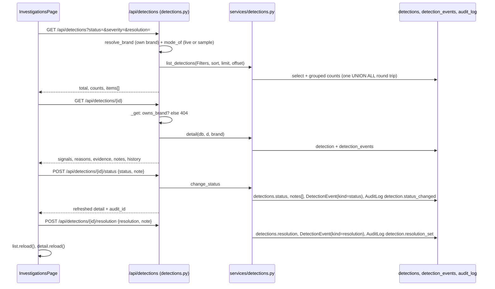

# Investigations

## Plain-language summary

When a scan finds something that might be impersonating the brand (a fake profile, a fake app, a look-alike website), it becomes a "case" with a risk score. The Investigations page lets a person work each case to a decision. They record a status (keep reviewing, confirm as fake, or dismiss) and, separately, an outcome called a resolution (true positive, false positive, resolved, or still monitoring), with an optional note. Every decision is saved with who made it and when, and also written to the audit log. The system never reports or takes anything down by itself: it only records what a person decided.

This feature is real code against the database. The cases themselves come from scans; in sample data mode they are sample records (see `docs/features/source-health-and-providers.md` for data modes).

## Purpose and user-facing behaviour

Page `/investigations` (`frontend/src/App.tsx:145-152`, component `InvestigationsPage`, `frontend/src/pages/InvestigationsPage.tsx:18`):

- Three filters (status, severity, resolution) and a list of cases for the active brand (`:21-33`). Each row shows name or handle, category, platform, resolution, score, severity chip and status chip (`:94-110`). The first case is selected by default (`:35`).
- The case panel (`CasePanel`, `:124-200`) shows status, severity and resolution chips, the score line, a note box (max 1000 characters, `:161`), three status buttons (Reviewing, Confirmed, Dismissed), a resolution dropdown with "Save resolution", and a timeline built from `history` (newest first, `:187-197`).
- A viewer sees "Read only: your role can view but not change cases." and all buttons are disabled (`:183`, `canWrite` from `frontend/src/hooks/useMe.ts:33`).
- Status buttons are disabled once a case is `marked_official` (`:167`).
- With no brand yet the page shows `NoBrand` (`:39-48`).

### Vocabulary

| Field | Values | Set by | Code |
|---|---|---|---|
| `status` | `new` (initial), `reviewing`, `confirmed`, `dismissed`, `marked_official`, `cleared` (below threshold but near-name; false-positive guard), `retired` (brand identity changed) | people can set only `reviewing`, `confirmed`, `dismissed`; `marked_official` via the mark-official action; `new`, `cleared`, `retired` by the system | `backend/app/models/detection.py:32-33`; `backend/app/services/detections.py:30-33`, `:308-312` |
| `resolution` | `true_positive`, `false_positive`, `resolved`, `monitoring`, or null | `POST /api/detections/{id}/resolution` | `models/detection.py:34-35`; `services/detections.py:329-345` |
| `severity` | `LOW`, `MEDIUM`, `HIGH`, `CRITICAL` | risk engine at scan time (default cutoffs 40 / 70 / 85) | `models/detection.py:28-29`; `backend/app/config/config.py:166-168` |
| `band` | `high`, `medium`, `low` | scan | `models/detection.py:27` |

Status and resolution are independent: setting a resolution never changes the status (`services/detections.py:333`, docstring).

## Step-by-step flow

1. **List.** `GET /api/detections` (`backend/app/api/detections.py:59-97`). Query filters: `category` (`social|apps|web`), `type`, `platform`, `band`, `severity`, `resolution`, `status` (repeatable), `source` (`live|sample|all`), `q` (max 200, substring match on name, handle, package id, publisher), `min_score`, `sort`, `from`, `to`, `limit` (1-200, default 50), `offset`, `brand_id`. The brand is `resolve_brand(db, brand_id, user)`, so it is the user's active brand unless an owned `brand_id` is passed (`:81`). By default only records of the current data mode are returned; `source=all` shows both (`_source_filter`, `:52-56`). The Investigations page sends none of `source`, `sort`, `limit` except the `sm.detections` defaults `sort=score_desc, limit=200` (`frontend/src/api/sm.ts:108-109`).
2. **Which statuses appear.** With no `status` filter the list shows `new, reviewing, confirmed, dismissed` (`LISTED_STATUSES`, `services/detections.py:31`). `cleared`, `retired` and `marked_official` never appear in a list; asking for `marked_official` explicitly is stripped out (`:81-83`), so the "Marked official" option in the status filter (`InvestigationsPage.tsx:14`) returns an empty list. **Needs confirmation:** confirm this is the intended behaviour for that filter option. Invalid status values return 422 (`detections.py:87-89`).
3. **Detail.** `GET /api/detections/{id}` returns the score breakdown (`signals`, `weights`, `reasons`, `name_match`, `domain`, `reputation`, `logo`, `text_analysis`), the evidence summary (page URL, capture time, snapshot hash, screenshot link), `score_history`, `notes`, the append-only `history`, and category-specific blocks (`suspect`, `official`) (`services/detections.py:229-283`).
4. **Status.** `POST /api/detections/{id}/status` with `{status, note}` (`note` max 1000). Shortcuts `POST .../confirm`, `.../keep-reviewing`, `.../dismiss` do the same with an optional note (`detections.py:177-188`). `change_status` (`services/detections.py:308-326`): aliases such as `confirm` or `keep-reviewing` are accepted (`:34-35`); anything other than `reviewing|confirmed|dismissed` returns 422; a `marked_official` detection returns 409 "This asset was marked official and is on the allowlist. Remove it from the allowlist first."; setting the same status with no note is a no-op (returns no audit id); otherwise it stores the note in `detections.notes` (keeps the last 50, `[-50:]`), adds a `DetectionEvent` and an audit row `detection.status_changed`, and commits.
5. **Resolution.** `POST /api/detections/{id}/resolution` with `{resolution, note}` (`detections.py:170-174`); `set_resolution` stores it, adds a `DetectionEvent(kind="resolution")` and an audit row `detection.resolution_set` with detail `"<old or none> -> <new>: <note>"` (`services/detections.py:332-345`).
6. **Mark official** (not on the Investigations page, but the same service). `POST /api/detections/{id}/mark-official` adds the asset to the brand allowlist (`official_accounts` or `official_apps`), records an `official_matches` row and closes the case, so future scans drop it before scoring (`services/detections.py:348-414`). Refused (422) for web look-alike domains (add the domain to the brand profile instead), for apps not listed on Google Play or the App Store, for detections with no package id or handle, and for handles over 30 characters; 409 if already marked official.

## Files, functions, classes

| Item | Path |
|---|---|
| Routes and request bodies (`StatusBody`, `ResolutionBody`, `NoteBody`, `MarkOfficialBody`) | `backend/app/api/detections.py` |
| Queries, serialisation, review actions, `ActionError` | `backend/app/services/detections.py` |
| Models `Detection`, `DetectionEvent`, `OfficialMatch` | `backend/app/models/detection.py` |
| Audit helper | `backend/app/services/audit.py:6-26` |
| Page and hooks | `frontend/src/pages/InvestigationsPage.tsx`, `frontend/src/hooks/useApi.ts`, `useBrand.ts`, `useMe.ts`; API calls `sm.detections`, `sm.detection`, `sm.setReview`, `sm.setResolution` (`frontend/src/api/sm.ts:108-118`) |

## APIs, tables, external services

| Endpoint | Method | Role | Notes |
|---|---|---|---|
| `/api/detections` | GET | any signed-in user | list with filters and counts |
| `/api/detections/{id}` | GET | any signed-in user | detail, 404 if not the user's brand |
| `/api/detections/{id}/evidence`, `/evidence/screenshot` | GET | any signed-in user | see `docs/features/reports.md`; screenshot 404 "No screenshot was captured (screenshots are off by default)" |
| `/api/detections/{id}/status`, `/confirm`, `/keep-reviewing`, `/dismiss` | POST | `admin`, `analyst` | writer only |
| `/api/detections/{id}/resolution` | POST | `admin`, `analyst` | writer only |
| `/api/detections/{id}/mark-official` | POST | `admin`, `analyst` | writer only |
| `/api/detections/excluded`, `/false-positives` | GET | any signed-in user | official items and `cleared` list |

Tables touched: `detections` (`status`, `resolution`, `notes`, `updated_at`), `detection_events` (append-only history), `audit_log`, and for mark-official `official_accounts`, `official_apps`, `official_matches`. The `resolution` column came from migration `0007_resolution.py`. No external service is called: this feature only records human decisions (`services/detections.py:1-5`, docstring).

## Validation, permissions and error handling

- **Tenant isolation:** `_get` returns 404 "Detection not found" unless `owns_brand` is true (`detections.py:38-42`); `owns_brand` is in `backend/app/api/common.py:53-58`.
- **Roles:** reads need any signed-in user; every change needs `require_writer` (`admin` or `analyst`); a `viewer` gets 403 "You do not have permission to do this" (`backend/app/config/deps.py:46-56`). The UI disables the buttons for viewers as well (`InvestigationsPage.tsx:167`, `:174`, `:179`).
- **Notes:** at most 1000 characters (Pydantic `Field(max_length=1000)`, `detections.py:21`, `:26`); trimmed; kept as `{at, actor, text, kind:"reviewer"}`, newest 50 only.
- **Errors:** `ActionError` is converted to `HTTPException` with the same status and message (`detections.py:45-49`). Validation errors are 422 with a `detail` list.
- **Audit:** `detection.status_changed`, `detection.resolution_set`, `detection.marked_official`, plus `app.added` / `account.added` when mark-official creates the allowlist entry. Rows carry the detection's `source` (`live` or `sample`). The audit log page is described in `docs/features/settings-and-audit.md`.
- **Edge cases:** a brand identity change retires all non-official detections (`status="retired"`) so they vanish from this page (see `docs/features/brand-registry.md`); `sync_with_allowlist` can move a case to `marked_official` automatically when an official account or app is added (`services/detections.py:430-445`); a status change to the same value with a note still records the note and event (`:317-318`).

## Related configuration (names only)

`SEVERITY_MEDIUM_MIN`, `SEVERITY_HIGH_MIN`, `SEVERITY_CRITICAL_MIN` (severity cutoffs, `backend/app/config/config.py:166-168`), `SCREENSHOTS_ENABLED` (screenshots off by default, `:121`), `STORAGE_BACKEND`. There is no feature flag for the review workflow itself.
