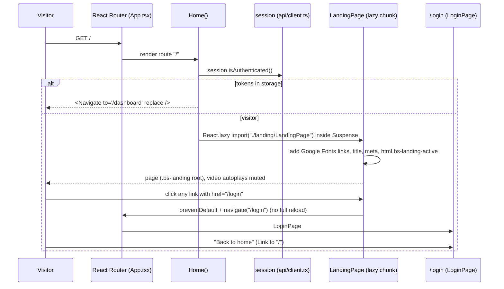

# Landing Page

## Plain-language summary

The landing page is the public marketing page people see when they open BrandShield's address (`/`) without being signed in. It explains what BrandShield does (finding fake social profiles, cloned apps and look-alike websites), plays a short product video and invites visitors to sign in. It is a ready-made design that was ported into the React app as-is, so it does not use the app's own styling. Every "get started" style button leads to the login page. Visitors who are already signed in never see it: `/` sends them straight to their dashboard.

---

## 1. Purpose and user-facing behavior

| Behavior | Detail | Source |
|---|---|---|
| Who sees it | Signed-out visitors at `/`. Signed-in users are redirected to `/dashboard`. | `frontend/src/App.tsx:28-36,183` |
| Content | Header with mega menus, hero with search box and floating orb, hero video card, "expertise" scroll section, example cards (fake profile, cloned app, look-alike domain), sources marquee, "about", "how it works" (`#engine`), Brand Studio section (`#studio`), footer | section ids at `frontend/src/landing/LandingPage.tsx:655,820,1002,1239,1324,1508,1664` |
| Calls to action | All 19 `href="/login"` links (header buttons, pills, round buttons, the hero search "Check" button, the Studio section button, footer) open the login page | `LandingPage.tsx` (for example `:275-346,576-618,704,1679`) |
| In-page links | `#top`, `#expertise`, `#how`, `#work`, `#marquee`, `#about`, `#engine`, `#studio` scroll within the page; smooth scrolling is turned on only while the page is mounted | `frontend/src/landing/landing.css:209` |
| External links | GitHub repository and three docs (`USER_GUIDE.md`, `FEATURE_STATUS.md`, `SECURITY.md`) with `target="_blank" rel="noopener"` | `LandingPage.tsx:490-529` |
| Back to home | The login and register pages show a "Back to home" link to `/` | `frontend/src/pages/LoginPage.tsx:117-120`, `frontend/src/pages/RegisterPage.tsx:126-129` |
| Page title | Sets `document.title` to "BrandShield — Digital Risk Protection with explainable scores" and a meta description while mounted, restored on leave | `LandingPage.tsx:9-10,21-49` |

---

## 2. Step-by-step flow

1. **Route.** `<Route path="/" element={<Home />} />` sits outside `RequireAuth`, so it is public (`frontend/src/App.tsx:183`).
2. **`Home()`** returns `<Navigate to="/dashboard" replace />` when `session.isAuthenticated()` (a token pair is in storage), otherwise renders the lazily loaded landing inside `<Suspense fallback={null}>` (`App.tsx:29-36`). The landing code is a separate chunk loaded with `lazy(() => import('./landing/LandingPage'))` so app users never download it (`App.tsx:26`).
3. **Document-level setup.** `useEffect` sets title and description, appends two `<link rel="stylesheet">` tags (Manrope and Unbounded from Google Fonts), and adds class `bs-landing-active` to `<html>`; the cleanup removes everything (`LandingPage.tsx:5-8,20-49`).
4. **Cursor dot.** A small dot follows the mouse through a ref (no React state per move). It is skipped unless the device supports hover and the user has not asked for reduced motion (`LandingPage.tsx:51-61`).
5. **Hero video.** `<video id="introVideo" src="/brandshield-intro.mp4" autoPlay muted loop playsInline preload="metadata">` (`LandingPage.tsx:638`); the file is `frontend/public/brandshield-intro.mp4`. A shield-icon fallback (`.vfallback`) shows until the `playing` event hides it. On a `error` event the sound button is hidden. With `prefers-reduced-motion: reduce` autoplay is removed, the video is paused and native controls appear. The "Sound on" button toggles `muted`, starts playback if paused and updates `aria-pressed`, `aria-label` and its text (`LandingPage.tsx:63-93`).
6. **CTA navigation.** One `onClick` on the `.bs-landing` root finds the closest `<a>`; if its `href` is exactly `/login` and no meta, ctrl or shift key is held, it calls `navigate('/login')` (client-side navigation). Modified clicks fall through to the browser (open in new tab) (`LandingPage.tsx:98-106`). Because the links are real anchors, the page also works if JavaScript routing fails.
7. **Login.** `/login` is `LoginPage`; after sign-in the user continues to the app (the `?next=/studio/` rule is unrelated to this page; see `docs/features/brand-studio.md`).

---

## 3. How the page was built (generated from a standalone design)

* The file header says: "Generated from the approved standalone design; markup is a verbatim port (class -> className, style strings -> objects)" (`LandingPage.tsx:1`). It is a 1,851-line component whose JSX is the exported HTML, with inline `style` objects and inline SVG icons. There is no component decomposition and no content from the API.
* **Scoped CSS.** All styles are in `frontend/src/landing/landing.css` (269 lines), imported by the component (`LandingPage.tsx:4`). Every selector is prefixed with `.bs-landing` (196 occurrences), and the design tokens are defined on `.bs-landing` (`--bg`, `--ink`, `--acc`, `--b1`, `--b2`, ...) rather than `:root` (`landing.css:1-5`). This keeps the page from affecting, or being affected by, the app's `tokens.css` and light-mode patches. The only global rule is `html.bs-landing-active{scroll-behavior:smooth}` (`landing.css:209`).
* **"Port addendum" blocks** at the end of the CSS fix things the app's global reset broke (input padding) and shorten the scroll distance of the hero video (`landing.css:187-269` region).
* **Fonts** come from Google Fonts at runtime (added in `useEffect`), so `connect`/`style-src`/`font-src` policies must allow `fonts.googleapis.com` and `fonts.gstatic.com`; the Vercel CSP does (`vercel.json:114`).
* **Test:** `frontend/src/landing/LandingRoute.test.tsx` checks that a signed-out visitor sees the heading matching /Threat detection/ inside a `.bs-landing` element and that a signed-in user is redirected to `/dashboard` (`LandingRoute.test.tsx:15-30`).

---

## 4. Scroll-driven video card

The hero video sits in a card that grows to full screen as you scroll.

* Markup order: `.herowrap` contains `.vlayer` > `figure.vcard` (the video) and then `section#top.hero` (`LandingPage.tsx:628-655`). A spacer `
` sits after the hero (`LandingPage.tsx:769`).
* Default layout: `.vlayer` is absolutely positioned over the hero (`height:max(100vh,720px)`, `z-index:40`, `pointer-events:none`), and the card is placed bottom right (`right:32px; bottom:100px`) with size `--cw` (`clamp(340px,27vw,520px)`) by `--ch` (16:9) and a rounded shape `110px 24px 24px 24px` (`landing.css:211-215,247`).
* With `@supports (animation-timeline: scroll())`: `.vlayer` becomes `position: sticky; height: 100vh; margin-bottom: -100vh`, and the card runs the `vgrow` keyframes tied to `scroll(root)` from 0 to 420 px of page scroll, growing to `width:100%; height:100vh; border-radius:0`. The "Product tour" chip fades between 260 and 420 px. `.vspacer` adds 420 px of scroll room (`landing.css:224-232,264-268`). The first version used 720 px and 1000 px; an addendum shortened it (`landing.css:261-268`).
* Below 1100 px width the card becomes a normal block under the hero (`position:relative`, `height:56vw`, no animation) (`landing.css:233-236`). With `prefers-reduced-motion` the animation is off and the layer stays absolute (`landing.css:237`). Browsers without scroll-driven animations simply show the static bottom-right card.
* The "expertise" section uses a similar mechanism with `view-timeline` (`.exp{height:1500px; view-timeline-name:--exp}`) for the growing card, text swaps and text colour reveals (`landing.css:88,187-200`).

---

## 5. Files and dependencies

| Path | Role |
|---|---|
| `frontend/src/landing/LandingPage.tsx` | The page (default export is the named export `LandingPage`) |
| `frontend/src/landing/landing.css` | All page CSS, scoped under `.bs-landing` |
| `frontend/src/landing/LandingRoute.test.tsx` | Route test |
| `frontend/public/brandshield-intro.mp4` | Hero video (served from the site root) |
| `frontend/src/App.tsx:26-36,183` | `lazy` import and `Home()` |
| `frontend/src/pages/LoginPage.tsx`, `RegisterPage.tsx` | "Back to home" links (`data-testid="back-to-home"`) |

* APIs used: none. DB tables: none. External services: Google Fonts (CSS only); the example cards and logos are inline markup, not fetched.
* Permissions: public route. Nothing is rendered conditionally on role.
* Edge cases: a stale or expired token in storage still counts as authenticated for `Home()`, so the user lands on `/dashboard`, where the API client refreshes or signs them out (`App.tsx:30`, `frontend/src/api/client.ts:108-136`). If the video file is missing the fallback shield stays and the sound button is hidden.
* Related config: none specific (no env var or feature flag). The video path is hard coded as `/brandshield-intro.mp4`.

**Needs confirmation:** the "standalone HTML design" the page was generated from is not in the repository (only its React port is), so the mapping from design to `LandingPage.tsx` cannot be re-run from this repo; the person who produced the port should confirm where the source design lives.
