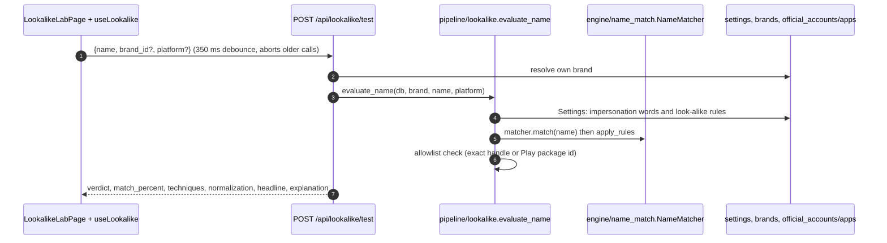
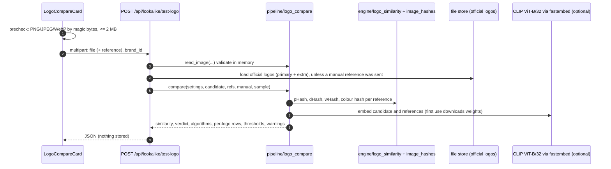

# Look-alike Lab

## Plain-language summary

The Look-alike Lab is a safe playground for checking how BrandShield judges impersonation, without creating any detection. You can
type a profile name, handle or app name and see instantly whether it would be flagged as a look-alike of your brand and why;
upload a suspicious logo and see how closely it resembles your official logos; run a built-in checklist of example names (some
that must be flagged, some that must not, some that are yours) to prove the matcher still behaves; and test domain names on the
Web Threats page. Nothing you do in the Lab is stored as a finding, and no score or report is created.

All paths are relative to the repository root (`ScamMind AI/`).

## 1. Purpose and user-facing behavior

Page: `frontend/src/pages/LookalikeLabPage.tsx` (header "Look-alike Lab", lines 63-66). Components, top to bottom:

| Block | What it does | Code |
|---|---|---|
| **Compare a logo** card | upload a candidate logo, compare with every official logo or with one manual reference logo | `frontend/src/components/common/LogoCompareCard.tsx:142-396`, mounted at `LookalikeLabPage.tsx:71` |
| **Test a name** | text box "Profile name, handle or app name"; verdict appears 350 ms after typing stops | `LookalikeLabPage.tsx:76-143`, hook `frontend/src/hooks/useLookalike.ts:8-45` |
| Preset pills | the first 8 stored test-case names of this brand | `LookalikeLabPage.tsx:50,93-104` |
| "How the name was normalized" | 5-step timeline (typed, lower-cased, look-alike characters folded, spaces and symbols removed, brand + extra words) | `LookalikeLabPage.tsx:128-139`, built by `_normalization` (`backend/app/core/pipeline/lookalike.py:101-111`) |
| "Variations we catch" and "How we avoid over-flagging" | static explanations with examples derived from the brand name (`brandExamples`) | `LookalikeLabPage.tsx:148-211` |
| **Test cases** table | stored cases (expected verdict), button "Run test cases", pass/fail per row and "N of M pass" | `LookalikeLabPage.tsx:216-275` |
| URL tester | lives on the **Web Threats** page, not here (see `docs/features/web-threats.md`) | `frontend/src/pages/WebThreatsPage.tsx:138-259` |

Roles: the name tester, the URL tester, logo comparison (`POST /api/lookalike/test-logo`), reading test cases and the logo-engine status need any signed-in
user (`get_current_user`, `backend/app/api/lookalike.py:70-122`). **Run test cases** needs `admin` or `analyst` (`require_writer`, lookalike.py:158-164; the button is disabled for viewers,
`LookalikeLabPage.tsx:232-233`). Adding or deleting a test case needs `admin` (`require_admin`, lookalike.py:133-155); the page has no UI for that, only the API. "Add this reference as an official
logo" (logo card) needs `admin`/`analyst` because it calls `POST /api/brands/{id}/logos` (`backend/app/api/brands.py:449-453`, `require_writer`; button shown only when `canWrite`, `LogoCompareCard.tsx:382`).

Nothing is saved by the testers: "Pure: no side effects, safe to call on every keystroke" (lookalike.py:72) and "Nothing is stored; no score or detection is created" (lookalike.py:94).
The only writes in this feature are the seeding of built-in test cases, adding/deleting cases, an audit row when cases are run, and the optional "add as official logo".

## 2. Name tester

- Request body `TestBody` (`backend/app/api/lookalike.py:26-37`): `name` 1-200 characters, whitespace collapsed and control characters dropped (`clean_name`, lines 21-23); empty after cleaning is a 422
  "Type a name to test". `brand_id` defaults to the user's own brand; someone else's brand id is a 404.
- Logic (`evaluate_name`, `backend/app/core/pipeline/lookalike.py:114-152`): uses the **same engine and the same Settings** as a real scan (`build_matcher` with the configured impersonation words;
  `apply_rules` with the Settings switches for character swaps, digits and symbols, added words, spacing, transposed or missing letters).
  Verdicts returned:

| `verdict` | When | `official_basis` |
|---|---|---|
| `official` | the name (without `@`) is an exact official social handle (optionally for the given platform) or an exact Google Play package id on the allowlist | `allowlist` |
| `official` | the engine verdict is `brand_name` (the exact brand name). The text explains that in a real scan the name alone excludes nothing, only an exact handle, URL or package id does | `name` |
| `flagged` | engine verdict `flagged`; `reasons` lists techniques (character swap, digit or symbol swap, added word, spacing, transposed, missing/extra letter, homoglyph) and impersonation words | `null` |
| `not_flagged` | anything else, including `review` (half weight in a scan); mentions switched-off rules when relevant | `null` |

- Response also contains `match_percent`, `engine_verdict`, `techniques`, `technique_labels`, `squat_category`, `edit_distance`, `normalization[]`, `on_allowlist`, `headline`, `explanation` (lookalike.py:125-133).
- The matcher itself (`backend/app/core/engine/name_match.py:1-25`) decides in order: exact after folding, brand token plus extra words (flagged only for digits or impersonation words), one edit,
  window within one edit with only known leftover words, two edits for long brands (always `review`), first word only, otherwise safe. Folding handles lower case, `@`, leet digits, Unicode
  homoglyphs, accents, full-width, `rn`->`m`, `vv`->`w`, separators. Tokens shorter than 5 characters are matched exactly only (`MIN_LEN_ONE_EDIT`, line 81). This is why "Acme Bakery" is never a hit for "Acme Bank".
- All local code: provenance `local_algorithm`; no external service is called.

## 3. Test cases

- Built-in cases are generated **per brand** from its registered name by `default_cases` (`backend/app/core/pipeline/lookalike.py:27-70`): 12 cases, de-duplicated case-insensitively:

| # | Expected | Construction (example for "Acme Bank") |
|---|---|---|
| 1 | flagged | glyph swap: `m`->`rn`, `w`->`vv`, `d`->`cl`, or a Cyrillic look-alike letter: `acrnebank` |
| 2 | flagged | `<name> Support`: `Acme Bank Support` |
| 3 | flagged | separated: `acme-bank` |
| 4 | flagged | spaced letters: `A C M E Bank` |
| 5 | flagged | digit swap (`e`->`3`, `a`->`4`, `o`->`0`, `i`->`1`): `acm3bank` |
| 6 | flagged | transposed last word: `Acme Bnak` |
| 7 | flagged | `<compact>_official`: `acmebank_official` |
| 8-10 | not_flagged | `<first word> Bakery`, `Hotels`, `Weather` (other businesses) |
| 11 | official | the exact name: `Acme Bank` |
| 12 | official | `@<compact>`: `@acmebank` |

  The docstring says they are not filtered by what the matcher says, "a failing case is information" (lookalike.py:30-31).
- Seeding: `ensure_default_cases` (78-98) inserts them once per brand when it has none (so an admin's deletions are respected), under a process lock plus the partial unique index
  `uq_lookalike_cases_builtin_name` to avoid duplicates from simultaneous requests (`backend/app/models/ops.py:144-160`). Rows get `builtin=True`, `source="sample"`. It is also triggered
  by `GET /api/lookalike/test-cases`, so a read can write.
- When a brand is renamed, its built-in cases are replaced by cases for the new name; admin-added cases are kept (`rebuild_default_cases`, lookalike.py:186-190, called from
  `backend/app/api/brands.py:188-189`).
- `GET /api/lookalike/test-cases` returns `{total, items:[{id, name, expected, builtin, source}]}` (lookalike.py:125-130).
- `POST /api/lookalike/test-cases` (admin): body `{name 1-200, expected: flagged|not_flagged|official}`; duplicate name+expected is 409 "This test case already exists"; audit `lookalike.case_added` (133-144).
- `DELETE /api/lookalike/test-cases/{id}` (admin): 404 if the case is not in the user's brand; audit `lookalike.case_removed` (147-155).
- `POST /api/lookalike/test-cases/run` (writer): `run_cases` (lookalike.py:155-168) runs every stored case through `evaluate_name` and compares with `expected`; the result is **computed, never copied from the expected
  value**. Returns `{total, passed, failed, summary: "N of M pass", items:[{id, name, expected, result, pass, match_percent, builtin}], ran_at}` and writes audit `lookalike.cases_run` (lookalike.py:158-164).
- `confusion(items)` (lookalike.py:171-183) computes true/false positives and negatives, precision and recall of "flagged" over the cases. It is used by the Evaluation page
  (`backend/app/api/evaluation.py:60,84`), not by the Lab page.
- Results shown in the table exist only after a run; before that every row shows "Not run" (`LookalikeLabPage.tsx:57-59,264`).

## 4. URL tester (summary)

`POST /api/lookalike/test-url` and `GET /api/lookalike/test-urls` (lookalike.py:77-80,119-122) are surfaced on the Web Threats page; they compare a domain or URL with the official domains, never open it and
never call Safe Browsing (`backend/app/core/pipeline/lookalike.py:248-249,298`). Full description: `docs/features/web-threats.md`.

## 5. Logo comparison

### Endpoints

| Endpoint | Role | Purpose |
|---|---|---|
| `POST /api/lookalike/test-logo` (multipart `file`, optional `reference`, query `brand_id`) | any signed-in user | compare; 422 "Add an official logo in Brand Registry or upload a reference logo." when there is nothing to compare against (`backend/app/api/lookalike.py:83-110`, `NO_LOGO`, `logo_compare.py:47`) |
| `GET /api/lookalike/logo-engine` | any signed-in user | is the AI (CLIP) engine usable? Checks the package and the weights on disk only: no model load, no network (lookalike.py:113-116, `clip_status`, `logo_compare.py:117-126`) |

### Validation (`read_image`, `backend/app/core/pipeline/logo_compare.py:60-78`)

Size cap `LOGO_MAX_BYTES` (2 MB; 413), type from magic bytes only (PNG, JPEG, WebP; SVG and everything else 415; the filename is never read), Pillow `verify()` plus decode, minimum 16 x 16 px and maximum
6000 x 6000 px (422), maximum 25 million pixels (decompression-bomb guard `MAX_PIXELS`, line 32). The browser pre-checks type and size (`precheckImage`, `LogoCompareCard.tsx:28-33`), but the server is authoritative.
A very small image (< 64 px) or an almost single-colour one gets a warning (`_warnings`, 103-110).

### Algorithms

| Algorithm | Where | How |
|---|---|---|
| **pHash** | `backend/app/core/engine/logo_similarity.py:76-91` | 32 x 32 grayscale (auto-contrast, LANCZOS), 2-D DCT, low 8 x 8 block compared with its median (DC term excluded) -> 64 bits |
| **dHash** | logo_similarity.py:94-105 | 9 x 8 grayscale, bit = left pixel brighter than right neighbour -> 64 bits |
| **wHash** | `backend/app/core/engine/image_hashes.py:25-35` | simplified Haar low-pass of a 64 x 64 image reduced to 8 x 8 (not bit-identical to the ImageHash library) |
| **colour hash** | image_hashes.py:38-57 | 14-bin hue/saturation histogram, reported separately |
| hash score | logo_similarity.py:112-114 | `max(0, (1 - hamming/64 - 0.5) / 0.5) x 100` (unrelated images sit near 0.5 raw) |
| default hash similarity (`image-1`) | logo_similarity.py:117-124 | 0.6 x pHash + 0.4 x dHash |
| `multihash` (`image-2`) | image_hashes.py:22,76-83 | 0.4 pHash + 0.3 dHash + 0.3 wHash |
| **CLIP** (`Qdrant/clip-ViT-B-32-vision`) | logo_similarity.py:185,241-278 | image embedding through fastembed (ONNX Runtime, no torch), L2 normalised; cosine similarity |
| CLIP calibration | logo_similarity.py:190-203 | piecewise linear knots cosine -> score: (0.62,0), (0.80,55), (0.88,80), (0.97,90), (1.00,100) |
| combined | logo_similarity.py:206-211 | CLIP leads; a hash score >= 90 only lifts an already-similar (>= 55) CLIP score, never rescues a low one |

The Lab tester (`compare`, `logo_compare.py:140-188`) always returns the four fingerprint scores per reference (`algorithms`: `phash`, `dhash`, `whash`, `colorhash`), the headline `similarity`, and the CLIP score
when available. `method` is `clip+hash` or `hash`. Which hash backend produces `hash_similarity` follows `IMAGE_SIMILARITY_BACKEND` (`_image_impl`, scan_pipeline.py:332-347), so the Lab and scans use the same engine.
When CLIP is on, the model weights (about 336 MB) download into `DATA_DIR/models` on first use (a hint says up to half a minute; `FIRST_USE_NOTE`, `logo_compare.py:42`); a failure is remembered for 60 s so an offline machine
does not retry each request (`get_clip_embedder`, logo_similarity.py:291-310, `_FAILURE_TTL` 284). `LOGO_COMPARE_CLIP=off` forces hashes only; `auto` (default) uses CLIP when installed.

### Thresholds and verdicts (`verdict_for`, `logo_compare.py:50-57`; constants 29, `logo_similarity.py:32-33`)

| Similarity | Verdict | Meaning in the UI |
|---|---|---|
| >= 90 (`SAME_MIN`) | `same_logo` | red |
| >= 80 (`LIKELY_COPY_MIN`) | `very_similar` | red; copy, resize, recolour, JPEG recompress measured >= 80 |
| >= 55 (`SIMILAR_MIN`) | `somewhat_similar` | orange; slight crops or light edits, scores points in scans |
| < 55 | `different` | green; no points in scans |

(`VERDICT_TONE`, `LogoCompareCard.tsx:17`.) The same 55 / 80 cutoffs drive scan scoring (`image_points`, `backend/app/core/engine/scoring.py:102-107`): nothing below 55, a third of the maximum at 55, the maximum
at 90.

Extra behaviours: the best result across all official logos is the headline (`best`); a candidate against hashes only that scores below 55 is re-tested colour-inverted and, if that matches, a warning says it "looks like a
colour-inverted version" (`logo_compare.py:168-173`; known gap documented in `logo_similarity.py:11`). The response carries `thresholds`, `explanation` ("a risk signal, not proof of reuse"), `warnings`, `is_sample`
and `sample_note` (when the app is in sample data mode, `logo_compare.py:43-46`).

### UI details (`LogoCompareCard.tsx`)

Drag-and-drop pickers (accept `image/png,image/jpeg,image/webp`, 2 MB hint, line 128-137); official logos shown as blob thumbnails because the files sit behind the bearer header (`useOfficialThumbs`, 57-93);
optional manual reference mode (line 145, `manual = useManual && !!reference`); score ring, bar, per-algorithm rows with labels such as "pHash (overall shape)", per-logo table, a CLIP hint with the install command when the engine is not
available (`showHint`, lines 173-175; `CLIP_HINT = 'pip install fastembed'`); each new comparison aborts the previous one (`abortRef`, 154,194-197). "Add this reference as an official logo" (writers, manual mode only) uploads it
as an extra logo labelled "Added from Look-alike Lab" and refreshes the brand cache (221-223). That upload uses the stricter brand-logo rules (minimum 256 x 256 px, at most 10 extra logos, duplicates 409;
`backend/app/core/pipeline/logo.py:12,59-60`, `backend/app/api/brands.py:455-463`).

## 6. Files, tables, APIs, external services

| Item | Detail |
|---|---|
| Frontend | `frontend/src/pages/LookalikeLabPage.tsx`, `frontend/src/components/common/LogoCompareCard.tsx`, `frontend/src/hooks/useLookalike.ts`, `frontend/src/utils/logoCheck.ts`, `frontend/src/api/sm.ts:150-162` |
| API | `backend/app/api/lookalike.py` (`/api/lookalike/test`, `/test-url`, `/test-logo`, `/logo-engine`, `/test-urls`, `/test-cases` GET/POST/DELETE, `/test-cases/run`) |
| Pipeline and engine | `backend/app/core/pipeline/lookalike.py`, `logo_compare.py`, `backend/app/core/engine/name_match.py`, `logo_similarity.py`, `image_hashes.py`, `normalize.py`, `domain_match.py` |
| Tables | `lookalike_cases` (`backend/app/models/ops.py:144-162`), `audit_log`, read-only: `brands`, `brand_logos`, `official_accounts`, `official_apps`, `settings`; files via `stored_files` or `DATA_DIR` |
| External services | none at request time. The only network use is the one-off download of the CLIP model weights from Hugging Face by fastembed (REAL, optional, only when `fastembed` is installed and `LOGO_COMPARE_CLIP` is not `off`) |
| Mock or sample | the built-in test-case rows carry `source="sample"` because they are generated; logic is real. With data mode `sample` the logo card shows the sample note, and sample scan candidates compare against generated images (`backend/app/core/collectors/sample_images.py`) |

## 7. Validation, errors, edge cases

| Case | Behavior |
|---|---|
| Name empty or only control characters | 422 "Type a name to test" |
| Name over 200 characters | 422 (pydantic `max_length`); the hook also truncates to 200 (`useLookalike.ts:32`) |
| No brand | name tester: 404 "No brand profile yet. Create one first."; the page shows `NoBrand` (`LookalikeLabPage.tsx:108`) |
| Logo larger than 2 MB / wrong type / corrupt / too small or large | 413 / 415 / 415 / 422 with a plain message (`logo_compare.py:60-78`) |
| No official logo and no reference | 422 `NO_LOGO`; card shows a link to Brand Registry |
| CLIP not installed, weights missing, offline | falls back to hashes only; response `clip: {available: false, reason: not_installed | model_unavailable | off, hint}`; the UI shows the hint |
| First CLIP comparison | slow (model load); the UI warns up to half a minute |
| Duplicate test case | 409; non-admin add/delete 403 |
| Case deleted by an admin | not re-seeded as long as the brand still has at least one case |
| Hash tester on inverted logos | scores about 0; a warning appears (known gap) |

**Needs confirmation:** `TestBody.platform` (`backend/app/api/lookalike.py:29`) lets a caller restrict the allowlist check to one platform, but `LookalikeLabPage` and `sm.lookalikeTest`
(`frontend/src/api/sm.ts:151`) never send it, so in the UI the check is across all platforms. Confirm whether a platform selector is planned.

**Needs confirmation:** the hint text in `LogoCompareCard.tsx:25` is `pip install fastembed`, while the backend hint also mentions `requirements-extra.txt` (`logo_similarity.py:186`);
`fastembed` is listed in `backend/requirements-extra.txt` and not in `requirements.txt`. Confirm that the hosted deployment installs the extra requirements, otherwise CLIP is never active in production.

## 8. Config (names only)

`LOGO_COMPARE_CLIP` (`auto` | `off`, default `auto`; config.py:83), `IMAGE_SIMILARITY_BACKEND` (`hash` | `multihash` | `imagehash` | `clip`; config.py:81), `LOGO_MAX_BYTES` (2 MB; config.py:61), `DATA_DIR` (model cache
`DATA_DIR/models`, `logo_compare.py:113-114`). Settings page values `impersonation_words` and the five look-alike `rules` change name-tester results because the tester reads them (`lookalike.py:116-124`).
Dependencies: `fastembed` (optional, `backend/requirements-extra.txt`), `rapidfuzz`, `tldextract`, `idna` (`backend/requirements.txt`).
