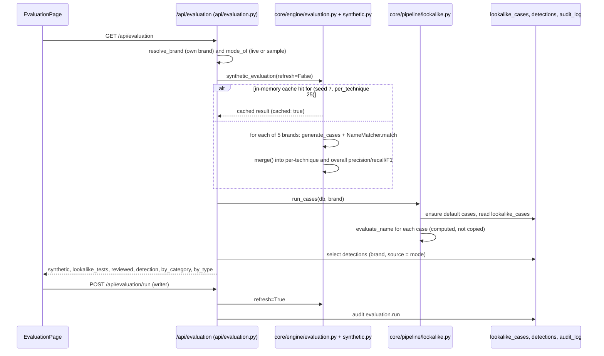

# Model evaluation

## Plain-language summary

The Evaluation page answers "how good is the look-alike name matcher?". It does this in two ways. First, it runs the matcher over a large set of made-up fake names (for five fictional brands) and counts how many it catches and how many innocent names it wrongly flags; this gives precision, recall and F1 for each trick (for example swapping letters for digits). Second, it shows real results from the people using the product: how many detections reviewers confirmed versus dismissed. The made-up numbers are deliberately labelled optimistic because the test names are made with the same tricks the matcher was built to catch. They show the matcher is consistent, not how it performs on real scammers. The page is administrator-only in the interface.

Sample versus real: the "synthetic" block is entirely generated data (never real impersonation reports). The "reviewer decisions" block is real, from this account's own brand and the current data mode.

## Purpose and user-facing behaviour

Page `/evaluation` (`frontend/src/pages/EvaluationPage.tsx:16`), wrapped in `RequireAdmin` (`frontend/src/App.tsx:174-179`), menu item for admins only (`frontend/src/components/layout/Sidebar.tsx:143-146`), and also linked from Settings, Account tab, "Open the evaluation" (`frontend/src/pages/SettingsPage.tsx:579-585`).

Sections, top to bottom (`EvaluationPage.tsx`):

1. Dataset banner: "SYNTHETIC DATA: generated, not real impersonation reports." plus dataset name, version, case count, algorithm versions and the split note (`:60-66`).
2. "Read this first" caveat from the server (`LABEL`) (`:67-69`).
3. Four headline tiles: synthetic precision, recall, F1, and reviewer precision (`:72-95`).
4. Confusion matrix and "Hard negatives by group" table (`:97-129`).
5. "Per class: reviewer decisions by category" (`:131-145`).
6. "By technique (synthetic names)" table: precision, recall, F1, found, missed, false alarms, with an Overall row (`:147-191`).
7. "Labelled look-alike test names": the brand's own 12 test cases with expected versus actual verdict (`:193-228`).
8. "Real results: reviewer decisions": confirmed, dismissed, marked official, pending (`:230-241`).

"Re-run evaluation" (`:44-52`) calls `POST /api/evaluation/run` and is disabled for roles that cannot write.

## Step-by-step flow

### How the synthetic evaluation set is built

- Brands: `BRANDS = ["Acme Bank", "Zenith Pay", "Orbit Telecom", "Zoho", "Northern Lights Mutual Insurance"]` (`backend/app/core/engine/evaluation.py:14`). `Zoho` is a real company name used only as a test string; all five are used as plain text.
- Generation: `generate_cases(brand, seed=7, per_technique=25, other_brands=...)` (`backend/app/core/engine/synthetic.py:235-286`). It is deterministic: the random generator is seeded with `"{seed}:{brand}"` (`:237`).
  - Positives (should be flagged): up to 25 distinct names for each of the 7 techniques plus a `mixed` generator, so up to 200 per brand. Generators: character swap, digit or symbol swap, added word, spacing or separator, transposed letters, missing or extra letter, homoglyph, and mixed (`:63-218`, registry `:223-232`; techniques list `backend/app/core/engine/name_match.py:58-66`).
  - Negatives (should not be flagged): hard negatives (other businesses sharing the brand's first or last word, benign suffixes such as the `BENIGN_SUFFIXES` list, words like "River Bank"), fan pages ("<brand> Fans", "Friends of <brand>"), authorized resellers ("<brand> Authorized Reseller"), and unrelated names including the other four brands (`:251-285`; groups `hard_negative`, `fan_page`, `authorized_reseller`, `unrelated`).
  - There is no train/test split: nothing is trained, every case is a test case (`api/evaluation.py:49`).
- Scoring: `evaluate_brand` runs `NameMatcher(brand).match(text)` for each case (`core/engine/evaluation.py:24-62`). A positive counts as found when the verdict is `flagged`; its label counts as correct (`label_ok`) when the technique that fired matches the generator's technique (for `mixed`, at least two techniques). A negative that is flagged is a false positive. `_prf` turns tp/fp/fn into precision, recall and F1 (`:17-21`). `merge` sums the five brands (`:86-96`), and `confusion` builds the binary matrix, false-positive and false-negative rates, accuracy and per-negative-group rates (`:65-83`).
- Important detail in the code: in `evaluate_brand` every technique row uses the total false-positive count of the brand's negatives (`_prf(tp[t], len(fp_neg), fn[t])`, `:53`), not false positives attributed to that technique, because negatives do not belong to a technique. So per-technique precision values are all computed against the same pool of false alarms; read them as "precision if this were the only technique".
- The synthetic evaluation uses a bare `NameMatcher(brand)`; it does not use the account's Settings (impersonation words, rules, sensitivity) and does not touch the database (`evaluation.py:27`).

### How it is cached

`synthetic_evaluation` stores its result in a module-level dict `_cache` keyed by `(seed, per_technique)` guarded by a lock (`backend/app/api/evaluation.py:30-56`). The inputs are fixed, so the result is stable. `GET /api/evaluation` always passes `refresh=False` (`:94-98`); `POST /api/evaluation/run` passes `refresh=True` and replaces the cached entry (`:101-108`). The cache is per server process, never expires by time, and is shared by all accounts because it does not depend on a brand. The response says `cached: true/false` and the page shows "(cached for this server process)" (`EvaluationPage.tsx:152`). The generic response cache (`RESPONSE_CACHE_SECONDS`) does not include `/api/evaluation` (`backend/app/config/response_cache.py:15-18`). With several server processes each keeps its own copy.

### The labelled look-alike test names and reviewer numbers

- `lookalike.run_cases` seeds 12 labelled cases for the brand on first use (7 look-alikes expected `flagged`, 3 other businesses `not_flagged`, 2 `official`) built from the brand's own name by `default_cases`, then runs every case through `evaluate_name`, which uses the real matcher, the brand allowlist and the Settings impersonation words (`backend/app/core/pipeline/lookalike.py:27-70`, `:78-98` (`ensure_default_cases`), `:114-122`, `:155-168`). The result is computed, not copied from the expected value. `confusion` over these cases gives precision and recall for `flagged` (`:171-183`). Admins can add or delete cases in the Look-alike Lab (`backend/app/api/lookalike.py:134`, `:148`); built-in cases are rebuilt when the brand name changes (`:186-190`).
- Reviewer numbers come from `detections` for this brand and the current data mode: `confirmed`, `dismissed`, `marked_official`, pending (`new` or `reviewing`). Precision is `confirmed / (confirmed + dismissed)`, or null when none are reviewed. The API states that recall cannot be measured without labelled ground truth (`api/evaluation.py:59-91`). `by_category` and `by_type` break this down; the page renders `by_category` only (`EvaluationPage.tsx:131-145`), `by_type` is returned by the API but not displayed.

## Files, functions, classes

| Item | Path |
|---|---|
| Endpoints, cache, `build`, `LABEL`, dataset constants (`DATASET_NAME = "scammind-synthetic-names"`, `DATASET_VERSION = "2"`) | `backend/app/api/evaluation.py:22-108` |
| `BRANDS`, `evaluate_brand`, `merge`, `confusion`, `_prf` | `backend/app/core/engine/evaluation.py` |
| Synthetic generators, `Case`, `MIXED`, `generate_cases` | `backend/app/core/engine/synthetic.py` |
| `NameMatcher`, `TECHNIQUES` | `backend/app/core/engine/name_match.py` |
| Labelled cases | `backend/app/core/pipeline/lookalike.py`, model `LookalikeCase` in `backend/app/models/ops.py:144` |
| Algorithm version constants | `backend/app/core/engine/risk_engine.py` (`ALGORITHM_V1`, `ALGORITHM_V2`), returned as `algorithm_version` |
| Page | `frontend/src/pages/EvaluationPage.tsx`; `sm.evaluation`, `sm.runEvaluation` in `frontend/src/api/sm.ts` |

## APIs, tables, external services

| Endpoint | Method | Role |
|---|---|---|
| `/api/evaluation?brand_id=` | GET | any signed-in user (the page itself is admin-only in the UI) |
| `/api/evaluation/run?brand_id=` | POST | `admin`, `analyst` (`require_writer`) |

Tables: `lookalike_cases` (read, and written on first use to seed the defaults), `detections` (read), `audit_log` (`evaluation.run` with the look-alike summary, for example "9 of 12 pass"). External services: none. The ML classifier is explicitly deferred: `"ml_classifier": "deferred until labelled analyst data exists"` (`api/evaluation.py:52`).

## Validation, permissions, edge cases

- Tenant isolation: the brand is always `resolve_brand(db, brand_id, user)`, so only the caller's own brand data appears; a foreign `brand_id` gives 404 (`api/common.py:22-27`, `:43-50`). The synthetic numbers are the same for every account.
- No brand yet: `resolve_brand` raises 404 "No brand profile yet. Create one first." and the page shows the error box (`EvaluationPage.tsx:56`).
- A plain `GET /api/evaluation` has a side effect: it seeds the 12 default look-alike cases for the brand if none exist (`lookalike.py:78-98`, called by `run_cases` at `:157`).
- Sample data: `data_mode` and `is_sample` are returned; in sample mode the reviewer numbers are over sample detections (`api/evaluation.py:81-84`).
- A failing labelled case is information, not an error (`lookalike.py:31`).
- **Needs confirmation:** the API lets any signed-in role read `/api/evaluation` and lets analysts re-run it, while the UI shows the page to admins only. Confirm that the API access level is intended.

## Related configuration (names only)

No environment variable controls the evaluation itself. Indirectly: `SEVERITY_MEDIUM_MIN`, `SEVERITY_HIGH_MIN`, `SEVERITY_CRITICAL_MIN` (risk engine cut-offs), the impersonation words and rules saved in Settings (used by the labelled cases only), and `RESPONSE_CACHE_SECONDS` (does not cover this endpoint).
