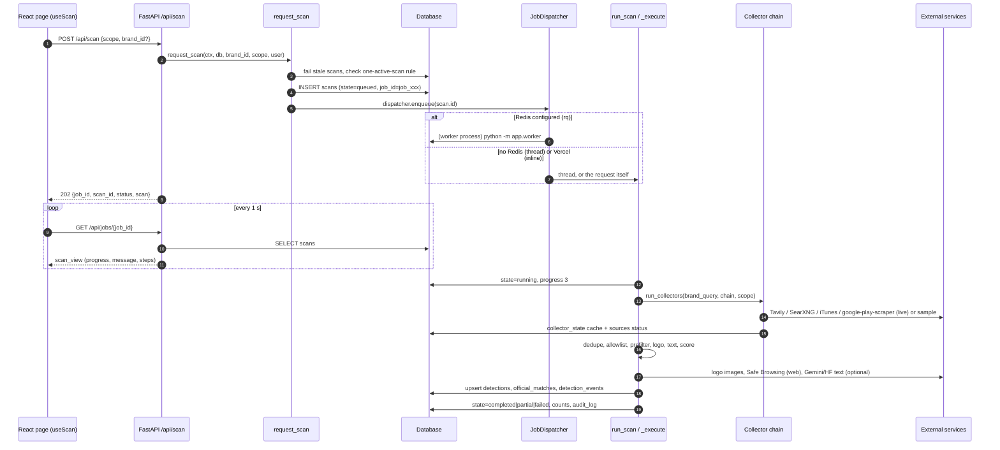

# Scanning and detection

## Plain-language summary

A "scan" is BrandShield's way of looking for people who pretend to be your brand. It searches social networks and app stores
for names that look like yours, checks each result against the official accounts and apps you registered (those are skipped),
scores everything that is left (name similarity, logo similarity, suspicious wording, account age ...) and saves the suspicious
ones as "detections" for a human to review. Nothing is reported or taken down automatically. A scan can be started by hand,
on a timer, or by a daily cron call. When no real search service is configured the app uses clearly fake "sample" data instead.

All paths below are relative to the repository root (`ScamMind AI/`). Line numbers refer to the code at the time of writing.

## 1. Purpose and user-facing behavior

| What the user sees | Where it comes from |
|---|---|
| "Scan social platforms now" / "Scan app stores now" buttons (scope `social` / `apps`) | `frontend/src/pages/SocialMonitoringPage.tsx:80-89`, `frontend/src/pages/AppStoreMonitoringPage.tsx:82-90`, hook `frontend/src/hooks/useMonitor.ts:64` |
| Dashboard scan button (scope `all`, which also covers web candidates) | `frontend/src/pages/DashboardPage.tsx:70` (`useScan('all', ...)`) |
| Progress percentage and message while scanning | `frontend/src/hooks/useScan.ts:44-65` polls `GET /api/jobs/{job_id}` every 1 s (`POLL_MS`, line 10) for at most 10 min (`MAX_WAIT_MS`, line 11) |
| "A scan is already running" is shown as a running scan, not an error | HTTP 409 handling in `frontend/src/hooks/useScan.ts:89-102`; a scan started elsewhere (scheduler, other tab) is attached to on page load (`useScan.ts:105-115`) |
| Sources bar with online / slow / unavailable pills | `frontend/src/components/monitor/MonitorParts.tsx:51-138`, fed by `GET /api/sources` (`backend/app/api/sources.py:125-157`) |
| Only scans for the signed-in user's own brand | `backend/app/api/scans.py:34-35` (someone else's `brand_id` is a 404 "Brand not found") and `backend/app/core/pipeline/scan_pipeline.py:146-155` (no own brand: `NoBrand`, HTTP 409) |

Roles: starting a scan needs role `admin` or `analyst` (`require_writer`, `backend/app/config/deps.py:56`). Viewers can read
scans and jobs (`get_current_user`). The UI disables the buttons for viewers (`SocialMonitoringPage.tsx:84-85`).

## 2. End-to-end flow

Step by step:

1. **Queue.** `POST /api/scan` (`backend/app/api/scans.py:25-45`) accepts `{"scope": "all"|"social"|"apps", "brand_id": int|null}`
   (`ScanBody`, lines 20-22) and returns HTTP 202. It calls `request_scan`
   (`backend/app/core/pipeline/scan_pipeline.py:146-191`), which:
   - resolves the brand (explicit id, or the user's oldest non-archived brand; the scheduler passes `user=None`, lines 149-155);
   - fails any queued/running scan older than `SCAN_STALE_MINUTES` (30) via `fail_stale_scans` (lines 117-125);
   - refuses with `ScanAlreadyRunning` (HTTP 409 and the running job in the body, `scans.py:40-43`) if one is active. A partial unique
     index `uq_scans_one_active_per_brand` also enforces this in the database (`backend/app/models/ops.py:56-58`, scan_pipeline.py:176-185);
   - freezes the data mode on the row (`Scan.data_mode`, line 170) and writes a `scan.started` audit row (lines 186-188);
   - generates `job_id = job_<ms-hex><brand-hex>` (line 164).
2. **Dispatch.** `JobDispatcher.enqueue` (`backend/app/services/jobs.py:39-52`) picks the executor, see section 3.
3. **Run.** `run_scan` (scan_pipeline.py:770-792) only starts a scan whose state is still `queued`, sets `running`/progress 3, calls
   `_execute` (803-871) and converts any crash into state `failed` with a redacted message (781-792).
4. **Collect.** `_execute` builds the collector chain (`select_collectors` then `CollectorRuntime.build`, scan_pipeline.py:809-815)
   and calls `run_collectors` (810-823). Progress is set to 40.
5. **Process** every unique candidate: allowlist, prefilter, logo, text analysis, scoring, persistence (sections 5-9).
   Progress moves from 40 to 95 and is committed every 25 candidates (scan_pipeline.py:865-867).
6. **Finish.** `_finish` (873-919) decides the final state, stores `counts`, `source_report`, `steps`, `errors`, `timings`, `result`
   and writes the `scan.finished` audit row.

### Scan states and what the API returns

`scan_view` (scan_pipeline.py:926-955) exposes two vocabularies: `status` = the real state (`queued | running | completed | partial | failed`)
and `state` = the older job vocabulary (`queued | running | done | error`; `completed` and `partial` both map to `done`, `failed` to `error`).

| Final state | Rule (scan_pipeline.py:873-887) |
|---|---|
| `failed` | every active (non-skipped) collector was unavailable AND no fresh (non-cached) candidate exists |
| `partial` | some collector unavailable, or a slow collector reported warnings |
| `completed` | none of the above |

A failing source never blocks a scan: its cached results (flagged `stale`) are used instead (see section 4).

## 3. Job queue vs inline execution (Vercel), scheduler and cron

| Executor | When | Code |
|---|---|---|
| `rq` (Redis + RQ worker) | `SCAN_EXECUTOR=auto` (default) and `REDIS_URL` set, or `SCAN_EXECUTOR=rq` | `backend/app/services/jobs.py:23-30`; enqueue `jobs.py:59-67` (`app.worker.run_scan_job`, `job_id=f"scan-{id}"`, timeout `SCAN_JOB_TIMEOUT_SECONDS`=900) |
| `thread` (in-process daemon thread) | no `REDIS_URL`, or Redis could not be reached when queuing (falls back and logs a warning, `jobs.py:46-51`) | `jobs.py:51-52` |
| `inline` (runs inside the HTTP request) | tests, and **Vercel by default** (`SCAN_EXECUTOR` defaults to `inline` when `VERCEL` is set unless you set it yourself) | `jobs.py:40-42`, `backend/app/config/config.py:175-190` (defaults at 181-187) |

- Worker process: `python -m app.worker` (`backend/app/worker.py:45-60`). It builds its own `ScanContext` (`worker.py:28-37`), listens on queue
  `SCAN_QUEUE_NAME` (default `scans`) and uses `SimpleWorker` on Windows because RQ's forking worker is not available there (line 58).
  It exits with code 2 when `REDIS_URL` is missing (lines 49-51).
- On Vercel the request that started the scan also runs it, so the `POST /api/scan` response already contains the finished scan
  (`scans.py:44`, comment "an inline run has already finished by now"). `vercel.json` gives the backend function `maxDuration: 300`
  seconds (`vercel.json`, `services.backend.functions`).
- **Scheduler loop** (local / Docker): `SchedulerLoop` (`backend/app/services/scheduler.py:192-218`) is a daemon thread that calls
  `scheduler_tick` every `SCHEDULER_POLL_SECONDS` (60, minimum 5). It is started in the app lifespan only if `SCHEDULER_ENABLED` and
  `APP_ENV != test` (`backend/app/main.py:84-89`). On Vercel `SCHEDULER_ENABLED` defaults to false (config.py:182).
- **Cron** (Vercel): `GET /api/cron/scan` (`backend/app/api/cron.py:32-46`) is scheduled `0 6 * * *` in `vercel.json` (`crons`).
  Requires `Authorization: Bearer <CRON_SECRET>` (503 when the secret is unset, 401 when wrong, `cron.py:34-37`). It calls the same
  `scheduler_tick` with `now + 60 min` slack (`CRON_SLACK`, cron.py:24) and returns `{ran, skipped, reason, scan_id}`.
  Full detail in `docs/background-jobs-and-integrations.md`.
- **Schedule decision** (`decide_schedule`, scheduler.py:52-89, pure function): interval from `SCAN_INTERVAL_MINUTES` env (wins) or the
  Settings page value `off|5m|15m|1h|1d` (`backend/app/services/app_settings.py:15-16,79-83`, default `1d`, line 20).
  When Tavily is part of the live chain the interval is **stretched** so the monthly credit budget lasts (scheduler.py:1-13, 68-84), and
  scheduled scans are **paused** (manual scans still work) when fewer than two scans' worth of credits remain (lines 70-77).
  A brand with no official account or app is not scanned by the scheduler ("Waiting for the first official account or app",
  scheduler.py:92-95, 168-169). At most `SCHEDULER_MAX_BRANDS_PER_RUN` (5) brands are started per pass (line 178).
- **Status endpoints**: `GET /api/scan/status` (`scans.py:56-80`: last scan, next scan, schedule, running job, data mode),
  `GET /api/jobs/{job_id}` (48-53), `GET /api/scans` (83-95, `limit` 1-100), `GET /api/scans/latest` (98-102), `GET /api/scans/{scan_id}` (105-110).
  A scan or job of someone else's brand is a plain 404 (`owns_brand`, `backend/app/api/common.py:53-58`).

## 4. Data modes (live / sample / auto) and the collector chain

Data mode is stored in the `settings` table under key `data_mode` (`backend/app/services/data_mode.py:9-11`; default `auto`).
`select_collectors` (`backend/app/core/collectors/selection.py:68-114`) resolves it to an effective mode:

| Requested mode | Effective mode |
|---|---|
| `sample` | always sample (one collector: `sample`) |
| `live` | always live |
| `auto` | live if at least one of: `TAVILY_API_KEY`, `SEARXNG_BASE_URL`, the `google_play_scraper` package is present; otherwise sample. iTunes needs no key, so on its own it does **not** switch auto to live (selection.py:77-80, 92-97) |

Who can change it: `PUT /api/settings/data-mode` (admin only; the shared demo administrator may only choose `sample`),
`backend/app/api/sources.py:239-249`; also via `PUT /api/settings` (`backend/app/api/settings.py:130-182`).

Chain in live mode, in order (`CHAIN_ORDER`, selection.py:27, entries 102-113):

| # | Collector | Platforms covered | Needs | Real or mock |
|---|---|---|---|---|
| 1 | `tavily` (`backend/app/core/collectors/tavily.py`) | instagram, facebook, x, telegram, linkedin, google_play, app_store, third_party_apk (line 84) | `TAVILY_API_KEY`; spends credits | REAL external call to `https://api.tavily.com/search` (line 38) |
| 2 | `searxng` (`searxng.py`) | instagram, facebook, x, telegram, linkedin (line 57) | `SEARXNG_BASE_URL` (optional, only active when set) | REAL call to your own SearXNG instance |
| 3 | `itunes` (`itunes.py`) | app_store | nothing | REAL call to `https://itunes.apple.com/search` (line 34), ~20 calls/min, cached |
| 4 | `google_play` (`google_play.py`) | google_play | optional package `google-play-scraper` (in `backend/requirements-extra.txt`, not in `requirements.txt`) | REAL scraping via the third-party package; reports `not_installed` if absent (lines 44-56) |
| - | `sample` (`sample.py`) | all, including `web` (line 73) | nothing | MOCK: deterministic fake candidates, every one has `source="sample"` |

Collector details:

- **Tavily**: queries are quoted brand terms combined with lure words (`support official helpline rewards`), aliases and generated
  look-alike spellings (`build_queries`, tavily.py:55-78, `generate_variants` in `variants.py:22-46`). The request is restricted with
  `include_domains` to social and store domains only (`PLATFORM_DOMAINS`, tavily.py:41-51; body at 150-160), uses `exact_match` and
  `include_usage`. Each call first **reserves credits** in the ledger (tavily.py:143-149; `CreditLedger.reserve`, `credits.py:83-98`,
  an atomic `UPDATE ... WHERE credits + cost <= budget`). 4xx answers are refunded, a timeout or 5xx keeps the reservation because it
  may have been billed (tavily.py:165-176). Error mapping at 204-223: 401 `invalid_key`, 432/433 `quota`, 429 `rate_limited`, 5xx `unreachable`.
  Cost: `basic` = 1 credit, `advanced` = 2 (`credits.py:25-29`). Caps: `TAVILY_MAX_QUERIES_PER_SCAN` (12), `TAVILY_MAX_RESULTS` (10, max 20).
- **SearXNG**: `GET {base}/search?q=...&format=json`. The base URL must resolve to a public address unless
  `SEARXNG_ALLOW_PRIVATE_HOSTS=true` (`_check_base`, searxng.py:78-93). HTTP 403 means JSON output is disabled on the instance
  (`json_disabled`, lines 129-130).
- **iTunes**: `term`, `country` (`ITUNES_COUNTRY`, default `in`), `entity=software`; calls spaced by `SpacingLimiter` and cached by `TTLCache`
  (`backend/app/core/collectors/util.py:13-56`, TTL `ITUNES_CACHE_TTL_SECONDS`=3600).
- **Google Play**: `search(term, lang, country, n_hits)` of `google_play_scraper`; listings without a package id are dropped
  (google_play.py:123-127). Licence and terms risk is noted as unverified in the file header (lines 1-9).
- **No live collector discovers websites.** Verified: every live collector only builds candidates through `candidate_from_url`, which
  returns social profiles and store listings only (`backend/app/core/collectors/base.py:329-378`), Tavily's `include_domains` excludes
  ordinary websites, and `candidate_from_web_url` (base.py:381-400) is called only by the sample collector (`sample.py:291,296`) and by manual /
  imported rows (`backend/app/core/pipeline/candidate_intake.py:143`). See `docs/features/web-threats.md`.

### Orchestrator

`run_collectors` (`backend/app/core/collectors/orchestrator.py:211-255`):

- builds the platform set from the scope and from the `sources.monitored` flags (lines 227-234); for scope `all` it adds the pseudo platform
  `web` (line 234), which has no Source Health row;
- runs each collector in `_run_one` (258-331): a collector with no covered platform is `skipped`; one that raises `SourceUnavailable`
  (or crashes, lines 290-292) is marked `unavailable`, its failure counter rises and the next retry is delayed
  **1 min, 5 min, 15 min, 1 h, then 6 h** (`BACKOFF_SCHEDULE_SECONDS`, orchestrator.py:39). Problems fixed by local configuration
  (`no_key`, `not_installed`, `not_configured`, `unsafe_base_url`) are retried on the next scan without waiting (line 42, 62-68);
- while in back-off or after a failure it returns the **cached** previous result, every candidate marked `stale=True` (`_cached`, 191-204);
- after success it stores the new result in `collector_state.cache` (lines 299-314) and writes per-platform status to `sources`
  (`_write_sources`, line 334).

## 5. Candidate de-duplication, allowlist and prefilter

- **Dedupe** (`dedupe_candidates`, scan_pipeline.py:213-233): the key is `platform:handle` (lower-cased, `@` stripped) or the canonical URL
  (`canonical_key`, 198-203). Later duplicates only fill empty fields of the kept one. The collectors also dedupe internally
  (`base.py:403`). Counter `duplicates_removed`.
- **Cap**: more than `SCAN_MAX_CANDIDATES` (500) unique candidates are truncated, counter `truncated` (scan_pipeline.py:833-835).
- **Allowlist first** (`BrandAllowlist.check`, `backend/app/core/pipeline/matching.py:168-191`): exact official handle, exact official profile
  URL, Google Play package id, numeric App Store id or bundle id, a VERIFIED publisher id, or (web) an official registrable domain
  (`_check_web`, matching.py:194-199). **The brand name alone never excludes anything.** Matches are dropped before scoring and recorded in
  `official_matches` (`_record_official`, scan_pipeline.py:727-749). An existing detection for such an asset is closed as
  `marked_official` with an event (lines 855-861). Apple numeric ids are learned from iTunes bundle ids in memory per scan (`learn_apple_ids`,
  matching.py:154-167).
- **Prefilter** (`SCAN_PREFILTER`, default true): a social/app candidate whose name is `safe` with name match below 25% (`NEAR_NAME_PCT`)
  and no brand keyword/domain in its text is `ignored` before logo/AI steps. Manual and imported rows are never prefiltered
  (scan_pipeline.py:526-528, `_kw_hit` 236-243).
- **Look-alike rules** from Settings (character swaps, digits and symbols, added words, spacing, transposed/missing letters) can downgrade a
  flagged name to `review` when all its techniques are switched off (`apply_rules`, matching.py:94-103; defaults 35-41).
  **Impersonation words** default to `support helpline official refund rewards kyc` (matching.py:34).

## 6. Logo fetch and similarity

`_logo_step` (scan_pipeline.py:383-442) never fails a candidate: any problem becomes `{"status": "unavailable", "reason": "Logo unavailable: ..."}` and
counter `logo_unavailable`. Three origins:

| Candidate | What is compared | Network? |
|---|---|---|
| sample | generated image bytes carried by the sample candidate (variants of the brand's own uploaded logo, `sample_images.py`); `origin: generated_sample` (lines 391-407) | none |
| manual / import | only an image the analyst uploaded and linked by `image_id` (`_intake_image`, 364-377); its URLs are never fetched (408-421) | none |
| live (tavily, searxng, google_play, itunes) | the `icon_url` downloaded by the SSRF-safe `SafeFetcher` (`backend/app/core/pipeline/image_fetch.py`: public hosts only, redirect hops re-validated, size cap, content-type allow-list, magic-bytes check, decompression-bomb guard). Skipped when `SCAN_LOGO_FETCH=false`, no official logo is uploaded, no icon URL, the listing is a cached copy, or `SCAN_MAX_LOGO_FETCHES` (25) is reached (422-442) | yes, to the candidate's own image host |

Similarity backend is chosen by `IMAGE_SIMILARITY_BACKEND` (`_image_impl`, scan_pipeline.py:332-347):

| Value | Algorithm label | Method |
|---|---|---|
| `hash` (default) | `image-1` | 0.6 x pHash + 0.4 x dHash, each rescaled `(1 - hamming/64 - 0.5)/0.5` to 0-100 (`backend/app/core/engine/logo_similarity.py:76-124`) |
| `multihash` | `image-2` | 0.4 pHash + 0.3 dHash + 0.3 wHash (`image_hashes.py:22,76-83`) |
| `imagehash` | `image-2-imagehash` | same weights with the optional ImageHash library |
| `clip` | `image-3-clip` | CLIP ViT-B/32 via fastembed ONNX, calibrated to 0-100 (`logo_similarity.py:185-211,319-326`); falls back to `image-1` with one warning if not installed |

Thresholds: `SIMILAR_MIN = 55` and `LIKELY_COPY_MIN = 80` (logo_similarity.py:32-33). Below 55 a logo scores 0 points; from 55 it earns a
third of the maximum, rising linearly to the maximum at 90 (`image_points`, scoring.py:102-107). Hash similarity is only a hint, never proof
(note text in `_logo_step`). More in `docs/features/lookalike-lab.md`.

## 7. Text analysis (local / Gemini / Hugging Face)

`TextAnalysisService.analyze` (`backend/app/core/pipeline/text_analysis.py:66-88`) is called for a social bio (`kind="bio"`,
scan_pipeline.py:537) and an app description (`kind="app_description"`, line 544).

1. The **local baseline always runs**: `LocalTextProvider` (`backend/app/core/providers/text/local.py:18-45`) applies phrase rules and RapidFuzz
   against the brand description. It is informational and adds **no points** (no double counting, local.py:1-5).
2. A **hosted provider** runs only when ALL are true: `SCAM_LLM_ENABLED=true` (default false), the active provider is `gemini` or `huggingface`
   (stored in `settings` key `text_provider`, else `SCAM_LLM_PROVIDER`, `active_choice` lines 32-35), the provider is configured
   (key; Hugging Face also needs `HUGGINGFACE_MODEL`), the candidate is **not sample** data and **not a cached (stale) copy** (line 74), and the
   text has at least 12 characters (`MIN_TEXT_CHARS`, `providers/text/base.py:21`).
3. Providers: Gemini (`gemini.py`, default model `gemini-3.5-flash-lite`, JSON schema output, temperature 0), Hugging Face
   (`huggingface.py`, no default model). Both go through `ApiTextProvider.analyze` (`base.py:106-138`): sanitised text, answer cache
   (SHA-256 key, in-memory plus `text_analysis_cache` table, 30 days, `cache.py:18-26`), bounded retries with backoff for 5xx/timeout only
   (`base.py:141-151`), quota cool-down 600 s and bad-key cool-down 900 s (`base.py:22-23,153-159`). A failure becomes an `unavailable`
   finding, never an exception (`base.py:3-4`).
4. Effect on the score: only a finding with `scam_likelihood >= 0.6` on a **social bio of at least 20 characters** reaches the scorer, adding
   `round(10 x likelihood)` points inside the bio cap of 28 (scan_pipeline.py:538; `score_social`, scoring.py:168-171). For apps the text result is
   informational only (scan_pipeline.py:543-545). An AI answer can only add points: it cannot lower a score or change the allowlist.
5. A scan-level warning when the AI check is switched on but unusable (`note`, text_analysis.py:56-64) is appended to `scans.errors` only
   (scan_pipeline.py:879-880); the final state is decided by the sources alone (881-887), so it does not make a scan `partial`.

## 8. Scoring and risk engine

`RiskEngine` (`backend/app/core/engine/risk_engine.py:150-222`) wraps the scorers and adds severity, algorithm version and per-signal availability.

**Weights (frozen as `WEIGHTS_V1`, risk_engine.py:41; maxima in `scoring.py:34-35`):**

| Social (algorithm 1.0) | max | App (algorithm 1.0) | max |
|---|---|---|---|
| name | 34 | name | 24 |
| logo | 28 | icon | 30 |
| added_words | 12 | publisher | 22 |
| bio | 28 | description | 17 |
| account (age 6, few posts 3, follower oddity 4, unverified 2, empty bio 1, foreign link 2) | 18 | store (third-party mirror 4, few installs 3, new listing 2, few ratings 1) | 10 |

Details: `name_points` (scoring.py:92-99) gives `max x pct/100` for a flagged name, 90% of max for the exact brand name that is not on the
allowlist, half weight for `review`. Account signals: `_account_reasons` (187-218). App publisher points count only if another brand signal
(name, icon or description) already scored (`_publisher_reason`, 265-280). `score = min(100, raw_total)` (`_finish`, 79-82); each category is capped
when produced; maxima sum above 100 on purpose.

**Web (algorithm 2.0, `WEIGHTS_V2_WEB`, risk_engine.py:43)**: `domain_similarity` 40, `rapidfuzz_similarity` 12, `deceptive_subdomain` 20,
`idn_homograph` 15, `added_words` 10 (`WEB_MAX`, `backend/app/core/engine/domain_match.py:39`) plus `url_reputation` 45 only on a Safe Browsing match
(`assess_web`, risk_engine.py:199-222). See `docs/features/web-threats.md`.

**Band (unchanged since v1):** `>= 85` high, `70-84` medium, `< 70` low (`backend/app/core/pipeline/bands.py:1-11`, `scoring.py:39-44`).

**Severity (beside band):** `LOW < 40`, `MEDIUM 40-69`, `HIGH 70-84`, `CRITICAL >= 85`; cutoffs from `SEVERITY_MEDIUM_MIN=40`,
`SEVERITY_HIGH_MIN=70`, `SEVERITY_CRITICAL_MIN=85` and validated `0 < medium < high < critical <= 100`
(`RiskConfig`, risk_engine.py:46-55; `severity_for`, 61-68; config.py:166-168).

**Signals** (`Signal`, risk_engine.py:71-90) have status `present | clean | unavailable`, `value` = null when unavailable (a missing answer is never
treated as clean) and provenance `real_api | local_algorithm | pretrained_model | synthetic` (sample data is labelled `synthetic` on every signal,
`providers/base.py:10-15`).

**What becomes a detection** (`is_hit`, matching.py:244-250): the candidate needs a reason tied to THIS brand (name, logo/icon, description,
domain signals; `BRAND_SIGNALS`, matching.py:83-84) AND (score >= threshold OR the name matcher flagged it outright OR, for web, verdict is
look-alike). Threshold = `100 - sensitivity`; sensitivity is 50-95, default 75, so default threshold is 25 (`threshold_for`, app_settings.py:74-76;
defaults 17-24). Outcomes (`evaluate`, scan_pipeline.py:515-554):

| Outcome | Meaning | Stored as |
|---|---|---|
| `hit` | passes `is_hit` | detection with status `new` |
| `cleared` | below threshold but its name still resembles the brand (verdict not `safe` or name match >= 25%) | status `cleared`: the false-positive guard list ("similar names of other businesses") |
| `ignored` | nothing ties it to the brand | not stored |

## 9. Detection persistence

`upsert_detection` (scan_pipeline.py:678-724) keyed by `(brand_id, canonical_key)` (unique constraint, `backend/app/models/detection.py:14`):

- **New**: inserts the row with score, band, severity, `algorithm_version`, `scored_at`, `reasons`, `details` (name match, logo, signals, weights,
  text analysis, domain, reputation; `_details`, 604-635), `evidence` (SHA-256 snapshot saved in the file store, `_evidence_for`, 574-591 and
  `backend/app/core/pipeline/evidence.py:31-37`), first score-history point and a `scan` event. A `cleared` candidate whose name does not resemble the
  brand is not stored (686-687).
- **Existing, undecided**: fields are re-applied; a change across the threshold writes a `status` event (`new` <-> `cleared`) (718-724).
- **Existing, decided by a human** (`HUMAN_STATES` = reviewing, confirmed, dismissed, marked_official, line 72): status, score and reasons are **never
  reset**; only `last_seen_at`, evidence history and score history are updated, plus a note when the score moved by at least 10 points
  (`MATERIAL_DELTA`, 75; lines 710-716).
- `detection_type`: `lookalike_domain` (web), `fake_app` (app), `scam_account` if a bio signal gives >= 6 points, else `fake_brand_page`
  (Facebook/LinkedIn) or `fake_profile` (`_detection_type`, 249-256).
- `origin`: `synthetic` (sample), `manual`, `import`, or `scan` (`origin_of`, 80-81). `source` column is `sample` or `live` (`Candidate.data_source`,
  `base.py:75-78`).
- Screenshots: only if `SCREENSHOTS_ENABLED=true` and Playwright is installed (default off, `backend/app/core/pipeline/screenshot.py:43-46`).

Tables touched by a scan: `scans`, `sources`, `collector_state`, `api_usage` (Tavily and Safe Browsing counters), `detections`, `detection_events`,
`official_matches`, `stored_files` (when `STORAGE_BACKEND=database`), `text_analysis_cache`, `audit_log`, `settings` (read).

## 10. Counters and result shape

`scans.counts` keys (scan_pipeline.py:825-830): `candidates_found, duplicates_removed, unique_candidates, official_excluded, prefiltered, evaluated,
detections_new, detections_updated, detections_protected, cleared_new, logo_compared, logo_unavailable, llm_checked, llm_errors,
official_detections_closed, truncated, web_candidates, reputation_checked, reputation_not_checked, reputation_match, reputation_clean,
reputation_unavailable, reputation_skipped_sample, reputation_over_limit`. `scans.result` (lines 900-909) feeds the UI sentence
"Social scan finished: N candidates checked, M new detections". `scans.timings` has `collect_ms`, `process_ms`, `total_ms`.

## 11. Config and feature flags (names only)

| Name | Default | Purpose | Declared |
|---|---|---|---|
| `SCAN_EXECUTOR`, `REDIS_URL`, `SCAN_QUEUE_NAME`, `SCAN_JOB_TIMEOUT_SECONDS`, `SCAN_STALE_MINUTES` | auto, unset, scans, 900, 30 | job execution | `backend/app/config/config.py:110-114` |
| `SCAN_PREFILTER`, `SCAN_LOGO_FETCH`, `SCAN_LOGO_MAX_BYTES`, `SCAN_LOGO_TIMEOUT_SECONDS`, `SCAN_MAX_CANDIDATES`, `SCAN_MAX_LOGO_FETCHES` | true, true, 2 MB, 5 s, 500, 25 | pipeline limits | config.py:115-120 |
| `SCREENSHOTS_ENABLED` | false | Playwright evidence hook | config.py:121 |
| `SCHEDULER_ENABLED`, `SCAN_INTERVAL_MINUTES`, `SCHEDULER_POLL_SECONDS`, `SCHEDULER_MAX_BRANDS_PER_RUN` | true, unset, 60, 5 | timer | config.py:122-126 |
| `CRON_SECRET` | unset | enables `/api/cron/scan` | config.py:38 |
| `TAVILY_API_KEY`, `TAVILY_MONTHLY_BUDGET`, `TAVILY_MAX_QUERIES_PER_SCAN`, `TAVILY_SEARCH_DEPTH`, `TAVILY_MAX_RESULTS` | -, 900, 12, basic, 10 | Tavily | config.py:91-95 |
| `SEARXNG_BASE_URL`, `SEARXNG_ALLOW_PRIVATE_HOSTS`, `SEARXNG_MAX_QUERIES_PER_SCAN` | -, false, 12 | SearXNG | config.py:96-98 |
| `ITUNES_COUNTRY`, `ITUNES_CALLS_PER_MINUTE`, `ITUNES_CACHE_TTL_SECONDS`, `ITUNES_MAX_QUERIES_PER_SCAN` | in, 20, 3600, 8 | iTunes | config.py:99-102 |
| `GOOGLE_PLAY_COUNTRY`, `GOOGLE_PLAY_MAX_QUERIES_PER_SCAN` | in, 6 | Google Play | config.py:103-104 |
| `SOURCE_SLOW_THRESHOLD_MS`, `COLLECTOR_TIMEOUT_SECONDS` | 4000, 15 | collector timing | config.py:105-106 |
| `IMAGE_SIMILARITY_BACKEND`, `LOGO_COMPARE_CLIP` | hash, auto | logo scoring | config.py:81,83 |
| `SCAM_LLM_ENABLED`, `SCAM_LLM_PROVIDER`, `GEMINI_API_KEY`, `GEMINI_MODEL`, `HUGGINGFACE_API_TOKEN`, `HUGGINGFACE_MODEL`, `TEXT_PROVIDER_TIMEOUT_SECONDS`, `TEXT_PROVIDER_MAX_RETRIES` | false, gemini, ... | text analysis | config.py:68-88 |
| `GOOGLE_SAFE_BROWSING_API_KEY`, `SAFE_BROWSING_*` | - | web reputation | config.py:132-136 |
| `SEVERITY_MEDIUM_MIN`, `SEVERITY_HIGH_MIN`, `SEVERITY_CRITICAL_MIN` | 40, 70, 85 | severity cutoffs | config.py:166-168 |
| `RESPONSE_CACHE_SECONDS` | 15 (0 on Vercel) | cached dashboard/list reads, busted when a scan is queued and when it ends (`_busts_cache`, scan_pipeline.py:132-142) | config.py:123 |

Runtime (database) settings, admin only: data mode, monitoring `schedule`, `sensitivity` (50-95), look-alike `rules`, `impersonation_words`
(`backend/app/services/app_settings.py:19-24`, `backend/app/api/settings.py:130-182`); active text provider (`backend/app/api/providers.py:50-57`).

## 12. Error handling and edge cases

- No brand: `POST /api/scan` returns 409 "Create the brand profile before scanning." (scans.py:38-39).
- Second scan for the same brand: 409 with `job_id`, `scan_id` and the running scan (scans.py:40-43).
- Dead worker: a queued/running scan older than 30 minutes is failed on the next request or tick (scan_pipeline.py:117-125).
- Crash inside a scan: state `failed`, message "The scan stopped because of an internal error.", error text redacted of configured secrets
  (`_redact`, 755-757; handler 781-792).
- All sources down and nothing cached: `failed`, "No data source was available, so nothing could be checked." (`_finish`, 910-914).
- Cached results are labelled stale; stale candidates skip logo fetch, hosted text analysis and Safe Browsing (scan_pipeline.py:428-429, 461-463;
  text_analysis.py:74).
- Scan counts are not decreased by human decisions; `detections_protected` counts decided detections that were seen again.
- Brand renamed or its domains changed: earlier detections are set to status `retired` and vanish from every list
  (`retire_results`, `backend/app/services/detections.py:499-505`).

**Needs confirmation:** `REACHABILITY_CHECKS_PER_SCAN` (config.py:107, `.env.example`) is documented as an SSRF-safe reachability check of result URLs,
but `_execute` passes `url_checker=None, reachability_checks=0` to `run_collectors` (scan_pipeline.py:820-821) and no other code reads the setting
(only `backend/app/services/canary.py:111` sets it to 0). It looks like a dead setting for real scans; confirm with the maintainers.

**Needs confirmation:** `SCHEDULER_MAX_QUERIES_PER_SCAN` (config.py:127) is declared as a credit estimate override but `schedule_inputs` uses
`TAVILY_MAX_QUERIES_PER_SCAN` directly (scheduler.py:116); the setting appears unused.

**Needs confirmation:** the text-analysis embeddings (`TEXT_EMBEDDINGS_ENABLED`, `GEMINI_EMBEDDING_MODEL`) are built only to report status in
`GET /api/providers` (`backend/app/api/providers.py:38`); no scoring path calls `GeminiEmbedder.embed`. Treated here as not used by scans.

## 13. Key files

| Area | File |
|---|---|
| API | `backend/app/api/scans.py`, `backend/app/api/cron.py`, `backend/app/api/sources.py`, `backend/app/api/settings.py` |
| Pipeline | `backend/app/core/pipeline/scan_pipeline.py`, `matching.py`, `evidence.py`, `image_fetch.py`, `url_safety.py`, `text_analysis.py` |
| Collectors | `backend/app/core/collectors/{selection,orchestrator,base,credits,tavily,searxng,itunes,google_play,sample,sample_images,variants,util}.py` |
| Engine | `backend/app/core/engine/{scoring,risk_engine,name_match,domain_match,logo_similarity,image_hashes,text_signals,allowlist}.py` |
| Providers | `backend/app/core/providers/{safe_browsing,base}.py`, `backend/app/core/providers/text/*.py` |
| Jobs and timer | `backend/app/services/{jobs,scheduler,context,data_mode,app_settings}.py`, `backend/app/worker.py`, `backend/api/index.py`, `vercel.json` |
| Models | `backend/app/models/ops.py` (Scan, Source, CollectorState, ApiUsage, Setting), `backend/app/models/detection.py` |
| Frontend | `frontend/src/hooks/useScan.ts`, `useMonitor.ts`, `frontend/src/api/sm.ts:102-105` |
