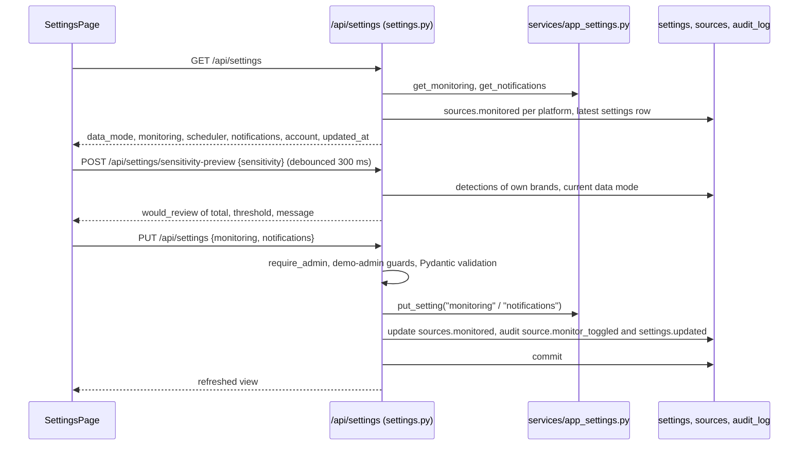

# Settings and audit log

## Plain-language summary

The Settings page is where an administrator decides how BrandShield behaves: how often it scans, which platforms it watches, how strict it is about what counts as suspicious, which extra words signal impersonation (such as "support" or "refund"), and where alerts should go. It also holds the choice between real data, sample data or automatic, and the choice of AI text provider. Every change an administrator saves is written to an audit log (who, what, when). Settings are shared by the whole installation, not per account. The page is administrator-only in the interface; alert preferences are stored but nothing is actually sent yet. The shared "demo administrator" account can change harmless settings but is blocked from anything that would affect other people (live data, AI provider, webhook, other accounts' audit rows).

## Purpose and user-facing behaviour

Page `/settings` (`frontend/src/pages/SettingsPage.tsx:64`), inside `RequireAdmin` (`frontend/src/App.tsx:174-179`) and shown in the menu only to admins (`frontend/src/components/layout/Sidebar.tsx:33`, `:171`). The page reads `GET /api/settings`, keeps a local draft, and saves with `PUT /api/settings` (`SettingsPage.tsx:66`, `:123-144`). The active tab is remembered per browser (`usePref('settingsTab', ...)`, `:67`). Three tabs (`:14-15`):

| Tab | Contents | Code |
|---|---|---|
| Monitoring | Scan schedule (5 minutes, 15 minutes, hourly, daily), social platforms and app stores checkboxes, detection sensitivity slider (50 to 95) with a live "N of M candidates would be sent to review" preview, five look-alike rule checkboxes, impersonation words editor, link to the Look-alike Lab | `:204-363` |
| Notifications | email alerts, weekly digest, webhook switch and URL. A banner states "Preferences are saved, but nothing is delivered yet" | `:365-422` |
| Account | signed-in user line, "Export Audit Log" button (CSV), Data mode switch, Analysis providers panel with the Safe Browsing line, link to Evaluation | `:424`, `:500-588` |

A bar at the bottom shows "You have unsaved changes", Cancel and "Save settings"; non-admins would see "Only administrators can change settings" and disabled controls (`:146-174`; non-admins cannot reach the page anyway).

## Step-by-step flow

1. **Read.** `GET /api/settings` (any signed-in user) returns `data_mode` and `effective_data_mode`, the `monitoring` block (`schedule`, per-platform `sources`, `sensitivity`, derived `threshold`, `rules`, `impersonation_words`), a `scheduler` block, `notifications` (with `delivery: "not_implemented"`), the `account` block (organization = the active brand's name, and the user) and `updated_at` (`backend/app/api/settings.py:96-127`). The webhook URL is returned only to a real admin; the demo admin and all others receive an empty string plus `webhook_configured` (`:118`).
2. **Preview.** `POST /api/settings/sensitivity-preview` (any signed-in user, read-only) counts how many of this account's stored candidates (current data mode, excluding `marked_official`) would be sent to review at a given sensitivity using the same `is_hit` rule as scans, and returns a plain-language message: "Strict" below 60, "A balanced setting" up to 80, "Sensitive" above (`:186-207`; `is_hit` in `backend/app/core/pipeline/matching.py:244-250`).
3. **Save.** `PUT /api/settings` (`require_admin`, `:130-183`). Only changed values are written. Monitoring changes are saved under the `monitoring` key of the `settings` table; per-platform toggles update `sources.monitored` and each writes `source.monitor_toggled`; notification preferences are saved under `notifications`. If anything changed, one audit row `settings.updated` with `changed: <sorted list>` (for example `monitoring.sensitivity, monitoring.rules.added_words`) is written (`:178-179`). A data-mode change in the same request is applied after the commit and audited as `settings.data_mode_changed` (`:181-182`).
4. **Effect.** Saved values apply from the next scan: the scan environment reads sensitivity, rules and words at the start of every scan (`backend/app/core/pipeline/scan_pipeline.py:290-302`), the Look-alike Lab tester reads the words (`backend/app/core/pipeline/lookalike.py:116`), and the scheduler reads the schedule (`backend/app/services/scheduler.py:101-121`).

## Settings fields and rules

| Field | Allowed values and validation | Default | Code |
|---|---|---|---|
| `monitoring.schedule` | `off`, `5m`, `15m`, `1h`, `1d` (the UI offers all but `off`, which is shown only when already set) | `1d` | `api/settings.py:25`; `services/app_settings.py:15-24`; `SettingsPage.tsx:36`, `:223` |
| `monitoring.sources` | map of platform slug to bool; unknown slug gives 422 "Unknown platform" | all monitored | `api/settings.py:31-39` |
| `monitoring.sensitivity` | integer 50 to 95; the minimum score to review is `100 - sensitivity` (75 gives 25, 50 gives 50, 95 gives 5) | 75 | `app_settings.py:17`, `:74-76`; `api/settings.py:27` |
| `monitoring.rules` | five booleans: `character_swaps`, `digits_and_symbols`, `added_words`, `spacing_and_separators`, `transposed_or_missing`; unknown rule gives 422 | all true | `backend/app/core/pipeline/matching.py:35-41`; `api/settings.py:41-49` |
| `monitoring.impersonation_words` | lower-cased, whitespace-collapsed, de-duplicated, each at most 30 characters, at most 50 words | `support, helpline, official, refund, rewards, kyc` | `api/settings.py:51-67`; `matching.py:34` |
| `notifications.email_alerts`, `high_risk_immediate`, `weekly_digest` | booleans | false | `app_settings.py:25-30` |
| `notifications.webhook_url` | empty or must start with `https://` and contain no spaces; max 500 characters | empty | `api/settings.py:70-83` |
| `data_mode` | `live`, `sample`, `auto` | `auto` | `api/settings.py:87`; `services/data_mode.py:9-11` |

Stored values are merged over defaults, so unknown stored keys are ignored and a missing key falls back to its default (`app_settings.py:37-56`). The `SCAN_INTERVAL_MINUTES` environment value, when set, overrides the Settings schedule (0 means off) (`app_settings.py:79-83`; `scheduler.py:101-121`). **Notifications are stored preferences only.** `delivery: "not_implemented"` is hard-coded in the response (`api/settings.py:117-119`); no code reads `webhook_url` to send anything (searched `backend/app`; the only other hits are in `services/voice.py`, unrelated).

**Settings are global.** The `settings` table is a key/value table with no account or brand column (`backend/app/models/ops.py:82-91`), and `GET/PUT /api/settings` do not scope by account. One admin's sensitivity, rules, words and data mode apply to every account's scans. Only the `account` block and the sensitivity preview are per account.

## Account tab: data mode and providers

- **Data mode.** `GET /api/settings/data-mode` (any user) and `PUT /api/settings/data-mode` (admin) switch between `live`, `sample` and `auto`, and the tab shows the effective mode, the reason and the collector chain (`SettingsPage.tsx:494-577`; `backend/app/api/sources.py:233-249`). Details of what each mode does are in `docs/features/source-health-and-providers.md`.
- **Providers.** `ProvidersPanel` shows `GET /api/providers` and lets an admin choose `off`, `local`, `gemini` or `huggingface` with `PUT /api/providers/active`; keys are never displayed (`SettingsPage.tsx:434-491`; `backend/app/api/providers.py:45-57`). It also shows "Google Safe Browsing: configured: yes/no" taken from `GET /api/sources` (`:486-488`).

## Audit log

### What is recorded

`audit.record(db, actor, action, target, detail, actor_label=None, source="live")` adds an `AuditLog` row to the caller's own transaction, so it commits or rolls back together with the action (`backend/app/services/audit.py:6-26`). Columns: `ts`, `actor_id` (no foreign key, so the log outlives users), `actor` (name), `action`, `target` (cut at 300 characters), `detail`, `source` (`live` or `sample`) (`backend/app/models/ops.py:129-141`). The table is documented as append-only; there is no delete or edit endpoint.

Actions written by the code (searched `audit.record` in `backend/app`): `auth.login`, `auth.login_failed`, `auth.logout`, `auth.registered`; `brand.created`, `brand.updated`, `brand.archived`, `brand.restored`; `logo.added`, `logo.removed`, `logo.replaced`; `account.added`, `account.removed`; `app.added`, `app.updated`, `app.removed`; `publisher.added`, `publisher.removed`; `asset.verification_changed`; `candidates.added`, `candidates.imported`, `candidate_image.uploaded`; `scan.started`, `scan.finished`; `detection.status_changed`, `detection.resolution_set`, `detection.marked_official`; `report.generated`, `report.approved`; `settings.updated`, `settings.data_mode_changed`, `settings.provider_changed`; `source.monitor_toggled`, `source.retry`; `lookalike.case_added`, `lookalike.case_removed`, `lookalike.cases_run`; `evaluation.run`; `health.canary`.

### Reading it

| Endpoint | Role | Behaviour |
|---|---|---|
| `GET /api/audit?from=&to=&actor=&action=&limit=&offset=` | `admin`, `analyst` (viewers get 403) | newest first, `limit` 1 to 200 (default 50), returns `{total, items[]}` |
| `GET /api/audit/export.csv` | `admin`, `analyst` | CSV `ts, actor, action, target, detail`; cells starting with `=`, `+`, `-`, `@`, tab or CR get a leading apostrophe (formula-injection guard) |

(`backend/app/api/audit.py:52-84`, `_safe_cell` `:70-72`.)

- **Who sees which rows:** `_filtered` shows every row to a real admin; every other caller (analyst) sees only rows whose `actor_id` is their own, and the shared demo administrator is treated the same way (`own_only`) so it cannot read other accounts' activity (`audit.py:36-40`, `:64`, `:80`). The log has no brand column, so a real admin's view mixes all accounts' brand names and handles.
- **UI:** there is no audit-log table page in the frontend. The only UI is the "Export Audit Log" button on the Settings Account tab, which downloads the CSV (`SettingsPage.tsx:521-541`; searched `frontend/src` for `/api/audit`). The button is enabled for analysts and admins; since the page is admin-only in the router it is reachable only by admins. `GET /api/audit` (JSON) is not called by any page.

## Demo-administrator restrictions (summary)

The shared demo administrator (`DEMO_ADMIN_EMAIL`) passes `require_admin` but `forbid_demo_admin` (`backend/app/services/seed.py:113-116`) returns 403 "Disabled for the shared demo administrator: ..." for: choosing `live` or `auto` data mode (via `PUT /api/settings` or `PUT /api/settings/data-mode`, `api/settings.py:136-137`, `api/sources.py:246-247`), changing the AI provider (`api/providers.py:53`), and setting a non-empty webhook URL (`api/settings.py:138-139`). An empty webhook value from its form is skipped so it cannot clear the real URL (`:171-172`), the stored URL is hidden from it (`:118`), and its audit view is limited to its own actions (`audit.py:64`, `:80`). Everything else on the page works for it. Full description: `docs/features/authentication-and-accounts.md`.

## Files, tables, services

| Item | Path |
|---|---|
| Settings routes and schemas (`MonitoringIn`, `NotificationsIn`, `SettingsIn`, `PreviewBody`) | `backend/app/api/settings.py` |
| Defaults, merge, `put_setting`, `threshold_for`, `interval_minutes` | `backend/app/services/app_settings.py` |
| Per-request settings memo (reads the whole `settings` table once) | `backend/app/services/setting_rows.py`, `backend/app/db/request_cache.py:17-21` |
| Data mode | `backend/app/services/data_mode.py` |
| Audit routes and helper | `backend/app/api/audit.py`, `backend/app/services/audit.py` |
| Models `Setting`, `AuditLog` | `backend/app/models/ops.py:82-91`, `:129-141` |
| Page | `frontend/src/pages/SettingsPage.tsx`, API calls in `frontend/src/api/sm.ts` (`settings`, `saveSettings`, `sensitivityPreview`, `dataMode`, `setDataMode`, `providers`, `setProvider`) |

Tables touched: `settings` (keys `monitoring`, `notifications`, `data_mode`, `text_provider`), `sources` (`monitored`), `audit_log`, `detections` (read for the preview), `brands` (read). External services: none from this page itself. `GET /api/settings` and `/api/providers` are in the short-lived response cache; any write request clears it (`backend/app/config/response_cache.py:15-18`, `backend/app/main.py:137-158`).

## Permissions, errors and edge cases

| Situation | Result |
|---|---|
| Non-admin calls `PUT /api/settings` | 403 "You do not have permission to do this" (`require_admin`) |
| Unknown platform or rule, sensitivity outside 50 to 95, word over 30 characters or more than 50 words, webhook not `https://` | 422 with a plain message |
| Demo admin tries a guarded change | 403 "Disabled for the shared demo administrator: ..." |
| Save with no actual change | no `settings.updated` row, response is the current view |
| Two admins editing at once | last write wins; the page does not detect concurrent edits (`SettingsPage.tsx:76-83` only loads once) |

`GET /api/settings` is open to any signed-in user (`api/settings.py:125-127`) and returns the rules and words; only the webhook is hidden. **Needs confirmation:** confirm that exposing sensitivity, rules and impersonation words to analysts and viewers through the API is intended (the page itself is admin-only).

## Related configuration (names only)

`SCAN_INTERVAL_MINUTES` (overrides the schedule), `SCHEDULER_ENABLED`, `SCHEDULER_POLL_SECONDS`, `SCHEDULER_MAX_BRANDS_PER_RUN`, `SEVERITY_MEDIUM_MIN`, `SEVERITY_HIGH_MIN`, `SEVERITY_CRITICAL_MIN`, `SCAM_LLM_ENABLED`, `SCAM_LLM_PROVIDER`, `RESPONSE_CACHE_SECONDS`, `DEMO_ADMIN_EMAIL`, `DEMO_ADMIN_PASSWORD`, `ADMIN_EMAIL`, `ADMIN_PASSWORD` (`backend/app/config/config.py:45-50`, `:122-127`, `:163-169`).
