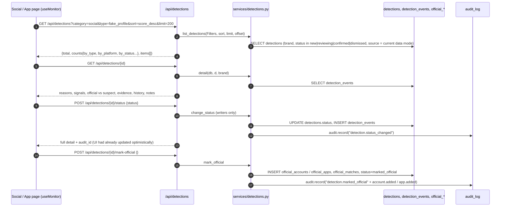

# Social Threats and App Threats

## Plain-language summary

These two screens ("Social Media Monitoring" and "App Store Monitoring") are the review queue. After a scan, every suspicious
fake profile, fake brand page, scam account or fake app appears in a list sorted by risk. You click one, see why it scored the way
it did (name, logo, bio, publisher ...), look at the evidence that was saved, and then make a decision: confirm it is an
impersonation, keep reviewing, dismiss it as a false positive, or mark it as one of your own official accounts or apps. A person
always decides: the system never reports or takes anything down by itself.

All paths are relative to the repository root (`ScamMind AI/`).

## 1. Purpose and user-facing behavior

| Screen | Page component | Route data |
|---|---|---|
| Social Media Monitoring | `frontend/src/pages/SocialMonitoringPage.tsx` | `useMonitor('social')` (`frontend/src/hooks/useMonitor.ts:16`) |
| App Store Monitoring | `frontend/src/pages/AppStoreMonitoringPage.tsx` | `useMonitor('apps')` |

What each page shows (both share `useMonitor` and the building blocks in `frontend/src/components/monitor/MonitorParts.tsx`):

1. **Sources bar** with the status of each platform (online / slow / unavailable) and, on the App page, an inline Retry for a failing source
   (`MonitorParts.tsx:51-138`).
2. **Filter tabs with counts.** Social: All, Fake profiles, Fake brand pages, Scam accounts (filter is the detection `type`;
   `SocialMonitoringPage.tsx:14-19`). Apps: All stores, Google Play, App Store, Third-party APK (filter is the `platform`;
   `AppStoreMonitoringPage.tsx:14-19`). The App page opens on Google Play unless a `?detection=` deep link is present
   (`useMonitor.ts:18-21`).
3. **Scan button** ("Scan social platforms now" / "Scan app stores now") and **Add candidate / Import CSV / JSON** tools
   (`CandidateTools`, see `docs/features/candidate-import.md`).
4. **Detections list**, sorted by risk (`sort=score_desc`, `frontend/src/api/sm.ts:108-109`), each row showing name, handle or package id,
   platform, type, score, severity chip and status chip (`SocialMonitoringPage.tsx:118-143`).
5. **Detail panel** for the selected row (the first row by default, or the one in `?detection=`):
   - official-versus-suspect comparison cards. Social shows bio, followers, joined date, link and "Logo N% match" (`SocialMonitoringPage.tsx:181-229`).
     Apps shows publisher, store, a red "Publisher differs from the official one" banner (`AppStoreMonitoringPage.tsx:180-189`), and "Icon N% match";
   - "Why it scored N": every reason with its points plus a per-signal availability list (`ReasonsBox`, `MonitorParts.tsx:238-283`);
   - "Evidence kept": link to the profile URL, capture time, SHA-256 of the saved snapshot, and a screenshot link only if one exists (`EvidenceBox`, 285-323);
   - the action row: **Confirm impersonation / Confirm fake app**, **Keep reviewing**, **Dismiss as false positive**, **Mark as official**
     (`ActionRow`, 325-344).
6. **Two bottom panels**: "Excluded as official" (items matched on the allowlist, never scored) and the false-positive guard list
   ("cleared automatically": similar-sounding names of other businesses) (`ExcludedCard` 153, `GuardCard` 184; used at
   `SocialMonitoringPage.tsx:247-248`, `AppStoreMonitoringPage.tsx:272-273`).
7. A banner "Sample data" on a detail whose `source` is `sample`, and a footer note when the app is in sample mode
   (`SocialMonitoringPage.tsx:159-161`, `SampleNote` in `frontend/src/components/common/States.tsx:53-61`).

Roles: every GET needs a signed-in user. Every action (status change, resolution, mark official, scan, add or import candidates) needs role `admin` or
`analyst` (`require_writer`, `backend/app/config/deps.py:56`). A `viewer` can read and sees disabled buttons (`disabled={!canWrite || ...}`,
`SocialMonitoringPage.tsx:235`). Detections of another account's brand are a 404 "Detection not found" (`backend/app/api/detections.py:38-42`, `owns_brand`).

## 2. Flow

### Listing and filtering

`GET /api/detections` (`backend/app/api/detections.py:59-97`). Query parameters (all optional):

| Parameter | Values | Notes |
|---|---|---|
| `category` | `social`, `apps`, `web` | the pages pass `social` / `apps` |
| `type` | `fake_profile`, `fake_brand_page`, `scam_account`, `fake_app`, `lookalike_domain`, or the words `social`, `app`, `apps`, `web`, `website(s)` | `normalize_type`, `backend/app/services/detections.py:63-76`; anything else is 422 |
| `platform` | e.g. `instagram`, `google_play`, `app_store`, `third_party_apk` | exact match |
| `band` | `high`, `medium`, `low` | |
| `severity` | `LOW`, `MEDIUM`, `HIGH`, `CRITICAL` | |
| `resolution` | `true_positive`, `false_positive`, `resolved`, `monitoring` | |
| `status` (repeatable) | `new`, `reviewing`, `confirmed`, `dismissed`, `marked_official`; aliases `confirm`, `dismiss`, `keep-reviewing` | other values 422 (detections.py:84-89). `marked_official` is always stripped (`_base`, services/detections.py:82) |
| `source` | `live`, `sample`, `all` | default = the current effective data mode (`_source_filter`, detections.py:52-56). So in sample mode only sample detections are listed and vice versa |
| `q` | up to 200 chars | case-insensitive contains on name, handle, package id, publisher (`_base`, 104-109) |
| `min_score` | 0-100 | |
| `sort` | `score_desc` (default), `score_asc`, `found_desc`, `found_asc`, `last_seen_desc` | |
| `from`, `to` | ISO datetimes on `found_at` | |
| `limit` / `offset` | 1-200 (default 50) / >= 0 | the UI asks for 200 |
| `brand_id` | int | defaults to the user's own brand (`resolve_brand`) |

Default visible statuses are `new, reviewing, confirmed, dismissed` (`LISTED_STATUSES`, services/detections.py:31). `cleared`, `marked_official` and
`retired` never appear in these lists (cleared ones surface only in the guard list, official ones in the excluded list).
The response (`detections.py:94-97`) holds `total`, `data_mode`, `is_sample`, `includes_sample`, `counts` and `items` (shape: `summary_row`,
services/detections.py:178-202: `id, category, type, platform, name, handle, package_id, publisher, profile_url, score, risk_band, severity,
status, resolution, summary, tags, found_at, last_seen_at, stale, source, origin`). Tab counts are computed in one round trip with `UNION ALL`
and exclude the tab being counted so "All 6 / Fake profiles 3" add up (`list_detections`, 129-163).

### Detail

`GET /api/detections/{id}` returns `detail()` (services/detections.py:229-283): everything in the summary plus `algorithm_version`, `scored_at`,
`weights` (`weights_v1`), `signals`, `reasons` (each `{signal, label, detail, points, max_points}`), `name_match`, `raw_total`, `capped`,
`threshold`, `official` (the registered side), `logo` (status `compared` or `unavailable` with a reason), `evidence`, `score_history`, `notes`,
`history` (events), `text_analysis`. App detections add `publisher_differs`, `official_publisher`, `suspect{icon_match_percent, rating, ...}` and
`description{snippet, overlap_points}` (265-274). Social adds `suspect{bio, followers, following, posts, joined, verified, logo_match_percent}`
(279-282).
`GET /api/detections/{id}/evidence` returns the saved snapshot and `hash_verified` (re-hash of the stored bytes vs the stored SHA-256,
`evidence_bundle`, 286-293). `GET /api/detections/{id}/evidence/screenshot` returns a PNG, or 404 "No screenshot was captured (screenshots are off
by default)" (detections.py:146-154).

### Review status actions

| UI button | Endpoint | Resulting status | Code |
|---|---|---|---|
| Confirm impersonation / Confirm fake app | `POST /api/detections/{id}/status {"status":"confirmed"}` (UI) or shortcut `POST .../confirm` | `confirmed` | detections.py:163-167, 186 |
| Keep reviewing | same, `reviewing`, or `.../keep-reviewing` | `reviewing` | detections.py:187 |
| Dismiss as false positive | same, `dismissed`, or `.../dismiss` | `dismissed` | detections.py:188 |
| Mark as official | `POST /api/detections/{id}/mark-official` | `marked_official` | detections.py:191-200 |

`change_status` (services/detections.py:308-326): only `reviewing | confirmed | dismissed` can be set by a person (`new`, `cleared`, `marked_official`
cannot, 422). A `marked_official` detection refuses status changes with 409 "Remove it from the allowlist first". Setting the same status with no note
is a no-op. An optional `note` (max 1000 chars) is stored in `detections.notes` (keeps the last 50), a `detection_events` row is added with the actor,
and `audit_log` gets `detection.status_changed` ("old -> new: note").
Note that the UI button "Dismiss as false positive" sets **status `dismissed`**; it does not set the separate `resolution` field `false_positive`.

`POST /api/detections/{id}/resolution {"resolution": "true_positive|false_positive|resolved|monitoring", "note"}` records the investigation outcome
without changing the status (`set_resolution`, 332-345; audit `detection.resolution_set`). On these two pages no button calls it; the typed client
function `sm.setResolution` (`frontend/src/api/sm.ts:115`) is used by the Investigations page (`frontend/src/pages/InvestigationsPage.tsx:179`, "Save resolution").

**Mark as official** (`mark_official`, services/detections.py:348-414):

- social detection: needs a handle of at most 30 characters; creates an `official_accounts` row (status `verified`, "Marked official by a reviewer") unless
  one exists, builds its URL with `build_account_url` (375-394);
- app detection: only `google_play` or `app_store` listings (a third-party APK is never official, 358-359); needs a package id; creates an `official_apps` row
  with the given or detected publisher, `stores=[platform]` (357-374);
- web detections cannot be marked official: 422 "add its domain to the brand's official domains on the Brand Profile" (355-356);
- writes/updates an `official_matches` row with reason `marked_official` and the rule "Marked official by <name>: <note>" (395-402), sets the status to
  `marked_official`, writes an event, `detection.marked_official` audit row (+ `account.added` / `app.added`), and touches `brand.updated_at`;
- afterwards future scans drop that exact asset before scoring (`BrandAllowlist`, see `docs/features/scanning-and-detection.md` section 5).
  Adding an official account or app by hand also closes matching existing detections (`sync_with_allowlist`, services/detections.py:430-445).
- UI behaviour (`useMonitor.ts:95-126`): optimistic removal from the list, restored with an error message if the server refuses.

Optimistic updates for confirm/keep reviewing/dismiss (`useMonitor.ts:75-92`) roll back list and detail if the server answers with an error.

### Excluded items and false positives

- `GET /api/detections/excluded?category=` (`detections.py:100-111`, `excluded_items`, services/detections.py:452-475): lists the brand's registered official
  accounts and apps with how many times scans matched them (`official_matches.times_seen`), reason `exact_handle` or `package_id`.
- `GET /api/detections/false-positives?category=&source=` (`detections.py:114-126`, `false_positive_items`, 478-496): detections with status `cleared`, ordered
  by score, each with `reason` text built by `_clear_reason` ("Name partly resembles the brand (N%); logo X% match; score S is below the review threshold of T; no
  other brand evidence", scan_pipeline.py:557-567), `name_match_percent`, and logo or icon match.

### Detection lifecycle (statuses)

`new` -> `reviewing` / `confirmed` / `dismissed` (human) -> `marked_official` (allowlist). A scan creates `new` (above threshold) or `cleared` (near-name but
below threshold). A re-scan never changes a human decision (`HUMAN_STATES`, `backend/app/core/pipeline/scan_pipeline.py:72,710-716`) but may append a note when
the score moves by 10 or more. `retired` (brand identity changed) hides rows everywhere (`retire_results`, services/detections.py:499-505).

## 3. Data, APIs, services

| Item | Detail |
|---|---|
| Tables | `detections` (`backend/app/models/detection.py:10-53`), `detection_events` (84-97), `official_matches` (56-81), `official_accounts`, `official_apps` (`backend/app/models/brand.py:43-80`), `audit_log` |
| Endpoints used by these pages | `GET /api/detections`, `GET /api/detections/{id}`, `POST /api/detections/{id}/status`, `POST /api/detections/{id}/mark-official`, `GET /api/detections/excluded`, `GET /api/detections/false-positives`, `GET /api/detections/{id}/evidence/screenshot`, `GET /api/sources?kind=social|store`, `POST /api/scan`, `GET /api/jobs/{job_id}`, `POST /api/sources/{id}/retry` |
| Frontend client | `frontend/src/api/sm.ts:102-122` (scan, detections, status, mark official, excluded, false positives) |
| Backend files | `backend/app/api/detections.py`, `backend/app/services/detections.py`, `backend/app/core/pipeline/scan_pipeline.py` (what creates them) |
| External services | none are called when a person reviews. Scans (separate feature) call Tavily, SearXNG, iTunes, google-play-scraper; the Sources retry button runs collectors (`backend/app/api/sources.py:179-230`) and for Tavily needs a confirmation because it can spend credits (409 `confirmation_required`, lines 207-214; `MonitorParts.tsx:64-86`) |

Real versus mock: with data mode `sample` (or `auto` and no live source configured) every row on these pages is fabricated by the sample collector from your own
brand name and carries a "Sample data" badge. Logo percentages in sample mode come from generated images derived from your uploaded logo, not from real
profile pictures (`scan_pipeline.py:391-407`).

## 4. Validation, permissions, errors and edge cases

| Case | Behavior |
|---|---|
| Not signed in | 401 (`get_current_user`, deps.py:28-45) |
| Viewer role tries an action | 403 "You do not have permission to do this" (deps.py:46-53); the UI also disables buttons |
| Detection id belongs to another account | 404 "Detection not found" |
| Invalid status | 422 "status must be one of: reviewing, confirmed, dismissed" |
| Note longer than 1000 characters | 422 (pydantic `Field(max_length=1000)`, detections.py:19-35) |
| Change status of an official detection | 409 |
| Mark official twice | 409 "already marked official" |
| Mark official: no handle / no package id / handle > 30 chars / non-Play non-App Store app / web | 422 with a plain message (services/detections.py:355-380) |
| Cached (`stale`) detection | the App detail shows "cached <time>" (`AppStoreMonitoringPage.tsx:157`); source data came from the previous good scan |
| Detection created by manual entry or import | `origin` is `manual`/`import` and `source` is `live` (see below) |
| No brand | the pages render a "create a brand profile first" state (`NoBrand`, `SocialMonitoringPage.tsx:44-53`) |

Edge cases worth knowing:

- Screenshots are off by default (`SCREENSHOTS_ENABLED=false`), yet the App page footer says "Store screenshot and listing details are saved as evidence"
  (`AppStoreMonitoringPage.tsx:264`); in practice only the JSON snapshot plus SHA-256 is saved unless Playwright is enabled
  (`scan_pipeline.py:582-589`, `backend/app/core/pipeline/screenshot.py:43-46`).
- The App detail panel reads `suspect.downloads` and `official.downloads`, but the server always sends `downloads: null` for them
  (`services/detections.py:214,270`), so the Downloads line only appears when `released` exists.
- The official-side social card shows "The official page bio is not collected" because `bio`, `followers`, `joined` are `None` (`services/detections.py:219-220`).

**Needs confirmation:** manual and imported candidates are saved with `source = "live"` (`Candidate.data_source` returns `sample` only for the sample collector,
`backend/app/core/collectors/base.py:75-78`; assigned at `scan_pipeline.py:674`). The default list filter equals the current effective data mode
(`detections.py:52-56`), so while the app is in `sample` mode a freshly added manual candidate would be hidden from the default list until the viewer asks for
`source=all` (the pages never send `source`). Please confirm whether this is intended.

## 5. Related config (names only)

`SEVERITY_MEDIUM_MIN`, `SEVERITY_HIGH_MIN`, `SEVERITY_CRITICAL_MIN` (severity chip); Settings page values `sensitivity` (review threshold = 100 - sensitivity),
look-alike `rules`, `impersonation_words` (`backend/app/services/app_settings.py:19-24`); `SCREENSHOTS_ENABLED`; `STORAGE_BACKEND` (where the evidence snapshot is kept,
`backend/app/core/storage.py:169-175`); `RESPONSE_CACHE_SECONDS`. Data mode (live / sample / auto) decides which rows are listed by default.
