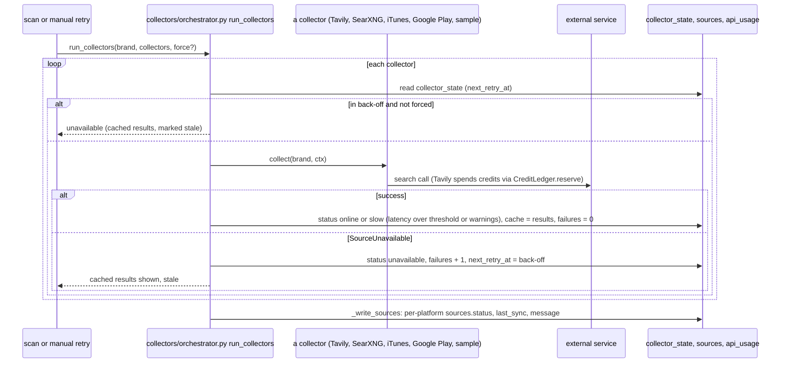
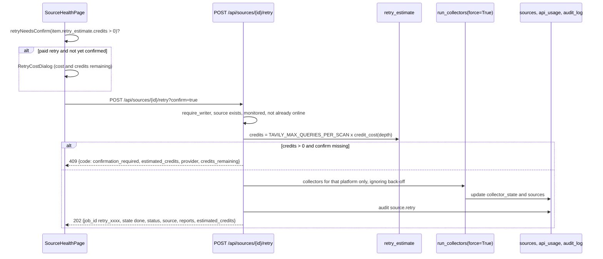

# Source Health and providers

## Plain-language summary

BrandShield looks for fakes on several platforms (Instagram, Facebook, X, Telegram, LinkedIn, Google Play, the App Store and third-party APK sites) through "data sources" such as a search service and the Apple store search. The Source Health page shows whether each platform's source is working (online), slow (partial results) or unavailable, when it was last checked and when the system will try again by itself. An administrator can pause a platform, or press "Retry now"; if the retry could spend paid search credits the system first asks for confirmation and shows how many credits are left. The page is administrator-only. Where the data comes from (real, sample, or automatic) and which AI text-analysis provider is used are chosen on the Settings page, and this document explains both because they are one system.

Real versus sample: when the data mode resolves to `sample` no outside service is contacted and every source row says it will use sample data. All numbers on this page come from the database and live collector state.

## Purpose and user-facing behaviour

Page `/sources` (`frontend/src/pages/SourceHealthPage.tsx:62`), route wrapped in `RequireAdmin` (`frontend/src/App.tsx:174-179`) and menu item hidden for non-admins (`frontend/src/components/layout/Sidebar.tsx:33`, `:124`).

| Part of the page | Behaviour | Code |
|---|---|---|
| Four tiles: Online, Slow, Unavailable, Next scan | counts from `summary` and the schedule | `SourceHealthPage.tsx:171-213` |
| Sources list | one row per platform: status chip, "Monitor" checkbox, message, "Last sync", cached age, next retry, "Retry now" (only for `slow` or `unavailable`) | `:229-298` |
| "When a source is unavailable" | four fixed explanation steps; step 3 is generated from `summary.retry_policy` by `describeRetry` | `:304-331`, `:29-40` |
| Recent source events | built in the browser from the source reports of the latest 5 scans (`GET /api/scans?limit=5`); there is no separate event feed | `:48-60`, `:334-352` |
| Search credits (Tavily) meter | `used of budget credits used in <month> · N left`; amber at 80 percent or more | `:140-142`, `:355-372` |

Viewers and analysts cannot open this page (admin only), but the API endpoints below still apply the roles listed in the table further down. The Dashboard shows a six-row "Source health" mini card for everyone and a "Manage" link only for admins (`frontend/src/pages/DashboardPage.tsx:399-434`).

**The data-mode switch, the provider choice and the Safe Browsing status are not on this page.** They are on Settings, tab "Account" (`frontend/src/pages/SettingsPage.tsx:494-577` for data mode, `:434-491` for `ProvidersPanel` and the Safe Browsing line). See `docs/features/settings-and-audit.md`.

## How a source gets its status

- **Statuses.** `online`, `slow`, `unavailable` (`backend/app/models/ops.py:18`, `:35`). A call that works but takes longer than `SOURCE_SLOW_THRESHOLD_MS` (default 4000) or returns warnings is `slow` with the reason `slow` or `partial` and its results are kept (`backend/app/core/collectors/orchestrator.py:299-314`). A `SourceUnavailable` exception, or any unexpected exception in a collector (reported as `internal_error`), makes it `unavailable` (`:286-293`, `:316-330`). A buggy collector never stops a scan.
- **Automatic retry (back-off).** After consecutive failures the wait is 1 minute, 5 minutes, 15 minutes, 1 hour, then 6 hours (`BACKOFF_SCHEDULE_SECONDS = (60, 300, 900, 3600, 21600)`, `orchestrator.py:39`, `backoff_delay` `:56-59`). A provider's `Retry-After` is honoured up to 24 hours (`:40`, `:62-68`). Problems fixed by editing configuration (`no_key`, `not_installed`, `not_configured`, `unsafe_base_url`) have no wait; they are re-checked on the next scan (`:42`, `:64-65`). Success resets the counter (`:305-307`). While waiting, cached results from the last good run are served and labelled stale with their age (`:264-277`, `_cached` `:191-204`).
- **Per-platform rows.** `GET /api/sources` builds each row from the `sources` table, the collectors that cover that platform and their state (`backend/app/api/sources.py:76-122`). If a platform has never been checked in the current mode it shows "Not scanned yet. Sample data will be used." (sample) or "Not checked yet." / "No live data source is configured. ..." (live) (`:86-99`). Data written under the other data mode is not presented as current (`:85-88`). `retry_in_minutes` is derived from the earliest `next_retry_at` (`:100-102`).
- **Monitoring toggle.** A platform with `monitored = false` is left out of scans (`run_collectors` intersects the scan scope with monitored platforms, `orchestrator.py:227-230`).
- **Sources are shared by all accounts.** The `sources` and `collector_state` tables have no brand or owner column (`models/ops.py:10-46`), so one admin's toggle or retry affects every account. Retry runs the collectors for the caller's own brand (`api/sources.py:199-203`).

### Which collectors run (data mode)

`select_collectors` (`backend/app/core/collectors/selection.py:68-114`):

| Requested mode | Result |
|---|---|
| `sample` | chain is only the `sample` collector: fictional candidates, "never real results" (`:88-89`, `:99-100`) |
| `live` | chain `tavily`, `searxng`, `itunes`, `google_play`; entries without a key or package show "unavailable (no_key / not_installed)" instead of falling back to sample (`:102-114`) |
| `auto` (default) | live when a Tavily key (`TAVILY_API_KEY`), SearXNG URL (`SEARXNG_BASE_URL`) or the `google-play-scraper` package is present; otherwise sample. iTunes needs no key, so on its own it does not switch auto to live (`:77-79`, `:92-97`) |

The stored mode is the `data_mode` row of `settings` (default `auto`, `backend/app/services/data_mode.py:9-16`). `GET /api/settings/data-mode` (any signed-in user) returns `{data_mode, effective_mode, reason, chain[]}`; `PUT /api/settings/data-mode` is admin only, writes the setting and an audit row `settings.data_mode_changed` with `old -> new` (`api/sources.py:233-249`, `data_mode.py:19-31`). The shared demo administrator may only choose `sample` (`api/sources.py:246-247`, see `docs/features/authentication-and-accounts.md`). Changing mode affects every account because the setting is global.

## Retry with credit confirmation

- Endpoint `backend/app/api/sources.py:179-230`. Preconditions, each 409: the source is not monitored ("Turn monitoring on first."), the source is already online with a last sync ("This source is online. Nothing to retry."), the caller has no brand ("Create the brand profile before retrying a source."), no collector is active for that platform in the current mode.
- Only Tavily spends credits: the estimate is `TAVILY_MAX_QUERIES_PER_SCAN * credit_cost(TAVILY_SEARCH_DEPTH)` (12 x 1 for `basic`, 12 x 2 for `advanced`) and is an upper bound (`retry_estimate`, `:44-53`; `credit_cost` `backend/app/core/collectors/credits.py:25-29`). iTunes, SearXNG, Google Play and sample retries are free.
- The retry runs synchronously and answers `state: "done"`; the UI would poll for up to 10 attempts every 2 seconds if the server ever answered something else (`SourceHealthPage.tsx:97-109`, `:124`).
- The audit detail lists `collector=status` pairs and, if credits were involved, "up to N credits, confirmed" (`api/sources.py:224-225`).

## Tavily credit counter

`CreditLedger` (`backend/app/core/collectors/credits.py:36-124`) keeps a monthly counter in `api_usage` (provider `tavily`, month `YYYY-MM`) plus a second row `tavily:reported` for credits the API says it charged. The meter uses the larger of the two (`:57-69`). `reserve(cost)` is one atomic `UPDATE ... WHERE credits + cost <= budget`, so concurrent scans cannot overshoot; `refund` returns credits when a call provably did not run (`:83-109`). Budget is `TAVILY_MONTHLY_BUDGET` (default 900, the free plan is 1000) (`config.py:92`). `GET /api/sources` returns `tavily_credits` as `{provider, month, used, budget, remaining, reported_used}` (`api/sources.py:154`). The ledger caches its snapshot for 3 seconds when the response cache is on (`selection.py:137`). The scheduler stretches or pauses scans when credits run low (`backend/app/services/scheduler.py:101-144`).

## Monitoring toggles

`PATCH /api/sources/{source_id}` with `{monitored: bool}` (`api/sources.py:160-176`): role `admin` or `analyst` (`require_writer`), 404 "Source not found", writes `source.monitor_toggled` only when the value changed. The same toggles can be saved through `PUT /api/settings` (`monitoring.sources`), which accepts only known platform slugs and is admin only (`backend/app/api/settings.py:31-39`, `:160-166`). Default platforms are created on first read by `ensure_sources` (`orchestrator.py:149-167`, `SOURCE_DEFAULTS` `:44-53`).

## Provider selection (`backend/app/api/providers.py`)

| Endpoint | Role | Behaviour |
|---|---|---|
| `GET /api/providers` | any signed-in user | `active_text_provider`, `hosted_text_analysis_enabled` (the `SCAM_LLM_ENABLED` flag), the three text providers (`local`, `gemini`, `huggingface`) with `label, configured, model, needs_key, reason, active`, embeddings status, `image_similarity_backend`; never a key (`:27-47`) |
| `PUT /api/providers/active` | admin only; refused for the shared demo admin | body `{provider: "off" | "local" | "gemini" | "huggingface"}`; stored in the `settings` table under `text_provider`; audit `settings.provider_changed` (`:23-24`, `:50-57`) |

- The active choice is the stored value if valid, otherwise `SCAM_LLM_PROVIDER` (default `gemini`) (`backend/app/core/pipeline/text_analysis.py:32-35`). Hosted analysis (Gemini or Hugging Face) only runs when `SCAM_LLM_ENABLED=true` (default false, so no candidate text leaves the server) (`config.py:66-69`, note in `providers.py:41`). Keys come only from `GEMINI_API_KEY` and `HUGGINGFACE_API_TOKEN`; the Hugging Face model has no default (`config.py:71-75`). The `local` provider is a deterministic baseline (RapidFuzz and phrase rules) and needs no key (`backend/app/core/providers/text/local.py:18-23`).
- Embeddings stay off unless `TEXT_EMBEDDINGS_ENABLED=true` with a model id and key (`backend/app/core/providers/text/factory.py:34-39`).
- The provider setting is global, not per account.

## Google Safe Browsing status

`GET /api/sources` includes `reputation` = `SafeBrowsingClient.status()`: `{provider, api_version, configured, note, key_env: "GOOGLE_SAFE_BROWSING_API_KEY", quota, last, blocked_until}`; it contains only whether a key exists (`backend/app/core/providers/safe_browsing.py:116-124`, `backend/app/api/sources.py:156`). `quota` comes from a daily ledger in `api_usage` (provider `safe_browsing:YYYY-MM-DD`, budget `SAFE_BROWSING_DAILY_BUDGET`, default 5000, `safe_browsing.py:50-56`). The note states that URLs are sent to Google and never opened by the app, and that a clean result is not a safety guarantee. Without a key every lookup is `unknown`. The only place the UI shows this is one line on the Settings account tab: "Google Safe Browsing: configured: yes/no" (`SettingsPage.tsx:486-488`); the Source Health page does not render it.

## APIs, tables, files

| Endpoint | Method | Role |
|---|---|---|
| `/api/sources?kind=social\|store` | GET | any signed-in user |
| `/api/sources/{id}` | PATCH | `admin`, `analyst` |
| `/api/sources/{id}/retry?confirm=` | POST | `admin`, `analyst` |
| `/api/settings/data-mode` | GET (any user), PUT (admin) | |
| `/api/providers`, `/api/providers/active` | GET (any user), PUT (admin) | |

Tables: `sources`, `collector_state` (status, reason, back-off, last good cache), `api_usage` (Tavily and Safe Browsing counters), `settings` (`data_mode`, `text_provider`), `audit_log` (`source.monitor_toggled`, `source.retry`, `settings.data_mode_changed`, `settings.provider_changed`). External services called: Tavily search (key `TAVILY_API_KEY`), optional SearXNG instance (`SEARXNG_BASE_URL`), iTunes Search (no key, about 20 calls per minute, cached), optional `google-play-scraper`, Google Safe Browsing Lookup API (key optional), and the text providers above.

Files: `backend/app/api/sources.py`, `backend/app/api/providers.py`, `backend/app/core/collectors/` (`orchestrator.py`, `selection.py`, `credits.py`, `tavily.py`, `searxng.py`, `itunes.py`, `google_play.py`, `sample.py`), `backend/app/services/data_mode.py`, `backend/app/services/scheduler.py`, `backend/app/core/providers/`, `frontend/src/pages/SourceHealthPage.tsx`, `frontend/src/components/common/ConfirmDialog.tsx` (`retryNeedsConfirm`, `isConfirmationRequired`, `RetryCostDialog`).

## Validation, permissions and edge cases

- The page and the data-mode and provider controls are admin only in the UI. On the server the writes are split: data mode and provider are `require_admin`; monitoring toggle and retry are `require_writer`, so an analyst could call them directly even though the page is hidden. **Needs confirmation:** confirm that analysts being able to toggle monitoring and trigger retries through the API is intended, given the page is admin-only.
- Auto-retry is driven by scans and the scheduler, not by a timer of its own: the next attempt happens at the next scan after `next_retry_at` passes.
- Back-off and cache are per collector, so a failing Tavily key also shows every platform it covers as unavailable.
- Source Health is global across accounts (see above); credits are global too.
- Web look-alike candidates have no Source Health row; they ride along with a full scan (`orchestrator.py:233-234`).

## Related configuration (names only)

`TAVILY_API_KEY`, `TAVILY_MONTHLY_BUDGET`, `TAVILY_MAX_QUERIES_PER_SCAN`, `TAVILY_SEARCH_DEPTH`, `TAVILY_MAX_RESULTS`, `SEARXNG_BASE_URL`, `SEARXNG_ALLOW_PRIVATE_HOSTS`, `SEARXNG_MAX_QUERIES_PER_SCAN`, `ITUNES_COUNTRY`, `ITUNES_CALLS_PER_MINUTE`, `ITUNES_CACHE_TTL_SECONDS`, `ITUNES_MAX_QUERIES_PER_SCAN`, `GOOGLE_PLAY_COUNTRY`, `GOOGLE_PLAY_MAX_QUERIES_PER_SCAN`, `SOURCE_SLOW_THRESHOLD_MS`, `COLLECTOR_TIMEOUT_SECONDS`, `REACHABILITY_CHECKS_PER_SCAN`, `SCAM_LLM_ENABLED`, `SCAM_LLM_PROVIDER`, `GEMINI_API_KEY`, `GEMINI_MODEL`, `HUGGINGFACE_API_TOKEN`, `HUGGINGFACE_MODEL`, `TEXT_EMBEDDINGS_ENABLED`, `GEMINI_EMBEDDING_MODEL`, `TEXT_PROVIDER_TIMEOUT_SECONDS`, `TEXT_PROVIDER_MAX_RETRIES`, `GOOGLE_SAFE_BROWSING_API_KEY`, `SAFE_BROWSING_TIMEOUT_SECONDS`, `SAFE_BROWSING_DAILY_BUDGET`, `SAFE_BROWSING_MAX_URLS_PER_SCAN`, `SAFE_BROWSING_CACHE_TTL_SECONDS`, `IMAGE_SIMILARITY_BACKEND`, `SCAN_INTERVAL_MINUTES`, `SCHEDULER_ENABLED` (all in `backend/app/config/config.py:62-136`; names in `backend/.env.example`).
