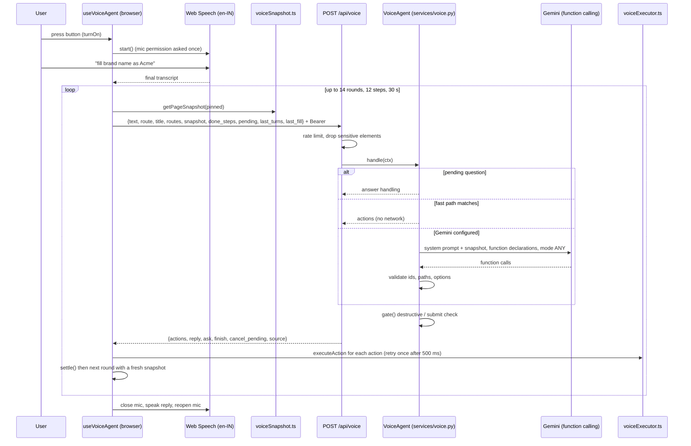

# Voice Agent

## Plain-language summary

The voice assistant is a round button at the bottom right of every signed-in BrandShield page. When you switch it on, you can speak ("open reports", "fill brand name as Acme", "select high severity") and it will move around the app and fill in forms for you. Simple commands are understood by the server with no AI at all; harder ones are sent to Google Gemini, which picks from a short list of safe actions. The assistant never types into password, one-time-code or card fields, asks before anything destructive (delete, pay, block) or before submitting a form you did not ask to submit, and the microphone is only open while the switch is on.

---

## 1. Purpose and user-facing behavior

| Behavior | Detail | Source |
|---|---|---|
| Button | Floating "voice-fab" with a status panel; mounted once above all signed-in routes so it keeps its state when the route changes. Not shown on `/login`, `/register`, `/`. | `frontend/src/App.tsx:56-78`, `frontend/src/components/voice/VoiceAgentButton.tsx:15-92` |
| States | `off`, `listening`, `thinking`, `speaking`, `error`; panel texts such as "Listening... try 'scroll down' or 'fill brand name as Acme'" | `frontend/src/hooks/useVoiceAgent.ts:13`, `VoiceAgentButton.tsx:6-12` |
| Language | Speech recognition and speech synthesis both use `en-IN` | `useVoiceAgent.ts:46,129` |
| Browser support | Needs the (prefixed) Web Speech API: Chrome or Edge on desktop or Android. Otherwise the panel says "Voice commands need Chrome or Edge on a computer or Android phone." | `useVoiceAgent.ts:41-44,375-379` |
| Microphone | Requested only when the person presses the button the first time (`rec.start()`); released (`abort()`) on OFF, on error and on unmount | `useVoiceAgent.ts:341-343,353-368,397-398` |
| Stop | Panel "Stop" button, or saying stop / cancel / abort while it works | `useVoiceAgent.ts:50,177-181,289-296`, `VoiceAgentButton.tsx:57-61` |
| Follow-up questions | The agent can ask one short question (confirm, choose an option, provide a value). Answers can be spoken or tapped as chips ("Skip", "That's all" for values). | `VoiceAgentButton.tsx:17,45-56`, `useVoiceAgent.ts:387-395` |
| Silence timer | A pending question is re-asked once after 10 s of silence, then dropped | `useVoiceAgent.ts:49,162-175` |

Example phrases that work with no AI key (fast path): "open the look-alike lab", "scroll down", "go back", "what page am I on", "fill test name with acm3bank", "my brand name is Acme", "change it to Acme Bank", "undo", "clear that", "fill the whole form" (`backend/app/services/voice.py:261-281`; the e2e test uses the first and fifth, `frontend/e2e/voice.spec.ts:55-69`).

---

## 2. Step-by-step flow

1. **Switch on.** `toggle` calls `turnOn`; with no Speech API it shows the error, otherwise `onRef=true` and `startListening()` (`useVoiceAgent.ts:370-384`).
2. **Listen.** Recognition is `continuous=false`, `interimResults=true`. Interim text is shown in the panel; the first final result is sent to `finalRef` (`useVoiceAgent.ts:298-321`). Chrome ends recognition after a pause, so `onend` restarts it while ON and not speaking (`useVoiceAgent.ts:333-339`). `no-speech` and `aborted` errors are ignored; other errors turn the agent off with a message ("Microphone access was blocked..." for `not-allowed`) (`useVoiceAgent.ts:322-332`).
3. **Run the command (`runCommand`).** Up to 14 request rounds. Each round builds a fresh snapshot and POSTs to `/api/voice` via `sm.voice` (`frontend/src/api/sm.ts:73`). The request includes `routes: voiceRoutes(isAdmin)` so the server only sees pages this user may open (`useVoiceAgent.ts:205-219`).
4. **Execute.** For each returned action: limit of 12 steps and 30 s total ("I stopped here because this is taking too long."); the step is shown in the panel; if it fails it waits 500 ms and tries once more; if it fails again the agent says "I couldn't ..." and stops (`useVoiceAgent.ts:222-243`). Navigations to a path beginning `/studio` use `window.location.assign` (Studio is a separate app); others use React Router (`useVoiceAgent.ts:199`).
5. **Settle.** After actions, `settle()` waits about 250 ms of DOM quiet and no spinners (up to 5 s) before the next snapshot (`frontend/src/utils/voiceExecutor.ts:316-345`).
6. **Finish or ask.** The loop ends on `finish`, on `ask`, on empty actions, on failure or cancel (`useVoiceAgent.ts:252-259`). The reply (and question) is spoken with the microphone closed (so the agent cannot hear itself), then listening resumes; a pending question arms the silence timer (`sayAndListen`, `useVoiceAgent.ts:145-160`). `speak()` has a guard timer in case a browser never fires `end` (`useVoiceAgent.ts:131-132`).
7. **Pending question.** The pending question is stored in `pendingRef` and sent as `pending` on round 0 of the next utterance, which is then treated as its answer (`useVoiceAgent.ts:195,214,276`). `last_turns` (last 6) and `last_fill` (for "undo", "change it to") travel with each request (`useVoiceAgent.ts:215-216,249,280`).
8. **Stop.** `stopRun` sets `cancelRef`, aborts the in-flight fetch and cancels speech; the agent says "Stopped." (`useVoiceAgent.ts:177-181,269-274`).
9. **Switch off.** `turnOff` clears every ref and timer, aborts the fetch, closes recognition and cancels speech (`useVoiceAgent.ts:353-368`). The e2e test asserts `aborts` increases after OFF (`frontend/e2e/voice.spec.ts:66-69`).

### 2.1 Page snapshot (`frontend/src/utils/voiceSnapshot.ts`)

* Compact keys per element: `i` id (`data-voice-id`, `v1`, `v2`...), `t` type, `l` label, `n` field name (`data-voice`), `v` value, `r` required, `d` disabled, `e` validation error, `o` options, `c` checked, `off` off-screen (`frontend/src/utils/voice.ts:34-48`).
* What counts as a control: the `CONTROLS` selector (buttons, links, inputs, selects, ARIA roles tab/button/combobox/checkbox/radio/switch/option/menuitem, Radix collection items, table rows, `.detection-row-card`, `[data-voice-row]`) (`voiceSnapshot.ts:10-14`).
* **Where it looks:** the page, **open shadow roots** and **same-origin iframes** (cross-origin frames are skipped) (`roots`, `voiceSnapshot.ts:52-65`), **portals** (dropdown options live under `<body>` and are found because the search is document-wide), and **off-screen** elements: they only need a non-zero size and not `display:none`/`visibility:hidden`; off-screen ones carry `off:1` (`visible`, `isOffscreen`, `voiceSnapshot.ts:34-47`).
* Hidden elements: anything inside `.voice-agent` itself, `[hidden]` or `[aria-hidden="true"]` is ignored (`voiceSnapshot.ts:35`).
* **Open dialogs:** while a `[role="dialog"]` or `[aria-modal="true"]` is visible, only controls inside it are offered, plus dropdown options (`openModal`, `collectAll` at `voiceSnapshot.ts:73-76,206-223`).
* **150 cap:** `getPageSnapshot` keeps at most `MAX = 150` controls, ranked by priority: open dialog (0), form fields (1), buttons/tabs/options (2), rows (3), links (4); at most 40 rows (`MAX_ROWS`); ids found by `find_element` ("pinned") always stay; the result is put back in page order. If there are rows, a first synthetic `info` element `v0` says "N rows (first 40 listed)" (`voiceSnapshot.ts:7-8,225-246`).
* Labels come from `aria-label`, `aria-labelledby`, `label[for]`, wrapping label, placeholder, nearby label, visible text, title, or `data-voice` (`labelOf`, `voiceSnapshot.ts:115-147`); table rows use their first three cells (`:142-145`).
* The server cap matches: `snapshot` max 200 elements (`backend/app/api/voice.py:47`).

### 2.2 Executor (`frontend/src/utils/voiceExecutor.ts`)

Actions: `navigate`, `back`, `scroll`, `find`, `wait`, `close`, `highlight`, `click`, `select`, `fill`, `toggle` (`frontend/src/utils/voice.ts:9-20`, `voiceExecutor.ts:227-314`).

* **Element resolution:** by `data-voice-id`; if the id is stale (page re-rendered) or the element is hidden, it searches again by the label the planner gave (`voiceExecutor.ts:274-283`).
* **`find_element`:** fuzzy search over the whole live DOM using label, value, name, placeholder, aria-label and (for rows) the first 300 characters of row text; threshold 55, best 3 matches; if nothing is found it scrolls the page down in up to 5 steps, waiting 1.5 s each, in case lists load lazily; the best match is scrolled into view and flashed (`voiceExecutor.ts:56-129`). Result ids are returned as `found` and "pinned" into later snapshots (`useVoiceAgent.ts:197,246`).
* **Fill:** only `<input>` and `<textarea>`, not disabled or read-only. Uses the native value setter and dispatches `input` so React-controlled fields update state (`voiceExecutor.ts:147-151,293-302`).
* **Select (native):** best fuzzy option by text then by value; sets the value and dispatches `change` (`voiceExecutor.ts:173-184`).
* **Select (custom dropdown):** `pickFromDropdown` clicks the trigger, waits for the page to settle, searches the **whole page** (including portals) for option-like elements (`[role=option]`, `[role=menuitem]`, `li`, classes containing option / menu-item / dropdown-item), prefers elements that appeared after the click, clicks the best match, and verifies the trigger's shown value changed. Two attempts; errors are "The options did not open." or "There is no option called X." (`voiceExecutor.ts:188-225`).
* **Toggle:** clicks only if the current state differs from the requested state (`voiceExecutor.ts:303-310`).
* **Close:** clicks a dialog button named close/cancel/dismiss, else dispatches Escape (`voiceExecutor.ts:249-257`).
* **Highlight:** used for sensitive fields; scrolls to, focuses and pulses a password or one-time-code field so the person can type it themselves (`voiceExecutor.ts:258-270`).
* Scrolling targets the open dialog, else `.main-panel`, else the document (`voiceExecutor.ts:153-171`).
* `bestMatch` scores exact 100, prefix 85, contains 75, shared words up to 70, minimum 50 (`voiceExecutor.ts:27-51`).

### 2.3 `data-voice` attributes

A page makes a field speakable by adding `data-voice="<name>"` (snake_case). The name is spoken as words ("test_name" becomes "test name") and is matched by the fast path. Examples: `brand_name`, `industry`, `description`, `alias`, `keyword`, `domain`, `account_platform`, `account_handle`, `app_name`, `app_store` (`frontend/src/pages/BrandProfilePage.tsx:265-620`); setup wizard fields incl. `scan_depth` (`frontend/src/pages/SetupPage.tsx:408-829`); `status_filter`, `severity_filter`, `resolution_filter`, `note`, `resolution` (`InvestigationsPage.tsx:58-174`); `test_name` (`LookalikeLabPage.tsx:84`); `date_range` (`ReportsPage.tsx:182`); `schedule`, `impersonation_word`, `webhook_url` (`SettingsPage.tsx:213-406`); `search` in the sidebar (`Sidebar.tsx:49`); and dynamic keys in `CandidateTools.tsx:120,128`. `data-voice-row` marks custom clickable rows (`Sidebar.tsx:156` marks the Studio link). `collectVoiceFields()` lists fillable `data-voice` fields (`voice.ts:109-118`). Fields without `data-voice` can still be offered by label, but `fill` helpers in `voice.ts` skip anything without a name (`voice.ts:100-106`).

### 2.4 Backend `POST /api/voice`

Route: `backend/app/api/voice.py:54-66`, mounted in `backend/app/main.py:181`. Auth: `get_current_user` (any role).

| Request field | Type and limit | Source |
|---|---|---|
| `text` | string, max 1000 | `voice.py:43` |
| `route`, `title` | max 200, 120 | `voice.py:44-45` |
| `routes[]` | max 50; each `{path (100), spoken_names (max 10)}` | `voice.py:23-25,46` |
| `snapshot[]` | max 200; `i` must match `^v\d{1,5}$`, `t` max 12, `l/n/v` max 60, `e` max 100, `o` max 60 items | `voice.py:28-39,47` |
| `done_steps` | max 40, values cut to 200 chars | `voice.py:48,63` |
| `pending`, `last_fill` | free objects | `voice.py:49,51` |
| `last_turns` | max 6, text cut to 200 | `voice.py:50,64` |

Response: `{actions, reply, ask, finish, cancel_pending, source}`; `source` is `fast`, `gemini` or `none` (`backend/app/services/voice.py:66-77`).

Errors: 429 "Too many voice commands. Wait a moment and try again." with `Retry-After: 20` when the per-user limiter (`VOICE_RATE_PER_MINUTE`, default 30, in memory) is exceeded (`voice.py:56-57`, `backend/app/main.py:104`). Gemini failures never produce an error page: the agent answers "The AI service is busy right now. Please try again in a moment." for 429/503/504, else "Sorry, I didn't understand that..." (`services/voice.py:532-539`). The browser shows "Sorry, I didn't catch that. Please try again." on other failures and the server message on 429 (`useVoiceAgent.ts:261-265`).

**Order of work in `VoiceAgent.handle`** (`backend/app/services/voice.py:514-539`):

1. Normalise text (max 500 characters), keep only routes in `ALLOWED_PATHS` (`:515-516`).
2. If a question is pending, `_answer` interprets the utterance as its answer, unless it is clearly a new command (open, scroll, back, close, stop) which cancels the question (`:519-522,390-447`).
3. Otherwise, if earlier steps exist and a just-filled field now shows a validation error, ask for a corrected value (`validation_follow_up`, `:523-526,480-486`).
4. **Fast path** (regex plus RapidFuzz, no network): `fast_command` (stop, "where am I", scroll, back, close, open page) then `fast_fill` ("fill X as Y", "put Y in X", "X is Y", corrections, undo, clear, "fill the whole form") (`:301-384,527`). Page names match with a score of at least `NAV_SCORE = 82`, field names with `FIELD_SCORE = 80` using `fuzz.ratio` and `token_set_ratio` (`:48-49,174-180,198-206,291-298`).
5. If no Gemini key: "I can open pages, scroll and fill fields with simple commands, like "open reports"." (`:530-531`).
6. **Gemini**: `_gemini` (`:541-613`), then `gate()` (`:533`).

**Follow-up questions.** After a fill or select, `_follow_up` asks "Do you want me to fill X too?" with options Yes / Skip / That's all for the next empty field (`:245-256`). "Fill the whole form" starts guided mode field by field; `Skip` moves on, "That's all" ends (`:361-365,421-447`). A select with 4 or fewer options asks "Which X? A, B, C?"; otherwise it asks for a value (`_ask_value`, `:231-237`). Ambiguous options give up to 4 candidates (`match_option`, `:183-195`). Ordinals ("first", "second") pick by position (`:186-188`). Spoken email ("at the rate", "dot"), phone ("double five") and URL words are converted to written form (`normalize_value`, `:158-171`).

**Safety gate** (`gate`, `:457-477`):

| Rule | Pattern | Result |
|---|---|---|
| Destructive | label matches `delete, remove, block, pay, payment, purchase, buy, archive, discard, revoke, erase, terminate, deactivate` (`:39`) | The click is withheld and the agent asks "Do you want me to <label>? Say yes or no." The click is stored in `ask.then` and run only after a spoken yes |
| Submit not requested | click on a label matching `submit, register, create, finish, publish, launch, send, save, confirm` (`:40`) and the spoken text does not contain that word | The agent reads back up to 5 filled values and asks "Should I submit?" |
| Yes / no words | `YES`, `NO`, `SKIP`, `THATS_ALL`, `STOP` regexes (`:41-45`) | Used when answering a pending confirm |

When confirmed, `then` actions are re-checked against the current snapshot ids and only `click` and `toggle` types are accepted (`:403,405-410`).

**Gemini call** (`_gemini`, `:541-613`): the model gets a system prompt ("You control the BrandShield web UI using the given page snapshot. Use only ids from it..."), a compact JSON of goal, route, done steps, recent turns and elements, and function declarations `navigate`, `scroll`, `find_element`, `wait`, `reply`, `finish`, `ask_user`, plus (only when the snapshot is not empty) `click`, `select_option`, `fill_field`, `toggle`, whose `id` argument is an enum of the ids actually in the snapshot. Settings: `mode="ANY"` (must call a function), automatic function calling disabled, temperature 0, `max_output_tokens=512`, `thinking_level = VOICE_THINKING_LEVEL` (default `minimal`) (`:581-601`). The client uses one attempt and a hard timeout of `max(10, VOICE_TIMEOUT_SECONDS)` seconds (`:503-512`). **Fallback:** if the primary model (`VOICE_GEMINI_MODEL`) raises and less than 4 seconds have passed (`FALLBACK_WITHIN_SECONDS`), the same request is retried once on `VOICE_GEMINI_FALLBACK_MODEL` without a thinking level, unless the fallback is empty or equal to the primary (`:603-613`).

**Validation of Gemini output** (`_validate`, `:615-669`): at most 14 calls considered; `navigate` only to an allowed path and only once; `find_element` queries that match the sensitive pattern are dropped and a search ends the batch; `click` only on clickable, enabled, known ids; `toggle` only on checkbox/radio/switch; `fill_field` only on enabled non-sensitive inputs with a non-empty value; `select_option` option names are matched against the element's real options (ambiguity becomes a question); `ask_user` options must be known option strings or Yes/No/Skip/That's all, questions are cut to 140 characters; `wait` is capped at 2000 ms; replies are cut to 300 characters. With nothing usable it answers "Sorry, I didn't understand that...".

---

## 3. Routes the agent may open (`voiceRoutes`) and admin-only filtering

`frontend/src/utils/voice.ts:71-94` defines 14 routes with spoken names; `voiceRoutes(isAdmin)` removes `/sources`, `/settings`, `/evaluation` for non-admins (`ADMIN_ONLY`, `voice.ts:72,92-94`). The hook sends the filtered list on each request, using `session.user()?.role === 'admin'` (`useVoiceAgent.ts:211`). The server independently keeps an allowlist: `ALLOWED_PATHS` (`/dashboard, /brand, /social, /apps, /web, /investigations, /lookalike, /sources, /reports, /settings, /evaluation, /setup, /protect-brand, /studio/`) and only honours routes present in both lists (`backend/app/services/voice.py:34-37,516,618`).

Note: the server allowlist contains the admin pages and trusts the browser's route list to hide them; the real protection is the `RequireAdmin` route guard, which sends a non-admin to `/dashboard` even if the agent navigates there (`frontend/src/App.tsx:38-54,174-179`). Consequence: a non-admin who bypasses the browser list could ask the server to plan a `navigate`, but the page would still redirect.

---

## 4. Sensitive-field rules (three layers)

| Layer | Rule | Source |
|---|---|---|
| Snapshot builder | Elements whose label, `data-voice`, id, `name` or `autocomplete` match `pass(word|code)`, `pwd`, `secret`, `token`, `otp`, `one-time`, `pin`, `cvv`, `cvc`, `card`, `credit`, `ssn`, `api key`, `credential`, `auth` are never described; `autocomplete="one-time-code"` too; password, hidden, file, range, color inputs have no type | `voiceSnapshot.ts:9,78-87,170-171` |
| Request filter (server) | Elements matching the server `SENSITIVE` regex in label or name are dropped from the snapshot before planning "whatever the browser says" | `backend/app/api/voice.py:59-60`, `backend/app/services/voice.py:38` |
| Planner and validators | `_find_field`, `_next_empty`, `_validate` skip sensitive elements; a request such as "enter my password" is answered "Please type this field yourself." and a `highlight` action focuses the field | `services/voice.py:121-123,198-217,272,359-360,638` |
| Fill helpers | `usable()` rejects password/hidden/file/checkbox/radio/range inputs and names matching the client `SENSITIVE` | `voice.ts:96-106` |
| Logging | Snapshots, values and the API key are never logged; only exception type and status code | `services/voice.py:16-17,534-537` |

---

## 5. Debug flag `voiceDebug` (development only)

`dbg()` prints `[voice] ...` to the console only when `import.meta.env.DEV` is true **and** `localStorage.voiceDebug === '1'`. It never runs in a production build (`frontend/src/utils/voiceSnapshot.ts:18-25`). It logs snapshot sizes, id lookup failures, matched elements, `find_element` results and dropdown option counts (`voiceSnapshot.ts:244`, `voiceExecutor.ts:127,209,278,284`). Enable in the browser console: `localStorage.setItem('voiceDebug','1')`.

---

## 6. Files, APIs, tables and services

| Item | Detail |
|---|---|
| Frontend files | `frontend/src/components/voice/VoiceAgentButton.tsx` (+ `.css`), `frontend/src/hooks/useVoiceAgent.ts`, `frontend/src/utils/voice.ts`, `voiceSnapshot.ts`, `voiceExecutor.ts`, `frontend/src/api/sm.ts:73` |
| Backend files | `backend/app/api/voice.py`, `backend/app/services/voice.py` (`VoiceAgent`, `Ctx`, `Route`, `VoiceResult`, `fast_command`, `fast_fill`, `gate`), `backend/app/config/ratelimit.py` |
| API | `POST /api/voice` |
| DB tables | None. The voice agent does not read or write the database; it only authenticates the user. |
| External services | Google Gemini through the `google-genai` SDK (imported lazily, `services/voice.py:505-506`); RapidFuzz library (local) |
| Tests | `frontend/src/utils/voice.test.ts`, `frontend/e2e/voice.spec.ts` (fake `SpeechRecognition`, uses the fast path, no Gemini key; second test checks the unsupported-browser message) |

## 7. Related configuration (names only)

| Name | Purpose | Default (`backend/app/config/config.py:144-150`) |
|---|---|---|
| `VOICE_GEMINI_API_KEY` | Gemini key for voice (secret); falls back to `GEMINI_API_KEY` if unset (`services/voice.py:495`). With no key, only fast-path commands work | none |
| `VOICE_GEMINI_MODEL` | Primary model, must support function calling | `gemini-3-flash-preview` |
| `VOICE_GEMINI_FALLBACK_MODEL` | Tried once when the primary fails within 4 s | `gemini-flash-latest` |
| `VOICE_THINKING_LEVEL` | `minimal`, `low`, ...; empty = model default | `minimal` |
| `VOICE_TIMEOUT_SECONDS` | HTTP deadline (floor of 10 s, "Gemini refuses a deadline under 10 s") | 10.0 |
| `VOICE_RATE_PER_MINUTE` | Per-user limit, in memory, single process | 30 |

Browser-side limits are constants, not config: 12 steps, 30 s, 14 rounds, 10 s question silence, language `en-IN` (`useVoiceAgent.ts:46-50,205`).

## 8. Edge cases

* **Mic is deaf while the agent talks** and after it ends if `onRef` is still on; `speak()` guards against a missing `end` event (`useVoiceAgent.ts:131-132`).
* **Anything said while it is working is ignored** except "stop" (`useVoiceAgent.ts:289-296`).
* **Page changes mid-plan:** each round re-snapshots; stale ids fall back to a label search (`voiceExecutor.ts:274-283`).
* **Sign-out or unmount** while ON releases the microphone (`useVoiceAgent.ts:397-398`). The button is only mounted under `RequireAuth`.
* **Studio:** `/studio/` is a route the agent may open; it triggers a full page load (`useVoiceAgent.ts:199`). The voice button does not exist inside Studio (separate app).
* **Not understood:** the stock reply `NOT_UNDERSTOOD` suggests "open reports" or "fill brand name as Acme" (`services/voice.py:47`).
* The `Permissions-Policy` header on Vercel and in the frontend nginx is `microphone=(self)` (`vercel.json:106`, `frontend/nginx/default.conf.template:17`), so the page may use the microphone. It was `microphone=()` (blocked) until it was corrected; the standalone Studio container still sends `microphone=()`. Not verified on a deployed build.
