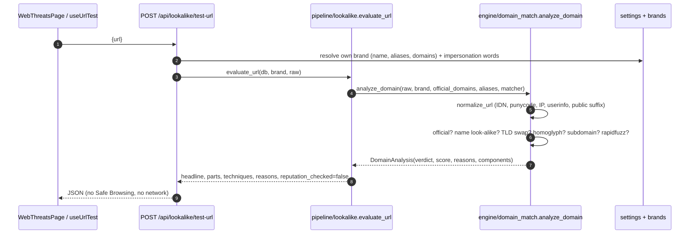
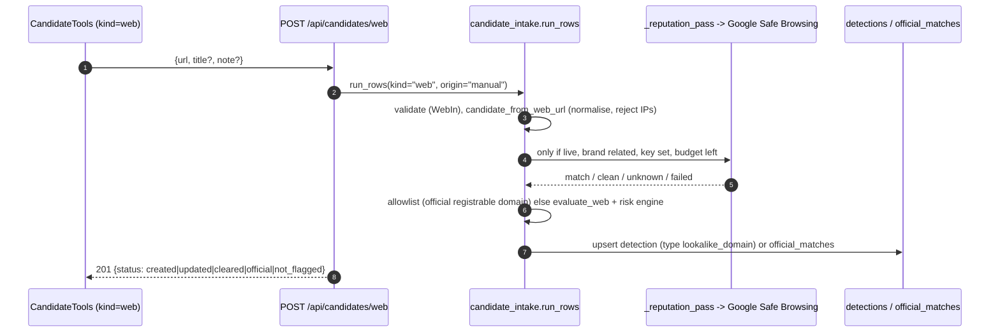

# Web Threats (look-alike domains and URLs)

## Plain-language summary

The Web Threats screen answers one question: "does this website address imitate our official domains?" You can type any domain or
URL into the tester and instantly see whether it is your official site, a look-alike (for example a swapped ending such as
`.net` instead of `.com`, look-alike letters from another alphabet, or your brand placed in front of someone else's domain),
or unrelated. Addresses that are saved as web threats are listed below the tester for review. **Important:** BrandShield does not
go out and discover websites by itself. Web threats only exist when they come from the built-in sample data, or when a person adds
a URL by hand or imports a file. The app never opens a website; the optional Google Safe Browsing check only sends the address to Google.

All paths are relative to the repository root (`ScamMind AI/`).

## 1. Purpose and user-facing behavior

Page: `frontend/src/pages/WebThreatsPage.tsx` (route "Web Threats", header at line 121). It has two parts.

**A. Domain / URL tester** (`WebThreatsPage.tsx:138-259`)

- Text box "Domain or URL (never opened)", max 2048 characters (line 159). The result is requested automatically 350 ms after typing stops
  (`useUrlTest`, `frontend/src/hooks/useUrlTest.ts:16-50`, `DEBOUNCE_MS` from `useLookalike.ts:8`); each keystroke cancels the previous request.
- Preset pills come from `GET /api/lookalike/test-urls` (example inputs generated from the registered brand and its official domains).
- Result: headline, explanation, verdict chip (Official domain / Look-alike domain / Related: review / No look-alike signal / Cannot be compared, lines 22-29),
  "Domain score N/100", name match %, technique chips, "How the address was read" (hostname, punycode vs unicode form, subdomain, registrable
  domain, TLD, which official domain it was compared with, port and `user@` credentials) and every scoring reason with its points (lines 174-225).
- A note always states that reputation was not checked in the tester (`r.reputation_note`, line 222).
- "Run examples" runs every preset through the tester and shows pass/fail against its expected verdict (lines 77-94, 227-258).
- If the brand has no official domain registered a notice links to Brand Registry (lines 147-151) and only the brand name is compared.

**B. Web detections list** (`WebThreatsPage.tsx:284-358`)

- Severity filter (All / Critical / High / Medium / Low), list "Suspicious domains" sorted by risk, detail panel with the shared `ReasonsBox` and `EvidenceBox`,
  and three actions: **Confirm threat**, **Keep reviewing**, **Dismiss as false positive** (lines 344-354) via `sm.setReview` -> `POST /api/detections/{id}/status`
  (`frontend/src/api/sm.ts:117-118`). There is no "Mark as official" for web detections.
- "Add candidate" and "Import CSV / JSON" tools for kind `web` (`CandidateTools`, line 296; see `docs/features/candidate-import.md`).
- Empty state text: "No web threats. Add a URL by hand or run a scan with web checks enabled." (line 310). See the note on this wording in section 4.

Roles: viewing and testing need any signed-in user (`get_current_user`; `backend/app/api/lookalike.py:77-80`). Review actions and candidate tools need
`admin` or `analyst` (`require_writer`, `backend/app/config/deps.py:56`; buttons disabled otherwise, `WebThreatsPage.tsx:345-352`).

## 2. Where web candidates come from (verified)

| Source | Produces web candidates? | Evidence |
|---|---|---|
| `tavily` | NO. Search is restricted to social and app-store domains, and results pass through `candidate_from_url`, which only yields profiles and store listings | `backend/app/core/collectors/tavily.py:41-51,116,154`; `backend/app/core/collectors/base.py:329-378` |
| `searxng` | NO. Platforms are the five social networks only | `backend/app/core/collectors/searxng.py:57,146-153` |
| `itunes` | NO. App Store only | `backend/app/core/collectors/itunes.py:59` |
| `google_play` | NO | `backend/app/core/collectors/google_play.py:71` |
| `sample` | YES, fake `.test` hosts (RFC 2606 reserved, can never resolve), only in sample data mode | `backend/app/core/collectors/sample.py:73,271-299` |
| Manual entry (`POST /api/candidates/web`) and import (`POST /api/candidates/import?kind=web`) | YES, whatever the person types | `backend/app/api/candidates.py:46-48,51-72`; `backend/app/core/pipeline/candidate_intake.py:143` |

The only function that builds a web candidate is `candidate_from_web_url` (`backend/app/core/collectors/base.py:381-400`), and a repository-wide search finds
exactly three callers: `sample.py:291`, `sample.py:296`, `candidate_intake.py:143`. Therefore **no live collector discovers websites**.

The orchestrator adds the pseudo platform `web` to a scan of scope `all` (`backend/app/core/collectors/orchestrator.py:233-234`), but with live collectors
this changes nothing because none emits web candidates. Scopes `social` and `apps` never include `web`. The sample collector produces, for a brand name of at least
4 letters, six look-alike URLs and, if the brand has an official domain, an official echo to prove the allowlist works (sample.py:281-298):

| Technique label | Example shape (for brand `acmebank`) | Tier |
|---|---|---|
| `tld_swap` | `https://acmebank.test/login` | strong |
| `combo` | `https://acmebank-support.test/kyc-update` | strong |
| `deceptive_subdomain` | `https://acmebank.<official>.verify-account.test/` | strong |
| `typo` | letters 2 and 3 swapped, `.test` | medium |
| `homoglyph` | first `a` (or `o`) replaced by a Cyrillic letter, `.test` | medium |
| `hard_negative` | `https://acme-<benign suffix>.test/` (another business) | weak |

## 3. Domain look-alike analysis

All in `backend/app/core/engine/domain_match.py`. Pure code: no network, no database (`domain_match.py:1-20`).

### Normalisation (`normalize_url`, domain_match.py:149-230)

Never raises and never touches the network:

1. Rejects empty input, input over 2048 characters (`MAX_URL_LENGTH`), and any control character or space (`_CONTROL`, line 45). Backslashes become slashes; a missing scheme is
   guessed as `http://`; only `http` and `https` are accepted.
2. Splits off port and `user@` userinfo (flagged, because `acmebank.com@evil.test` is a known trick).
3. Recognises IP hosts, including decimal/hex/octal forms such as `2130706433` or `0x7f000001` (`_integer_ipv4`, 101-126). IP hosts have no domain name, so the verdict is
   `not_comparable` (line 314-315).
4. **Punycode / IDN**: the host is encoded with `idna.encode(..., uts46=True)` to the ASCII form (`xn--...`) and decoded back for display (lines 197-214); `has_idn` is true if the
   two differ. A non-strict ASCII name (underscore) is tolerated with a warning.
5. **Registrable domain** via `tldextract` using its bundled Public Suffix List snapshot (`suffix_list_urls=()`, no download, `_extractor`, 48-51). An unknown TLD
   (`.test`, newer gTLDs) is treated as a one-label suffix so `acmebank.com.evil.test` resolves to `evil.test` (`_split_host`, 137-146).

### Verdicts and scoring (`analyze_domain`, 302-417)

| Verdict | Meaning | How it is reached |
|---|---|---|
| `not_comparable` | cannot be judged | unparseable input, IP host, or no public suffix (lines 311-317) |
| `official` | exact match | the registrable domain equals one of the brand's official registrable domains (never substring; lines 318-320, `official_registrables` 271-277) |
| `lookalike` | imitates the brand | name verdict `flagged` or `brand_name`, or a deceptive subdomain / userinfo trick, or an IDN homograph reason (415-416) |
| `related` | some brand signal but not enough | any positive reason, or a name verdict other than `safe` |
| `unrelated` | no signal | otherwise |

Signals and maximum points (`WEB_MAX`, domain_match.py:39):

| Signal | Max | Rule |
|---|---|---|
| `domain_similarity` | 40 | the domain label against brand name, aliases and official domain labels with the same `NameMatcher` used for social names, so decided hard negatives hold (`acmeplumbing.com` is not a look-alike of Acme Bank) (329-346). Same label under another TLD sets `tld_swap` (337-344) |
| `idn_homograph` | 15 | non-ASCII label that folds to the brand (homoglyph technique), or mixed alphabets while resembling the brand (348-360). Mixed scripts that do not resemble the brand are noted but not scored |
| `deceptive_subdomain` | 20 | brand (flagged or exact, never weak `review`) appears in a subdomain chunk, e.g. `acmebank.com.verify-account.test`; or in the part before `@` (362-389) |
| `added_words` | 10 | only when the name matched: 10 for strong scam words, 6 for impersonation words (391-397) |
| `rapidfuzz_similarity` | 12 | extra signal only when the home-grown matcher said `safe` and RapidFuzz ratio is at least 90 for a label of at least 6 characters (`RAPIDFUZZ_MIN_RATIO`, `RAPIDFUZZ_MIN_LEN`, 399-410) |
| `url_reputation` | 45 | only from Google Safe Browsing, see section 4; added in `RiskEngine.assess_web` (`backend/app/core/engine/risk_engine.py:199-222`) |

The domain score is `min(100, sum of points)`. When saved as a detection, the risk engine combines it with reputation (algorithm version `2.0`, weights `weights_v2_web`,
`risk_engine.py:11,43`); band and severity use the same cutoffs as social and app detections (85 / 70 and 40 / 70 / 85).

`is_hit` for web (`backend/app/core/pipeline/matching.py:244-250`): a brand-related reason is required AND (score >= threshold OR name flagged OR verdict `lookalike`),
so a look-alike always goes to review even with a low score. Detection type is `lookalike_domain`, category `web` (`scan_pipeline.py:249-252,659`). The row stores
`handle` = ASCII host, `name` = unicode host, `profile_url` = canonical URL without credentials, query or fragment (`candidate_from_web_url`; `_apply_fields`, `scan_pipeline.py:654-676`).
Summary tags such as "TLD swap", "brand in the subdomain", "look-alike characters", "listed by Google Safe Browsing" come from `_evaluate_web` (scan_pipeline.py:487-512).

## 4. Google Safe Browsing: when it is and is NOT called

Adapter: `backend/app/core/providers/safe_browsing.py` (Lookup API v4 `threatMatches:find`, endpoint at line 42, key in header `x-goog-api-key` at line 177, never in the URL).

**Called only from the scan pipeline's `_reputation_pass`** (`backend/app/core/pipeline/scan_pipeline.py:445-484`), which is used by scans (line 845) and by manual / imported
candidates (`candidate_intake.py:247`). A URL is sent only if ALL of these hold:

1. the candidate is a web candidate with a URL;
2. it is not an official match on the allowlist (line 455);
3. it is not sample data: sample URLs are never sent (lines 457-460, note "Sample data: the URL is not sent to Google.");
4. it is not a cached (`stale`) copy (461-463);
5. the domain analysis says it is brand related (`analysis.brand_related`, 464-467), so unrelated domains are never sent (quota and privacy);
6. fewer than `SAFE_BROWSING_MAX_URLS_PER_SCAN` (100) URLs have been collected (468-471);
7. inside the client: a key is configured, no 429 block is active, and the daily budget has room (below).

**Never called by:**

- `POST /api/lookalike/test-url` and the tester on the Web Threats page: `evaluate_url` is documented "no network, no Safe Browsing"
  (`backend/app/core/pipeline/lookalike.py:248-249,298`; it returns `reputation_checked: false`);
- any social or app detection, the Look-alike Lab name tester, or detection review actions;
- the Sources page except to read its status: `GET /api/sources` includes `reputation: runtime.safe_browsing.status()` (`backend/app/api/sources.py:156`), which makes no request.

Verdicts (`backend/app/core/providers/base.py:18,22-44`):

| Verdict | Meaning | Reaches the engine as |
|---|---|---|
| `match` | Google lists the URL (`MALWARE`, `SOCIAL_ENGINEERING`, `UNWANTED_SOFTWARE`, `POTENTIAL..._APPLICATION`; safe_browsing.py:44) | `present`, +45 points |
| `clean` | request succeeded, no match. NOT a safety guarantee (`CLEAN_NOTE`, line 47) | `clean`, 0 points |
| `unknown` | not asked: no key (`no_key`), our daily budget used (`budget`), HTTP 429 or quota 403 (`quota`), unattributed match | `unavailable`, 0 points |
| `failed` | asked and it went wrong: timeout, network error, 5xx, 400/401/403, bad body | `unavailable`, 0 points |

Quota ledger: `DailyLedger` (safe_browsing.py:50-87) counts **requests** per UTC day in table `api_usage` under provider `safe_browsing:YYYY-MM-DD`; `reserve` is one atomic
`UPDATE ... WHERE credits + n <= budget`. The limit is our own `SAFE_BROWSING_DAILY_BUDGET` (default 5000), not a Google figure. Up to 500 URLs go into one request
(`MAX_URLS_PER_REQUEST`, line 43), so one scan normally costs one request. Cache: `TTLCache` keyed by URL with `SAFE_BROWSING_CACHE_TTL_SECONDS` (3600); only `match` and
`clean` are cached (lines 139-142, 242-243). A 429 sets `blocked_until` (the `Retry-After` value or one hour) and later calls return `unknown/quota` without a request
(158-164, 197-200). Without `GOOGLE_SAFE_BROWSING_API_KEY` no request is made at all (159-160). Terms note in the file header: non-commercial use only; Web Risk is the paid alternative.

What the detail panel shows: `details.reputation` (`ReputationResult.to_dict`) or `{"verdict": "unavailable", "provider": "google_safe_browsing", "checked_at": null}` when it was not
checked (`scan_pipeline.py:630-633`), plus a per-URL note why it was skipped (`reputation_note`, lines 458-471). Counters in `scans.counts`: `web_candidates`, `reputation_checked`,
`reputation_match`, `reputation_clean`, `reputation_unavailable`, `reputation_skipped_sample`, `reputation_over_limit`.

## 5. Step-by-step flows

### 5.1 Testing a typed URL

1. User types; after 350 ms `sm.lookalikeTestUrl(url)` sends `POST /api/lookalike/test-url {"url": "...", "brand_id"?: n}` (`frontend/src/api/sm.ts:152`).
2. `UrlBody` trims the text and rejects empty input or more than 2048 characters (`backend/app/api/lookalike.py:40-50`; 422).
3. `evaluate_url` (`backend/app/core/pipeline/lookalike.py:248-299`) loads the Settings impersonation words, builds a matcher over brand name, aliases and official domain labels
   (`make_domain_matcher`, domain_match.py:280-287) and calls `analyze_domain`.
4. The response (lines 285-299) holds `verdict`, `verdict_label`, `headline`, `explanation`, `official_domains`, `compared_with`, `parts{hostname, hostname_unicode,
   subdomain_labels, registrable_domain, domain_label, tld, is_idn, punycode, port, has_credentials, is_ip, warnings}`, `techniques`, `score`, `name_match_percent`, `reasons`,
   `reputation_checked: false`, `reputation_note`.

### 5.2 Examples

`GET /api/lookalike/test-urls` returns labelled examples from `domain_examples` (lookalike.py:208-245): official domain, brand in subdomain (`<official>.verify-account.test`), added
word (`<label>-support.<suffix>`), two TLD swaps, a homoglyph and its punycode form, a separator variant, and two unrelated business names. If the brand has no domain a plausible
`<name>.com` is derived and `derived: true` with an explanatory note.

### 5.3 Saving a web threat

Details of validation, limits and statuses are in `docs/features/candidate-import.md`. The same pipeline runs for CSV/JSON imports and for a scan of scope `all` in sample mode.

## 6. Files, tables, APIs, services

| Item | Detail |
|---|---|
| Frontend | `frontend/src/pages/WebThreatsPage.tsx`, `frontend/src/hooks/useUrlTest.ts`, `frontend/src/components/monitor/CandidateTools.tsx`, `MonitorParts.tsx` (`ReasonsBox`, `EvidenceBox`, `SeverityChip`) |
| API | `POST /api/lookalike/test-url`, `GET /api/lookalike/test-urls` (`backend/app/api/lookalike.py:77-80,119-122`); `GET /api/detections?category=web[&severity=]`; `GET /api/detections/{id}`; `POST /api/detections/{id}/status`; `POST /api/candidates/web`; `POST /api/candidates/import?kind=web&format=csv|json&dry_run=` |
| Engine | `backend/app/core/engine/domain_match.py`, `risk_engine.py` (`assess_web`), `name_match.py`, `urls.py` |
| Pipeline | `backend/app/core/pipeline/lookalike.py` (tester), `scan_pipeline.py:445-512` (`_reputation_pass`, `_evaluate_web`), `matching.py:194-199` (official domain exclusion) |
| Provider | `backend/app/core/providers/safe_browsing.py`, `providers/base.py` |
| Tables | `detections`, `detection_events`, `official_matches`, `api_usage` (Safe Browsing day counter), `collector_state` (sample cache), `audit_log` |
| External service | Google Safe Browsing `https://safebrowsing.googleapis.com/v4/threatMatches:find` (REAL, only when a key is set; URL is sent, never opened). Everything else on this feature is local code or sample data |

Mock versus real: the tester and the domain scoring are real local algorithms (provenance `local_algorithm`). Detections in sample mode are fabricated (`.test` hosts) and every signal
is labelled `synthetic` (`risk_engine.py:17-18,121-122`). The reputation signal is `real_api` only when Google answered.

## 7. Validation, errors, edge cases

| Case | Behavior |
|---|---|
| Empty or over-long URL to the tester | 422 (`lookalike.py:44-50`) |
| Input with spaces or control characters | verdict `not_comparable`, explanation "contains spaces or control characters" (`NOT_COMPARABLE_WHY`, lookalike.py:198-203) |
| IP address host (also integer/hex forms) | `not_comparable`; also rejected as a candidate ("IP addresses are not compared", `candidate_intake.py:144-145`) |
| URL not http(s) | `not_comparable` in the tester; "url must be an http(s) address" for candidates (`_http_url`, candidate_intake.py:107-115); a missing scheme is added as `https://` there |
| Official domain registered with a different TLD | other TLD is a `tld_swap` look-alike |
| Official domain list empty | name-only comparison; UI notice |
| Unknown TLD (e.g. `.test`) | treated as one-label suffix with a warning (`domain_match.py:218-219`) |
| Brand token shorter than 5 characters | only matched exactly by the name matcher (`MIN_LEN_ONE_EDIT = 5`, `name_match.py:81`) |
| Safe Browsing key missing, quota, timeout | reputation is `unavailable` (never "clean"), scan continues |
| Review of a web detection | same rules as other detections: status change audited, re-scans never reset it (`docs/features/social-and-app-threats.md`) |
| Mark web detection official | 422: add the domain under Brand Profile official domains instead (`backend/app/services/detections.py:355-356`) |

Notes and wording issues found while verifying:

- The empty-state text "run a scan with web checks enabled" (`WebThreatsPage.tsx:310`) suggests a switch that does not exist. There is no web-checks setting in `backend/app/config/config.py`,
  and the only scans that produce web candidates are sample-mode scans of scope `all`. The Web Threats page itself has no scan button; scope `all` is started from the Dashboard (`DashboardPage.tsx:70`).
- Changing a brand's official `domains` (or name, aliases, keywords) through `PUT /api/brands/{id}` retires ALL earlier detections of that brand (status `retired`, hidden everywhere), rebuilds the
  Look-alike Lab built-in cases when the name changed, and tells the user to re-scan (`backend/app/api/brands.py:162,165-195`, `retire_results`, `backend/app/services/detections.py:499-505`).
  So an old web detection for a domain you later register as official disappears with that edit.

**Needs confirmation:** whether a manually added web candidate should be sent to Google Safe Browsing. The code does send it when a key is configured and the domain looks brand related
(`candidate_intake.py:247` calls `_reputation_pass`; `data_source` is `live` for `manual`/`import`, `base.py:75-78`), although the page text promises that URLs "are never opened" (true) and
the tester note says reputation is not checked "here" (true for the tester only).

## 8. Config (names only)

`GOOGLE_SAFE_BROWSING_API_KEY`, `SAFE_BROWSING_TIMEOUT_SECONDS` (5), `SAFE_BROWSING_DAILY_BUDGET` (5000), `SAFE_BROWSING_MAX_URLS_PER_SCAN` (100), `SAFE_BROWSING_CACHE_TTL_SECONDS` (3600)
(`backend/app/config/config.py:132-136`); `SEVERITY_*` cutoffs; Settings page `impersonation_words` and `sensitivity` (affects the `score >= threshold` branch of `is_hit`); `IMPORT_MAX_BYTES`
(1 MB) and `IMPORT_MAX_ROWS` (500) for imports (config.py:85-86). Data mode `sample` is what makes sample `.test` web threats appear.
