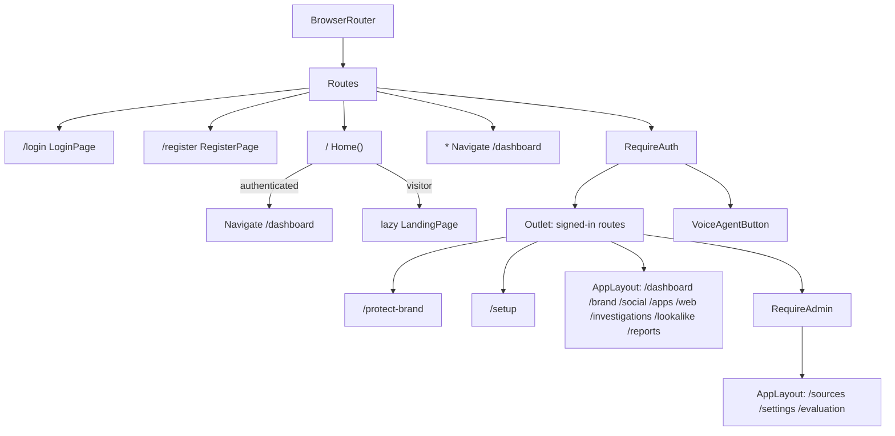
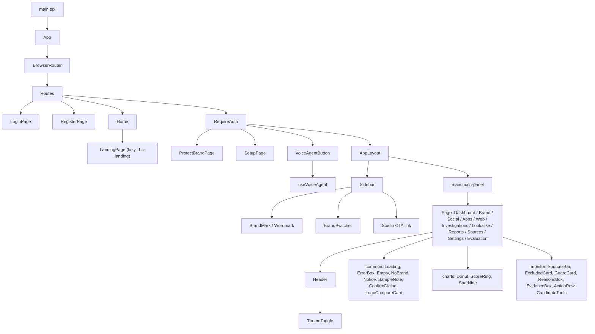

# BrandShield Frontend

## Plain-language summary

The frontend is the web application people use to protect a brand: a marketing page, sign-in and sign-up screens, a first-run setup wizard, and a set of monitoring screens (dashboard, social, apps, web, investigations, look-alike lab, reports) plus administrator-only screens (source health, settings, model evaluation). It is a single-page React app: after the first load, moving between screens does not reload the page. It talks to the backend through one small API layer that attaches the signed-in user's token, refreshes it when it expires, and remembers the last answer of each screen so screens reappear instantly. A separate app, Brand Studio, lives in `studio/` and shares the same login.

---

## 1. Stack and folder map

| Item | Detail | Source |
|---|---|---|
| Framework | React 19, React Router 7, TypeScript 6, Vite 8, lucide-react icons, d3-geo (map) | `frontend/package.json:16-39` |
| Entry | `main.tsx` applies the saved theme, then renders `<App />` in `StrictMode` | `frontend/src/main.tsx:1-13` |
| Folders | `src/pages` (screens + per-page CSS), `src/components/{layout,common,charts,monitor,voice}`, `src/hooks`, `src/api`, `src/utils`, `src/styles`, `src/landing`, `src/test` | `frontend/src/` |
| Not in this app | Brand Studio is in `studio/` (see `docs/features/brand-studio.md`) | |

---

## 2. Pages and screens

Route table from `frontend/src/App.tsx:80-188`. "Layout" means wrapped in `AppLayout` (sidebar plus main panel).

| Route | Component | Layout | Who can open it | Notes |
|---|---|---|---|---|
| `/` | `Home()` then `LandingPage` (lazy) | none | Public; signed-in users are redirected to `/dashboard` | `App.tsx:26-36,183`; see `docs/features/landing-page.md` |
| `/login` | `LoginPage` | none | Public | Handles `?next=/studio/` via `safeStudioNext` (`pages/LoginPage.tsx:51-52`); demo credentials button (`e2e/demo-login.spec.ts`) |
| `/register` | `RegisterPage` | none | Public | Signs the new user in and goes to `/protect-brand` (`App.tsx:86`) |
| `/protect-brand` | `ProtectBrandPage` | none | Any signed-in user | Two cards: "Create a Brand" opens Studio (`openStudio()`), "Protect a Brand" goes to `/setup` (`/setup?new=1` when adding another brand) (`pages/ProtectBrandPage.tsx:8-18`). `/protect-your-brand` redirects here (`App.tsx:92`) |
| `/setup` | `SetupPage` | none | Any signed-in user at the route level; actions need analyst/admin on the API | 3-step first-run wizard ("Set up brand protection in three steps"), "Skip setup for now" (`pages/SetupPage.tsx:312-319`) |
| `/dashboard` | `DashboardPage` | yes | Any signed-in user | "Dashboard"; starts scans (button disabled without write role) |
| `/brand` | `BrandProfilePage` | yes | Any signed-in user; editing needs `canWrite` | "Brand Profile": identity, accounts, apps, logos (`pages/BrandProfilePage.tsx:37,411-691`) |
| `/social` | `SocialMonitoringPage` | yes | Any signed-in user | "Social Media Monitoring" (shares `useMonitor` and `MonitorParts`) |
| `/apps` | `AppStoreMonitoringPage` | yes | Any signed-in user; scans need `canWrite` | "App Store Monitoring" (`pages/AppStoreMonitoringPage.tsx:24,86-87`) |
| `/web` | `WebThreatsPage` | yes | Any signed-in user | "Web Threats" |
| `/investigations` | `InvestigationsPage` | yes | Any signed-in user | "Investigations": case workflow |
| `/lookalike` | `LookalikeLabPage` | yes | Any signed-in user | "Look-alike Lab" live matcher (`useLookalike`, `useUrlTest`) |
| `/reports` | `ReportsPage` | yes | Any signed-in user | "Reports": draft, preview, approve, CSV/HTML export |
| `/sources` | `SourceHealthPage` | yes | **Administrator only** (`RequireAdmin`) | "Source Health" |
| `/settings` | `SettingsPage` | yes | **Administrator only** | "Settings" (sensitivity, schedule, webhook, data mode) |
| `/evaluation` | `EvaluationPage` | yes | **Administrator only** | "Evaluation" / "Model Evaluation" |
| `*` | redirect | none | any | `Navigate to="/dashboard"` (`App.tsx:184`) |

Roles come from the account saved at sign-in: `admin`, `analyst`, `viewer` (`frontend/src/api/client.ts:68-75`). `useMe()` exposes `isAdmin` (`role === 'admin'`) and `canWrite` (`admin` or `analyst`); viewers can read but buttons that change data are disabled with a title such as "Your role can view but not start scans" (`hooks/useMe.ts:11-34`, `pages/AppStoreMonitoringPage.tsx:86-87`). The real enforcement is on the API (`require_writer`, `require_admin`).

Sidebar menu labels differ from page titles: Overview, Brand Registry, Social Threats, App Threats, Web Threats, Investigations, Look-alike Lab, Source Health (admin), Reports, Model Evaluation (admin), then Brand Studio, then bottom items Settings (admin) and Support (`components/layout/Sidebar.tsx:60-190`).

---

## 3. Routing

* **`BrowserRouter` with `Routes`** in `App()` (`App.tsx:80-188`).
* **`RequireAuth`**: if `session.isAuthenticated()` is false it redirects to `/login` with `state.from` (`App.tsx:69`). It subscribes to the `scammind:unauthorized` event (fired when a refresh is rejected) and then calls `resetBrand()` and navigates to `/login` (`App.tsx:59-66`). It renders `<Outlet />` plus a single `<VoiceAgentButton />` so the voice agent keeps its state across pages (`App.tsx:71-77`). There is deliberately no offline or sample session: "without a token the user must sign in" (`App.tsx:68`).
* **`RequireAdmin`**: reads the role saved at sign-in; only if missing does it call `GET /api/me` once; non-admins are redirected to `/dashboard`; while the role is unknown it renders nothing (`App.tsx:39-54`).
* **Lazy landing**: `lazy(() => import('./landing/LandingPage'))` inside `<Suspense fallback={null}>` (`App.tsx:26-36`). All other pages are imported eagerly (`App.tsx:10-24`).
* **Full-page jumps**: Brand Studio is not part of this router. The sidebar button is a normal `<a href="/studio/">` and the voice agent uses `window.location.assign` for paths beginning `/studio` (`Sidebar.tsx:156`, `hooks/useVoiceAgent.ts:199`).
* **Production rewrites**: SPA fallback for every non-asset path in `vercel.json:15-24` (frontend service) and nginx for Docker (`frontend/nginx/default.conf.template`).

---

## 4. Layout

`AppLayout` (`components/layout/AppLayout.tsx:11-39`) renders `.app-container` with `<Sidebar />` and `<main className="main-panel">`. It clones each child and injects `onOpenMobileMenu` so a page's `Header` can open the mobile sidebar. `main` has `key={epoch}`: pages are remounted (so they reload) only when the person switches to **another** brand, not when the first brand finishes loading (`AppLayout.tsx:13-17,24`).

`Sidebar` (`components/layout/Sidebar.tsx`):

1. Logo (`BrandMark`, `Wordmark`) linking to `/dashboard` (`:41-44`).
2. Search box with `data-voice="search"` (`:49`).
3. `BrandSwitcher` (`:55`).
4. Main menu `NavLink`s; admin-only links hidden unless `session.user()?.role === 'admin'` (`:32,65-91`).
5. **Studio CTA button**: `<a href={STUDIO_URL} className="studio-cta" data-voice-row>` "Brand Studio / Names, logos & palettes" (`:155-165`). `STUDIO_URL` is `VITE_STUDIO_URL` or `/studio/` (`utils/studio.ts:3`).
6. Bottom: Settings (admin) and Support (`alert('Support desk: support@brandshield.ai')`) (`:170-189`).

`BrandSwitcher` (`components/layout/BrandSwitcher.tsx`): shows the active brand, lists all brands from `GET /api/brands` when opened, and offers "Add another brand" (navigates to setup). Choosing a brand calls `POST /api/brands/{id}/select`, then `clearQueryCache()` (every cached page answer belonged to the previous brand), then `refreshBrand()` (`BrandSwitcher.tsx:17-61`).

`Header` (`components/layout/Header.tsx`): each page renders its own `<Header title subtitle actions onOpenMobileMenu />`. It shows a "Sample data" badge when the API said the data is sample (`useIsSample`), the `ThemeToggle`, a notifications bell, and a user chip with sign-out (`:55-90`). Sign-out calls `sm.logout()` (revokes the refresh token), `resetBrand()`, `resetSampleFlag()` and navigates to `/login` (`:26-33`).

Pages without `AppLayout`: `/login`, `/register`, `/protect-brand`, `/setup`.

---

## 5. State management

There is **no global store library** (no Redux, Zustand or React Query). State comes from five mechanisms:

| Mechanism | What it holds | Source |
|---|---|---|
| Session in `api/client.ts` | Access and refresh tokens and the user, in `localStorage` (or `sessionStorage` when "keep me signed in" is off) under `scammind.auth` and `scammind.user` | `api/client.ts:59-136` |
| `useBrand` external store | The workspace's active brand, shared by sidebar, setup wizard and pages | `hooks/useBrand.ts` |
| `useApi` + `queryCache` | Per-request data with stale-while-revalidate | `hooks/useApi.ts`, `api/queryCache.ts` |
| `useMe` | Current user and role flags | `hooks/useMe.ts` |
| Local component state and small hooks | Forms, tabs, filters; `usePref` for harmless UI prefs under `scammind.ui.*` | `hooks/usePref.ts`, `hooks/useScan.ts`, `useMonitor.ts`, `useLookalike.ts`, `useUrlTest.ts` |

**`useBrand`** is a module-level store used with `useSyncExternalStore`. Loading: `GET /api/me` (saves the user, reads `default_brand_id`) then `GET /api/brands/{id}`. `missing: true` when there is no brand or a 404. Concurrent calls share one request (`inflight`). `resetBrand()` clears it (sign-out, tests); `setBrandCache(brand)` replaces it after a mutation; `refreshBrand()` reloads (`hooks/useBrand.ts:21-66`).

**`useApi(fn, deps, enabled)`**: the cache key is `userId|fn.toString()|JSON(deps)`. If the key is cached, the data appears immediately and a background request refreshes it (`refreshing: true`, no loading screen). The request is cancelled with `AbortController` when the component unmounts, deps change or a newer load starts, so a slow answer never overwrites a newer one. `setData` updates state and the cache (optimistic updates). Returns `{data, loading, refreshing, error, reload, setData}` (`hooks/useApi.ts:5-92`).

**`queryCache`**: a `Map` with at most 150 entries (oldest evicted); a `null` value deletes the entry (`api/queryCache.ts:5-25`). It is cleared by `session.clear()` (so the next person never sees another user's pages), by the brand switcher and by the test setup (`api/client.ts:120-123`, `components/layout/BrandSwitcher.tsx:48`, `test/setup.ts:8`).

**`useMe`**: starts from the saved user, then confirms with `GET /api/me` and saves it back (`hooks/useMe.ts:19-34`).

Other hooks: `useScan` starts a scan and polls `GET /api/jobs/{id}` (409 attaches to the running job; gives up after a maximum wait) (`hooks/useScan.ts:1-4`); `useMonitor` shares logic of Social and App pages with optimistic review actions and rollback (`hooks/useMonitor.ts:1-2`); `useLookalike` and `useUrlTest` debounce typing and cancel the previous call (`hooks/useLookalike.ts:1-3`). `api/sample.ts` derives a global "this is sample data" flag from API answers (`is_sample`, `data_mode`) through `onResponse` taps, never guessed (`api/sample.ts:1-3`).

---

## 6. Component hierarchy

Shared components (`frontend/src/components/`): `common/States.tsx` (`Loading`, `ErrorBox`, `Empty`, `NoBrand`, `Notice`, `SampleNote`), `common/ConfirmDialog.tsx` (`ConfirmDialog`, `RetryCostDialog`), `common/LogoCompareCard.tsx`, `common/BrandMark.tsx`, `charts/Donut|ScoreRing|Sparkline.tsx`, `monitor/MonitorParts.tsx` and `CandidateTools.tsx` (used by Social and App pages), `layout/*`, `voice/VoiceAgentButton.tsx`.

---

## 7. Styling

| Piece | Detail | Source |
|---|---|---|
| Tokens | CSS variables on `:root` in `styles/tokens.css` (`--bg-page`, `--bg-shell`, `--bg-card`, `--text-main`, `--accent`, `--btn-primary-start/end`, `--red`, radii, ...); `styles/index.css` imports `tokens.css` then `light-mode-patches.css` | `styles/index.css:1-2`, `styles/tokens.css:1-30` |
| Per-page CSS | One `.css` file next to each page (for example `DashboardPage.css`), imported by the component (`ProtectBrandPage.tsx:6`) plus `components/layout/Layout.css`, `common/States.css`, `voice/VoiceAgentButton.css` | `frontend/src/pages/*.css` |
| Theme toggle | `utils/theme.ts`: preference stored in `localStorage` key `scammind.ui.theme`, default dark; `applyTheme` sets `data-theme` on `<html>`; applied before first render in `main.tsx`; toggled by `ThemeToggle` (in `Header`) | `utils/theme.ts:1-20`, `main.tsx:7`, `components/layout/ThemeToggle.tsx:6-27` |
| Light-mode patches | Page CSS uses hard-coded `rgba(255,255,255,...)`; `light-mode-patches.css` overrides those rules, all scoped to `:root[data-theme='light']`, so dark mode is untouched | `styles/light-mode-patches.css:1-20` |
| Landing page | Separate scoped CSS under `.bs-landing` with its own tokens | `landing/landing.css` |

---

## 8. API integration

**`api/client.ts`** (HTTP core):

* Base URL precedence: runtime `window.__SCAMMIND_CONFIG__.API_URL` (from `/config.js`, written at container start, no rebuild needed) then `VITE_API_URL` then `''` (same origin) in production or `http://127.0.0.1:8000` in development (`api/client.ts:16-27`; `public/config.js`).
* `request<T>(path, {method, json, form, signal, text, blob, anonymous, fallback})` adds `Authorization: Bearer <access>` unless `anonymous` (`api/client.ts:271-287,296-347`).
* 401 handling: refresh **once** (single flight per tab and a Web Lock `scammind-refresh` across tabs and across BrandShield and Studio), store the rotated pair and retry the original request once. A rotated refresh token must never be sent twice. 4xx on refresh clears the session and fires `scammind:unauthorized`; a network failure or 5xx keeps the session (`api/client.ts:227-262,314-347`).
* Errors become `ApiError(status, message)`; `message` is the server's `detail` (or the 422 `msg` items joined by "; "); `fields` maps `loc[-1]` to message; `retryAfter` from the `Retry-After` header; network failures have `status 0`, `network: true` (`api/client.ts:31-51,187-224`).
* `downloadFile` and `checkHealth` helpers (`api/client.ts:370-382`).

**`api/sm.ts`**: the typed endpoint catalogue (`export const sm = {...}`): auth (`login`, `register`, `demo`, `logout` from `api/auth.ts`), `me`, `voice` (`POST /api/voice`), brands (`brands`, `selectBrand`, `brand`, `createBrand`, `updateBrand`, logos, accounts, apps), `dashboard`, scans and jobs, detections and review actions, candidates and imports, providers, sources, data mode, look-alike tests and logo compare, settings, reports (create, approve, preview, download), evaluation (`api/sm.ts:66-181`). Types live in `api/types.ts`; formatting helpers in `api/format.ts`.

**Vite proxy (development)**: `frontend/vite.config.ts:8-14` proxies `/studio` (WebSocket enabled, default target `http://127.0.0.1:3000`, override `STUDIO_DEV_URL`) and `/api` (default `http://127.0.0.1:8000`, override `STUDIO_API_PROXY`). BrandShield itself uses `VITE_API_URL`; the `/api` proxy exists so Studio can use relative URLs on this origin.

---

## 9. Build tooling and tests

| Task | Command (from `frontend/package.json:6-14`) | Detail |
|---|---|---|
| Dev server | `npm run dev` (`vite`) | port 5173 by default |
| Build | `npm run build` (`tsc -b && vite build`) | type-checks first; output in `dist/` |
| Typecheck | `npm run typecheck` | `tsconfig.app.json`: ES2023, `noUnusedLocals`, `noUnusedParameters`, `erasableSyntaxOnly`, `verbatimModuleSyntax` (`tsconfig.app.json:1-27`) |
| Lint | `npm run lint` (`oxlint`) | `.oxlintrc.json`: plugins react, typescript, oxc; `react/rules-of-hooks` error, `react/only-export-components` warn |
| Unit and component tests | `npm test` (`vitest run`) | jsdom, `testTimeout: 20_000` (form tests type passwords key by key), `css: false`, `restoreMocks`, setup in `src/test/setup.ts` (`vite.config.ts:15-22`) |
| End-to-end | `npm run test:e2e` (`playwright test`), `npm run e2e:install` | Chromium |

Unit tests are next to the code: `App.test.tsx`, `vercelConfig.test.ts`, `api/*.test.ts` (base URL, client, format), `hooks/*.test.tsx` (`useApi` cache, `useLookalike`, `useScan`), `utils/*.test.ts` (brand examples, password policy, studio, theme, voice), `pages/*.test.tsx` (Investigations, Login, Login demo, ProtectBrand, Register, Setup, SourceHealth, WebThreats), `components/common/LogoCompareCard.test.tsx`, `landing/LandingRoute.test.tsx`. Helpers: `test/helpers.ts` (`jsonResponse`, `mockFetch`, `signIn`).

**Playwright** (`frontend/playwright.config.ts`): starts three servers: the REAL backend via `backend/scripts/e2e_server.py` (sample collector, temp SQLite database, no Tavily key, no network) on port 8765 (`E2E_API_PORT`), the BrandShield Vite dev server on 5174 (`E2E_WEB_PORT`), and Brand Studio's dev server on 3100 (`E2E_STUDIO_PORT`). One worker, serial, no retries; secrets are generated per run in memory (`playwright.config.ts:12-33,35-95`).

| Spec (`frontend/e2e/`) | What it proves |
|---|---|
| `smoke.spec.ts` | Wrong-password login and guarded routes; setup (create brand, logo, first scan); brand profile; dashboard scan in sample mode; social review actions with rollback; apps; look-alike lab; source health; reports with downloads (`smoke.spec.ts:56-325`) |
| `visual.spec.ts` | Captures every page at 1440 px into `e2e/screenshots/` (git-ignored); asserts each renders with data (`visual.spec.ts:10-25`) |
| `demo-login.spec.ts` | "Use demo credentials" fills the form; demo account signs in as non-admin; guarded demo administrator |
| `register.spec.ts` | Create account, password policy messages, duplicate email, lands on `/protect-brand`; "Create a Brand" goes to `/studio/` (Studio intercepted), "Protect a Brand" goes to `/setup` |
| `protect-hover.spec.ts` | Hover styling of the "Create a Brand" card |
| `studio-flow.spec.ts` | Whole cross-app flow: sign up, open Studio on the same login, create a brand there, see it in BrandShield, and a second account cannot see it; sign-out in Studio returns to `/studio/` after login |
| `multi-brand.spec.ts` | Several brands per account, Studio remembers inputs, saving a large picture to Collections, "Back to BrandShield", "Add another brand" opens an empty setup form |
| `voice.spec.ts` | Fake speech recognition: off until pressed, navigate and fill by voice, stays on across pages, releases the mic when off; friendly message where recognition is missing |

Helper `e2e/png.ts` generates test pictures (`makePng`).

---

## 10. Deployment pointers

* Vercel: the `frontend` service is a Vite app with an SPA rewrite that skips `assets/` and file extensions (`vercel.json:15-24`); security headers (including CSP `connect-src 'self'`, so the SPA must use the same origin for the API, hence the empty `BASE_URL` default in production) apply to all paths (`vercel.json:96-115`).
* Docker: `frontend/Dockerfile` and `frontend/nginx/` (runtime config script writes `config.js` from `API_URL`; `location /studio/` proxies to the studio container) (`api/client.ts:17`, `frontend/nginx/default.conf.template:35-60`).
* Existing docs `docs/FRONTEND_CONTRACT.md` and `docs/STUDIO.md` were not used as a source for this page; verify them against the code above before relying on them.

**Needs confirmation:** the exact set of props and layout (Header actions) of each individual page was summarised from titles and imports rather than from a full read of every page component; the route and role behaviour above is from `App.tsx`, `Sidebar.tsx` and `useMe.ts` and is verified, but per-page content descriptions are brief.
