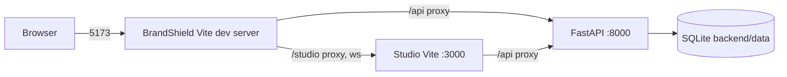

# Setup and deployment

**Plain-language summary**

* To run BrandShield on your own computer you need Python, Node, one settings file (`backend/.env`) and two commands:
  `npm run backend` and `npm run frontend`.
* The same code can also run as a Docker stack (api, worker, database, Redis, web) or as one Vercel project with a Supabase database.
* Whatever you choose, the database tables are created by migrations (`alembic`). If the API says the database is not ready, the
  migration step has not been run.
* Health pages (`/health`, `/health/live`) tell you whether the app is up. Logs are structured JSON with secrets removed.
* Several parts of the Docker and Vercel setup were written but never run by the authors. They are marked below.

## 1. Local setup (no Docker)

| Step | Command (from the project root unless stated) | Source |
|---|---|---|
| 1. Settings file | `copy backend\.env.example backend\.env` (Linux/macOS: `cp backend/.env.example backend/.env`) | `backend/.env.example` |
| 2. Fill required values | `JWT_SECRET` (16+ chars), `ADMIN_EMAIL`, `ADMIN_PASSWORD` | `backend/app/config/config.py:40,45-46` |
| 3. Generate a secret | `python -c "import secrets; print(secrets.token_urlsafe(48))"` | `docs/DEPLOY_VERCEL.md` section 3.3 |
| 4. Virtual env + packages | done automatically by `npm run backend` on first run, or by hand: `cd backend`, `python -m venv .venv`, `.\.venv\Scripts\python -m pip install -r requirements-dev.txt` | `scripts/dev.mjs:91-100` |
| 5. Migrations | `cd backend` then `.\.venv\Scripts\python -m scripts.migrate` (or `python -m alembic upgrade head`; `npm run backend` runs the latter) | `backend/scripts/migrate.py:45-51`, `scripts/dev.mjs:102` |
| 6. Web packages | done automatically by `npm run frontend` on first run, or `npm install` in `frontend/` and `studio/` | `scripts/dev.mjs:50-56,83-84` |

Notes

* The Settings class reads `backend/.env` and also a `.env` in the folder above `backend/` (the project root), in that order
  (`backend/app/config/config.py:18-24`). The root `.env` is the Docker compose file (see section 3); do not put compose-only values there for a
  non-Docker run.
* Blank values count as "not set" (`env_ignore_empty=True`, `config.py:23`).
* The default database is a SQLite file `backend/data/scammind.db`; `DATA_DIR` defaults to `backend/data` (`config.py:28-29`). Without
  `REDIS_URL` scans run in an in-process thread (`config.py:110-111`).
* `backend/.env` is gitignored (`.gitignore`: `.env`, `.env.*`, `!backend/.env.example`). Never commit it.
* Optional extras (Sentry, CLIP logo model, Google Play scraper, ImageHash): `pip install -r requirements-extra.txt`
  (`backend/requirements-extra.txt`). Not needed to run or test.

## 2. The two dev commands (`scripts/dev.mjs`)

`package.json:5-8` maps `npm run backend` to `node scripts/dev.mjs backend` and `npm run frontend` to `node scripts/dev.mjs frontend`.
The parent folder `ScamMind AI New/package.json` forwards both with `npm --prefix "ScamMind AI" run ...`.

| | `npm run backend` | `npm run frontend` |
|---|---|---|
| Port check | refuses to start if 8000 is in use (`scripts/dev.mjs:89`) | refuses if 5173 or 3000 is in use (`:80`) |
| First run | creates `backend/.venv` and pip-installs `requirements.txt` if missing (`:93-100`) | `npm install` in `frontend/` and `studio/` if `node_modules` is missing (`:83-84`) |
| Migrations | runs `python -m alembic upgrade head`; stops with "Database migration failed: check DATABASE_URL in backend/.env" on failure (`:102-106`) | none |
| Server | `uvicorn app.main:create_app --factory --port 8000 --reload --reload-dir app` (`:108`) | Studio `npm run dev` (port 3000) and BrandShield `npm run dev` (port 5173) (`:87-88`) |
| Open | http://localhost:8000/docs, `/health/live` (`:107`) | http://localhost:5173 (Studio at `/studio/`; port 3000 redirects there) (`:85`) |
| Stop | Ctrl+C, or when any child exits, the rest stop (`:26-31`); on Windows `taskkill /T /F` (`:39`) | same |

How the port check works: it tries to connect to the port on `127.0.0.1` and `::1`; a successful connection means busy (`:57-68`).

How the pieces fit in dev:



* BrandShield's own pages call the API directly at `http://127.0.0.1:8000` in development (`frontend/src/api/client.ts:27`).
* `/studio` is proxied to port 3000 and `/api` to port 8000 so Studio shares BrandShield's origin and login
  (`frontend/vite.config.ts:10-13`, `studio/vite.config.ts:11-21`).
* Opening Studio's port 3000 directly redirects to `http://localhost:5173/studio/` (`studio/src/lib/devRedirect.ts:16-21`).

## 3. Docker

Files: `docker-compose.yml`, `docker-compose.dev.yml`, `backend/Dockerfile`, `backend/docker-entrypoint.sh`, `frontend/Dockerfile`,
`frontend/nginx/`, `studio/Dockerfile`, `studio/nginx/default.conf`.

> The Docker files state they were **never built or run** where they were written (`backend/Dockerfile:5`, `frontend/Dockerfile:5`,
> `studio/Dockerfile:6`). CI builds the three images without running them (`.github/workflows/ci.yml:201-231`).

### Quick commands

| Task | Command |
|---|---|
| Create compose settings | `cp .env.example .env` (root `.env.example`), fill `POSTGRES_PASSWORD`, `REDIS_PASSWORD`, `JWT_SECRET`, `ADMIN_EMAIL`, `ADMIN_PASSWORD` (compose refuses to start without them: `docker-compose.yml:20-23,79-80`) |
| Start everything | `docker compose up --build` |
| Start with db/redis/studio ports published on localhost | `docker compose -f docker-compose.yml -f docker-compose.dev.yml up --build` |
| One-off migration | `docker compose run --rm api migrate` (`docker-compose.yml:82` comment; `backend/docker-entrypoint.sh:26`) |

### Services (`docker-compose.yml`)

| Service | Image / build | Role | Notes |
|---|---|---|---|
| `db` | `postgres:17-alpine` (`:39`) | PostgreSQL, volume `pgdata` | healthcheck `pg_isready` (`:47-52`) |
| `redis` | `redis:7.2-alpine` (`:55`) | RQ queue, password via `REDISCLI_AUTH` | appendonly on (`:60`) |
| `api` | `./backend` Dockerfile, tag `brandshield-server:local` (`:70-74`) | FastAPI on `127.0.0.1:${API_PORT:-8000}` | runs migrations then uvicorn; scheduler on by default (`:83`); healthcheck `/health/live` (`:95`) |
| `worker` | same image, command `worker` (`:106-108`) | RQ worker (`python -m app.worker`) | scheduler forced off (`:111`); starts after api is healthy (`:114-116`) |
| `frontend` | `./frontend` Dockerfile (`:132-136`) | nginx on `127.0.0.1:${FRONTEND_PORT:-5173}` -> 8080 | `API_URL` written to `/config.js` at start (`:140`) |
| `studio` | `./studio` Dockerfile (`:153-156`) | nginx, not published; frontend nginx proxies `/studio/` | `docker-compose.dev.yml:18-19` publishes it on `${STUDIO_PORT:-3000}` |

Compose forces `SCAN_EXECUTOR=rq` and `APP_ENV=production` unless overridden (`docker-compose.yml:16,22`); the dev overlay sets
`APP_ENV=local` and `LOG_LEVEL=DEBUG` on api and worker (`docker-compose.dev.yml:10-17`) and publishes `db` and `redis` on `127.0.0.1`
(`:4-9`).

### Images

| Image | Build | Source |
|---|---|---|
| Server (api, worker, migrate) | two stages: venv with `requirements.txt` (+ `requirements-extra.txt` if `--build-arg INSTALL_EXTRAS=true`), then slim runtime, non-root uid 10001, `VOLUME /data`, healthcheck on `/health/live` | `backend/Dockerfile:8-42` |
| Entrypoint roles | `api` (migrate unless `RUN_MIGRATIONS=false`, then uvicorn with `--proxy-headers`), `worker`, `migrate` | `backend/docker-entrypoint.sh:15-27` |
| Frontend | Vite build on `node:22-alpine`, served by `nginx-unprivileged:1.27-alpine` on 8080 | `frontend/Dockerfile:8-23` |
| Studio | Vite build (base `/studio/`) placed in `/usr/share/nginx/html/studio` | `studio/Dockerfile:8-21` |

### nginx

| Behaviour | Source |
|---|---|
| Security headers (nosniff, DENY framing, HSTS, CSP, Permissions-Policy) on every response | `frontend/nginx/default.conf.template:13-20` |
| `/config.js` served from `/tmp/runtime-config/config.js`, never cached | `default.conf.template:23-27` |
| `/healthz` returns `ok` | `default.conf.template:29-33` |
| `/studio/` proxied to `http://studio:8080`; `/studio` redirects to `/studio/` | `default.conf.template:38-56` |
| `/api/` proxied to `http://api:8000`, 6 MB body, 180 s read timeout (for Studio image generation) | `default.conf.template:60-70` |
| `/assets/` cached one year; everything else falls back to `index.html` | `default.conf.template:73-82` |
| `API_URL` must start with `http://` or `https://` and contain no credentials/quotes, else the container refuses to start | `frontend/nginx/40-runtime-config.sh:10-17` |

The worker healthcheck in `docker-compose.yml:122` imports `get_settings` from `app.config.config` (`backend/app/config/config.py`) and calls `check_worker` (`backend/app/services/health.py:99`). It previously imported a non-existent `app.core.config`; that was corrected. Not verified by running Docker.

## 4. Building

| Target | Command | Output |
|---|---|---|
| BrandShield | `npm run build` in `frontend/` (`tsc -b && vite build`, `frontend/package.json:8`) | `frontend/dist` |
| Brand Studio | `npm run build` in `studio/` (`vite build`, `studio/package.json:48`) | `studio/dist` (base `/studio/`) |
| Backend | no build step; Docker image or `pip install -r requirements.txt` | n/a |

In a production build the frontend calls the API on the same origin (relative `/api/...`) unless `API_URL` (runtime, `/config.js`) or
`VITE_API_URL` (build time) is set (`frontend/src/api/client.ts:22-27`).

## 5. Environments

| | Dev | Stage | Prod |
|---|---|---|---|
| How | `npm run backend` + `npm run frontend` | **Needs confirmation:** the repo defines no staging environment; Vercel preview deployments and a second compose stack are possible but not configured | Docker (generic host) or Vercel |
| `APP_ENV` | `local` (default, `config.py:26`) | n/a | `production` (compose default `docker-compose.yml:16`; Dockerfile `:23`) |
| Database | SQLite file | n/a | PostgreSQL (compose `db`, or Supabase on Vercel) |
| Scan executor | thread (no Redis) | n/a | `rq` with worker (compose) or `inline` (Vercel) |
| Scheduler | in-process loop (`config.py:122`) | n/a | exactly one process (compose api) or Vercel Cron |
| Data | sample unless a live source is configured | n/a | `auto`: live if Tavily key, SearXNG URL or google-play package is configured (`backend/app/core/collectors/selection.py:92`) |

`APP_ENV=production` makes a missing or old migration show as `degraded` in `/health` (`backend/app/services/health.py:66-80`).
`APP_ENV=test` disables the scheduler (`backend/app/main.py:86`).

## 6. Vercel (one project, three services)

Read `docs/DEPLOY_VERCEL.md` for the full step list. **That guide itself says the deployment is unverified** (Services is a Beta
feature; nobody had deployed it). Verified-from-code summary:

### `vercel.json`

| Part | What it does | Source |
|---|---|---|
| `services.backend` | root `backend`, FastAPI, entrypoint `api.index:app`, `maxDuration` 300 s, excludes tests/scripts/data from the bundle | `vercel.json:4-14` |
| `services.frontend` | root `frontend`, Vite; rewrite serves `/index.html` for non-file paths (SPA routes) | `vercel.json:15-24` |
| `services.studio` | root `studio`, Vite; rewrites map `/studio/assets/*` and `/studio/<file.ext>` to built files, other `/studio/...` to `/index.html` | `vercel.json:25-42` |
| Top-level `rewrites` (order matters) | `/api/(.*)`, `/health`, `/health/live` -> backend; `/studio`, `/studio/(.*)` -> studio; `/(.*)` -> frontend | `vercel.json:44-80` |
| `crons` | `GET /api/cron/scan` daily `0 6 * * *` (UTC) | `vercel.json:82-87` |
| `headers` | security headers + CSP (`connect-src 'self'`), immutable cache for `/assets/*` and `/studio/assets/*`, `no-cache` for `/config.js` | `vercel.json:88-150` |

`/docs`, `/redoc` and `/openapi.json` are not routed to the backend (they fall through to the frontend).

### Vercel-mode defaults (only when `VERCEL` is set)

`backend/app/config/config.py:175-190`: unless you set them explicitly, `SCAN_EXECUTOR=inline`, `SCHEDULER_ENABLED=false`,
`RESPONSE_CACHE_SECONDS=0`, `STORAGE_BACKEND=database`, `DATA_DIR=/tmp/brandshield`. Database pool shrinks to 1 + 1 connections with a 300 s
recycle (`backend/app/db/session.py:23-26`). `backend/api/index.py` builds the app at module level, seeds the admin/demo users at cold start
(never raises) and never starts the scheduler thread (`backend/api/index.py:19-40`).

Because scans run inline, a scan lives inside one request and is bounded by `maxDuration` (300 s). A scan left `running` after a timeout is
failed after `SCAN_STALE_MINUTES` (default 30, `config.py:114`).

### Environment variables to set on Vercel

| Name | Required | Notes |
|---|---|---|
| `DATABASE_URL` | yes | Supabase transaction pooler (port 6543), form `postgresql+psycopg://...` |
| `JWT_SECRET` | yes | 16+ characters (`config.py:40`) |
| `ADMIN_EMAIL`, `ADMIN_PASSWORD` | for the first sign-in | admin is created at cold start if missing; an existing password is never overwritten |
| `APP_ENV` | recommended | `production` |
| `CRON_SECRET` | for scheduled scans | without it `/api/cron/scan` answers 503; wrong secret gives 401 (`backend/app/api/cron.py:34-38`) |
| `MIGRATION_DATABASE_URL` | for you only | session/direct URL (port 5432) used by migrations, not needed at runtime (`config.py:37,217-222`) |
| `DEMO_EMAIL`/`DEMO_PASSWORD`, `DEMO_ADMIN_EMAIL`/`DEMO_ADMIN_PASSWORD` | optional | public demo accounts; use throwaway passwords |
| `TAVILY_API_KEY`, `GEMINI_API_KEY`, `GOOGLE_SAFE_BROWSING_API_KEY`, `GROQ_API_KEY`, `POLLINATIONS_API_KEY`, `VOICE_GEMINI_API_KEY` | optional | live sources and AI features; backend-only, never `VITE_`-prefixed |
| `SCAN_INTERVAL_MINUTES` | optional | e.g. `1440` for daily |
| Also enable | "Enable access to System Environment Variables" so `VERCEL=1` exists | `docs/DEPLOY_VERCEL.md` section 3.3 |

Leave `VITE_API_URL` unset (same origin) and do not set `STORAGE_BACKEND`, `SCAN_EXECUTOR`, `SCHEDULER_ENABLED`,
`RESPONSE_CACHE_SECONDS` (the guide's advice; the code defaults already match). `CORS_ORIGINS` is only needed for local development or a
separate frontend host (`backend/.env.example` comment).

### Database migration step (manual)

Nothing in the Vercel build runs migrations. Run them from your computer after every release that adds a migration:

```powershell
cd backend
$env:MIGRATION_DATABASE_URL = "<session pooler string, port 5432>"
.\.venv\Scripts\python -m scripts.migrate
```

`scripts.migrate` reads only `MIGRATION_DATABASE_URL` or `DATABASE_URL` (`backend/scripts/migrate.py:47`, `config.py:219-222`) and on PostgreSQL
holds an advisory lock so concurrent runs are safe (`migrate.py:32-42`). Skipping it gives a 500 on first request and `/health` shows
`migration: degraded`.

### Supabase notes

| Topic | Fact | Source |
|---|---|---|
| Runtime pooler | `DATABASE_URL` should use the **transaction pooler (port 6543)**. For `:6543/` URLs the code sets `prepare_threshold=None` (no server-side prepared statements) | `backend/app/db/session.py:30-31` |
| Session pooler limits | Supabase session mode allows only 15 clients in total; this is why the pool is small and why a session-mode `DATABASE_URL` on serverless exhausts connections (see troubleshooting) | `session.py:19-22` |
| Migrations | use session/direct URL (port 5432) via `MIGRATION_DATABASE_URL` | `config.py:35-37` |
| Driver prefix | URL must start `postgresql+psycopg://`; plain `postgresql://` raises `ModuleNotFoundError: psycopg2` per the Vercel guide | `docs/DEPLOY_VERCEL.md` section 6 |
| Stored files | on Vercel logos, candidate images and evidence live in the `stored_files` table and count toward database size | `config.py:32-34`, migration `0009_stored_files.py` |

### Limits on Vercel

No CLIP model (hash fallback), no RQ worker or threads, rate limiters are per instance, 4.5 MB body limit, cold starts
(`docs/DEPLOY_VERCEL.md` section 5).

## 7. Generic container host

Needs managed PostgreSQL and Redis, a TLS proxy, and a persistent volume for `DATA_DIR` shared by api and worker (`docker-compose.yml:88,113`).
Run `migrate` as a pre-deploy job and set `RUN_MIGRATIONS=false` on extra api replicas (safe either way: advisory lock). Exactly one
process runs the scheduler: `SCHEDULER_ENABLED=true` on one api, `false` elsewhere (`docker-compose.yml:83,111`). Set `CORS_ORIGINS` to the
frontend's https origin and `FORWARDED_ALLOW_IPS` to the proxy address (`backend/docker-entrypoint.sh:20`). Probes: liveness
`/health/live`, readiness `/health`.

## 8. CI/CD pipeline (`.github/workflows/ci.yml`)

Triggers: push to `main` and every pull request (`:6-9`); runs are cancelled when superseded (`:14-16`); read-only token (`:11-12`). No
secrets are used (`:1-2`). The workflow notes it was never run on GitHub Actions at the time of writing (`:3`).

| Job | What it runs | Depends on | Lines |
|---|---|---|---|
| `lint` | `ruff check .` (backend), `npm run lint` (oxlint) and `npm run typecheck` (frontend) | none | 19-47 |
| `test-server` | `python -m pytest -q` on Python 3.11 and 3.12, then `python -m scripts.canary` | none | 49-71 |
| `test-server-postgres` | postgres:17 service, `scripts.migrate` twice (second must be a no-op), `pytest -q` with `TEST_DATABASE_URL` | none | 73-112 |
| `test-frontend` | `npm test`, `npm run build` | none | 114-132 |
| `test-studio` | `npx tsc --noEmit`, `npx vitest run`, `npm run build` | none | 134-155 |
| `e2e` | Playwright (Chromium) against a real sample-mode API; uploads traces on failure | test-server, test-frontend, test-studio | 157-199 |
| `build` | builds server, studio and frontend Docker images, no push | lint, test-server, test-frontend, test-studio | 201-231 |
| `publish` | commented-out template pushing to ghcr.io | would need build, e2e, test-server-postgres | 233-261 |

There is no automatic deployment job. **Needs confirmation:** how Vercel deploys are triggered (Git integration on the Vercel side is
assumed by `docs/DEPLOY_VERCEL.md` but not configured in the repo).

## 9. Rollback

| Layer | What the repo says | Source |
|---|---|---|
| Application | roll back application code first; keep previous image tags | guidance from the former README deployment section (replaced; see git history), not enforced by code |
| Database | every migration 0001-0012 defines a `downgrade()`; avoid downgrading a database that holds real data without a backup | `backend/alembic/versions/*.py` (one `def downgrade` each) |
| Data | back up the database and `DATA_DIR` (evidence snapshots with SHA-256, report files, logos) before releases | `docker-compose.yml:88,113` |
| Demo emergency | an admin can switch data mode to Sample in Settings to continue on fictional data | `backend/app/api/settings.py:136,181-182` |

Downgrade command (manual): `python -m alembic downgrade -1` from `backend/` (standard Alembic; `backend/alembic.ini`).
**Needs confirmation:** a Vercel "instant rollback" procedure is not documented in the repo.

## 10. Monitoring and logging

| Item | Detail | Source |
|---|---|---|
| Logs | JSON lines to stdout: `ts`, `level`, `logger`, `message`, optional `exc`; level from `LOG_LEVEL` | `backend/app/config/logging.py:45-64` |
| Redaction | configured secret values, `password/token/api_key/authorization` pairs, bearer tokens and JWTs are replaced by `[REDACTED]` | `logging.py:7-28`, `config.py:197-202` |
| `GET /health` (also `/api/health`) | public; `status` ok / degraded / down plus one word per component (database, migration, redis, worker, data_dir, collectors); HTTP 503 only if the database is down; makes no third-party calls | `backend/app/api/health.py:22-27`, `backend/app/services/health.py:226-230` |
| `GET /health/live` | process liveness, no dependencies | `health.py:30-33` |
| `GET /api/health/details` | admin only: reasons, migration revision, worker count, disk | `health.py:36-40` |
| `POST /api/health/canary` / `python -m scripts.canary` | in-memory pipeline self-check (no network, no real data) | `health.py:43-49`, `ci.yml:69-71` |
| Sentry | optional: set `SENTRY_DSN` and `pip install -r requirements-extra.txt` (or `INSTALL_EXTRAS=true` build arg); events are scrubbed before sending; without the package one warning is logged | `backend/app/config/observability.py:1-12,79-87`, `docker-compose.yml:73` |
| Rate limit | 600 requests/min per IP and token, in memory; 429 "Too many requests. Slow down and retry shortly." | `main.py:119-135`, `config.py:163` |
| Probes | Docker healthchecks use `/health/live` (api) and `/healthz` (nginx) | `docker-compose.yml:95`, `frontend/Dockerfile:23` |
